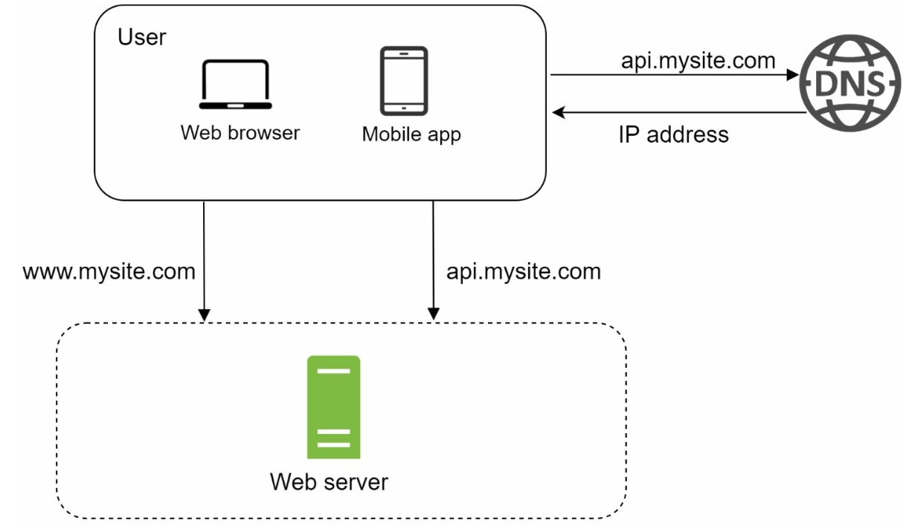
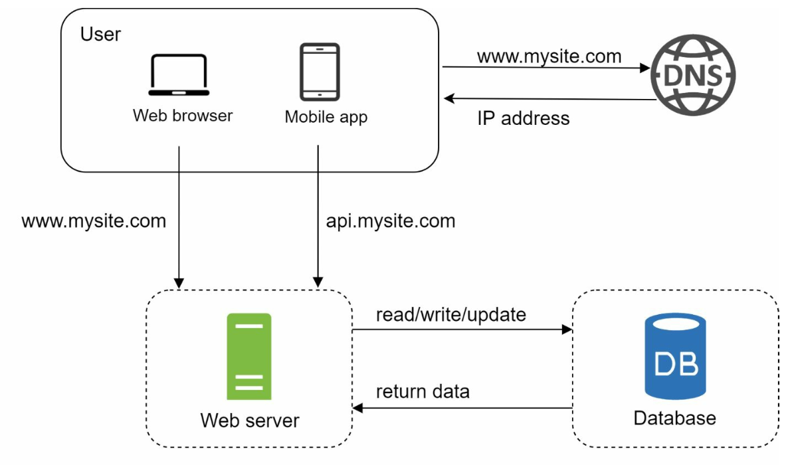
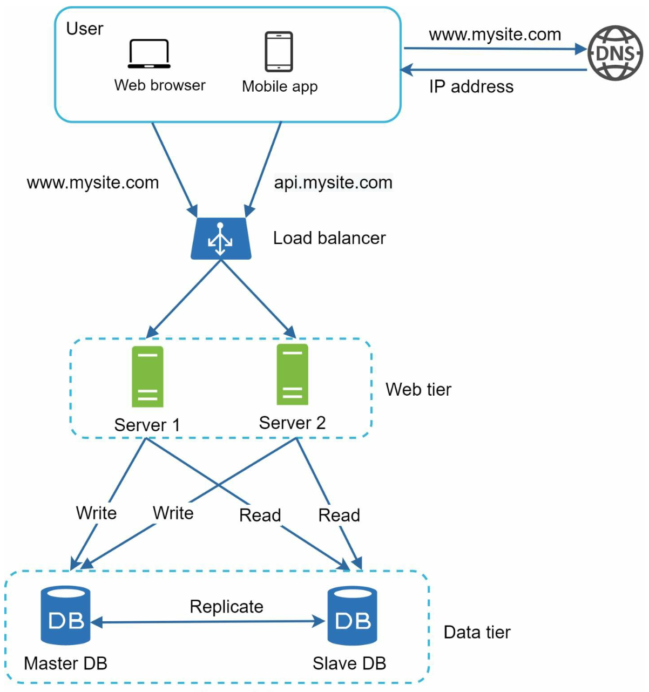
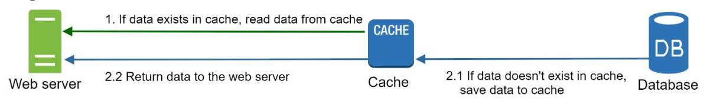
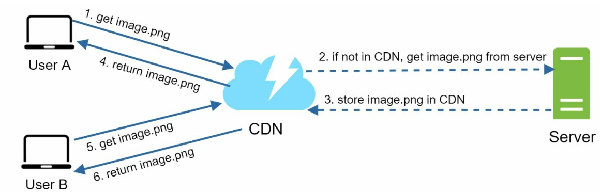
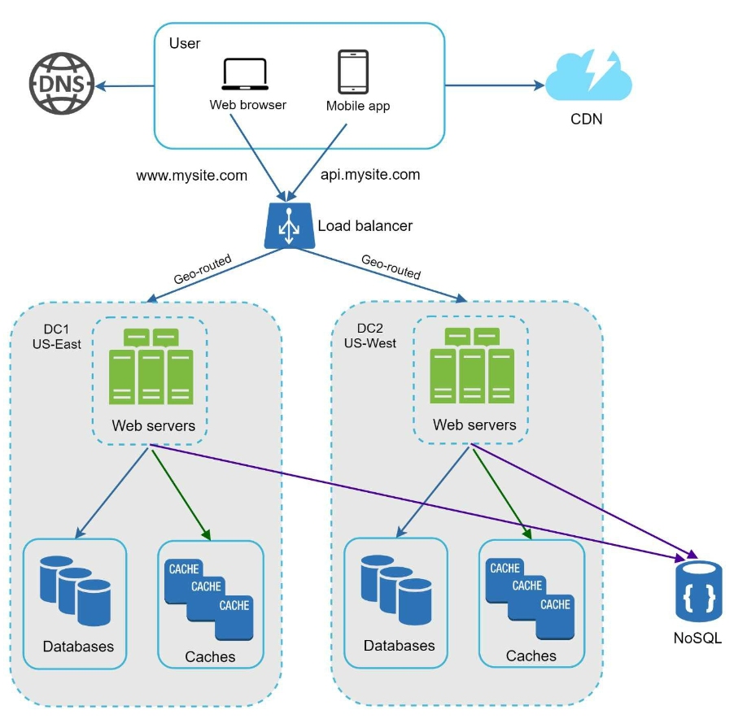
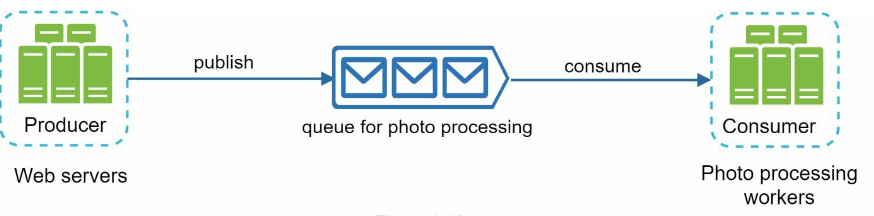

# 第1章: ゼロから数百万ユーザーへのスケール

## はじめに
数百万人のユーザーをサポートできるようにシステムをスケールさせることは、改良と最適化を繰り返す複雑な道のりです。本章では、単一サーバー構成から始めて、数百万人のユーザーを処理できるようにアーキテクチャを段階的にスケールさせる方法を説明します。

---

## セクション1: 単一サーバー構成
最初は、すべてのコンポーネント（Webアプリ、データベース、キャッシュ）が1台のサーバー上で動作します。

   

### リクエストの流れ
1. ユーザーはドメイン名（例: `api.mysite.com`）でアプリケーションにアクセスし、ドメイン名はDNSによってIPアドレスに解決されます。
2. WebサーバーのIPアドレスがブラウザまたはモバイルアプリに返されます。
3. HTTPリクエストがWebサーバーに送信され、WebサーバーはHTMLまたはJSONのレスポンスを返します。

### トラフィックの発生源
1. **Webアプリケーション:** ビジネスロジックにはサーバーサイド言語（例: Python、Java）を、表示にはクライアントサイド言語（例: JavaScript、HTML）を使用します。
2. **モバイルアプリケーション:** 軽量なデータ交換のため、HTTPとJSONを使ってWebサーバーと通信します。

---

## セクション2: データベースの分離
ユーザーベースが拡大するにつれ、データベースを専用サーバーに移し、Web層とデータベース層を独立してスケールできるようにします。

   

### データベースの選択肢

1. **リレーショナルデータベース（SQL）:** 構造化データをテーブルに格納します。例: MySQL、PostgreSQL。
2. **非リレーショナルデータベース（NoSQL）:** 非構造化データや低レイテンシ要件に適しています。次のカテゴリがあります。
   - キーバリューストア
   - グラフデータベース
   - カラムストア
   - ドキュメントストア

- 次のような場合は、非リレーショナルデータベースが適切な選択となる可能性があります。
   - アプリケーションが超低レイテンシを必要とする。
   - データが非構造化である、またはリレーショナルなデータがない。
   - データのシリアライズ/デシリアライズ（JSON、XML、YAMLなど）さえできればよい。
   - 膨大な量のデータを保存する必要がある。

---

## セクション3: 垂直スケーリングと水平スケーリング
### 垂直スケーリング
- 既存のサーバーにリソース（CPU、RAM）を追加します。
- ハードウェアの制約による上限があり、冗長性もありません。

### 水平スケーリング
- サーバープールにサーバーを追加するため、大規模システムにより適しています。
- サーバー間のリクエストのルーティングにはロードバランサーを使用します。
---

## セクション4: ロードバランサー

   

**ロードバランサー**は、複数のサーバーにトラフィックを分散させます。利点は次のとおりです。
1. 冗長性: あるサーバーがオフラインになると、トラフィックは別のサーバーに振り向けられます。
   -  サーバー1がオフラインになると、すべてのトラフィックはサーバー2にルーティングされます。
2. スケーラビリティ: トラフィックの急増に対応するため、簡単にサーバーを追加できます。
   -  Webサイトのトラフィックが急増した場合、追加のサーバーを投入して増加分を処理できます。

---

## セクション5: データベースレプリケーション

   

### マスター/スレーブモデル
- **マスターデータベース:** 書き込み操作を担当します。
   - insert、delete、updateなど、データを変更するすべてのコマンドはマスターデータベースに送信する必要があります。
- **スレーブデータベース:** 読み取り操作を担当し、性能と信頼性を向上させます。
   - ほとんどのアプリケーションでは書き込みに対する読み取りの比率が高いため、システム内のスレーブデータベースの数は通常マスターデータベースの数より多くなります。

### 利点
1. 読み取り操作の並列化による性能向上。
2. 冗長化による高可用性とデータの信頼性。

### 障害への対処
- スレーブデータベースが1台しかなく、それがオフラインになった場合、読み取り操作は一時的にマスターデータベースに向けられます。
- 複数のスレーブデータベースがある場合、読み取り操作は他の正常なスレーブデータベースに振り向けられ、古いサーバーは新しいサーバーに置き換えられます。
-  マスターデータベースがオフラインになった場合、スレーブデータベースの1台が新しいマスターに昇格されます。
- 本番システムでは、選ばれたスレーブデータベースが最新でない可能性があるため、データリカバリスクリプトを実行してデータを更新する必要があります（マルチマスターや循環レプリケーションといった手法が役立つ場合があります）。

---

## セクション6: キャッシュ
**キャッシュ**は、頻繁にアクセスされるデータをメモリに保存し、データベースの負荷を軽減します。キャッシュ層は一時的なデータストア層であり、データベースよりもはるかに高速です。

   

### キャッシュの検討事項
1. **ユースケース**: データが頻繁に読み取られるが、変更される頻度が低い場合にキャッシュの使用を検討します。
2. **有効期限ポリシー:** キャッシュされたデータは有効期限が切れるとキャッシュから削除されます。有効期限ポリシーがない場合、キャッシュされたデータはメモリに永続的に保存されます。
3. **整合性:** データストアとキャッシュの同期を保つことを意味します。データストアとキャッシュに対するデータ変更操作が単一のトランザクション内で行われないため、不整合が発生することがあります。
4. **障害の緩和**: 単一のキャッシュサーバーは単一障害点（SPOF）になり得るため、SPOFを避けるには異なるデータセンターに複数のキャッシュサーバーを置くことが推奨されます。
5. **追い出し（エビクション）ポリシー:** キャッシュが満杯になったら、メモリを解放するために項目を追い出す必要があります。LRUが最も一般的なキャッシュ追い出しポリシーです。

---

## セクション7: コンテンツデリバリーネットワーク（CDN）
**CDN**は、静的コンテンツ（画像、CSS、JavaScript）を地理的に分散したサーバーにキャッシュすることで、読み込み時間を改善します。

   

### ワークフロー
1. ユーザーは最寄りのCDNサーバーにコンテンツを要求します。
2. コンテンツがなければ、オリジンサーバーから取得してキャッシュします。

### CDNの検討事項
1. **コスト:** CDNはサードパーティのプロバイダーによって運営されており、CDNへの/からのデータ転送に対して課金されます。
2. **キャッシュの有効期限:** キャッシュの有効期限は長すぎても短すぎてもいけません。
3. **CDNフォールバック:** 一時的なCDN障害が発生した場合、クライアントは問題を検知してオリジンにリソースを要求できるべきです。
4. **ファイルの無効化:** ファイルが更新された場合、更新後のファイルを指すようにキャッシュを無効化する必要があります。

---

## セクション8: ステートレスなWeb層
セッションデータを共有データストアに移すことで、Webサーバーはステートレスになります。これにより次のことが可能になります。
1. 水平スケーリングが容易になる。
2. トラフィックに応じたオートスケーリング。

   

---

## セクション9: マルチデータセンター構成
複数のデータセンターにまたがってデプロイすることで、可用性が向上し、レイテンシが低減します。戦略には次のようなものがあります。

   

1. **GeoDNSルーティング:** ユーザーを最寄りのデータセンターに誘導します。
2. **データレプリケーション:** 不整合を防ぐため、データセンター間でデータを同期します。

### 主な検討事項
- **トラフィックのリダイレクト:** トラフィックを正しいデータセンターに誘導する効果的なツールが必要です。
- **データの同期:** 一般的な戦略は、複数のデータセンター間でデータをレプリケートすることです。
- **テストとデプロイ:** すべてのデータセンターでサービスの一貫性を保つには、自動デプロイツールが不可欠です。

---

## セクション10: メッセージキュー
**メッセージキュー**は、メモリに保存される耐久性のあるコンポーネントで、非同期通信をサポートします。バッファとして機能し、非同期リクエストを分配します。

   

- プロデューサー/パブリッシャーと呼ばれる入力側のサービスが、メッセージを作成してメッセージキューに発行します。
- コンシューマー/サブスクライバーと呼ばれる他のサービスがキューに接続し、メッセージで定義されたアクションを実行します。

---

## セクション11: ロギング、メトリクス、自動化

   

### 重要性
1. **ロギング:** エラーやシステムの健全性を追跡します。
2. **メトリクス:** 性能やユーザーの活動についての洞察を提供します。
3. **自動化:** テスト、デプロイ、スケーリングを効率化します。

---

## セクション12: データベースのスケーリング
### 垂直スケーリング
- ハードウェアリソースを追加しますが、物理的およびコスト面の制約があります。
- 次のような複数の欠点があります。
   -  単一障害点のリスクが高まる。
   -  垂直スケーリングの全体的なコストが高い。

### 水平スケーリング（シャーディング）

   

- キー（例: `user_id`）を使って、データを複数のシャードに分割します。
   - シャーディングは、大規模なデータベースを、シャードと呼ばれるより小さく管理しやすい部分に分割します。
   - 各シャードは同じスキーマを共有しますが、各シャード上の実際のデータはそのシャード固有のものです。
-  シャーディング戦略を実装する際には、シャーディングキーが極めて重要です。シャーディングキーを選ぶ際は、データを均等に分散できるキーを選ぶことが重要です。

#### 課題
1. **データの再シャーディング:** 次のような場合に再シャーディングが必要になります。
   - 急速な成長により、単一のシャードにそれ以上データを保持できなくなった。
   - データ分布の偏りにより、特定のシャードが他より早く容量を使い果たす。
   - これらの問題を克服するためにコンシステントハッシュが使われます。

2. **セレブリティ問題:** 特定のシャードへの過剰なアクセスがサーバーの過負荷を引き起こす可能性があります。
   - この問題を解決するには、セレブリティごとにシャードを割り当てる必要があるかもしれません。

3. **結合と非正規化:** データベースが複数のサーバーにシャーディングされると、シャードをまたいだ結合（join）操作を行うのが難しくなります。
   -  一般的な回避策は、データベースを非正規化して、単一のテーブルでクエリを実行できるようにすることです。

---

## まとめ
### 重要なポイント
1. Web層をステートレスに保つ。
2. すべての層に冗長性を持たせる。
3. キャッシュとCDNを使って性能を最適化する。
4. シャーディングでデータ層をスケールさせる。
5. 柔軟性のためにコンポーネントを疎結合にする。

本章は、数百万人のユーザーを処理できるスケーラブルなシステムを構築するための確かな基礎を提供します。
