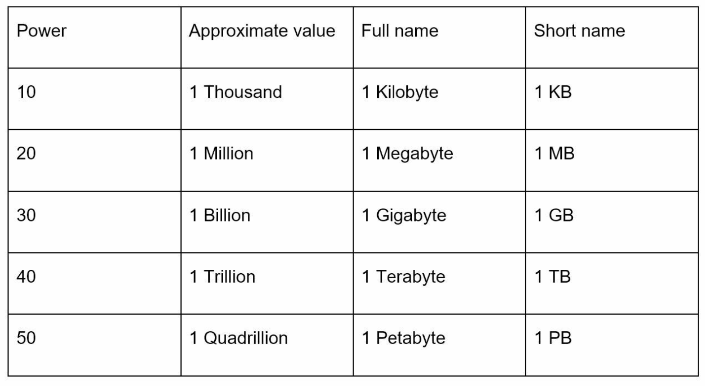

# 第2章: 概算見積もり（Back-of-the-Envelope Estimation）

## はじめに
概算見積もりは、システム設計面接において極めて重要なスキルです。システムの容量や性能を評価するために、素早く大まかな計算を行うことを指します。GoogleのシニアフェローであるJeff Deanによれば、こうした見積もりは、思考実験と一般的な性能指標を用いて、設計が要件を満たすかどうかを評価するのに役立ちます。

本章では、スケーラビリティと見積もりに習熟するための主要な概念、方法論、例を取り上げます。

---

## セクション1: 主要な概念

### 2のべき乗
データ量を2のべき乗で理解することは基本です。

この知識は、ストレージや帯域幅を正確に計算するのに役立ちます。

---

### すべてのプログラマーが知っておくべきレイテンシの数値
レイテンシの数値は、コンピューティングシステムにおけるさまざまな操作にかかる時間を表します。これにより相対的な性能を把握できます。

| 操作                                   | レイテンシ（2020年） |
|----------------------------------------|----------------------|
| L1キャッシュアクセス                   | 0.5 ns               |
| L2キャッシュアクセス                   | 7 ns                 |
| メインメモリアクセス                   | 100 ns               |
| SSDランダムリード                      | 150 µs               |
| HDDランダムシーク                      | 10 ms                |
| データセンター内のラウンドトリップ     | 500 µs               |
| リージョン間のデータセンター           | 150 ms               |

**重要な洞察:**
- メモリは速く、ディスクは遅い。
- ディスクシークは可能な限り避ける。
- 帯域幅を節約するため、インターネット経由で送信する前にデータを圧縮する。

---

### 可用性の数値
高可用性（HA）はダウンタイムを最小限に抑えることを保証します。可用性は**ナイン（9の数）**で表されます。
- **99%（ツーナイン）:** 年間約3.65日のダウンタイム
- **99.9%（スリーナイン）:** 年間約8.8時間のダウンタイム
- **99.99%（フォーナイン）:** 年間約52分のダウンタイム
- **99.999%（ファイブナイン）:** 年間約5.3分のダウンタイム
- **99.9999%（シックスナイン）:** 年間約31.56秒のダウンタイム

Amazon、Google、Microsoftなどのクラウドプロバイダーは、**99.9%以上**のSLA（サービスレベル合意）を目標としています。

---

## セクション2: 見積もりの例 - TwitterのQPSとストレージ要件

### 前提
- **月間アクティブユーザー（MAU）は3億人。**
- **50%がデイリーアクティブユーザー（DAU）。**
- **1ユーザーあたり1日の平均ツイート数:** 2。
- **ツイートの10%にメディアが含まれる。**
- **データ保持期間:** 5年。

### 見積もり
1. **1秒あたりのクエリ数（QPS）:**
   - DAU = \( 3億 x 50\% = 1億5,000万 \)
   - ツイートのQPS = \( 1億5,000万 x 2ツイート / 24時間 / 3600秒 = 約3500 )
   - ピークQPS = \( 2 x 3500 = 約7000 \)

2. **メディアストレージ:**
   - **ツイートサイズの内訳:**
     - `tweet_id`: 64バイト
     - `text`: 140バイト
     - `media`: 1 MB
   - **1日あたりのメディアストレージ:** \( 1億5,000万 x 2 x 10\% x 1MB = 1日あたり30TB \)
   - **5年間のストレージ:** \( 30TB x 365 x 5 = 約55PB \)

---

## セクション3: 効果的な見積もりのコツ

### 1. 丸めと近似
精度は重要ではなく、プロセスに集中しましょう。複雑な計算はキリのよい数字を使って単純化します。例:
- \( 99987 / 9.1 \) は \( 100,000 / 10 = 10,000 \) と近似できます。

### 2. 前提を書き出す
後で参照できるよう、前提を明確に記録しておきます。

### 3. 単位を明記する
曖昧さを避けるため単位を明記します（例: `5` ではなく `5 MB`）。

### 4. よくある見積もりのシナリオ
- **QPS（1秒あたりのクエリ数）:** トラフィックの強度を測る。
- **ピークQPS:** トラフィックの急増を考慮する。
- **ストレージ要件:** 必要なデータ総量を見積もる。
- **キャッシュ要件:** キャッシュに必要なメモリ量を評価する。
- **サーバー台数:** ワークロードに基づいて必要なハードウェアを計算する。
