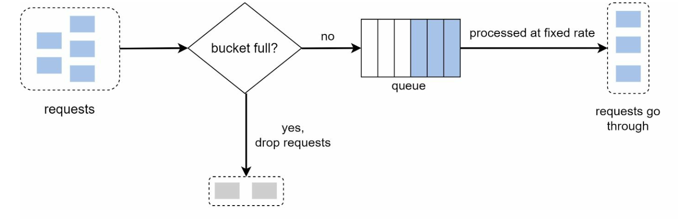
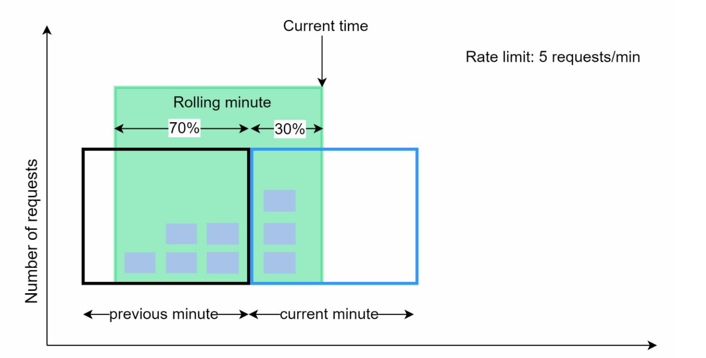
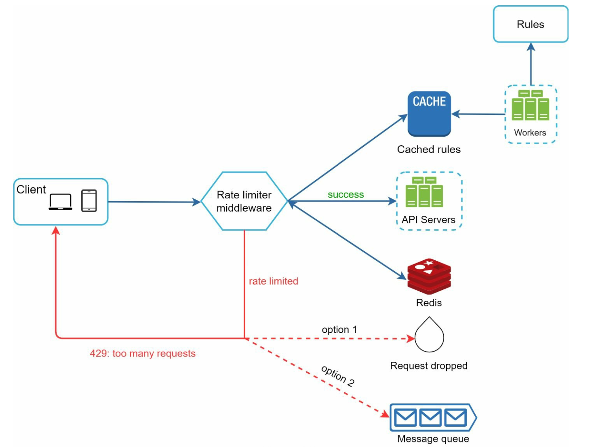

# 第4章: レートリミッターの設計

## はじめに
本章では、レートリミッター（クライアントやサービスから送信されるトラフィックのレートを制御するために使われるシステムコンポーネント）の設計と実装を探ります。レートリミッターは、悪用の防止、コストの削減、サーバーリソースの安定性確保に不可欠です。使用例としては、投稿数、アカウント作成数、特典の受け取り回数の制限などがあります。

## レート制限の利点
- **DoS攻撃の防止:** 過剰な呼び出しをブロックしてリソースの枯渇を防ぐ。
- **コスト削減:** 不要なリクエストを制限してサーバー費用を削減する。
- **過負荷の防止:** 過剰なリクエストを除外してサーバー性能を安定させる。

## ステップ1: 問題の理解
### 主な機能
- サーバーサイドのAPIレートリミッター。
- 複数のスロットリングルールのサポート。
- 分散環境における大規模システムへの対応。
- 独立したサービスとしても、アプリケーションレベルのコードとしても実装可能。
- スロットリングされたことをユーザーに通知する。

### 要件
- 正確なリクエストのスロットリング。
- 最小限のレイテンシ。
- 少ないメモリ使用量。
- 分散対応。
- 明確な例外処理。
- 高い耐障害性。

## ステップ2: 高レベル設計
### 配置の選択肢

    

1. **クライアントサイドでの実装:** 悪用される可能性があるため信頼性に欠ける。
2. **サーバーサイドでの実装:** 制御性と信頼性の点で望ましい。
3. **ミドルウェア（APIゲートウェイ）:** レート制限を統合できる柔軟な選択肢。

### 配置に関するガイドライン
- 現在の技術スタックを評価し、効率的な選択肢を選ぶ。
- ビジネス上のニーズに基づいて適切なアルゴリズムを選ぶ。
- マイクロサービスを採用している場合はAPIゲートウェイを使う。
- リソースが限られている場合は商用ソリューションを選ぶ。

## ステップ3: レート制限アルゴリズム
### 1. トークンバケット

  

- **説明:** トークンが一定のレートでバケットに追加され、各リクエストはトークンを1つ消費する。
- **パラメータ:** バケットサイズと補充レート。
- **長所:** 実装が容易で、メモリ効率が良く、トラフィックのバーストに対応できる。
- **短所:** パラメータの慎重な調整が必要。

### 2. リーキーバケット

  

- **説明:** FIFOキューを使い、一定のレートでリクエストを処理する。
- **長所:** メモリ効率が良く、流出レートが安定している。
- **短所:** トラフィックのバーストにより、最近のリクエストが遅延する可能性がある。

  例: https://github.com/uber-go/ratelimit

### 3. 固定ウィンドウカウンター

  

- **説明:** 時間を固定間隔に分割し、カウンターを使ってリクエストを制限する。
- **長所:** シンプルで、特定のユースケースでは効率的。
- **短所:** ウィンドウの境界でのトラフィック急増により上限を超える可能性がある。

- 時間ウィンドウの境界でトラフィックが突然バーストすると、許可された上限を超えるリクエストが通過してしまう可能性がある。

  

### 4. スライディングウィンドウログ

  

- **説明:** タイムスタンプを記録し、移動する時間ウィンドウを実現する。
- **長所:** 正確なレート制限。
- **短所:** メモリ消費量が多い。

### 5. スライディングウィンドウカウンター

  

- **説明:** 固定ウィンドウとスライディングログの手法を組み合わせ、急増を平滑化する。
- **長所:** メモリ効率が良く、トラフィックのバーストに対応できる。
- **短所:** 近似であるため、完全に厳密ではない場合がある。

## 高レベルアーキテクチャ

  

- **データストレージ:** 高速なカウンター操作のため、インメモリキャッシュ（例: Redis）を使用する。
- **手順:**
  1. クライアントがミドルウェアにリクエストを送信する。
  2. ミドルウェアがRedis内のカウンターを確認する。
  3. 上限に基づいてリクエストを処理するか拒否する。

## 高度な検討事項
### 分散環境
- **課題:** 競合状態、同期の問題。
- **解決策:** ロック、Luaスクリプト、Redisのソート済みセットを使用する。同期には集中型のデータストアを用いる。

### 性能の最適化
- レイテンシ削減のためのマルチデータセンター構成。
- 同期のための結果整合性モデル。

### 監視
- アルゴリズムの有効性を確認し、必要に応じてルールを調整するための定期的な分析。
