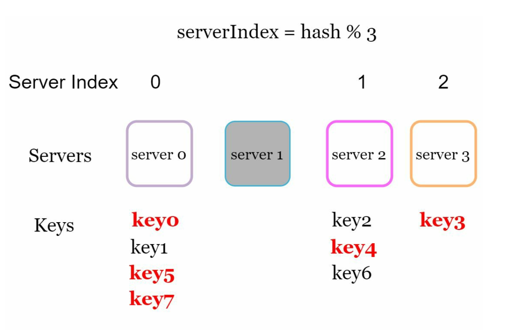
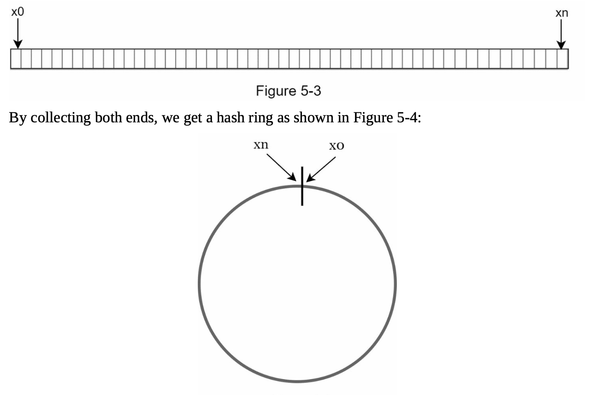
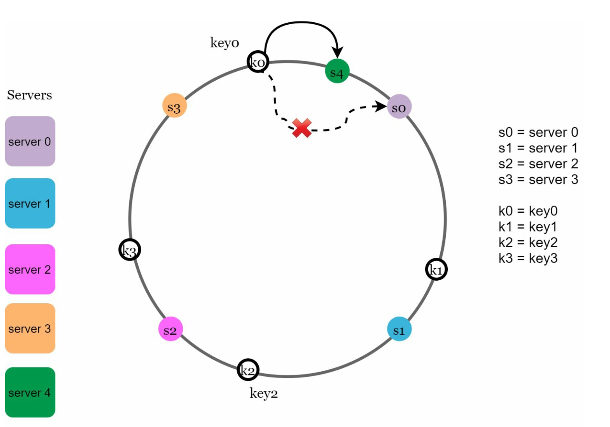
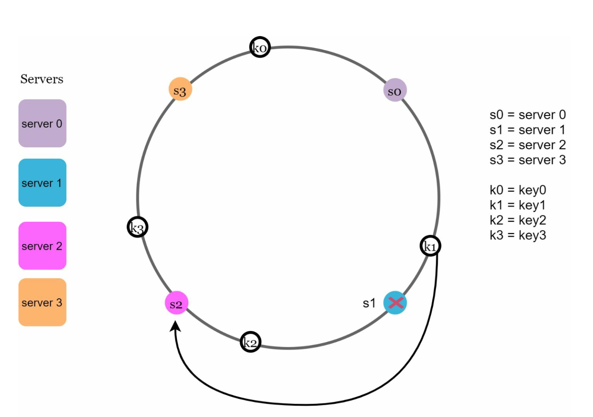
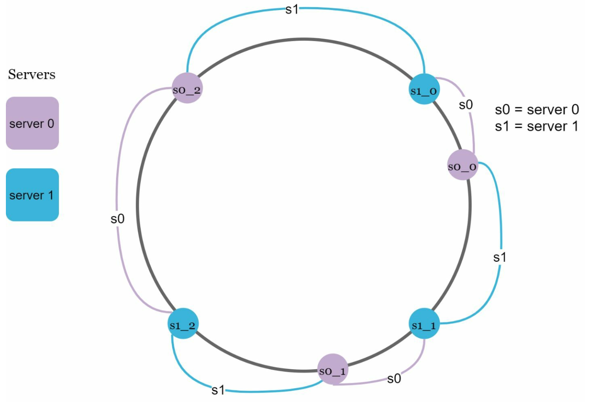

# 第5章: コンシステントハッシュの設計

## はじめに
本章では、コンシステントハッシュを探ります。これは、リクエストとデータをサーバー間に効率的に分散させることで水平スケーリングを実現するために不可欠な手法です。サーバーの追加・削除時のデータ再配置を最小限に抑え、データを均等に分散させることで、サーバーのホットスポットといった問題を緩和します。

## 再ハッシュ問題
### 説明
`serverIndex = hash(key) % N` のような従来のハッシュ手法では、サーバー数が変わるとデータの再配置が問題になります。例えば次のとおりです。
- サーバーを1台削除すると、ほとんどのキーが再割り当てされ、キャッシュミスが発生する。
- サーバーを1台追加すると、不要なキーの再配置が発生する。

  

- この方式は、サーバープールのサイズが固定されている場合にはうまく機能します。しかし、新しいサーバーを追加したり、既存のサーバーを削除したりすると問題が生じます。

  

### 主な問題
サーバー数が変わるとほとんどのキーが再配置され、非効率と過負荷を引き起こします。

## コンシステントハッシュ
### 定義
コンシステントハッシュでは、サーバーの追加・削除時に再マッピングされるキーはごく一部だけです。これにより混乱が最小限に抑えられ、スケーラビリティが向上します。

### 主な概念
1. **ハッシュ空間とリング:** ハッシュ空間は連続したリングを形成し、ハッシュ値は `0` から `2^160-1` まで分布します（例: SHA-1などのハッシュ関数を使用した場合）。両端をつなぐとリングになります。
    

    
    

- 同じハッシュ関数 f を使い、サーバーのIPまたは名前に基づいてサーバーをリング上にマッピングします。

    

    
    

1. **サーバーの検索**
- キーを担当するサーバーは、リング上を時計回りにたどって最初に見つかったサーバーとして決まります。

  

  
  

2. **サーバーの追加と削除**
- サーバーを追加すると、近くのキーのみが再配置されます。新しいサーバーに再配置されるのはキーのごく一部だけです。

  

  
  

- サーバーを削除すると、その範囲のキーのみが影響を受けます。削除されたサーバーのキーだけが、時計回りで次のサーバーに再割り当てされます。

  

  
  

## 課題と解決策
### 基本的なアプローチにおける2つの問題
1. **パーティションサイズの不均一:** サーバーごとにデータパーティションの大きさが異なる可能性がある。
2. **キー分布の不均一:** 一部のサーバーが他よりもはるかに多くのキーを受け取る可能性がある。

### 解決策: 仮想ノード
- 各サーバーは、リング上に均一に分布する複数の仮想ノードで表されます。
- 仮想ノードはキーの分布を改善し、負荷を均衡させます。仮想ノードの数が増えるほど、キーの分布はより均衡します。これは、仮想ノードが多いほど標準偏差が小さくなり、データ分布が均衡するためです。

  

  
  

## 影響を受けるキー
サーバーが追加または削除された場合:
- **追加されたサーバー:** 影響を受けるのは、新しいサーバーとその前のサーバーの間にあるキーです。
  次の例では、サーバー4がリングに追加されます。影響範囲はs4（新たに追加されたノード）から始まり、サーバー（s3）が見つかるまでリングを反時計回りに進みます。したがって、s3とs4の間にあるキーをs4に再配置する必要があります。

  

  
  

- **削除されたサーバー:** 影響を受けるのは、削除されたサーバーとその前のサーバーの間にあるキーです。次の例では、サーバー（s1）が削除されると、影響範囲はs1（削除されたノード）から始まり、サーバー（s0）が見つかるまでリングを反時計回りに進みます。したがって、s0とs1の間にあるキーをs2に再配置する必要があります。

  

  
  

## コンシステントハッシュの利点
- **再配置の最小化:** 再割り当てされるのはキーのごく一部だけ。
- **スケーラビリティ:** 水平スケーリングを可能にする。
- **ホットスポットの緩和:** データ分布を均衡させてサーバーの過負荷を防ぐ。

## 実世界での応用
- Amazon Dynamo DB
- Apache Cassandra
- Discord
- Akamai CDN
- Maglev ロードバランサー
