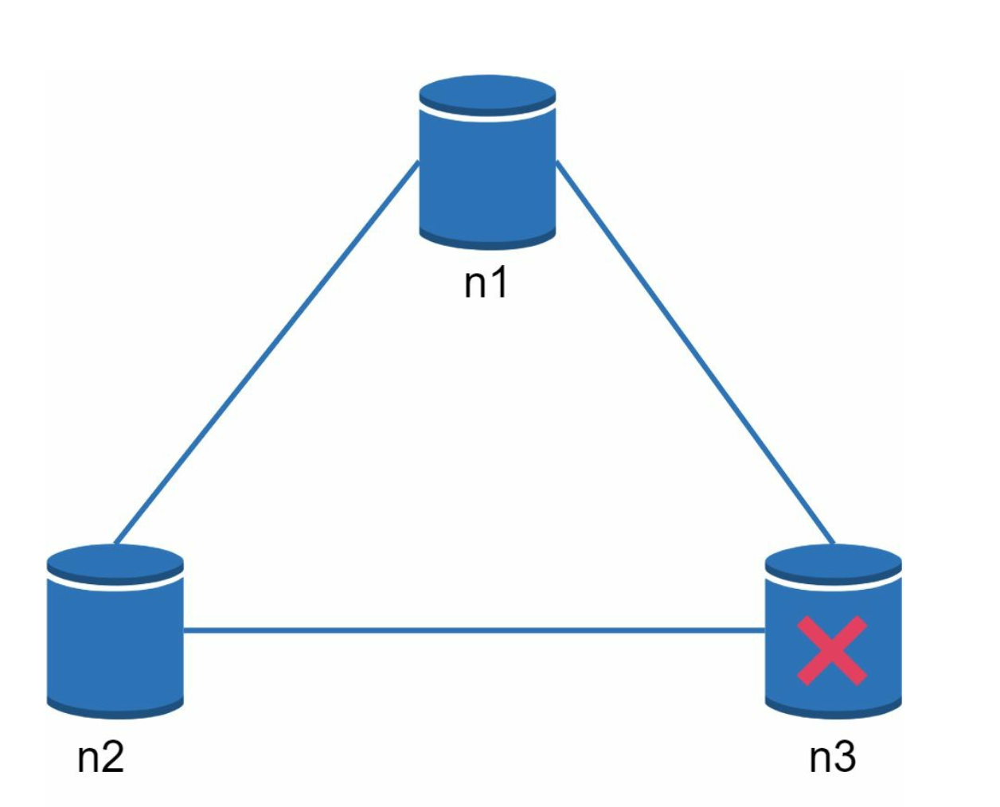
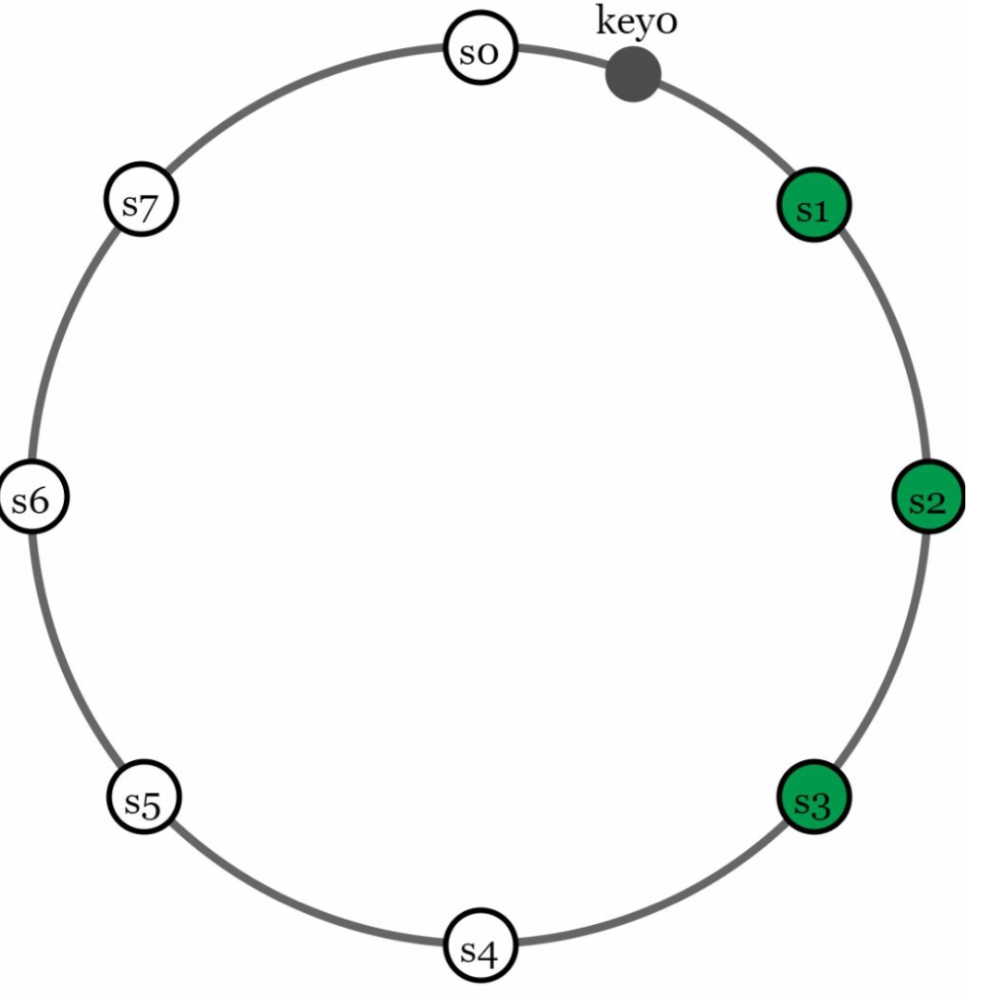
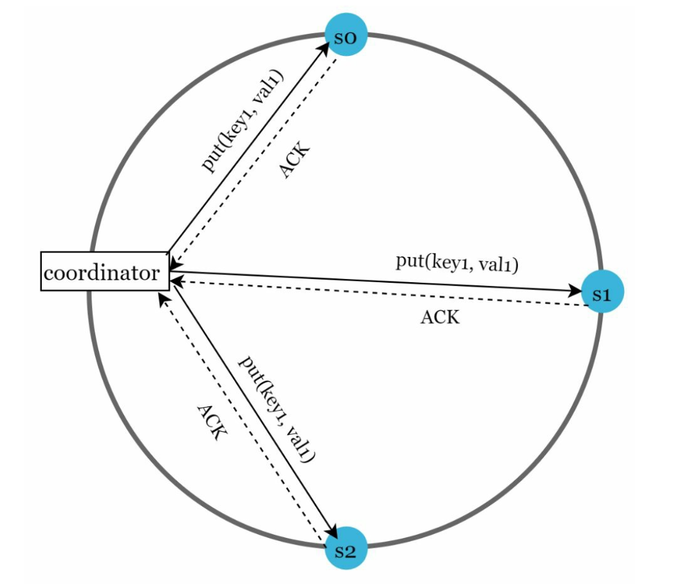
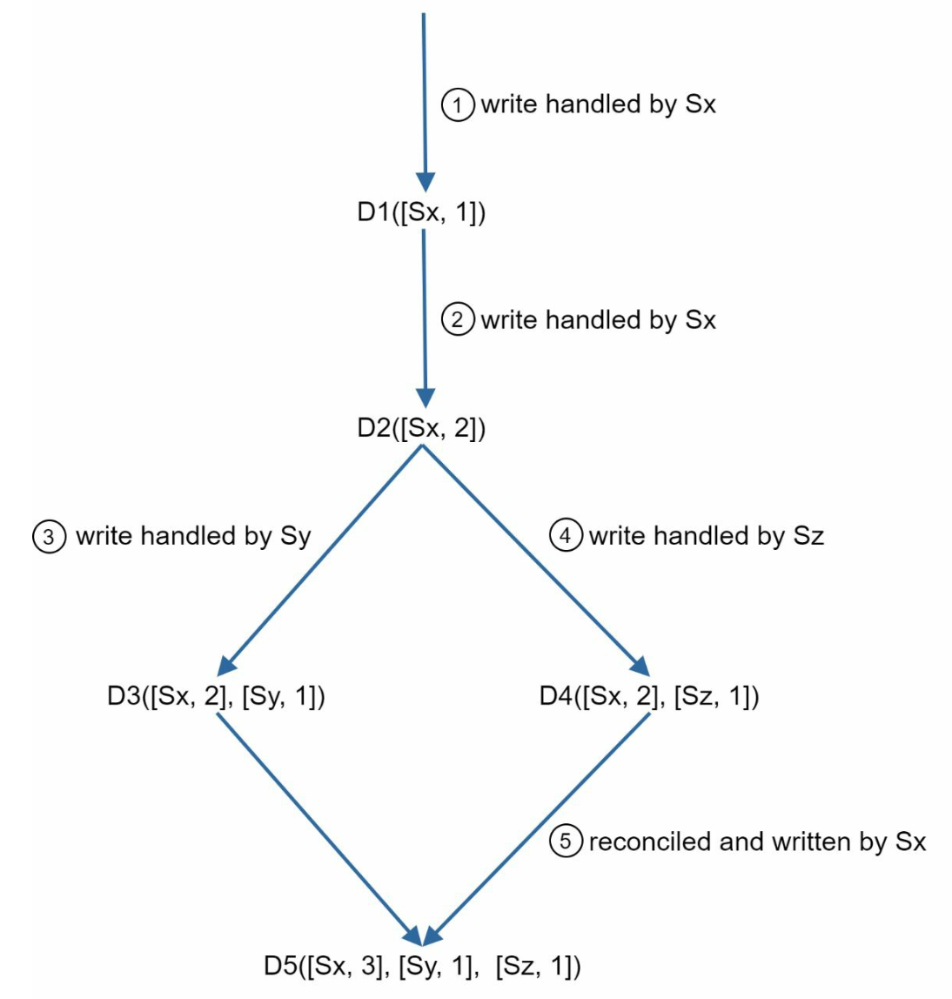
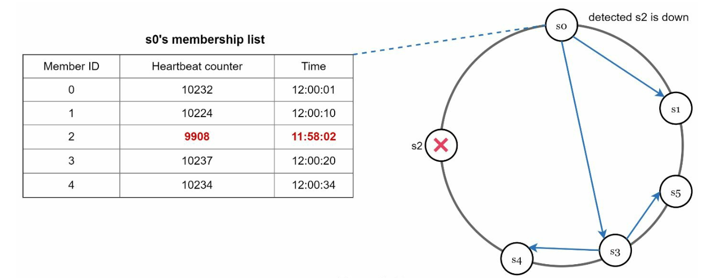
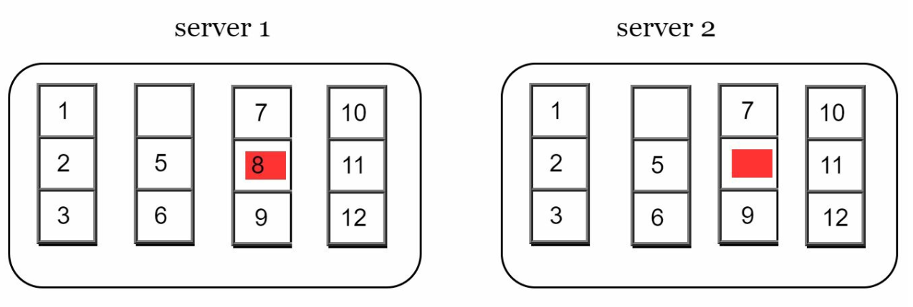
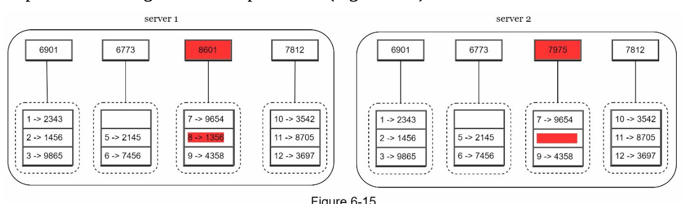
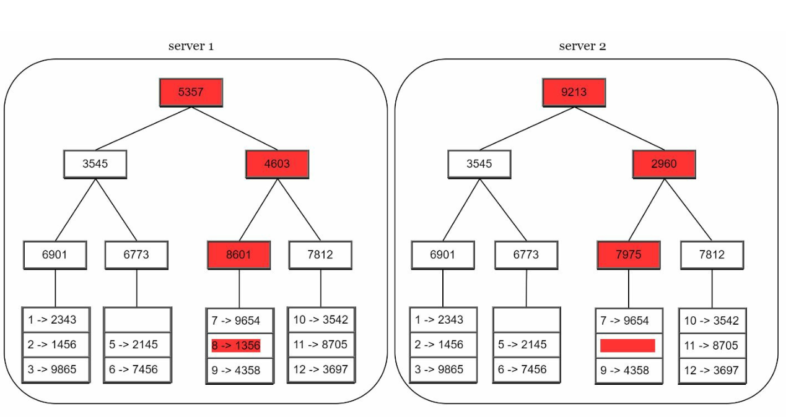
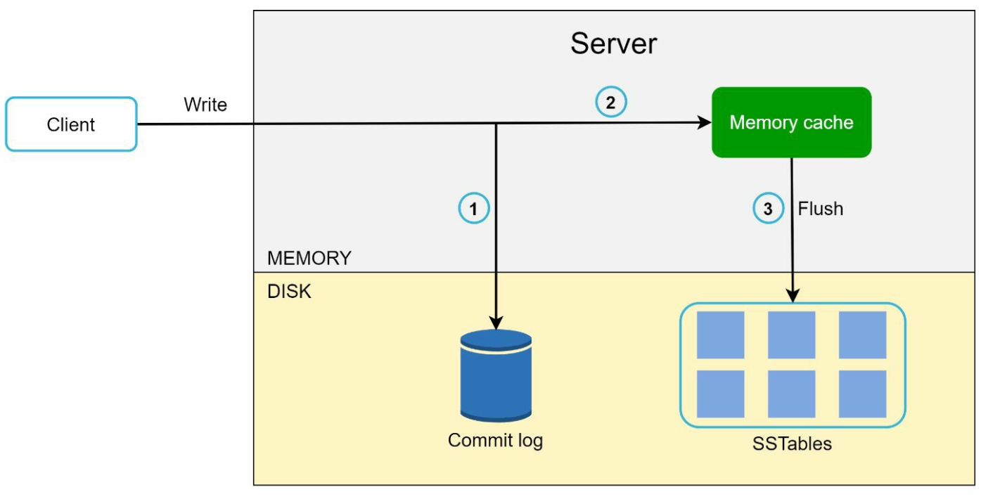
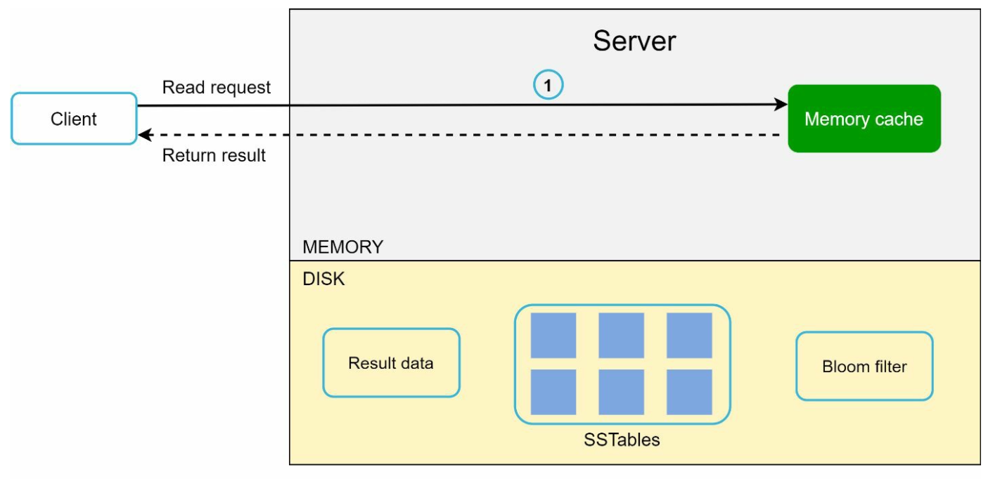

# 第6章: キーバリューストアの設計

## はじめに
**キーバリューストア**は、データをキーと値のペアとして保存する非リレーショナルデータベースの一種です。各キーは一意であり、値はそのキーを使ってアクセスされます。本章では、次のような操作をサポートする、スケーラブルで高可用な分散キーバリューストアの設計方法を詳しく説明します。
- データを挿入する `put(key, value)`。
- データを取得する `get(key)`。

### 設計の特徴
- 小さなキーバリューペア（10 KB未満）。
- 高可用性とスケーラビリティを備え、ビッグデータをサポートする。
- 自動スケーリングと調整可能な整合性。
- 低レイテンシ。

---

## 単一サーバーのキーバリューストア
### 実装
- キーバリューペアをメモリ上に保存するために**ハッシュテーブル**を使用する。
- 最適化:
  - データ圧縮。
  - アクセス頻度の低いデータをディスクに保存する。

### 制約
単一サーバーのメモリには限りがあるため、スケーラビリティのためには**分散アプローチ**が必要です。

---

## 分散キーバリューストア
**分散キーバリューストア**はデータを複数のサーバーにパーティショニングし、**CAP定理**が示すトレードオフに対処する必要があります。

### CAP定理
1. **一貫性（Consistency）:** すべてのクライアントが同時に同じデータを見る。
2. **可用性（Availability）:** 一部のノードがダウンしていても、システムはすべてのリクエストに応答する。
3. **分断耐性（Partition Tolerance）:** ネットワーク分断が発生してもシステムは動作し続ける。

**トレードオフ:** CAP定理によれば、3つの保証のうち同時に達成できるのは2つだけです。

  

#### システムの種類:
- **CPシステム:** 可用性を犠牲にして、一貫性と分断耐性を実現する（例: 銀行システム）。
- **APシステム:** 一貫性を犠牲にして、可用性と分断耐性を実現する（例: 結果整合性）。
- **CAシステム:** 分断耐性を犠牲にして、一貫性と可用性を実現する。

    **ネットワーク障害は避けられないため、分散システムはネットワーク分断に耐えなければなりません。したがって、CAシステムは実世界のアプリケーションには存在し得ません。**

    分散システムでは、分断は避けられません。分断が発生した場合、一貫性と可用性のどちらかを選ばなければなりません。例えば、ノードn3がダウンすると、ノードn1やn2に書き込まれたデータはn3に伝播できません。逆に、データがn3に書き込まれたもののまだn1とn2に伝播していない場合、ノードn1とn2は古いデータを持つことになります。

    

    
    

- CPシステムを選ぶ場合、データの不整合を避けるために、n1とn2へのすべての書き込み操作をブロックしなければなりません。
- APシステムを選ぶ場合、古いデータを返す可能性があっても、システムは読み取りを受け付け続けます。書き込みについては、n1とn2は書き込みを受け付け続け、ネットワーク分断が解消されたときにデータがn3に同期されます。

---

## システムコンポーネント
### 1. データのパーティショニング
- **手法:** コンシステントハッシュを使って、データを複数のサーバーに均等に分散させる。
- **利点:**
  - サーバーの追加/削除に伴う自動スケーリング。
  - 仮想ノードによる異種混在への対応。サーバーの仮想ノード数はサーバーの容量に比例させる。

### 2. データレプリケーション
- 高可用性のため、データを `N` 台のサーバーにレプリケートする。
- N台のサーバーは、サーバーの位置からリング上を時計回りにたどり、最初に見つかったN台を選んでデータのコピーを保存します。仮想ノードを使う場合は、信頼性向上のためにレプリカを異なるデータセンターに配置します。

    

    
    

### 3. 一貫性
データは複数のノードにレプリケートされるため、レプリカ間で同期する必要があります。
- **クォーラムコンセンサス:**
  - `N`: レプリカの総数。
  - `W`: 書き込みクォーラムのサイズ。書き込みが成功とみなされるには、W個のレプリカから書き込みの確認応答を得る必要がある。
  - `R`: 読み取りクォーラムのサイズ。読み取りが成功とみなされるには、少なくともR個のレプリカからの応答を待つ必要がある。
  - **ルール:** `W + R > N` であれば強い一貫性が保証される。
  - W、R、Nの設定は、レイテンシと一貫性の典型的なトレードオフです。

    

    
    

    - R = 1 かつ W = N の場合、システムは高速な読み取りに最適化される。
    - W = 1 かつ R = N の場合、システムは高速な書き込みに最適化される。
    - W + R > N の場合、強い一貫性が保証される（通常は N = 3、W = R = 2）。
    - W + R <= N の場合、強い一貫性は保証されない。

- **モデル**:
  - **強い一貫性:** 読み取り操作は、最新の書き込み結果に対応する値を返す。
  - **弱い一貫性:** 後続の読み取り操作で最新の値が見えない場合がある。
  - **結果整合性:** 十分な時間があれば、すべての更新が伝播し、すべてのレプリカが一貫した状態になる。

### 4. 不整合の解決
レプリケーションは高可用性をもたらしますが、レプリカ間の不整合を引き起こします。不整合の問題を解決するために、バージョニングとベクタークロックが使われます。
- **バージョニング:**
    - **ベクタークロック**を使ってデータのバージョンを追跡し、競合を解決する。
    - バージョニングとは、各データ変更をデータの新しいイミュータブル（不変）なバージョンとして扱うことです。
        

        
        
        

    - サーバー1が名前を変更し、サーバー2も名前を変更します。この2つの変更は同時に行われます。これで、v1とv2というバージョンの競合する値ができてしまいます。

- **ベクタークロック**
    1. **構成**: ベクタークロックは、データ項目に関連付けられた [サーバー, バージョン] のペアです。あるバージョンが他のバージョンより前か、後か、あるいは競合しているかを確認するのに使えます。
        - ベクタークロックを D([S1, v1], [S2, v2], …, [Sn, vn]) で表すとします。データ項目Dがサーバー Si に書き込まれる場合、システムは次のいずれかのタスクを実行する必要があります。
        - ここで、`D` はデータ項目、`Si` はサーバー識別子、`vi` はサーバー `Si` におけるデータのバージョンカウンターです。

    2. **ベクタークロックの更新:** データ項目がサーバーで変更されたとき:
        - そのサーバーがベクタークロックに存在する場合、そのバージョンカウンターをインクリメントする。
        - 存在しない場合、ベクタークロックに新しいエントリを追加する。

    3. **競合の検出:**
        - **競合なし:** Xのすべてのカウンターが、Yの対応するカウンター以下であれば、バージョンXはバージョンYの祖先である。
        - **競合あり:** Yのカウンターのうち少なくとも1つが、Xの対応するカウンターより小さい場合、2つのバージョンは兄弟（sibling）である。

    4. **競合の解決:** 競合（兄弟バージョン）が検出された場合、システムはアプリケーション固有のロジックまたはクライアントの介入によってデータを調停します。

        

        
        

- **課題:**
  - クライアントの複雑さが増す。
  - 更新が多いとベクタークロックのサイズが大きくなる可能性があるため、サイズを制限するための切り詰め戦略が必要になる。

### 5. 障害への対処

#### a. 障害の検出
あるサーバーが「ダウンしている」と言ったからといって、そのサーバーがダウンしていると判断するのは不十分です。通常、サーバーをダウンとみなすには、少なくとも2つの独立した情報源が必要です。
- **ゴシッププロトコル:**
    

        
    

    - 各ノードはメンバーIDとハートビートカウンターを保持する。
    - 各ノードは定期的に自身のハートビートカウンターをインクリメントする。
    - 各ノードは定期的に、ランダムに選んだノード群にハートビートを送信する。
    - あらかじめ定めた期間を超えてハートビートが増加しない場合、そのメンバーはオフラインとみなされる。

#### b. 一時的な障害
- **スロッピークォーラム:** 正常なノードを使って一時的に操作を維持する。
        

        
        

    - 障害を検出した後、システムは可用性を確保するための仕組みを展開する必要がある。
    - クォーラム要件を厳格に適用する代わりに、システムはハッシュリング上で、書き込みには最初のW台の正常なサーバーを、読み取りには最初のR台の正常なサーバーを選ぶ。
    - オフラインのサーバーは無視される。あるサーバーが利用できない場合、別のサーバーが一時的にリクエストを処理する。

- **ヒンテッドハンドオフ:** オフラインだったサーバーは、復旧時に変更内容に追いつく。
    - ダウンしていたサーバーが復旧すると、データの一貫性を達成するために変更がプッシュされる。

#### c. 恒久的な障害
- レプリカ間の効率的な同期のために**マークルツリー**を使用する。
    **マークルツリー**（ハッシュツリー）は、恒久的な障害の際にレプリカ間の不整合を効率的に検出・解決するためのデータ構造です。

- 仕組み
    1. **構造:**
        - **リーフノード**は個々のデータブロックのハッシュを保存する。
        - **非リーフノード**は子ノードのハッシュを保存する。
        - **ルートハッシュ**はツリー内の全データを合わせた状態を表す。

    2. **マークルツリーの構築:**
        - **ステップ1:** キー空間をバケットに分割する。

            

        - **ステップ2:** 一様ハッシュを使って、バケット内の各キーをハッシュ化する。

            

        - **ステップ3:** 各バケットに対して単一のハッシュを作成する。

            

        - **ステップ4:** バケットのハッシュを組み合わせて上位レベルのハッシュを計算し、最終的にルートハッシュを得る。

            

    3. **同期:**
        - 2つのレプリカを同期するには:
            - ルートハッシュを比較する。
            - ルートハッシュが一致すれば、レプリカは一貫している。
            - ルートハッシュが異なる場合、子のハッシュを再帰的に比較して、不整合のあるバケットを特定する。
        - 不整合のあるデータのみが同期される。

- 利点
    - **効率性:** 不整合のあるデータのみを同期するため、データ転送量が減る。
    - **スケーラビリティ:** 同期のオーバーヘッドが最小限で、大規模なデータセットに有効。
    - **信頼性:** レプリカ間のデータの一貫性を保証する。

### 6. データセンター障害への対処
- 障害時にも可用性を確保するため、データを複数のデータセンターにレプリケートする。

---

## 書き込みパスと読み取りパス
### 1. 書き込みパス（Cassandraのアーキテクチャに基づく）

    

- 書き込みを**コミットログ**に永続化する。
- データを**メモリキャッシュ**に保存する。
- キャッシュが満杯になったら、データをディスク上の**SSTable**（Sorted String Table）にフラッシュする。

### 2. 読み取りパス

    
    

- **メモリキャッシュ**にデータがあるか確認する。
- なければ、**ブルームフィルター**を使ってSSTable内のデータの場所を特定する。
- データを取得して返す。

---

## 最終的なアーキテクチャ

-  クライアントは、get(key) と put(key, value) というシンプルなAPIを通じてキーバリューストアと通信する。
- コーディネーターは、クライアントとキーバリューストアの間のプロキシとして機能するノードである。
- ノードはコンシステントハッシュを使ってリング上に分散される。
- システムは完全に分散化されているため、ノードの追加や移動を自動化できる。
- データは複数のノードにレプリケートされる。
- すべてのノードが同じ責務を持つため、単一障害点が存在しない。
