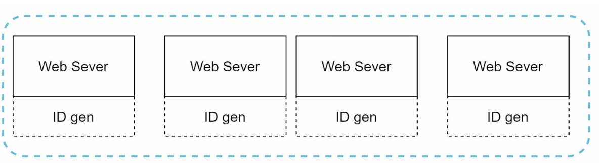
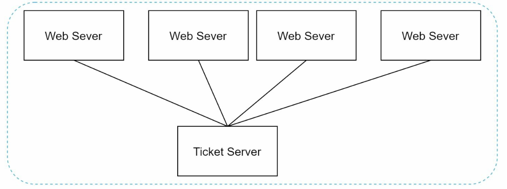

# 第7章: 分散システムにおける一意なID生成器の設計

## はじめに
本章では、分散システム向けの**一意なID生成器**を設計するという課題を扱います。従来のオートインクリメントのキーは、スケーラビリティと同期の課題があるため分散環境には適していません。次の要件を満たす、一意でソート可能な64ビットの数値IDを作成することに焦点を当てます。
- IDは**一意**であり、**日時順に並ぶ**こと。
- IDは**64ビット**に収まること。
- システムは**1秒あたり10,000件以上のID**を生成できること。

---

## ステップ1: 問題の理解
### 基本要件
- IDは一意な数値であり、64ビットに収まること。
- IDは時間とともに増加するが、厳密に `+1` ずつである必要はない。
- IDは日時でソート可能であること。
- システムは高いスループット（1秒あたり10,000件のID）に対応すること。

---

## ステップ2: 高レベル設計の選択肢
### 1. マルチマスターレプリケーション
- **アプローチ:** データベースの `auto_increment` をステップ増分で使用する（例: k台のサーバーなら `+k`）。

    

    
    

- **欠点:**
  - 複数のデータセンターにまたがってスケールさせるのが難しい。
  - IDが必ずしも時間とともに増加しない。
  - サーバーの追加/削除時にスケーリングの問題がある。

### 2. UUID（Universally Unique Identifier）
- **アプローチ:**
    - UUIDを使い、各サーバーで独立して128ビットの一意な識別子を生成する。
    - UUIDはサーバー間の調整なしに独立して生成できる。

        

        
        

- **利点:**
  - サーバー間の調整が不要。
  - Webサーバーとともに容易にスケールする。
- **欠点:**
  - 64ビットの要件を超える。
  - IDを時間順にソートできず、数値でない場合もある。

### 3. チケットサーバー
- **アプローチ:** 集中型のデータベースサーバーを使ってIDをインクリメントし、割り当てる。

    

    
    

- **利点:**
  - 小規模なシステムでは実装が簡単。
  - 数値のIDを生成する。
- **欠点:**
  - 単一障害点になる。
  - 複数サーバー構成での同期の課題。

### 4. Twitter Snowflake方式
- **アプローチ:**

    

      
    

    

      
    

    - 一意性とスケーラビリティを確保するため、IDをいくつかのセクションに分割する。
    - **符号ビット（1ビット）:** 常に `0`。符号付きと符号なしの数値を区別するために使える可能性がある。
    - **タイムスタンプ（41ビット）:** カスタムエポックからのミリ秒数（Twitterのデフォルトは `1288834974657` で、2010年11月4日 01:42:54 UTCに相当）。IDが時間順に並ぶことを保証する。
    - **データセンターID（5ビット）:** 最大 `2^5 = 32` 個のデータセンターを識別する。
    - **マシンID（5ビット）:** 各データセンター内の最大 `2^5 = 32` 台のマシンを識別する。
    - **シーケンス番号（12ビット）:** 同じミリ秒内に1台のマシンで生成されたIDを追跡し、1ミリ秒あたり最大 `2^12 = 4096` 個のIDをサポートする。シーケンスは1ミリ秒ごとに `0` にリセットされる。

- **利点:**
    - **スケーラビリティ:** 複数のサーバーで1秒あたり10,000件以上のIDを処理できる。
    - **時間順:** IDを時間順にソートできることを保証する。
    - **分散化:** 単一障害点がない。

## ステップ4: その他の検討事項
### 1. クロックの同期
- **課題:** ID生成は、サーバー間でクロックが同期していることを前提としている。
- **解決策:** **NTP（Network Time Protocol）**を使ってずれを最小限に抑える。

### 2. セクション長の調整
- ユースケースに応じてセクションのサイズを調整する（例: シーケンスのビットを減らし、タイムスタンプのビットを増やす）。

### 3. 高可用性
- ID生成器はミッションクリティカルであり、耐障害性が必要である。
- 冗長化とフェイルオーバーの仕組みを検討する。
