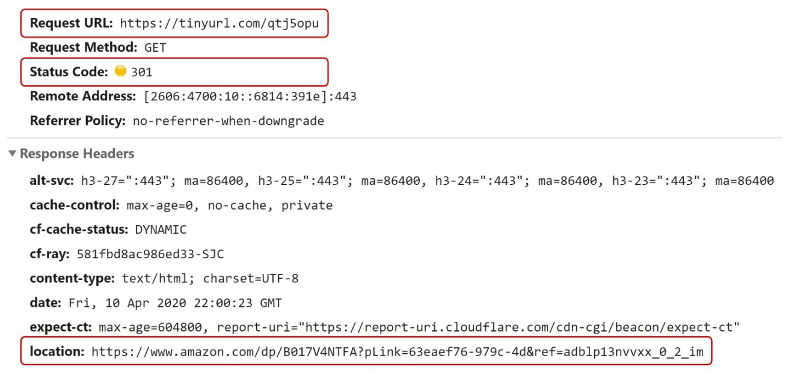
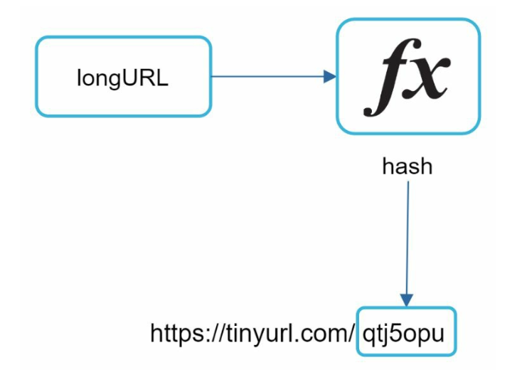
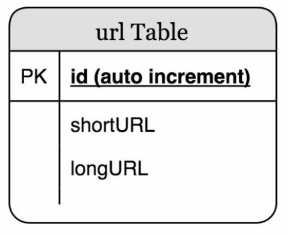
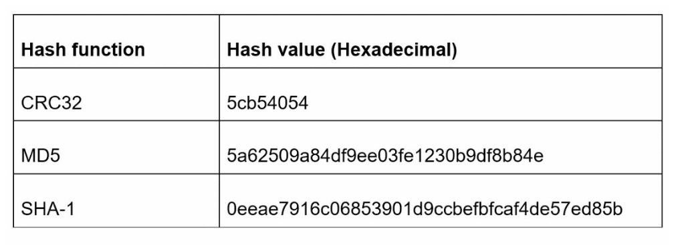
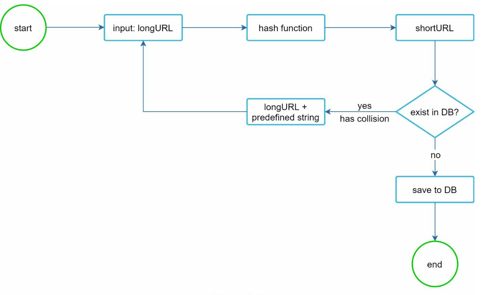

# 第8章: URL短縮サービスの設計

## はじめに
本章では、TinyURLのようなURL短縮サービスの設計について議論します。システムの主な目標は、**URLの短縮**、**リダイレクト**、そして大量のトラフィックを処理するための**高いスケーラビリティ**です。

### 要件
- 短縮URLは**一意**であり、**可能な限り短く**なければならない。
- **1日あたり1億件のURL生成**を処理し、10年間運用できる容量を持つ。
- 読み取りと書き込みの比率が10:1であることを踏まえ、**効率的な読み取り操作**をサポートする。
- 3,650億件のレコードを保存するため、10年間で約**365 TB**のストレージが必要。

---

## ステップ1: 高レベル設計

### APIエンドポイント
1. **URL短縮:**
   - エンドポイント: `POST api/v1/data/shorten`
   - パラメータ: `{longUrl: longURLString}`
   - 戻り値: `shortURL`

2. **URLリダイレクト:**
   - エンドポイント: `GET api/v1/shortUrl`
   - 戻り値: リダイレクト先の `longURL`。

    

    
    

### URLリダイレクト
- **301リダイレクト:** 301リダイレクトは、要求されたURLが長いURLへ「恒久的に」移動したことを示します。ブラウザはレスポンスをキャッシュし、同じURLへの以降のリクエストはURL短縮サービスに送信されません。
- **302リダイレクト:** 一時的なリダイレクト。クリック追跡などの分析に有用です。

### URL短縮

    

- **ハッシュ関数**を使って短縮URLを生成し、長いURLを一意な短縮版に対応付けます。
- ハッシュ関数は次の要件を満たす必要があります。
    - 各longURLは1つのhashValueにハッシュ化されること。
    - 各hashValueはlongURLに逆引きできること。

---

## ステップ2: 設計の深掘り

### データモデル
メモリ使用量を最適化するため、`<shortURL, longURL>` のマッピングをリレーショナルデータベースに保存します。テーブルスキーマには次が含まれます。
- `id`（主キー）
- `shortURL`
- `longURL`

    

### ハッシュ関数
#### 1. Base62変換:
- 文字 `[0-9, a-z, A-Z]` を使って数値をエンコードし、**62種類の文字**を使用できる。
- 基数変換は、URL短縮サービスでよく使われるもう1つのアプローチである。
- 短縮URLに一意なIDを割り当て、そのIDをBase62変換することで短縮URLを得られる。
- 7文字のハッシュで最大**3.5兆個の一意なURL**をサポートでき、3,650億件のURLには十分である。

**例:**
ID `2009215674938` をBase62に変換する:
- `2009215674938` → `zn9edcu`。

#### 2. ハッシュ + 衝突解決:
- CRC32、MD5、SHA-1などのハッシュ関数を使用する。

    

- 1つのアプローチはハッシュ値の先頭7文字を取ることだが、この方法ではハッシュの衝突が起こり得る。
- 衝突を解決するには、衝突がなくなるまで、あらかじめ定めた文字列を再帰的に付加する。ただし、これはコストが高くなる可能性がある。
- 効率的な検索のために、**ブルームフィルター**を使って衝突を解決する。

    

    
    

### 比較

-  **ハッシュ + 衝突解決:**
    - 短縮URLの長さが固定
    - 一意なID生成器が不要
    - 衝突が起こり得るため、解決が必要
    - IDに依存しないため、次に利用可能な短縮URLを求めることはできない

- **Base62変換**
    - 長さは固定ではなく、IDとともに長くなる
    - 一意なID生成器が必要
    - 衝突は起こらない
    - IDが1ずつ増える場合、次の短縮URLを容易に推測できる（セキュリティ上の懸念になり得る）

---

### URL短縮のフロー

    

1. `longURL` がデータベースに存在するか確認する。
2. 見つかれば、既存の `shortURL` を返す。
3. 見つからなければ:
   - **分散ID生成器**を使って一意なIDを生成する。
   - Base62を使ってIDを `shortURL` に変換する。
   - `<id, shortURL, longURL>` のマッピングをデータベースに保存する。

---

### URLリダイレクトのフロー

    

1. ユーザーが `shortURL` をクリックする。
2. `<shortURL, longURL>` のマッピングを問い合わせる:
   - 高速なアクセスのため、まず**キャッシュ**を確認する。
   - キャッシュになければ、データベースに問い合わせる。
3. ユーザーを `longURL` にリダイレクトする。

---

## その他の検討事項
### レートリミッター
- IPごとのリクエスト数に上限を設けて悪用を防ぐ。

### スケーラビリティ
1. **Web層:** ステートレスであり、Webサーバーの追加/削除によってスケールできる。
2. **データベース層:** レプリケーションとシャーディングを使用する。

### 分析
- ビジネス上の洞察を得るため、クリック率、流入元、タイムスタンプなどのデータを収集する。

### 高可用性と信頼性
- データベースのレプリケーションと耐障害性のある設計を用いて、一貫性があり信頼できるサービスを確保する。
