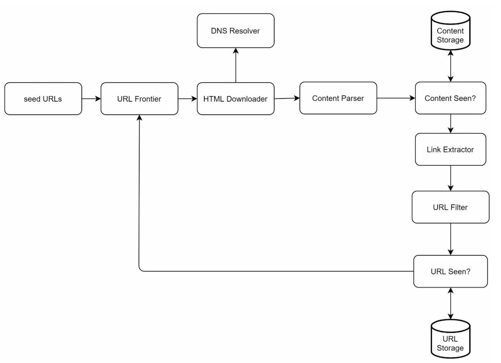
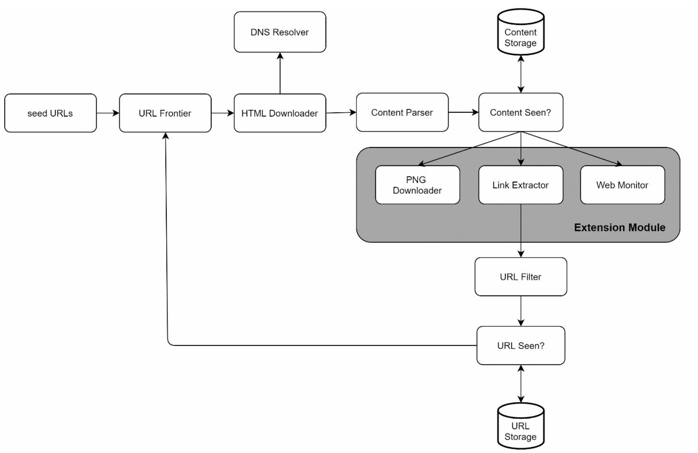

# 第9章: Webクローラーの設計

## はじめに
**Webクローラー**は、スパイダーやロボットとも呼ばれ、Webページ、画像、動画などのWebコンテンツを発見・収集するために使われます。本章では、**検索エンジンのインデックス作成**のためのスケーラブルなWebクローラーの設計に焦点を当てます。

### Webクローラーの用途
1. **検索エンジンのインデックス作成:** Webページを収集して検索可能なインデックスを作成する（例: Googlebot）。
2. **Webアーカイブ:** 将来の利用のためにWebデータを保存する（例: 米国議会図書館）。
3. **Webマイニング:** Webデータから知識を抽出する（例: 株主向け報告書の財務分析）。
4. **Web監視:** 著作権や商標の侵害を検出する。

### 設計上の課題
優れたWebクローラーは次の点に対処する必要があります。
- **スケーラビリティ:** 並列化によって数十億のページを処理する。
- **堅牢性:** 不正なHTML、クラッシュ、悪意のあるリンクに対処する。
- **礼儀正しさ（Politeness）:** 過剰なリクエストでサーバーに負荷をかけすぎないようにする。
- **拡張性:** 最小限の変更で新しいコンテンツタイプをサポートする。

---

## ステップ1: 問題の理解

### 要件
1. **月に10億ページ**をクロールする（毎秒400ページ、ピーク時800 QPS）。
2. **HTMLのみのコンテンツ**を収集する。
3. 新規ページと更新されたページを追跡する。
4. 重複コンテンツは無視する。
5. クロールしたデータを**5年間**保存する（約30 PBのストレージが必要）。

---

## ステップ2: 高レベル設計

### コンポーネント

1. **シードURL:** クローラーの出発点。
    - クローラーができるだけ多くのリンクをたどれるような、良い出発点を選ぶ必要がある。
    - さまざまな人気サイトに基づく地域性や、トピックに基づいて選ぶことができる。
    - 戦略: 地域やトピック（例: スポーツ、ヘルスケア）で分類する。

2. **URLフロンティア:** ダウンロード対象のURLを保存する。
   - **FIFOキュー**として実装される。

3. **HTMLダウンローダー:** URLフロンティアから提供されたURLのWebページをダウンロードする。

4. **DNSリゾルバー:** URLをIPアドレスに変換する。

5. **コンテンツパーサー:** Webページを検証・解析する。
   - 不正な形式のページは破棄する。

6. **Content Seen?（既出コンテンツ判定）:** ハッシュの比較（2つのWebページのハッシュ値を比較）によって重複コンテンツをチェックする。

7. **コンテンツストレージ:** HTMLページをディスクに保存する（レイテンシ削減のため、人気のあるコンテンツはメモリに置く）。

8. **URLエクストラクター:** 解析したページから新しいリンクを抽出する。

9. **URLフィルター:** ブラックリストに載っているURLやエラーのあるURLを除外する。

10. **URL Seen?（既訪問URL判定）:** 重複を避けるため、訪問済みのURLを追跡する。

11. **URLストレージ:** 訪問済みのURLを保存する。

---

### ワークフロー
1. **シードURL**をURLフロンティアに追加する。
2. **HTMLダウンローダー**がURLを取得し、DNSリゾルバーを介してIPを解決する。
3. **コンテンツパーサー**が検証し、コンテンツを「Content Seen?」コンポーネントに渡す。
4. コンテンツが新しいものであれば、**URLエクストラクター**でリンクを抽出する。
5. フィルタリングし、一意なリンクをURLフロンティアに追加する。

---

## ステップ3: 主要コンポーネントの深掘り
### DFS/BFS
-  Webは、Webページをノード、ハイパーリンク（URL）をエッジとする有向グラフとみなすことができる。
-  深さが非常に深くなり得るためDFSは理想的ではなく、グラフ探索には通常BFSが使われる。
-  標準的なBFSはURLの優先度を考慮しないが、すべてのページが同じ品質や重要度を持つわけではない。

### URLフロンティア
- **礼儀正しさ（Politeness）:**
    - 同一ホストへのリクエストは一度に1つだけにする。2つのダウンロードタスクの間に遅延を入れる。
    - ホスト名からキューおよびワーカー（ダウンロード）スレッドへのマッピングを使う。
    - 各ダウンローダースレッドは個別のFIFOキューを持ち、そのキューのURLのみをダウンロードする。

        

    - **キュールーター:** 各キュー（b1, b2, … bn）が同じホストのURLのみを含むようにする。
    - **マッピングテーブル:** 各ホストをキューに対応付ける。
    - **キューセレクター:** 各ワーカースレッドは1つのFIFOキューに対応付けられ、そのキューのURLのみをダウンロードする。キューの選択ロジックはキューセレクターが担う。
    - **ワーカースレッド1〜N:** ワーカースレッドは同じホストのWebページを順番にダウンロードする。2つのダウンロードタスクの間に遅延を入れることができる。

- **優先度:**
    - 重要なページ（例: PageRankや更新頻度による）に高い優先度を割り当てる。

        

    - **プライオリタイザー:** URLを入力として受け取り、優先度を計算する。
    - **キューf1〜fn:** 各キューには優先度が割り当てられている。優先度の高いキューほど高い確率で選択される。
    - **キューセレクター:** 優先度の高いキューに偏らせつつ、ランダムにキューを選ぶ。
    - **フロントキュー:** 優先度付けを管理する。
    - **バックキュー:** 礼儀正しさを管理する。

- **鮮度:** 更新履歴や重要度に基づいて再クロールする。

### HTMLダウンローダー
- **Robots.txtの遵守:** robots.txtファイルのルールを尊重する。
- **性能の最適化:**
  1. 複数のサーバーを使った分散クロール。
  2. 繰り返しの名前解決を避けるために**DNSキャッシュ**を使う。
  3. ダウンロードを高速化するため、クロールサーバーを地理的に分散させる。
  4. 遅いサーバーや応答しないサーバーを避けるため、短いタイムアウトを設定する。

### 堅牢性
1. **コンシステントハッシュ:** サーバー間で負荷を効果的に分散する。
2. **エラー処理:** 例外によるシステムのクラッシュを防ぐ。
3. **データ検証:** コンテンツの完全性を確保する。

### 拡張性
- 新しいコンテンツタイプのためのモジュールを追加する（例: PNGダウンローダー、Webモニター）。
- 例: 著作権侵害がないかWebコンテンツを監視するモジュールをプラグインとして追加する。

    
---

### 問題のあるコンテンツの回避
1. **重複コンテンツ:** ハッシュの比較で検出する。
2. **スパイダートラップ:** URLの長さ制限などの手法で無限ループを回避する。
3. **データノイズ:** 広告やスパムなどの無関係なコンテンツを除外する。

---

## ステップ4: まとめ
### 重要なポイント
1. Webクローラーは、スケーラビリティ、堅牢性、礼儀正しさ、拡張性のバランスをとる必要がある。
2. **礼儀正しさ**はサーバーの過負荷を防ぎ、**優先度**は重要なページが先にクロールされることを保証する。
3. 大規模なクロールを処理するには、効率的なストレージとエラー処理が不可欠である。

### その他の検討事項
- **サーバーサイドレンダリング:** JavaScriptやAJAXで生成される動的コンテンツに対処する。
- **スパム対策:** 低品質なページや無関係なページを除外する。
- **データベースのシャーディング:** レプリケーションとシャーディングを使ってデータ層をスケールさせる。
- **水平スケーリング:** ステートレスなサーバーを使ってクロールジョブを効率的にスケールさせる。
- **分析:** 洞察を得るためにデータを収集・分析する。
