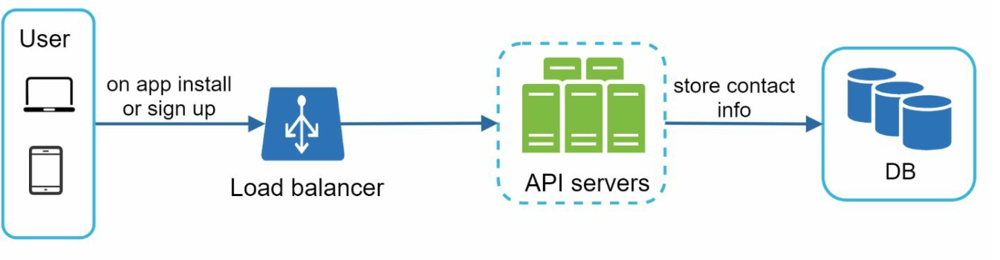
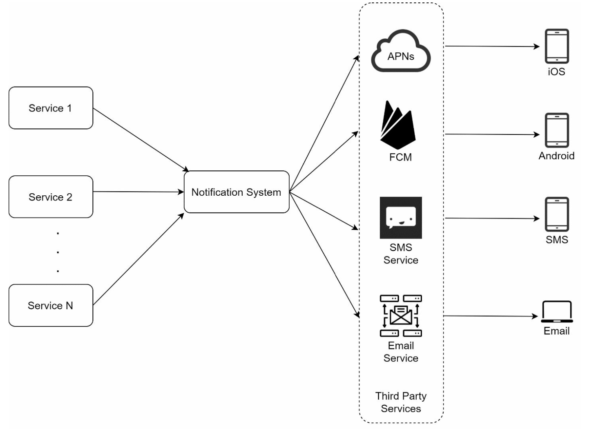
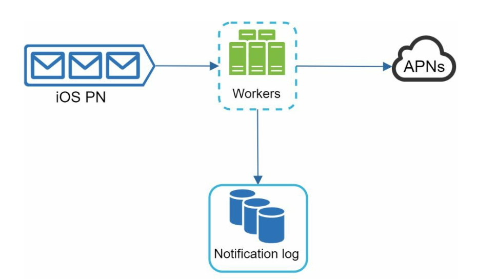
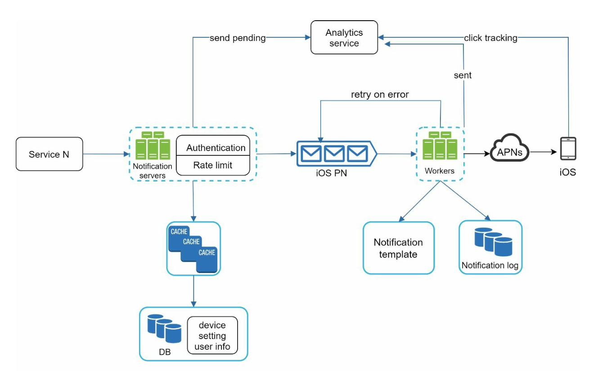

# 第10章: 通知システムの設計

## はじめに
**通知システム**は現代のアプリケーションに不可欠であり、製品の通知、イベント、オファー、アラートなどのタイムリーな更新を提供します。通知は次の手段で送信できます。
1. **プッシュ通知**（モバイルまたはデスクトップ）
2. **SMSメッセージ**
3. **メール**

本章では、毎日数百万件の通知を送信できるスケーラブルなシステムの設計に焦点を当てます。

---

## ステップ1: 問題の理解
### 要件
- **通知の種類:** プッシュ通知、SMS、メール。
- **配信:** 遅延を最小限に抑えたソフトリアルタイムシステム。
- **プラットフォーム:** iOS、Android、デスクトップ。
- **トリガー:** 通知はクライアントアプリケーションからトリガーすることも、サーバー上でスケジュールすることもできる。
- **規模:**
  - **プッシュ通知:** 1日1,000万件
  - **SMS:** 1日100万件
  - **メール:** 1日500万件
- **オプトアウトのサポート:** ユーザーは特定の種類の通知を無効にできる。

---

## ステップ2: 高レベル設計

### コンポーネント

1. **通知の種類:**
   - **iOSのプッシュ通知:** **Apple Push Notification Service（APNS）**を使用する。
   - **Androidのプッシュ通知:** **Firebase Cloud Messaging（FCM）**を使用する。
   - **SMSメッセージ:** TwilioやNexmoなどのサードパーティサービス。
   - **メール:** SendGridやMailchimpなどの商用メールサービス。

2. **連絡先情報の収集:**
   

      
   

   - アプリのインストール時やサインアップ時に、デバイストークン、電話番号、メールアドレスを収集する。
   - 連絡先情報をデータベースに保存する:
     - **デバイストークンテーブル:** プッシュ通知用。
     - **ユーザーテーブル:** メールアドレスと電話番号用。

3. **通知送信のフロー:**

   

      
   

   - **トリガーサービス:**
      - 通知を開始するイベントを生成する（例: 請求のリマインダー、配送状況の更新）。
      - サービスは、通知送信イベントをトリガーするマイクロサービス、cronジョブ、または分散システムのいずれでもよい。
   - **通知サーバー:**
      - サービスが通知を送信するためのAPIを提供する。
      - メールアドレスや電話番号を確認するための基本的なバリデーションを行う。
      - 通知のレンダリングに必要なデータを取得するため、データベースまたはキャッシュに問い合わせる。
   - **サードパーティサービス:** ユーザーに通知を配信する。

### 初期設計の課題
- **単一障害点（SPOF）:** 1台の通知サーバーがシステム全体をダウンさせ得る。
- **スケーラビリティの問題:** データベース、キャッシュ、処理コンポーネントを独立してスケールさせるのが難しい。
- **性能のボトルネック:** 通知の送信には多くのリソースが必要。

### 改善された設計

   

      
   

- データベースとキャッシュを通知サーバーから切り離す。
- 複数の通知サーバーによる**水平スケーリング**を導入する。
- システムコンポーネントを疎結合にするために**メッセージキュー**を使う。
   -  大量の通知を送信する際、メッセージキューはバッファとして機能する。
- メッセージキューから通知イベントを取り出し、対応するサードパーティサービスに送信するワーカーを追加する。

---

## ステップ3: 設計の深掘り

### 信頼性
1. **データ損失の防止:**
   

   
   

   - 通知データをデータベースに永続化し、リトライの仕組みを実装する。
   - データの永続化のため、通知ログデータベースを含める。

2. **重複排除:**
   - 重複した通知を送信しないよう、イベントIDを確認する。
   - 通知イベントが最初に到着したとき、イベントIDを確認して以前に処理済みかどうかを調べる。処理済みであれば破棄し、そうでなければ通知を送信する。

### 追加コンポーネント
   

   
   

1. **通知テンプレート:** 一貫性があり効率的な通知のための、あらかじめ書式設定されたテンプレート。
2. **通知設定:**
   - ユーザーは特定のチャネル（プッシュ、SMS、メール）をオプトインまたはオプトアウトできる。
   - 専用の通知設定テーブルに保存される。
3. **レート制限:** ユーザーに送信する通知の頻度に上限を設ける。
4. **リトライの仕組み:** サードパーティサービスが失敗した場合に通知の送信を再試行する。
5. **キューの監視:** キューに溜まった通知を追跡し、ワーカーを動的にスケールさせる。
6. **イベントの追跡:** 開封率、クリック率、エンゲージメントなどのメトリクスを収集する。

### セキュリティ
- プッシュ通知用のAPIを認証・保護するために、**AppKey**と**AppSecret**を使用する。

### 通知のフロー

   

   
   

1. トリガーサービスがAPIを呼び出して通知を送信する。
2. 通知サーバーがリクエストを検証し、キャッシュまたはデータベースからメタデータを取得する。
3. 通知イベントがメッセージキューに送られる。
4. ワーカーがイベントを処理し、サードパーティサービスとやり取りする。
5. サードパーティサービスがユーザーに通知を配信する。

---

## 主な最適化
1. **水平スケーリング:** 負荷分散のために通知サーバーを追加する。
2. **メッセージキュー:** 大量の処理に対応するため、処理を疎結合にする。
3. **キャッシュ:** 頻繁にアクセスされるデータをキャッシュしてレイテンシを削減する。
4. **分散配置:** 性能向上のため、メッセージ配信を地理的に最適化する。
