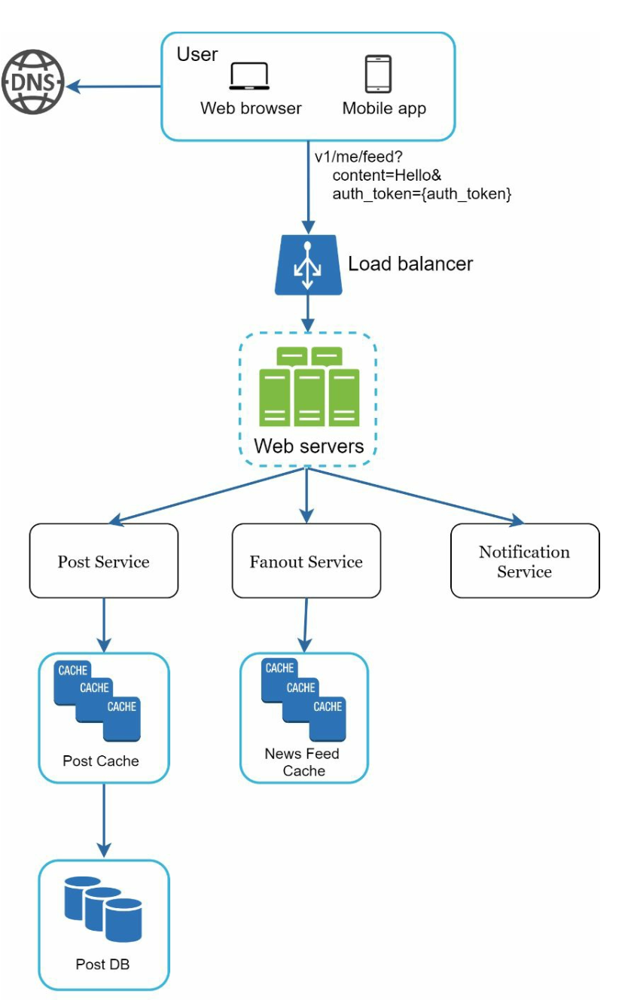
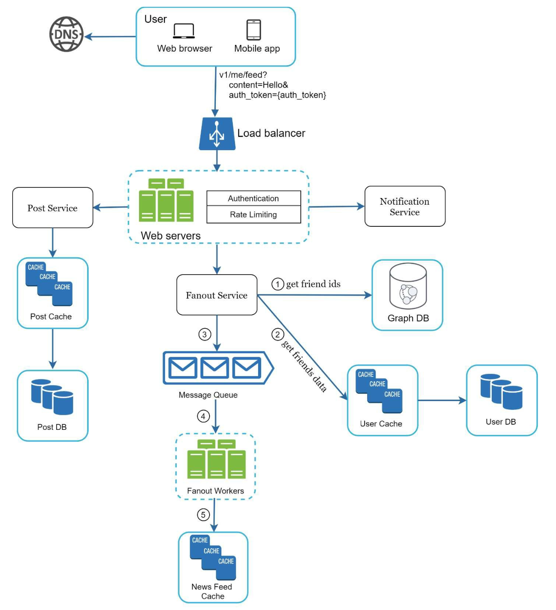

# 第11章: ニュースフィードシステムの設計

## はじめに
**ニュースフィードシステム**は、ユーザーのつながりのある相手からの投稿（ステータス更新、写真、動画、リンク）を、常に更新されるリストとして表示します。例としては、Facebookのニュースフィード、Instagramのフィード、Twitterのタイムラインがあります。本章では、スケーラブルなニュースフィードシステムの設計を探ります。

---

## ステップ1: 問題の理解

### 要件
1. **プラットフォーム:** Webとモバイルアプリの両方をサポートする。
2. **機能:**
   - ユーザーは投稿を公開できる。
   - ユーザーはニュースフィードで友達の投稿を閲覧できる。
3. **並び順:** 簡略化のため、フィードは**新しい順（逆時系列順）**に並べる。
4. **規模:**
   - ユーザーは最大5,000人の友達を持てる。
   - デイリーアクティブユーザー（DAU）は1,000万人。
   - フィードにはテキスト、画像、動画が含まれる場合がある。

---

## ステップ2: 高レベル設計

### 概要
設計には主に2つのフローがあります。
1. **フィードの公開:** ユーザーが投稿を公開すると、それがデータベースに書き込まれ、友達のフィードに伝播される。
2. **ニュースフィードの構築:** ユーザーは、友達の投稿を新しい順に集約することでニュースフィードを取得する。

---

### ニュースフィードAPI
1. **フィード公開API:**
   - **エンドポイント:** `POST /v1/me/feed`
   - **パラメータ:** `content`（投稿テキスト）と `auth_token`（認証）。

2. **ニュースフィード取得API:**
   - **エンドポイント:** `GET /v1/me/feed`
   - **パラメータ:** `auth_token`（認証）。

---

### フィードの公開

   

      
   

1. **ユーザー操作:** ユーザーがフィード公開APIを介して投稿を公開する。
2. **ロードバランサー:** トラフィックをWebサーバーに分散する。
3. **Webサーバー:** リクエストを認証し、各サービスに振り分ける。
4. **投稿サービス:** 投稿をデータベースとキャッシュに保存する。
5. **ファンアウトサービス:** キャッシュ内の友達のニュースフィードに投稿を伝播させる。
6. **通知サービス:** 友達に通知を送信する。

---

### ニュースフィードの構築

   

      
   

1. **ユーザー操作:** ユーザーが取得APIを介してニュースフィードを要求する。
2. **ロードバランサー:** トラフィックをWebサーバーに分散する。
3. **Webサーバー:** リクエストをニュースフィードサービスに転送する。
4. **ニュースフィードサービス:** ニュースフィードキャッシュから投稿IDを取得し、データベースまたはキャッシュから投稿の詳細を取得する。

---

## ステップ3: 設計の深掘り

### フィード公開の深掘り
1. **Webサーバー:**
   - `auth_token` を使ってユーザーを認証する。
   - スパムを防ぐためにレート制限を適用する。

2. **ファンアウトサービス:**
   - **書き込み時ファンアウト（Fanout on Write）:** 書き込み時に投稿を友達のフィードにプッシュする。
     - **長所:** リアルタイムに更新され、フィードの取得が速い。
     - **短所:** 友達の多いユーザーの場合、リソースを大量に消費する。
   - **読み取り時ファンアウト（Fanout on Read）:** 読み取り時に投稿をプルする。
     - **長所:** 非アクティブなユーザーに対して効率的。
     - **短所:** フィードの取得が遅い。
   - **ハイブリッドアプローチ:** ほとんどのユーザーにはプッシュモデルを、つながりの多いユーザー（例: セレブリティ）にはプルモデルを使う。

        

    **ファンアウトサービス**は次のように動作します。

    1. **友達IDの取得:** グラフデータベースから友達リストを取得する。
    2. **キャッシュを使った友達のフィルタリング:** キャッシュ内のユーザー設定にアクセスし、特定の友達（例: ミュートした友達や、限定公開の設定）を除外する。
    3. **メッセージキューへの送信:** フィルタリングした友達リストと新しい投稿IDを、処理のためにメッセージキューに送る。
    4. **ファンアウトワーカー:** ワーカーがメッセージキューからデータを取り出し、ニュースフィードキャッシュを更新する。メモリを節約するため、キャッシュにはユーザーや投稿のオブジェクト全体ではなく `<post_id, user_id>` のマッピングを保存する。
    5. **ニュースフィードキャッシュへの保存:** 新しい投稿IDを友達のニュースフィードキャッシュに追加する。ほとんどのユーザーは最新のコンテンツに注目するため、設定可能な上限によって最近の投稿のみを保存し、キャッシュのメモリ消費量を管理可能な範囲に保つ。

        

## ニュースフィード取得の深掘り

### キャッシュアーキテクチャ
キャッシュは5つの層に分かれています。
1. **ニュースフィードキャッシュ:** 素早く取得するために投稿IDを保存する。
2. **コンテンツキャッシュ:** 投稿の詳細を保存する（人気の投稿はホットキャッシュに置く）。
3. **ソーシャルグラフキャッシュ:** ユーザーの関係データを保存する。
4. **アクションキャッシュ:** ユーザーのアクション（いいね、返信、シェア）を記録する。
5. **カウンターキャッシュ:** いいね、返信、フォロワーなどの数を保持する。

    
---

## 主な最適化

### スケーリング
1. **データベースのスケーリング:**
   - 水平スケーリングとシャーディング。
   - トラフィックの多いクエリにはリードレプリカを使用する。
2. **ステートレスなWeb層:** 水平スケーリングを可能にするため、Webサーバーをステートレスに保つ。

### キャッシュ
1. 頻繁にアクセスされるデータをメモリに保存する。
2. レイテンシとデータベース負荷を減らすためにキャッシュ層を使う。

### 信頼性
1. **コンシステントハッシュ:** リクエストをサーバー間に均等に分散する。
2. **メッセージキュー:** システムコンポーネントを疎結合にし、トラフィックをバッファリングする。

### 監視
1. QPS（1秒あたりのクエリ数）やレイテンシなどの主要メトリクスを追跡する。
2. キャッシュヒット率を監視し、それに応じて設定を調整する。
