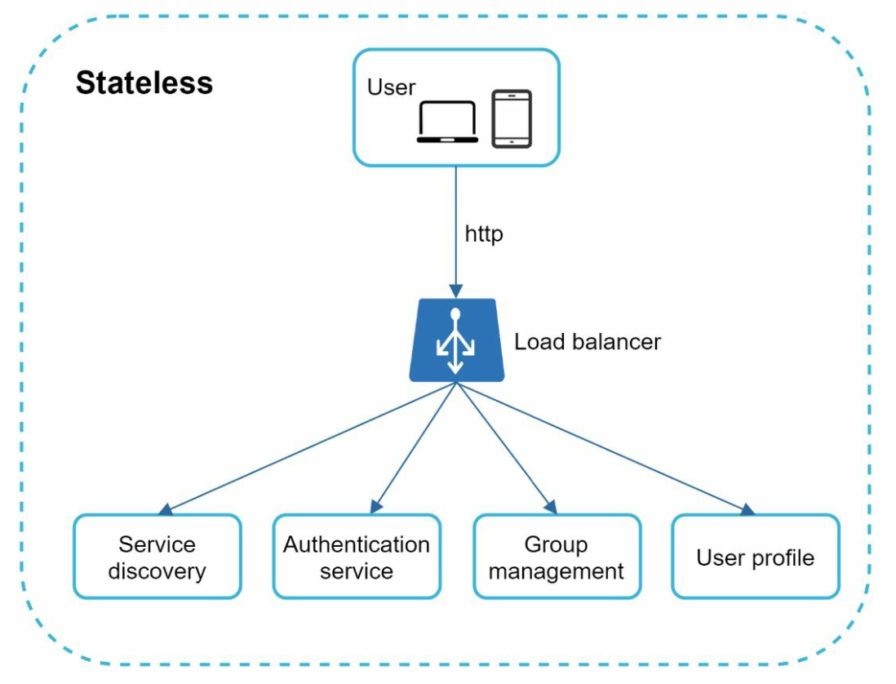
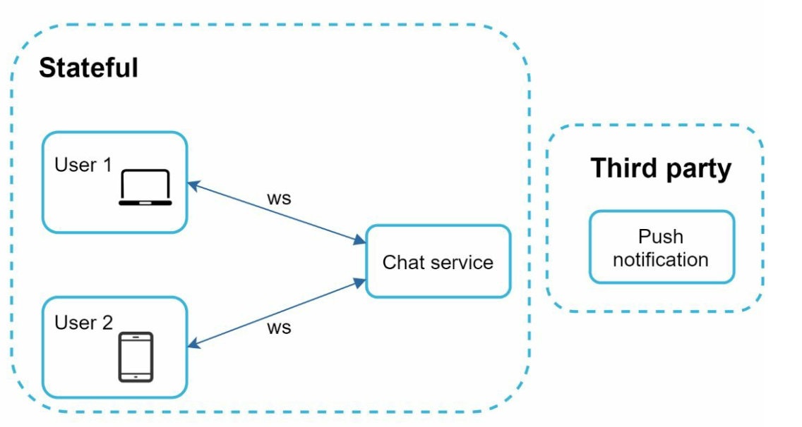
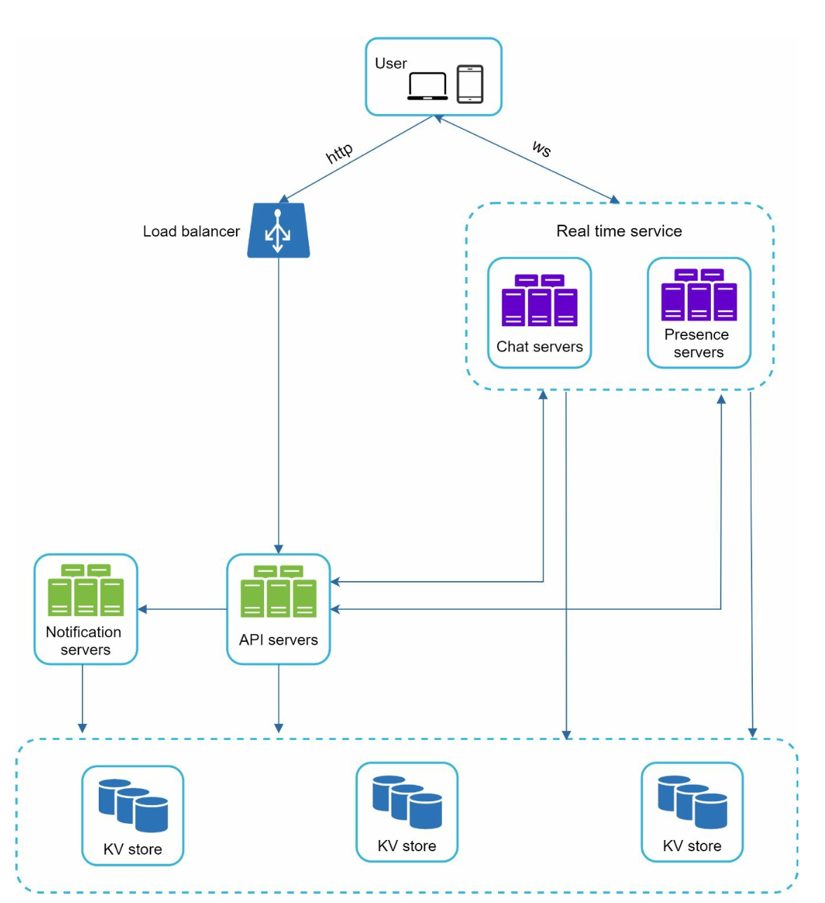
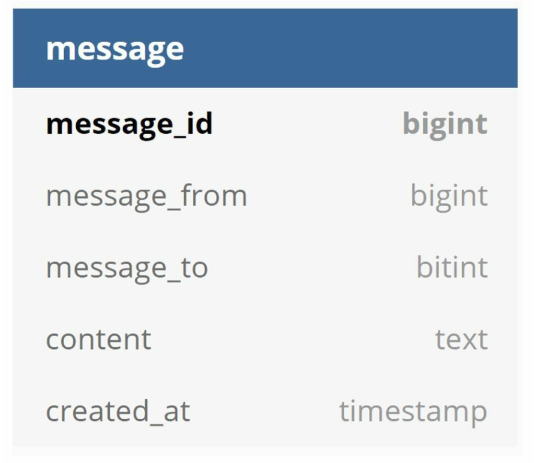
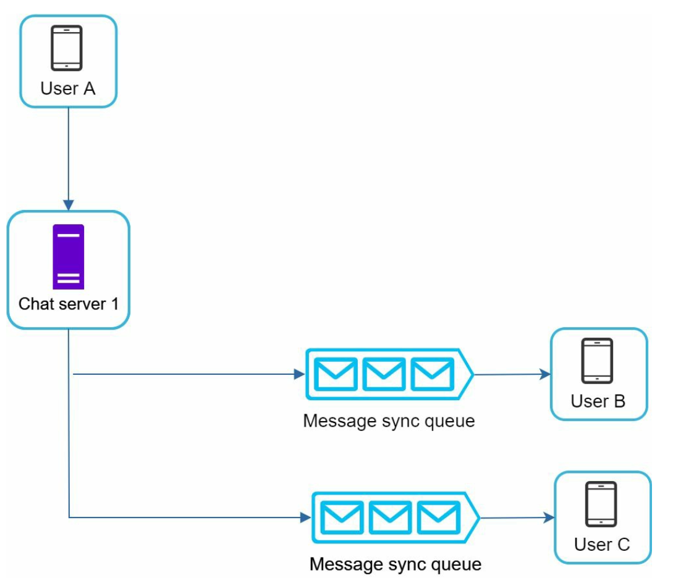

# 第12章: チャットシステムの設計

## はじめに
**チャットシステム**は、ユーザー間のリアルタイムなメッセージングをサポートします。本章では、次の機能を含むチャットアプリの設計に焦点を当てます。
- **1対1チャット**
- **グループチャット（最大100人）**
- **オンライン状態の表示**
- **複数デバイスのサポート**
- **プッシュ通知**

システムは**5,000万人のデイリーアクティブユーザー（DAU）**を対象とし、チャット履歴を永続的に保存します。

---

## ステップ1: 問題の理解

### 要件
1. **機能:**
   - 1対1チャットとグループチャット（最大100人）。
   - テキストベースのメッセージ（最大100,000文字）。
   - オンライン/オフラインの表示。
   - 複数デバイスのサポート。
   - プッシュ通知。
2. **規模:** 5,000万DAUを想定して設計する。
3. **ストレージ:** チャット履歴を永続的に保存する。

---

## ステップ2: 高レベル設計

### 通信プロトコル
1. **送信側:** メッセージの送信にはHTTPを使い、効率化のために持続的接続を活用する。

      

      
      

2. **受信側:**
   - **ポーリング:**
      - クライアントが定期的にサーバーに新しいメッセージがあるかを問い合わせる。
      - 頻繁で冗長なリクエストのため非効率。

         

   - **ロングポーリング:**
      - メッセージが届くまで接続を開いたままにする。
      - 非アクティブなユーザーに対しては非効率。

         

   - **WebSocket:**
      - リアルタイム通信のための双方向の持続的接続で、メッセージの送信と受信の両方に採用される。
      - メッセージの送受信にはWebSocket（ws）プロトコルを使う。

         

---

### コンポーネント

   
   

1. **ステートレスなサービス:**
   - サインアップ、ログイン、ユーザープロフィールの管理を担当する。
   - サービスディスカバリと連携し、最適なチャットサーバーを推薦する。
2. **ステートフルなサービス:**
   - チャットサーバーは持続的なWebSocket接続を維持する。
   - メッセージの配信と同期を担当する。
3. **サードパーティとの連携:**
   - プッシュ通知サービスが新しいメッセージをユーザーに通知する。
   - 通知の実装については「通知システム」の章を参照。

---
### 設計

クライアントは、リアルタイムメッセージングのためにチャットサーバーとの持続的なWebSocket接続を維持します。

      

- チャットサーバーはメッセージの送受信を仲介する。
- プレゼンスサーバーはオンライン/オフライン状態を管理する。
- APIサーバーは、ユーザーのログイン、サインアップ、プロフィール変更などすべてを処理する。
- 通知サーバーはプッシュ通知を送信する。
- 最後に、キーバリューストアはチャット履歴の保存に使われます。チャット履歴データのデータベースにキーバリューストアを使う理由は次のとおりです。
   - 容易に水平スケーリングできる。
   - KVストアはデータへのアクセスが非常に低レイテンシである。
   - リレーショナルデータベースはロングテールのデータをうまく扱えない。インデックスが大きくなると、ランダムアクセスのコストが高くなる。
   - KVストアは、実績のある信頼性の高い他のチャットアプリケーションでも採用されている。例えば、Facebook MessengerとDiscordの両方がそうである。

以下は、1対1チャットとグループチャットのデータモデルです。
   - 主キーはメッセージIDであり、メッセージの順序を決めるのに役立つ。
   - グループチャットでは、複合主キーは (channel_id, message_id) である。
      - IDはSnowflakeのようなグローバルな64ビットのシーケンス番号生成器を使って生成できる。
      - より良いアプローチは、ローカルなシーケンス番号生成器を使うことである。ローカルとは、IDがグループ内でのみ一意であることを意味する。
      - ローカルなIDで機能するのは、1対1のチャネルまたはグループチャネル内でメッセージの順序を維持できれば十分だからである。

      
      

## ステップ3: 設計の深掘り

### サービスディスカバリ

   

- サービスディスカバリの主な役割は、地理的な位置やサーバーの容量などの基準に基づいて、クライアントに最適なチャットサーバーを推薦することである。
- 地理的な位置やサーバー容量などの基準に基づいてチャットサーバーを割り当てるために、**Apache Zookeeper**を使う。
- 効率的な負荷分散を確保し、レイテンシを最小限に抑える。

### メッセージングのフロー
#### 1対1チャット

1. ユーザーAがチャットサーバー1にメッセージを送信する。
2. チャットサーバー1が一意なメッセージIDを割り当て、メッセージをキーバリューストアに保存する。
3. ユーザーBがオンラインであれば、メッセージは持続的なWebSocket接続を維持しているチャットサーバー2に転送される。
4. ユーザーBがオフラインであれば、プッシュ通知が送信される。

#### グループチャット

   

- メッセージはグループ内の各受信者の個別の受信箱にコピーされる。
- 同期が単純になるが、大きなグループではコストが高くなる。
- 受信側では、受信者は複数のユーザーからメッセージを受け取ることがある。各受信者は、さまざまな送信者からのメッセージを含む受信箱（メッセージ同期キュー）を持つ。

---

#### メッセージの同期

多くのユーザーは複数のデバイスを持っています。デバイス間でメッセージを同期する必要があります。各デバイスは cur_max_message_id という変数を保持し、デバイス上の最新のメッセージIDを追跡します。次の2つの条件を満たすメッセージは新しいメッセージとみなされます。

   

- 受信者IDが、現在ログインしているユーザーIDと等しい。
- キーバリューストア内のメッセージIDが cur_max_message_id より大きい。

---

### オンライン状態（プレゼンス）
1. **ハートビートの仕組み:**
   

      
   

   - クライアントはオンラインであることを示すために、定期的にプレゼンスサーバーにハートビートを送信する。
   - しきい値（例えば x = 30秒）以内にハートビートを受信しなかった場合、そのユーザーはオフラインとみなされる。

2. **ファンアウトモデル:**

   

      
   

   - 状態の更新は、友達のペアごとにチャネルを持つパブリッシュ/サブスクライブモデルを使って友達にプッシュされる。
   - ユーザーAのオンライン状態が変わると、チャネルA-B、A-C、A-Dの3つのチャネルにイベントが発行される。
   - これら3つのチャネルはそれぞれユーザーB、C、Dが購読しており、オンライン状態の更新を受け取る。
   - 上記の設計は小規模なユーザーグループには有効である。

---

## その他の検討事項
### スケーラビリティ
- **水平スケーリング:** ユーザー数の増加に応じてサーバーを追加する。
- **ロードバランシング:** トラフィックをサーバー間に均等に分散する。
- **キャッシュ:** データベースの負荷を減らし、レイテンシを改善する。

### エラー処理
- **リトライの仕組み:** リトライとキューイングでメッセージ配信の失敗に対処する。
- **サーバー障害:** 障害時にはサービスディスカバリを使って新しいサーバーを割り当てる。

### 将来の拡張
1. **メディアのサポート:** 圧縮やクラウドストレージを含め、写真や動画の扱いを追加する。
2. **エンドツーエンド暗号化:** メッセージのプライバシーを確保する。
3. **クライアントサイドのキャッシュ:** 性能向上のためにデータ転送量を減らす。
4. **読み込み時間の改善:** 地理的に分散したキャッシュネットワークを使う。
