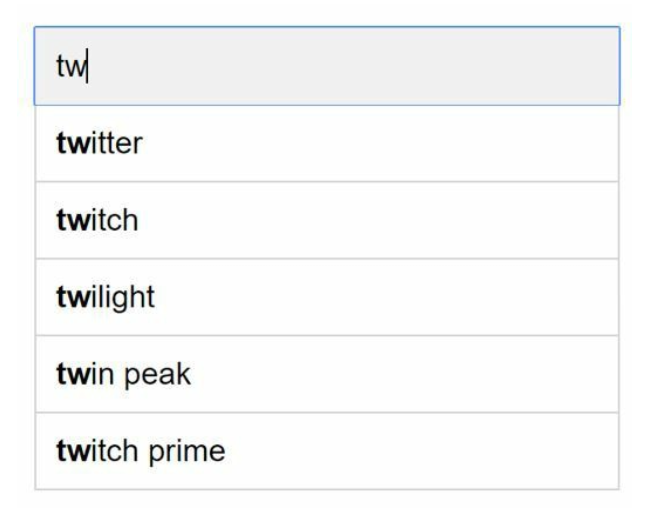
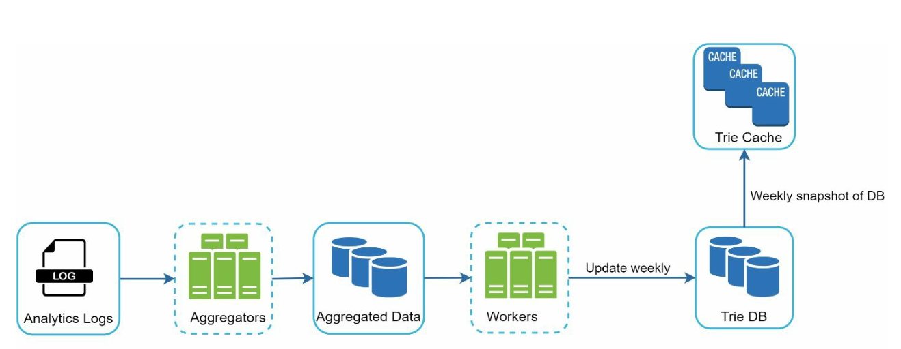

# 第13章: 検索オートコンプリートシステムの設計

## はじめに
オートコンプリートは、タイプアヘッドやインクリメンタルサーチとも呼ばれ、ユーザーが検索ボックスに入力するのに合わせてリアルタイムに候補を提示します。システムは、過去のクエリデータに基づいて、関連性が高く人気のある上位k件の候補を効率的に提供する必要があります。

### 主な機能
- 最大**5件のオートコンプリート結果**を提示する。
- **クエリの人気度**（頻度）に基づく。
- **英小文字のみ**をサポートする。
- 高速な応答時間（100ミリ秒未満）とスケーラビリティ。

---

## ステップ1: 問題の理解

### 要件
1. **リアルタイムの候補表示:** ユーザーの入力に合わせて関連する候補を表示する。
2. **上位k件の結果:** 人気度順に並べた最大5件の結果を返す。
3. **スケーラビリティ:** **1,000万DAU**、ピークQPS **48,000**に対応する。
4. **高可用性:** システムを停止させずに障害に対処する。
5. **データの増加:** 新しいクエリデータにより1日あたり**0.4 GB**増加するストレージをサポートする。

---

## ステップ2: 高レベル設計
高レベルでは、システムは2つのサービスに分けられます。
1. **データ収集サービス:**
    - ユーザーのクエリを収集し、頻度分析のためにリアルタイムで集計する。
    - 大規模なデータセットではリアルタイム処理は現実的ではないが、出発点としては良い。

2. **クエリサービス:** ユーザーの入力に基づいて上位k件の候補を提供する。

---

### データ収集サービス

    

- 分析ログからクエリデータを集計し、頻度テーブルを更新する。
- 過去のデータを毎週処理して**トライ木**（プレフィックスツリー）を構築する。

### クエリサービス

    
    

- データ収集サービスの頻度テーブルを使う。
- ユーザーの入力を処理し、トライ木を使って頻度テーブルから上位k件の候補を取得する。
- キャッシュと効率的なデータ構造を用いて高速な検索に最適化されている。
- 例えば、ユーザーが検索ボックスに「tw」と入力すると、検索回数上位5件のクエリが表示される。

---

## ステップ3: 設計の深掘り

### トライ木のデータ構造
**トライ木**は、クエリ文字列を効率的に保存・取得するために使われる木構造のデータ構造です。

#### 主な特徴
1. **コンパクトな保存:** プレフィックスを階層的に表現し、冗長性を最小限に抑える。
2. **頻度情報:** 各ノードにクエリの人気度を保存する。

4. **検索回数上位k件のクエリを得る手順**
   

      
   

    - プレフィックスを見つける
    - プレフィックスノードからサブツリーを走査して、有効な子をすべて取得する
    - 子をソートし、上位k件を得る

3. **最適化:**
   - 取得を高速化し、トライ木全体の走査を避けるため、各ノードに上位k件のクエリをキャッシュする。

        

   - ユーザーが非常に長い検索クエリを入力することはまれなので、プレフィックスの長さを制限（例えば50文字）して探索空間を縮小する。

#### トライ木の操作
1. **作成:**
    - 集計したクエリデータを使って毎週構築する。
    - データの出所は分析ログ/DBである。
2. **更新:** リアルタイムに更新されることはまれで、毎週の更新で古いデータを置き換える。
3. **削除:**
      

         
      

    - フィルターにより、望ましくない、または有害な候補（例: ヘイトスピーチ）を除外する。
    - フィルター層を設けることで、さまざまなフィルタールールに基づいて結果を除外する柔軟性が得られる。
    - 望ましくない候補は、非同期にデータベースから物理的に削除される。

---

### クエリ処理のフロー
1. **プレフィックス検索:**
   - ユーザーの入力に対応するプレフィックスノードを特定する。
   - サブツリーを走査して有効な候補を集める。
2. **上位k件のソート:**
   - ソートのオーバーヘッドを最小限に抑えるため、各ノードに上位k件の候補をキャッシュする。
3. **レスポンスの構築:**
   - 高速な応答のため、キャッシュされたデータを使って結果を構築する。

---

### 最適化
1. **各ノードでのキャッシュ:**
   - 冗長な走査を避けるため、上位k件のクエリを保存する。
2. **プレフィックス長の制限:**
   - 検索を高速化するため、プレフィックスの長さを小さな値（例: 50文字）に制限する。
3. **AJAXリクエスト:**
   - リアルタイムな応答のため、軽量な非同期リクエストを使う。
4. **ブラウザキャッシュ:**
   - よく検索される語については、オートコンプリートの結果をブラウザキャッシュに保存する。

---

### データ収集パイプライン
高レベル設計では、ユーザーが検索クエリを入力するたびにデータがリアルタイムで更新されていました。このアプローチは現実的ではありません。
- ユーザーは1日に数十億件のクエリを入力する可能性がある。クエリのたびにトライ木を更新するのは現実的ではない。
- トライ木が構築されると、上位の候補はそれほど変わらない可能性がある。

#### 改善された設計

   

1. **分析ログ:**
   - 毎週の集計のために、生のクエリデータをログとして保存する。
   - ログは追記専用で、インデックスは付けられない。
2. **アグリゲーター:**
   - ログを処理して、トライ木の構築に適した頻度テーブルにする。
   - Twitterのようなリアルタイムアプリケーションでは、より短い時間間隔でデータを集計する。
   - それ以外の場合は、例えば週1回など低い頻度でデータを集計すれば十分である。
3. **ワーカー:**
   - 非同期のサーバーがトライ木を再構築し、永続ストレージに保存する。
4. **ストレージの選択肢:**
    - **トライキャッシュ**: トライキャッシュは、高速な読み取りのためにトライ木をメモリ上に保持する分散キャッシュシステムである。
    - **トライDB**
        1. **ドキュメントストア（例: MongoDB）**: 新しいトライ木は毎週構築されるため、定期的にスナップショットを取ってシリアライズし、シリアライズしたデータをMongoDBのようなデータベースに保存できる。
        2. **キーバリューストア:**
            - 高速なアクセスのために、プレフィックスをノードのデータに対応付ける。
            - トライ木のすべてのプレフィックスは、ハッシュテーブルのキーに対応付けられる。
            - 各トライノードのデータは、ハッシュテーブルの値に対応付けられる。

                
---

### スケーラビリティ
1. **シャーディング:**
   - プレフィックスの範囲（例: `a-m`、`n-z`）に基づいて、トライノードをサーバー間に分散する。
   - 偏った分布を均衡させるため、プレフィックス内でさらにシャーディングする（例: `aa-ag`、`ah-an`）。
2. **ロードバランシング:**
   

      
   

   - シャードマップマネージャーを使って、リクエストを適切なサーバーにルーティングする。

---

## ステップ4: 高度な機能

### 多言語サポート
1. **Unicode文字:** 英語以外の言語をサポートするためにUnicodeを使う。
2. **国別のトライ木:** 国や地域ごとに別々のトライ木を構築する。

### トレンドのクエリ
- トライノードを動的に更新したり、最近のクエリに大きな重みを付けたりすることで、リアルタイムのイベントに対応する。
