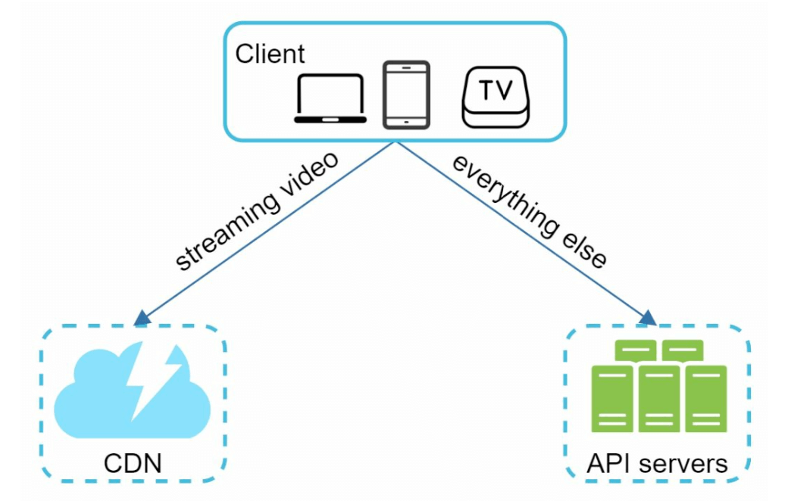
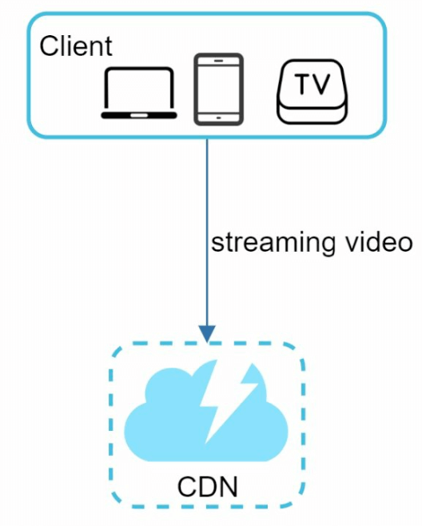
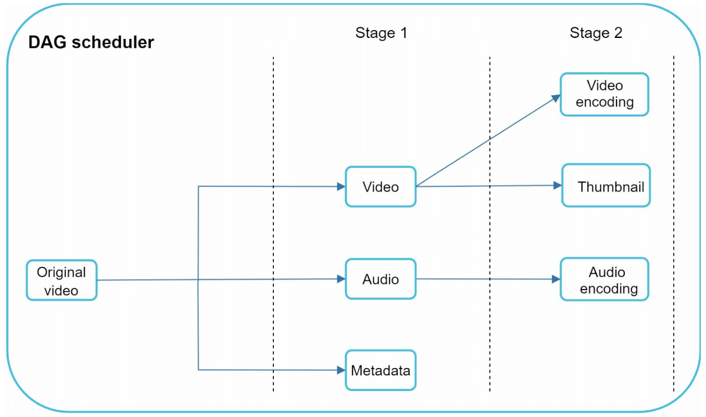
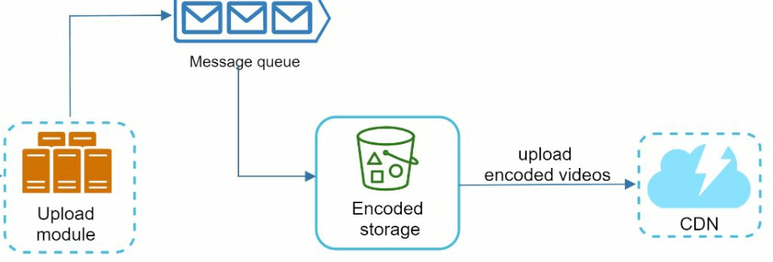
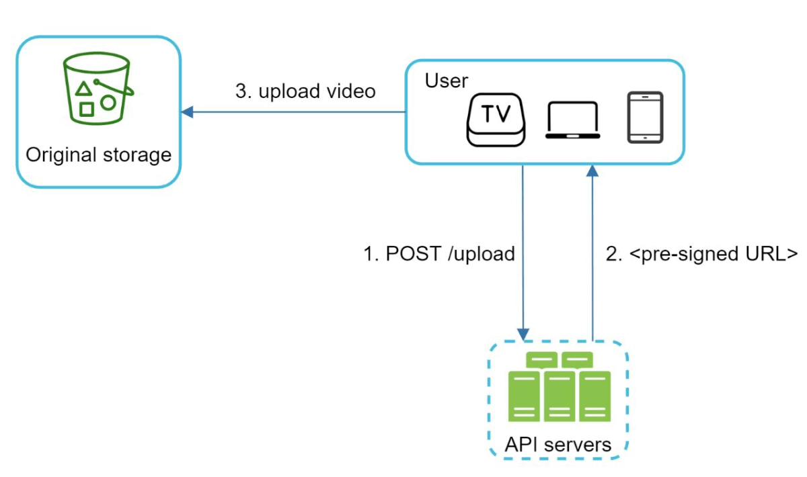

# 第14章: YouTubeの設計

## はじめに
YouTubeは、動画のアップロード、再生、さまざまなインタラクションをサポートする巨大な動画ストリーミングプラットフォームです。本章では、次の中核機能を備えたスケーラブルな動画ストリーミングシステムの設計に焦点を当てます。
- **高速な動画アップロード**
- **スムーズな動画ストリーミング**
- **動画の画質を変更する機能**
- **低いインフラコスト**
- **高可用性と信頼性**

### 主な統計（2020年）
- **月間アクティブユーザー20億人**
- **1日あたり50億本の動画が視聴される**
- **モバイルインターネットトラフィックの37%がYouTubeによるもの**
- **80の言語**で利用可能
- 2019年の**広告収入は151億ドル**

---

## ステップ1: 問題と範囲の理解

### 中核機能
1. 動画をアップロードする
2. 動画を視聴する

### サポートするプラットフォーム
- モバイルアプリ、Webブラウザ、スマートTV

### 前提
- **デイリーアクティブユーザー（DAU）:** 500万人
- **動画の平均サイズ:** 300 MB
- **アップロードの上限:** 動画1本あたり最大1 GB
- **1日あたりに必要なストレージ:** 150 TB
- **CDNコスト:** 500万 * 5本 * 0.3GB * $0.02 = 1日あたり$150,000（Amazon CloudFrontを使用した場合）

---

## ステップ2: 高レベル設計

### コンポーネント

    

1. **クライアント:** スマートフォン、コンピューター、TVなどのデバイス。
2. **CDN（コンテンツデリバリーネットワーク）:** 動画を保存し、ストリーミング配信する。
3. **APIサーバー:** 動画ストリーミング以外のすべてのユーザー操作（例: アップロード、メタデータの更新）を処理する。
4. **メタデータデータベース:** 動画のメタデータ（例: タイトル、説明、サイズ）を保存する。
5. **オリジナルストレージ:** アップロードされた動画のためのBlobストレージ。
6. **トランスコーディングサーバー:** 動画を複数の解像度や形式に変換する。
7. **トランスコード済みストレージ:** トランスコードされた動画のためのBlobストレージ。

---

### 中核となるワークフロー
#### 1. 動画アップロードのフロー
- **並列プロセス:**
  1. 動画をオリジナルストレージにアップロードする。
  2. データベース内の動画メタデータを更新する。

- **動画のアップロード（手順）:**

    

        
    

    - [1] 動画がBlobストレージにアップロードされる。
    - [2] トランスコーディングサーバーが動画を複数の形式に変換する。
    - [3] トランスコーディングが完了すると、次の2つのステップが並列に実行される。
        - [3a] トランスコードされた動画がトランスコード済みストレージに送られる。
        - [3b] トランスコーディング完了イベントが完了キューに入れられる。
    - [3a.1] 動画がCDNに配信される。
    - [3b.1] 完了ハンドラーがメタデータを更新し、ユーザーに通知する。

- **メタデータのアップロード（手順）:**

    

        
    

    - クライアントは並行して、動画メタデータを更新するリクエストを送信する。
    - リクエストには、ファイル名、サイズ、形式などを含む動画のメタデータが含まれる。

#### 2. 動画ストリーミングのフロー

  

- レイテンシを最小限に抑えるため、動画はエッジサーバーを使ってCDNから直接ストリーミングされる。
- 代表的なストリーミングプロトコルには、MPEG-DASH、Apple HLS、Adobe HDSがある。
-  *ストリーミングプロトコルによって、サポートする動画エンコーディングや再生プレーヤーが異なる。*

---

## ステップ3: 設計の深掘り

### 動画のトランスコーディング
#### 重要性
1. 生の動画は大量のストレージ容量を消費する。トランスコーディングによりストレージ容量を削減できる。
2. デバイスやブラウザ間の互換性を確保する。
3. ネットワーク状況に合わせて動画の画質を調整する。

#### 構成要素
- **コンテナ:** 動画、音声、メタデータをまとめる（例: MP4、AVI）。
- **コーデック:** 圧縮・伸張のアルゴリズム（例: H.264、VP9）。

#### 有向非巡回グラフ（DAG）モデル

    

- 動画のトランスコーディングは計算コストが高く、時間がかかる。
- DAGモデルは、エンコーディング、サムネイル生成、透かし（ウォーターマーク）の付与といったタスクを定義する。
- 動画処理において高い並列性を実現できる。

- 元の動画は、映像、音声、メタデータに分割される。
    - 映像のエンコーディング: 異なる解像度、コーデック、ビットレートをサポートするように動画を変換する。
    - サムネイル: ユーザーがアップロードすることも、システムが自動生成することもできる。
    - 透かし: 動画の上に重ねる画像で、動画に関する識別情報を含む。

---

### 動画トランスコーディングのアーキテクチャ

1. **プリプロセッサー:** 動画をより小さなチャンク（GOP単位）に分割する。4つの責務がある。

    

        
    

    - 動画の分割: 動画ストリームを、より小さなGOP（Group of Pictures）単位に分割（または再分割）する。
    - 古いクライアント向けに、GOP単位で動画を分割する。
    - クライアントのプログラマーが書いた設定ファイルに基づいてDAGを生成する。
    - エンコーディングが失敗した場合に、永続化したデータを使ってリトライできるよう、GOPとメタデータを一時ストレージに保存する。

2. **DAGスケジューラー:** タスクを逐次または並列のステージに編成する。
    

        
    

    - DAGグラフをタスクのステージに分割し、リソースマネージャー内のタスクキューに入れる。
    - ステージ1: 映像、音声、メタデータ。
    - ステージ2で、映像ファイルはさらに映像エンコーディングとサムネイルの2つのタスクに分割される。

3. **リソースマネージャー:** リソース割り当ての効率を管理する。3つのキューとタスクスケジューラーを含む。
    

        
    

    - タスクキュー: 実行すべきタスクを含む優先度付きキュー。
    - ワーカーキュー: ワーカーの使用状況の情報を含む優先度付きキュー。
    - 実行中キュー: 現在実行中のタスクと、それを実行しているワーカーを含む。
    - タスクスケジューラー: 最適なタスク/ワーカーを選び、選んだタスクワーカーにジョブの実行を指示する。

4. **タスクワーカー:** トランスコーディングやその他の処理を実行する。
    

        
   

    - タスクワーカーごとに異なるタスクを実行することがある。

5. **一時ストレージ:** リトライのために中間データを保存する。
    - ストレージシステムの選択は、データの種類、データサイズ、アクセス頻度、データの寿命などの要因によって決まる。
6. **出力:** 配信準備が整ったトランスコード済みの動画。

---

## システムの最適化

### 速度の最適化
1. **動画の並列アップロード:** 動画を小さなチャンクに分割し、高速かつ再開可能なアップロードを実現する。

    

2. **分散したアップロードセンター:** ユーザーに近いCDNをアップロードの拠点として使う。
3. **並列処理:** メッセージキューを使ってモジュールを疎結合にし、高い並列性を実現する。

    
    

### 安全性の最適化
1. **署名付きURL（Pre-Signed URL）:** 動画のアップロードを認可されたユーザーに制限する。

    

2. **動画の保護:**
   - **DRMシステム**（例: Apple FairPlay、Google Widevine）。
   - **AES暗号化。**
   - **透かし（ウォーターマーク）。**

### コスト削減の最適化
1. 人気のある動画のみをCDNで配信し、人気の低い動画は大容量サーバーから配信する。
2. アクセスがまれな動画はオンデマンドでエンコードする。
3. 人気度に基づいて動画の配信を地域ごとに最適化する。
4. 独自のCDNを構築し、ISPと提携して帯域幅コストを削減する。

---

## エラー処理
### 回復可能なエラー
- 失敗したアップロード、トランスコーディング、リソース割り当てのタスクをリトライする。

### 回復不能なエラー
- 不正な形式の動画の処理を停止し、エラーコードを返す。
