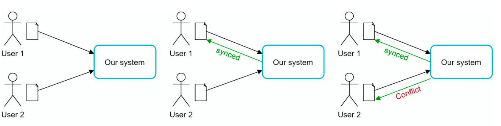
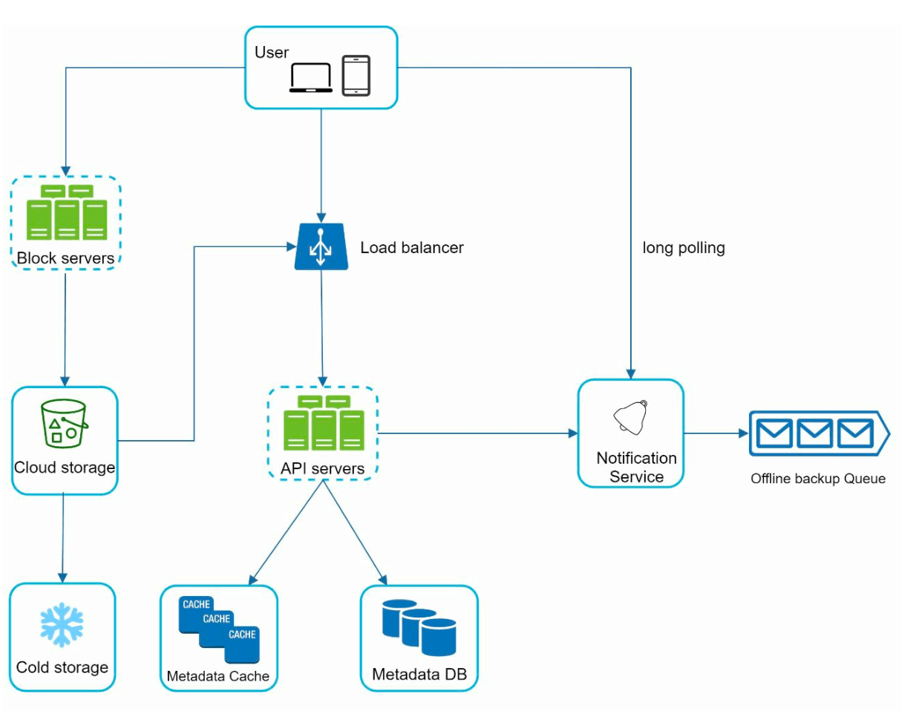
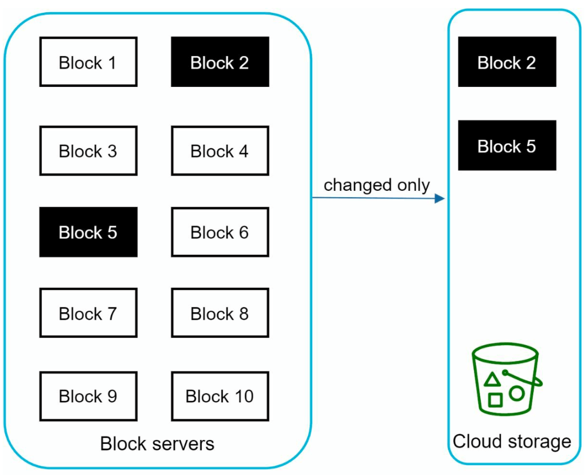
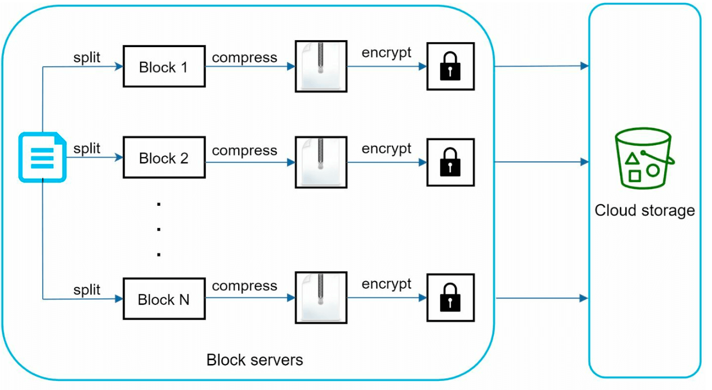
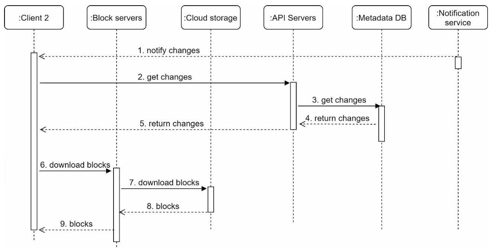

# 第15章: Google Driveの設計

## はじめに
Google Driveは、クラウドベースのファイル保存・同期サービスで、ユーザーはさまざまなデバイスからファイルを保存、アクセス、共有できます。本章では、次の機能を備えたスケーラブルなシステムの設計について議論します。
- **ファイルのアップロードとダウンロード**
- **デバイス間でのファイル同期**
- **ファイル共有**
- **ファイルの変更履歴**
- **編集、削除、共有の通知**

---

## ステップ1: 問題の理解

### 主な要件
#### 機能要件:
- ファイルをアップロード・ダウンロードする。
- 複数のデバイス間でファイルを同期する。
- ファイルの版（リビジョン）を保持する。
- 権限付きでファイルを共有できるようにする。
- ファイルの編集、削除、共有時に通知を送る。

#### 非機能要件:
- **信頼性:** データの損失は許されない。
- **高速な同期:** 同期の遅れでユーザーを苛立たせない。
- **帯域幅の効率:** 不要なデータ使用を最小限に抑える。
- **スケーラビリティ:** 1,000万人のデイリーアクティブユーザー（DAU）に対応する。
- **高可用性:** サーバー障害やネットワーク問題の発生時にも途切れなく動作する。

### 制約と前提
- ユーザーには**10 GBの無料容量**が与えられる。
- 最大ファイルサイズ: **10 GB**。
- 平均アップロードファイルサイズ: **500 KB**。
- アップロード頻度: **ユーザー1人あたり1日2ファイル**。
- 必要な総ストレージ: **500 PB**。

---

## ステップ2: 高レベル設計
### 単一サーバー構成
基本的な構成には次が含まれます。
1. **Webサーバー:** アップロードとダウンロードを処理する。
2. **メタデータデータベース:** ユーザーデータ、ログイン情報、ファイル情報などのメタデータを管理する。
3. **ストレージディレクトリ:** 名前空間ごとに整理されたファイルを保持する。

    

- Webサーバーと、アップロードされたファイルを保存するルートディレクトリとして drive/ というディレクトリを用意する。
- drive/ ディレクトリの下には、名前空間（namespace）と呼ばれるディレクトリが並ぶ。
- 各名前空間には、そのユーザーがアップロードしたすべてのファイルが含まれる。
- 各ファイルやフォルダは、名前空間と相対パスを結合することで一意に識別できる。

この設計は出発点としては役立ちますが、スケールさせるには不十分です。

#### API
1. **Google Driveへのファイルのアップロード:** 2種類のアップロードがサポートされる。
    - シンプルアップロード: ファイルサイズが小さい場合に使う。
    - 再開可能アップロード:
        - エンドポイント: https://api.example.com/files/upload?uploadType=resumable
        - 最初のリクエストを送って再開可能なURLを取得する。
        - データをアップロードし、アップロードの状態を監視する。
        - アップロードが中断された場合は、アップロードを再開する。
2. **Google Driveからのファイルのダウンロード:** ファイルをダウンロードするには
    -  エンドポイント: https://api.example.com/files/download
3. **ファイルの版の取得:**
    - エンドポイント: https://api.example.com/files/list_revisions

### 分散システムへの移行

#### 改善点:
1. **シャーディング:** `user_id` に基づいてストレージをサーバー間に分割する。
2. **Amazon S3:** スケーラブルで冗長なファイルストレージとしてS3を使い、リージョン間レプリケーションを行う。

    

3. **ロードバランサー:** トラフィックを複数のWebサーバーに分散する。
4. **メタデータデータベースのレプリケーション:** データベースのシャーディングとレプリケーションによって可用性を確保する。

#### 同期の競合:
Google Driveのような大規模ストレージシステムでは、同期の競合がときどき発生します。2人のユーザーが同じファイルやフォルダを同時に変更すると、競合が発生します。

- この例では、ユーザー1とユーザー2が同じファイルを同時に更新しようとするが、ユーザー1のファイルが先にシステムで処理される。
- ユーザー1の更新操作は成功するが、ユーザー2には同期の競合が発生する。
- システムは、同じファイルの両方のコピー（ユーザー2のローカルコピーとサーバー上の最新版）を提示する。
- ユーザー2は、両方のファイルをマージするか、一方の版で他方を上書きするかを選べる。

### 改善された設計

1. **ユーザー操作:** ユーザーはブラウザまたはモバイルアプリからアプリケーションにアクセスする。

2. **ブロックサーバー:**
   - ファイルは**4 MBのブロック**（最大サイズ）に分割され、一意なハッシュ値が割り当てられる。
   - ブロックはクラウドストレージ（例: Amazon S3）に独立して保存される。
   - ファイルの再構築は、ブロックを特定の順序で結合することで行う。

3. **クラウドストレージ:** スケーラビリティと冗長性のため、ブロックはクラウドストレージに保存される。

4. **コールドストレージ:** コスト削減のため、非アクティブなファイルはコールドストレージに移される。

5. **ロードバランサー:** 効率的な運用のため、リクエストをAPIサーバー間に均等に分散する。

6. **APIサーバー:**
   - ユーザー認証、プロフィール管理、ファイルメタデータの更新を処理する。
   - アップロード以外のすべてのワークフローを管理する。

7. **メタデータデータベースとキャッシュ:**
   - ユーザー、ファイル、ブロック、版のメタデータを保存する。
   - 頻繁にアクセスされるメタデータは、高速に取得できるようキャッシュされる。

8. **通知サービス:**
   - ファイルの変更（追加、編集、削除）をクライアントに通知する**パブリッシャー/サブスクライバー型のシステム**。
   - クライアントが最新の更新をプルできるようにする。

9. **オフラインバックアップキュー:** オフラインのクライアントがオンラインに戻ったときに同期できるよう、ファイル変更の情報を一時的に保存する。

---

## ステップ3: 設計の深掘り

### メタデータデータベース
以下は、最も重要なテーブルとフィールドのみを含む、大幅に簡略化した版です。
#### スキーマ設計:
- **ユーザーテーブル:** ユーザーのプロフィールと設定を保存する。
- **ファイルテーブル:** ファイルのメタデータ（例: サイズ、名前、パス）を保持する。
- **ブロックテーブル:** ファイルを再構築するためにファイルのブロックを追跡する。
- **ファイルバージョンテーブル:** ファイルの変更履歴を保存する。

---

### ファイルアップロードのフロー

1. **ファイルのアップロード:**
   - ファイルはブロックサーバーによってブロックに分割され、圧縮・暗号化される。
   - ブロックはブロックサーバーにアップロードされ、S3に保存される。
2. **メタデータのアップロード:**
   - クライアントがメタデータをAPIサーバーに送信する。
   - メタデータはステータス `pending` でデータベースに保存される。
3. **完了:**
   - S3がコールバックをトリガーし、ファイルのステータスを `uploaded` に更新する。
   - 通知サービスが関係するユーザーに通知する。

---

### ファイル同期
1. **差分同期:** ファイル全体ではなく、変更されたブロックのみを転送する。

    

    
    

2. **圧縮:** ファイルの種類に応じた圧縮アルゴリズムでブロックを圧縮する。
3. **競合の解決:**
   - 先に処理された版が優先される。
   - 競合する版は、ユーザーが解決できるよう別に保存される。

---

### ファイルダウンロードのフロー
ダウンロードのフローは、ファイルが別の場所で追加または編集されたときにトリガーされます。クライアントがそれを知る方法は2つあります。
- 別のクライアントがファイルを変更したときにクライアントAがオンラインであれば、通知サービスがクライアントAに通知する。
- 別のクライアントがファイルを変更したときにクライアントAがオフラインであれば、データはキャッシュに保存される。オフラインだったクライアントがオンラインに戻ると、最新の変更をプルする。

ファイルが変更されたことを知ると、クライアントはまずAPIサーバー経由でメタデータを要求し、次にブロックをダウンロードしてファイルを構築します。

1. **トリガー:** 通知サービスがクライアントにファイルの更新を通知する。
2. **メタデータの取得:** クライアントがAPI経由で更新されたメタデータを取得する。
3. **ブロックのダウンロード:** クライアントがブロックサーバーから更新されたブロックをダウンロードし、ファイルを再構築する。

---

### 通知サービス
1. **目的:** ファイルの変更についてクライアントを最新の状態に保つ。
2. **仕組み:** 非同期の通知のために**ロングポーリング**を実装する。
3. **例:** ファイルが追加、編集、削除されると、関係するすべてのクライアントに通知がプッシュされる。

---

### ストレージの最適化
1. **重複排除:** ハッシュベースの比較を使い、アカウント単位で重複ブロックを除去する。
2. **バージョニング戦略:**
   - 保存する版の数を制限する。
   - 頻繁に編集されるファイルについては、最近の版を優先する。
3. **コールドストレージ:** アクセス頻度の低いファイルを、より安価なストレージ（例: Amazon S3 Glacier）に移す。

---

### 障害への対処
1. **ロードバランサーの障害:** セカンダリのロードバランサーがアクティブになる。
2. **ブロックサーバーの障害:** 保留中のタスクを他のサーバーに再割り当てする。
3. **メタデータデータベースの障害:**
   - スレーブノードをマスターに昇格させる。
   - トラフィックを残りのレプリカに振り向ける。
4. **クラウドストレージの障害:** リージョン間レプリケーションを使って、利用できないファイルを取得する。
5. **通知サービスの障害:** クライアントは代替のサーバーに再接続する。
