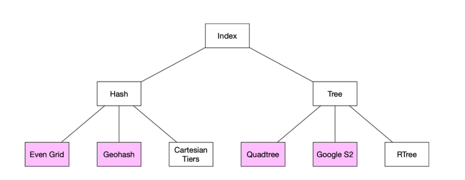
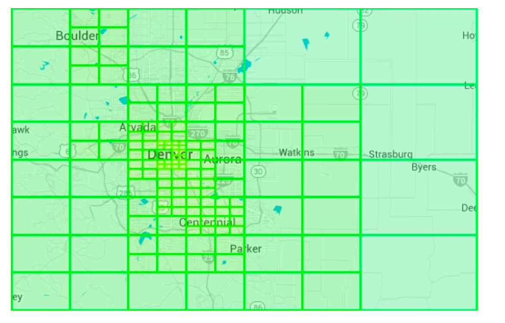
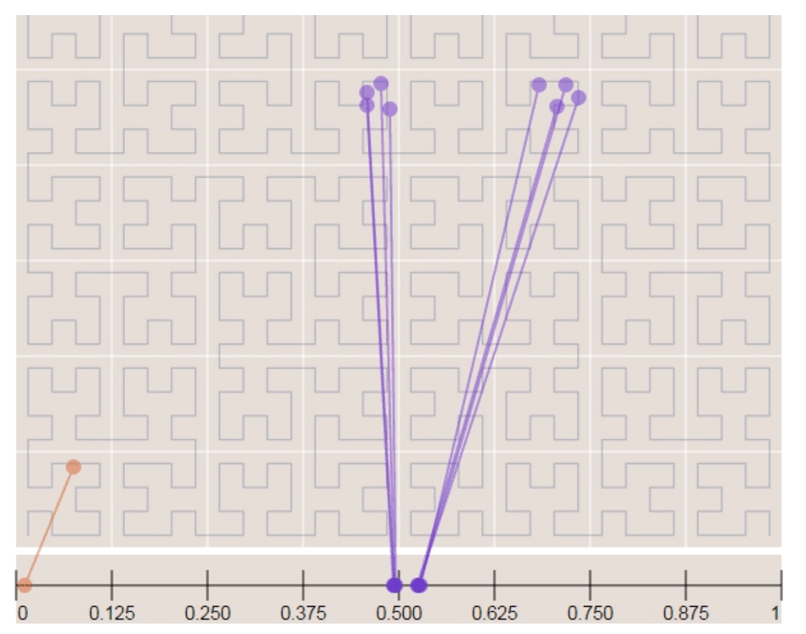
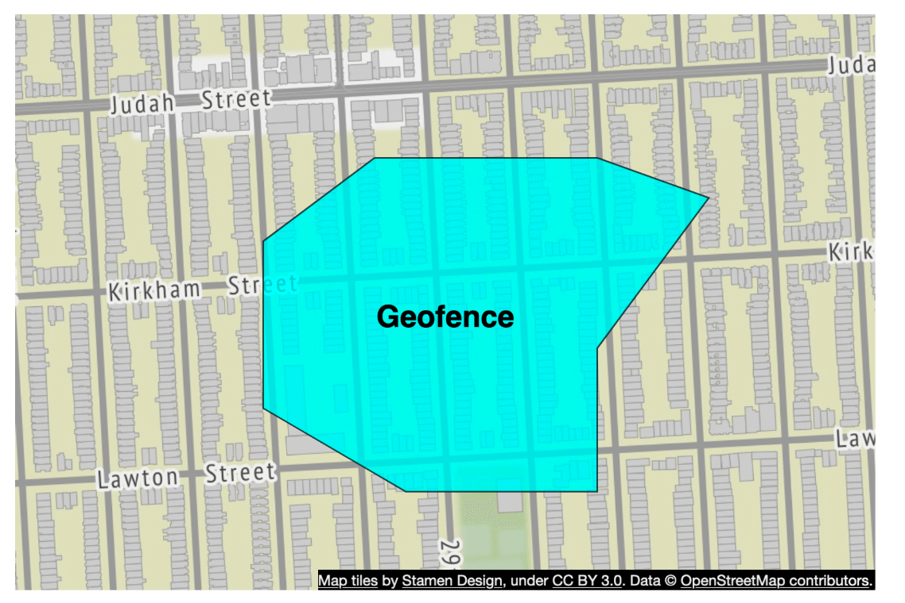

# 第16章: 近接サービス（Proximity Service）

## はじめに
**近接サービス**は、レストラン、ホテル、ガソリンスタンドなどの近くの場所や店舗を見つけるために設計されたサービスです。この機能は**Google Maps**や**Yelp**などのアプリケーションで使われ、ユーザーが指定した半径内の場所を見つけるのに役立ちます。


## ステップ1: 問題の理解と範囲の確定

### **機能要件**
1. ユーザーの位置（緯度、経度）と検索半径に基づいて**店舗を検索する**。
2. **店舗オーナーが**店舗を追加、更新、削除できるようにする（リアルタイムでなくてよい）。
3. 要求に応じて**店舗の詳細情報を提供する**。

### **非機能要件**
- **低レイテンシ**: ユーザーは素早く応答を得られるべきである。
- **データプライバシー**: GDPRやCCPAの規制に準拠する。
- **高可用性**: 混雑した地域でのピーク時の急増に対応する。

### **概算見積もり**
- **デイリーアクティブユーザーは1億人**。
- システム内の**店舗数は2億**。
- **検索QPSの計算**:
  - ユーザーは**1日に5回検索する**。
  - **検索QPS** = (1億 × 5) / 86,400 ≈ **5,000 QPS**。

---

## ステップ2: 高レベル設計

### **API設計**
#### **近くの店舗を検索する**
GET /v1/search/nearby

- **リクエストパラメータ**:
  - `latitude`: ユーザーの位置の緯度。
  - `longitude`: ユーザーの位置の経度。
  - `radius`: 検索半径（デフォルト: 5000m）。

#### **店舗API**
| APIエンドポイント                 | 説明                                             |
|-----------------------------------|--------------------------------------------------|
| `GET /v1/businesses/{id}`         | 店舗の詳細情報を取得する                         |
| `POST /v1/businesses`             | 新しい店舗を追加する                             |
| `PUT /v1/businesses/{id}`         | 店舗の詳細を更新する                             |
| `DELETE /v1/businesses/{id}`      | システムから店舗を削除する                       |


### **データモデル**
- 次の2つの機能が非常によく使われるため読み取り量が多く、MySQLのようなリレーショナルデータベースが適している。
  - 近くの店舗を検索する
  - 店舗の詳細情報を閲覧する

### **データスキーマ**
- 主要なデータベーステーブルは、店舗テーブルと地理空間インデックステーブルである。
- 店舗テーブルには、店舗に関する詳細情報が含まれる。

### **高レベルのシステムアーキテクチャ**
システムは、位置情報ベースサービス（LBS）と店舗関連サービスの2つの部分から構成されます。

<div style="margin-left:3rem">
    
</div>

- **位置情報ベースサービス（LBS）**:
  - 位置情報に基づく検索クエリを処理する。
  - 書き込みリクエストのない、読み取り中心のサービス。
  - 特に人口密集地域のピーク時にはQPSが高く、システムはステートレスである。
- **店舗サービス**: 2種類のリクエストを扱う。
  - 店舗オーナーが店舗を作成、更新、削除する。
  - 顧客が店舗の詳細情報を閲覧する。
- **ロードバランサー**: トラフィックをLBSと店舗サービスにルーティングする。
- **データベースクラスター**:
  - 読み取り中心のワークロードのために**プライマリ-レプリカ構成**を使う。
  - LBSが読み取るデータと、プライマリデータベースに書き込まれたデータとの間に、多少の不一致が生じる可能性がある。
  - 店舗情報はリアルタイムに更新されるものではないため、この不整合は問題にならない。


---

## ステップ3: 近くの店舗を取得するアルゴリズム

### **選択肢1: 2次元検索（素朴なアプローチ）**

<div style="margin-left:3rem">
    
</div>

最も直感的な方法は、あらかじめ定めた半径の円を描き、その円内のすべての店舗を見つけることです。

**SQLクエリ:**
```
SELECT business_id, latitude, longitude
FROM business
WHERE (latitude BETWEEN :lat - radius AND :lat + radius)
AND (longitude BETWEEN :long - radius AND :long + radius);
```
**問題点:**
- **非効率**: データベース全体をスキャンする必要がある。
- **1次元のインデックス**（緯度/経度）による制約がある。

改善策として経度と緯度の列にインデックスを作成することが考えられますが、多少ましになるとはいえ依然として非常に遅いです。

### より良いアプローチ
- 前のアプローチの問題は、データベースのインデックスでは1次元でしか検索速度を上げられないことである。
- 最適なアプローチは、地理空間インデックスを使って2次元のデータを1次元で表現することである。
  - ハッシュ: 均等グリッド、Geohash
  - ツリー: Quadtree、Google S2、R木

  <div style="margin-left:3rem">
    
  </div>


### **選択肢2: 均等に分割したグリッド**

  <div style="margin-left:3rem">
    
  </div>

- **世界を固定サイズのグリッドに分割する**。
- **問題点**: 店舗の分布が不均一である（都市部では高密度、地方では疎）。

### **選択肢3: Geohash**
- 本初子午線と赤道に沿って地球を4つの象限に分割する。そして各グリッドをさらに4つの小さなグリッドに分割する。
- 各グリッドは、経度のビットと緯度のビットを交互に並べることで表現できる。
- この分割を繰り返す。

  <div style="margin-left:3rem">
    
    
  </div>


- **緯度と経度を1つの英数字の文字列にエンコードする**。12段階の精度（レベル）がある。
- **階層的なグリッド構造**により、効率的な検索が可能になる。
- 適切な精度は、表に従って最小のGeohash長を選ぶことで決まる。
  <div style="margin-left:3rem">
    
  </div>
- Geohashでは、2つのGeohash間で共有するプレフィックスが長いほど、2地点が近いことが保証される。

- **課題**:
  <div style="margin-left:3rem">
    
  </div>

  - **境界の問題**（グリッドの境界付近にある店舗が除外される可能性がある）。
    - 2つの地点が非常に近くても、共有するプレフィックスがまったくない場合がある（赤道の反対側にある場合など）。
    - 2つの地点が長いプレフィックスを共有していても、異なるGeohashに属する場合がある。
  - 解決策: 隣接するグリッドも検索する必要がある。


### **選択肢4: Quadtree（四分木）**

  Quadtreeは、2次元空間を再帰的に4つの象限に分割する木構造のデータ構造で、各内部ノードはちょうど4つの子を持ち、それぞれが空間の4つの部分領域を表します。
  - Quadtreeはインメモリのデータ構造であり、各LBSサーバー上で動作し、サーバーの起動時に構築される。

  <div style="margin-left:3rem">
    
  </div>

  - ルートノードは、x件（この例では100件）を超える店舗を持つノードがなくなるまで、再帰的に4つの象限に分割される。

  <div style="margin-left:3rem">
    
  </div>

- Quadtreeのインデックスはそれほど多くのメモリを必要とせず（通常はGB単位）、1台のサーバーに容易に収まる。
- 木の構築の時間計算量は n log n であるため、木の構築には数分かかる場合がある。
- **k近傍検索のクエリに効率的**（例: 最寄りのガソリンスタンドを探す）。

  <div style="margin-left:3rem">
    
  </div>

#### 運用上の検討事項
 - 約2億件の店舗の場合、サーバーの起動時にQuadtreeを構築するのに数分かかる可能性がある。
 - Quadtreeの構築中はトラフィックを処理できないため、新しいリリースはサーバーの一部に段階的にロールアウトすべきである。
 - 店舗を更新または新規追加する場合、最も簡単なアプローチはQuadtreeを段階的に再構築することである（大量のキャッシュ無効化を招く）。
 - Quadtreeをその場で更新することも可能だが、実装はより複雑になる（ロックの仕組みが必要）。

### **選択肢5: Google S2**
ヒルベルト曲線に基づいて、球面を1次元のインデックスにマッピングします。ヒルベルト曲線上で互いに近い2点は、1次元空間でも近くにあります。


  <div style="margin-left:3rem">
    
    
  </div>

- **ヒルベルト曲線を使って地球を小さなセルに分割する**。
- さまざまなレベルで任意の領域をカバーできるため、ジオフェンシングに最適である。
- ジオフェンシングでは、関心のある領域を囲む範囲を定義することもできる。
- もう1つの利点として、固定の精度レベルの代わりに、S2では最小レベル、最大レベル、最大セル数を指定できる。


## トレードオフの比較

#### Geohash
- 使用・実装が容易で、木の構築/再構築が不要
- 固定半径での結果取得をサポートする
- インデックスの更新が容易
- 人口密度に応じてグリッドサイズを動的に調整できない

#### Quadtree
- 実装がやや難しい
- k近傍の店舗の取得をサポートする
- 人口密度に応じてグリッドサイズを動的に調整できる
- 木全体の再構築が必要になる場合があるため、インデックスの更新がより複雑

---

## ステップ4: データベースのスケーリングとキャッシュ戦略

### **店舗テーブルのスケーリング**
- **店舗IDによるシャーディング**でデータを均等に分散させる。
- テーブルでは店舗ごとに別々の行を持つ。

| Geohash | 店舗ID     |
|---------|------------|
| 9q9hvu  | 343        |
| 9q9hvu  | 347        |
| 9q9hvu  | 112        |

### **地理空間インデックスのスケーリング**
- Geohashテーブルにはシャーディングが適さない可能性がある。この例ではすべてのデータが1台のサーバーに収まるため、シャーディングする技術的な理由はない。
- より良いアプローチは、リードレプリカを用意して読み取り負荷に対処することである。


---

### **キャッシュ戦略**
最も明白なキャッシュキーの選択は位置座標ですが、いくつかの問題があります。
 - GPSから得られる位置座標は正確ではない。
 - ユーザーが移動すると位置座標が変わる。
 - より良いキーはGeohashである。

| キャッシュキー | キャッシュ値 |
|------------|------------|
| `geohash`  | そのグリッド内の店舗IDのリスト |
| `business_id` | 店舗の詳細（名前、住所、レビューなど） |

---

## ステップ5: デプロイ戦略と最終的なアーキテクチャ

### **リージョンとアベイラビリティゾーン**
- LBSと店舗サービスを**複数のリージョンにまたがって**デプロイする。

### **リアルタイム更新への対応**
- **店舗情報の更新は毎日バッチ処理される**。

### **最終的なシステムアーキテクチャ**


  <div style="margin-left:3rem">
    
  </div>


最終的なアルゴリズムは次のようになります。

## 近くの店舗を取得する手順
1. **ユーザーのリクエスト:**
   - ユーザーが**500メートル**以内のレストランを検索する。
   - クライアントは**緯度（37.776720）、経度（-122.416730）、半径（500m）**を**ロードバランサー**に送信する。

2. **リクエストの転送:**
   - **ロードバランサー（LB）**がリクエストを**位置情報ベースサービス（LBS）**に転送する。

3. **Geohashの計算:**
   - LBSが半径に対応する**Geohashの長さ**を決定する。
   - 参照表によれば、**500mはGeohash長 = 6に対応する**。

4. **隣接Geohashの取得:**
   - LBSが近隣の領域を含めるために**隣接するGeohash**を計算する。
   - 結果は次のリストになる:
     ```
     [my_geohash, neighbor1_geohash, neighbor2_geohash, ..., neighbor8_geohash]
     ```

5. **Redisからの店舗IDの取得:**
   - リスト内の各Geohashについて、LBSが**Geohash Redisサーバー**に問い合わせて**店舗ID**を取得する。
   - レイテンシを最小限に抑えるため、並列クエリを使う。

6. **店舗の取得とランキング:**
   - LBSが**店舗情報Redisサーバー**から**店舗の詳細情報**を取得する。
   - 店舗はユーザーの位置からの**距離順に並べ替えられる**。
   - **ランク付けされた結果**がクライアントに返される。

## 主な最適化
- **Redisの並列呼び出し**: 応答時間を短縮する。
- **Geohashインデックス**: 効率的な空間クエリを実現する。
- **キャッシュ**: 店舗データの検索と取得を高速化する。

この方法により、ユーザーの位置の近くにある店舗を**低レイテンシかつスケーラブルに**取得できます。

---

### **最適なインデックス方式の選択**
| インデックス方式 | 長所 | 短所 |
|----------------|------|------|
| **Geohash** | 実装が容易で、近接検索に効率的 | 境界の問題、グリッドサイズが固定 |
| **Quadtree** | 密度に応じて動的に調整でき、k近傍クエリをサポート | より複雑で、木の再バランスが必要 |
| **Google S2** | 高度なジオフェンシング、Google Mapsで使用 | 実装が難しい |

---

## 参考文献
1. [Geohashアルゴリズム](https://www.movable-type.co.uk/scripts/geohash.html)
2. [Quadtreeインデックス](https://en.wikipedia.org/wiki/Quadtree)
3. [Google S2 Geometry](https://s2geometry.io/)
