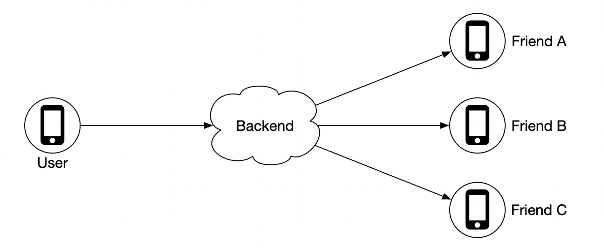
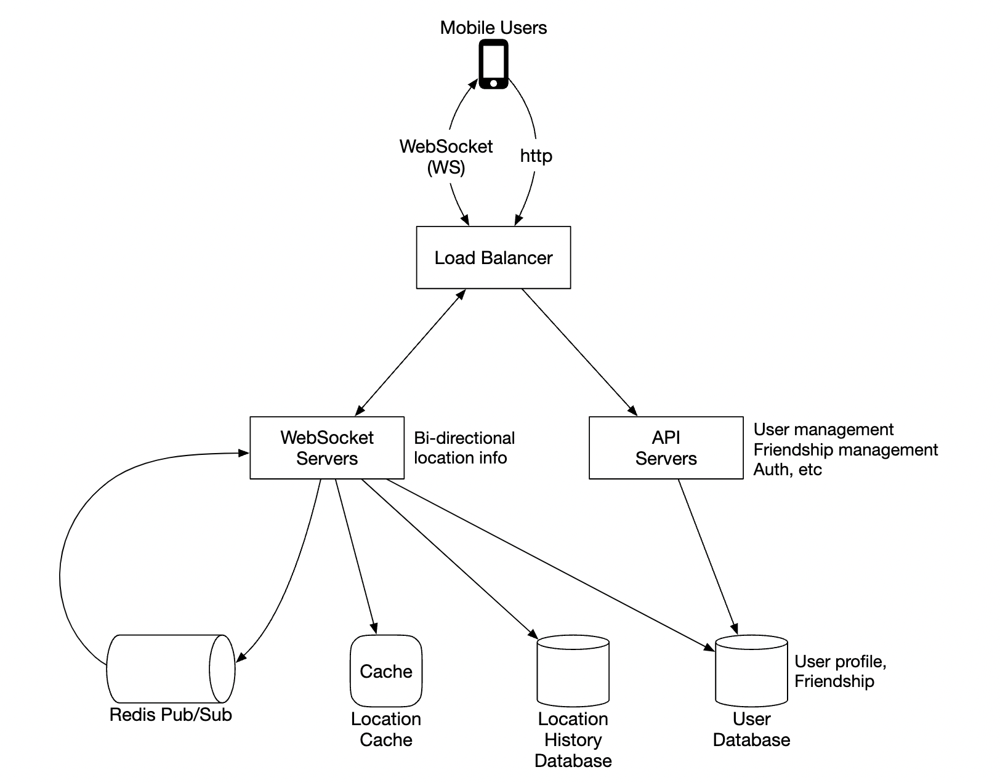
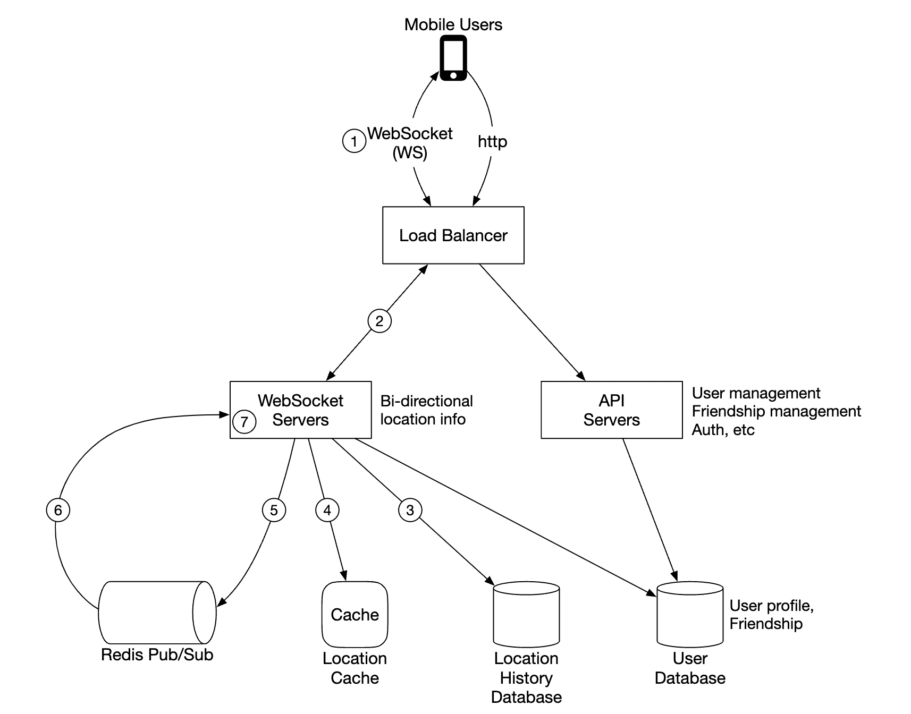
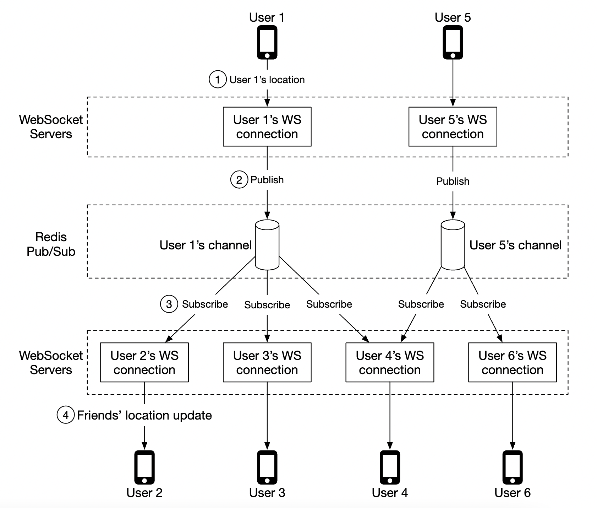
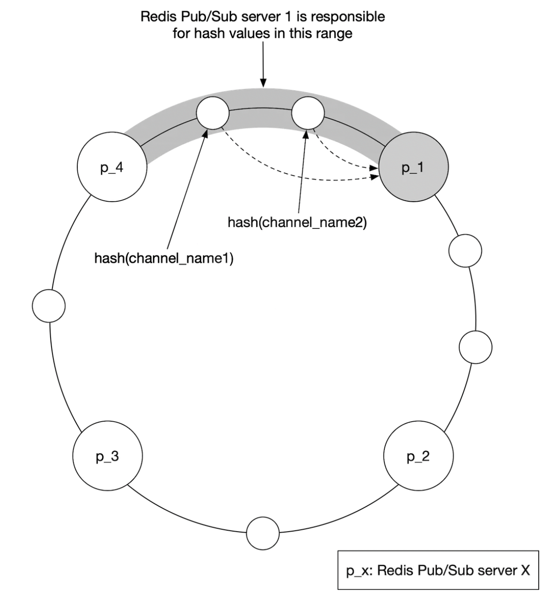
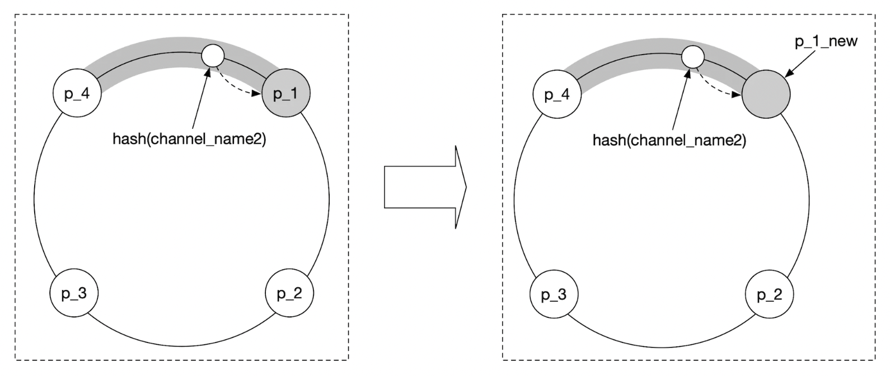
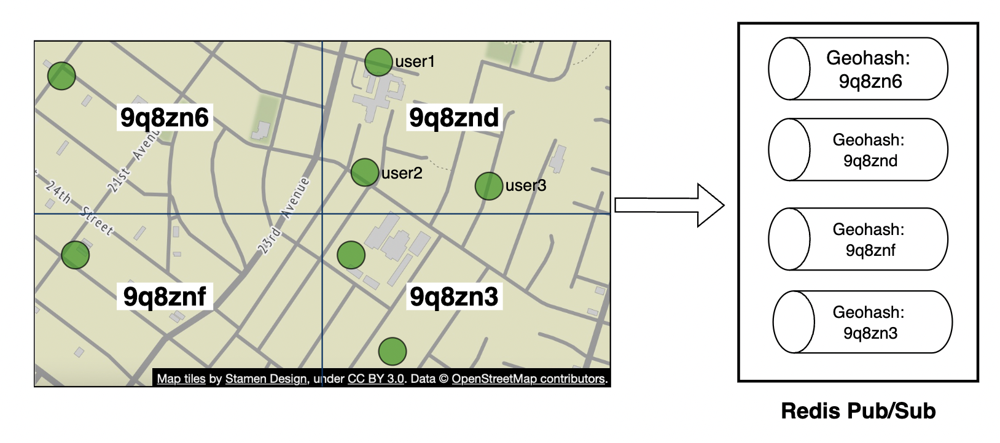
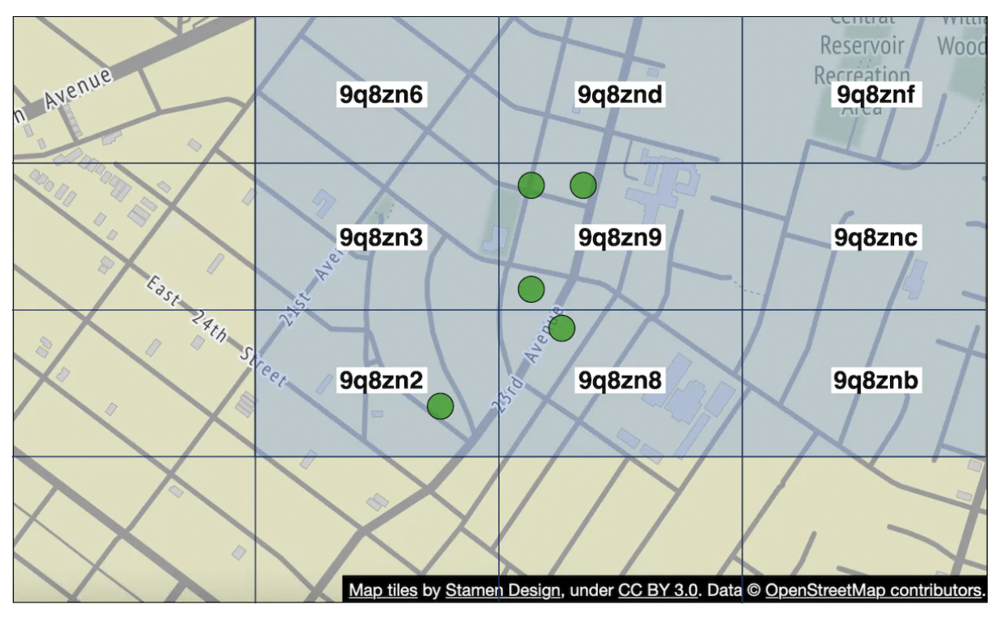

# 第17章: 近くの友達（Nearby Friends）

## はじめに

本章では、ユーザーが自分の位置情報を共有し、**近くにいる**友達を見つけられるアプリケーションのための、スケーラブルなバックエンドの設計に焦点を当てます。

近接サービスの章との大きな違いは、この問題では**位置が常に変化する**のに対し、近接サービスでは店舗の住所がほぼ変わらないという点です。

---

## ステップ1: 問題を理解し、設計の範囲を定める

面接を進めるための質問の例（C: 候補者、I: 面接官）:
 * C: 地理的にどのくらい近ければ「近く」とみなしますか？
 * I: 5マイルです。この数値は設定可能にしてください。
 * C: 距離は直線距離で計算しますか？ それとも、例えば友達の間にある川なども考慮しますか？
 * I: 直線距離で計算するという前提で妥当です。
 * C: アプリのユーザー数はどれくらいですか？
 * I: 10億ユーザーで、そのうち10%が「近くの友達」機能を使います。
 * C: 位置情報の履歴を保存する必要はありますか？
 * I: はい。例えば機械学習などに役立つ可能性があります。
 * C: 非アクティブな友達は10分で機能から表示されなくなると考えてよいですか？
 * I: はい。
 * C: GDPRなどを気にする必要はありますか？
 * I: いいえ、簡単のため考えなくてよいです。

### **機能要件**

 * ユーザーはモバイルアプリで近くの友達を確認できること。各友達には距離と、位置が更新された時刻を示すタイムスタンプが表示される。
 * 近くの友達リストは数秒ごとに更新されること。

### **非機能要件**

- **低レイテンシ**: 位置の更新を大きな遅延なく受け取れることが重要である。
- **信頼性**: データポイントがときどき失われることは許容されるが、システムは全般的に利用可能であるべきである。
- **結果整合性**: 位置データストアには強い一貫性は必要ない。異なるレプリカで位置データを受け取るのに数秒の遅延があっても許容される。

### **概算見積もり**

想定される規模を見積もります。
 * 近くの友達とは、半径5マイル以内にいる友達である。
 * 位置の更新間隔は30秒。人が歩く速度は遅いため、位置をそれほど頻繁に更新する必要はない。
 * 平均して1億人のユーザーが毎日この機能を使い、同時接続ユーザーはその10%、つまり1,000万人。
 * ユーザーは平均400人の友達を持ち、その全員が「近くの友達」機能を使う。
 * アプリは1ページあたり20人の近くの友達を表示する。
 * **位置更新のQPS** = 1,000万 / 30 = 毎秒約33.4万件の更新

---

## ステップ2: 高レベル設計を提案し、合意を得る

APIとデータモデルの設計を検討する前に、使用する通信プロトコルを検討します。これは従来のリクエスト-レスポンス型の通信モデルほど一般的ではないためです。

### **高レベル設計**

高レベルでは、ピア間で効果的にメッセージを受け渡せるようにしたいところです。これはピアツーピアのプロトコルで実現できますが、接続が不安定で電力消費の制約が厳しいモバイルアプリでは現実的ではありません。

より現実的なアプローチは、共有のバックエンドを、届けたい友達へのファンアウトの仕組みとして使うことです。

    

バックエンドは何をするのでしょうか？
 * すべてのアクティブユーザーから位置の更新を受け取る。
 * 位置の更新ごとに、それを受け取るべきアクティブユーザーをすべて見つけて転送する。
 * 友達間の距離が設定されたしきい値を超えている場合は、位置データを転送しない。

単純に聞こえますが、課題は私たちが扱う規模に耐えられるようにシステムを設計することです。

まずはシンプルな設計から始め、より高度なアプローチは深掘りの中で議論します。

    

- **ロードバランサー**: RESTful APIサーバーと双方向のWebSocketサーバーにトラフィックを分散する。
- **RESTful APIサーバー**: 友達の管理やプロフィールの更新などの補助的なタスクを処理する。
- **WebSocketサーバー**: 位置更新のリクエストをそれぞれのクライアントに転送するステートフルなサーバー。初期化時に、モバイルクライアントへ近くの友達の位置を初期データとして送る処理も管理する（詳細は後述）。
- **Redis位置キャッシュ**: 各アクティブユーザーの最新の位置データを保存するために使う。キャッシュの各エントリにはTTLが設定される。TTLが切れると、そのユーザーはもはやアクティブではなくなり、データはキャッシュから削除される。
- **ユーザーデータベース**: ユーザーと友達関係のデータを保存する。この目的にはリレーショナルデータベースとNoSQLデータベースのどちらも使える。
- **位置履歴データベース**: ユーザーの位置データの履歴を保存する。「近くの友達」機能で直接使うとは限らず、分析目的で履歴データを追跡するために使う。
- **Redis Pub/Sub**: 軽量なメッセージバスとして使い、位置更新のためにユーザーごとのチャネルとして個別のトピックを持てるようにする。

    

上の例では、WebSocketサーバーは自分に接続しているユーザーのためにチャネルを購読し、位置の更新を受け取るたびに適切なユーザーに転送します。

### **定期的な位置の更新**

定期的な位置更新のフローは次のように動作します。

    

 * モバイルクライアントが位置の更新をロードバランサーに送信する。
 * ロードバランサーが、そのクライアントの持続的接続を持つWebSocketサーバーに位置の更新を転送する。
 * WebSocketサーバーが位置データを位置履歴データベースに保存する。
 * 位置キャッシュ内の位置データが更新される。WebSocketサーバーは、そのユーザーについての以降の距離計算のために、位置データをメモリ内にも保存する。
 * WebSocketサーバーがRedis Pub/Subを介して、ユーザーのチャネルに位置データを発行する。
 * Redis Pub/Subが、そのユーザーのチャネルのすべての購読者（つまりそのユーザーの友達を担当するサーバー）に位置の更新をブロードキャストする。
 * 購読しているWebSocketサーバーが位置の更新を受け取り、更新を送るべきユーザーを計算して送信する。

同じフローのより詳細な版を示します。

    

ユーザーは平均400人の友達を持ち、そのうち10%が同時にオンラインであるため、平均して40件の位置の更新を転送することになります。

### **API設計**

サポートする必要のあるWebSocketのルーチン:
 * 定期的な位置の更新 - ユーザーが位置データをWebSocketサーバーに送信する。
 * クライアントが位置の更新を受け取る - サーバーが友達の位置データとタイムスタンプを送信する。
 * WebSocketクライアントの初期化 - クライアントがユーザーの位置を送信し、サーバーが近くの友達の位置データを返す。
 * 新しい友達の購読 - 例えば友達が初めてオンラインになったときなどに、モバイルクライアントが追跡すべき友達のIDをWebSocketサーバーが送信する。
 * 友達の購読解除 - 例えば友達がオフラインになったなどの理由で、モバイルクライアントが購読を解除すべき友達のIDをWebSocketサーバーが送信する。

HTTP API - 補助的な責務のための、従来型のリクエスト/レスポンスのペイロード。

### **データモデル**

 * 位置キャッシュは、`user_id` と `lat,long,timestamp` のマッピングを保存する。現在の位置だけが重要であり、このユースケースに必要なTTLによる追い出しをサポートしているため、このキャッシュにはRedisが最適である。
 * 位置履歴テーブルは同じデータを、上記の4つの列を持つリレーショナルテーブルとして保存する。このデータには、書き込み中心の負荷に最適化されたCassandraを使える。

---

## ステップ3: 設計の深掘り

対象とする規模で機能するように、高レベル設計をどのようにスケールさせるかを議論しましょう。

### **各コンポーネントはどの程度スケールするか？**

- **APIサーバー**: オートスケーリンググループとサーバーインスタンスの複製によって容易にスケールできる。
- **WebSocketサーバー**: WSサーバーは容易にスケールアウトできるが、サーバーを停止する際には既存の接続を正常にシャットダウンする必要がある。例えば、最終的にサーバープールから外す前に、ロードバランサーでサーバーを「ドレイン中」とマークし、そのサーバーへの新しい接続の送信を止めることができる。
- **クライアントの初期化**: クライアントが最初にサーバーに接続すると、サーバーはユーザーの友達を取得し、Redis Pub/Subで友達のチャネルを購読し、キャッシュから友達の位置を取得して、最後にクライアントに転送する。
- **ユーザーデータベース**: user_idに基づいてデータベースをシャーディングできる。ユーザー/友達のデータを、専任チームが管理する専用のサービスとAPIで公開するのも理にかなっているかもしれない。
- **位置キャッシュ**: 複数のRedisノードを立ち上げることで、キャッシュを容易にシャーディングできる。また、TTLにより一度に占有され得る最大メモリ量に上限がかかる。それでも大量の書き込み負荷には対処したい。
- **Redis Pub/Subサーバー**: 初期化されていても使われていないチャネルはメモリを消費しないという事実を活用する。そのため、「近くの友達」機能を使うすべてのユーザーのためにチャネルを事前に割り当てておき、例えばユーザーがオンラインになったときに新しいチャネルを立ち上げてアクティブなWebSocketサーバーに通知する、といった処理をしなくて済むようにできる。

### **Redis Pub/Subコンポーネントのスケーリングの深掘り**

すべてのPub/Subチャネルを維持するには、約200GBのメモリが必要です。これは100GBのRedisサーバーを2台使うことで実現できます。

しかし、毎秒約1,400万件の位置の更新をプッシュする必要があることを考えると、1台のサーバーが毎秒約10万件のプッシュを処理できると仮定して、その負荷を処理するには少なくとも140台のRedisサーバーが必要になります。

したがって、高いCPU負荷を処理するために分散Redisサーバークラスターが必要になります。

分散Redisクラスターをサポートするには、どのサーバーが稼働しているかを追跡するために、ZooKeeperやetcdなどのサービスディスカバリコンポーネントを利用する必要があります。

サービスディスカバリコンポーネントに記録する必要があるのは、次のデータです。

    

WebSocketサーバーは、ZooKeeperから取得したこのデータを使って、特定のチャネルがどこにあるかを判断します。効率化のため、ハッシュリングのデータは各WebSocketサーバーのメモリ内にキャッシュできます。

サーバークラスターのスケールアップ/ダウンについては、過去のトラフィックデータに基づいて必要に応じてクラスターをスケールさせる日次ジョブを設定できます。負荷の急増に対応するため、クラスターを過剰にプロビジョニングしておくこともできます。

チャネルについての状態が保持され、クラスター内に新しくプロビジョニングされたノードに引き継げるよう購読者との調整が必要なため、Redisクラスターはステートフルなストレージサーバーとして扱えます。

スケーリング操作の際には、いくつかの潜在的な問題に注意する必要があります。
 * チャネルが移動するため、WebSocketサーバーから大量の再購読リクエストが発生する。
 * 操作中にクライアントからの位置の更新が一部失われる可能性がある。この問題では許容されるが、それでも発生を最小限に抑えるべきである。1日のうちでトラフィックが最も少ない時間帯に操作を行うことを検討する。
 * サーバーの追加/削除の際に移動するチャネルの数を最小限に抑えるため、コンシステントハッシュを活用できる。

    

### **友達の追加/削除**

友達が追加/削除されるたびに、影響を受けるユーザーを担当するWebSocketサーバーは、その友達のチャネルを購読/購読解除する必要があります。

「近くの友達」機能はより大きなアプリの一部であるため、いずれかのイベントが発生したときにモバイルクライアント側でコールバックを登録でき、クライアントがWebSocketサーバーにメッセージを送って適切なアクションを行わせると想定できます。

### **友達の多いユーザー**

持てる友達の総数に上限を設けることができます。例えば、Facebookには最大5,000人という上限があります。

「クジラ（大量の友達を持つ）」ユーザーを担当するWebSocketサーバーは負荷が高くなるかもしれませんが、十分な数のWebSocketサーバーがあれば問題ないはずです。

### **近くのランダムな人**

面接官が、「近くの友達」マップにときどきランダムな人が表示される機能を含めるよう設計を更新したいと言ったらどうするでしょうか？

これに対処する1つの方法は、Geohashに基づいてPub/Subチャネルのプールを定義することです。

    

Geohash内にいる人は誰でも、適切なチャネルを購読して、ランダムなユーザーの位置の更新を受け取ります。

    

近くにいるものの隣接するGeohashにいる人のケースに対処するため、複数のGeohashを購読することもできます。

    

### **Redis Pub/Subの代替**

Pub/SubにRedisを使う代わりに、分散コンピューティングアプリケーション向けに最適化された汎用プログラミング言語であるErlangを活用する方法があります。

Erlangを使えば、互いに通信する数百万の小さなErlangプロセスを生成できます。分散Erlangアプリケーション内で、WebSocket接続とPub/Subチャネルの両方を扱えます。

ただし、Erlangを使う上での課題は、ニッチなプログラミング言語であり、優秀なErlang開発者を確保するのが難しい可能性があることです。

---

## ステップ4: まとめ

「近くの友達」機能をサポートするシステムの設計に成功しました。

中核となるコンポーネント:
- **WebSocketサーバー**: クライアントとサーバー間のリアルタイム通信
- **Redis**: 位置データの高速な読み書き + Pub/Subチャネル

また、RESTful APIサーバー、WebSocketサーバー、データ層、Redis Pub/Subサーバーをどのようにスケールさせるかを検討し、Redis Pub/Subの代替案も検討しました。さらに「近くのランダムな人」機能についても検討しました。
