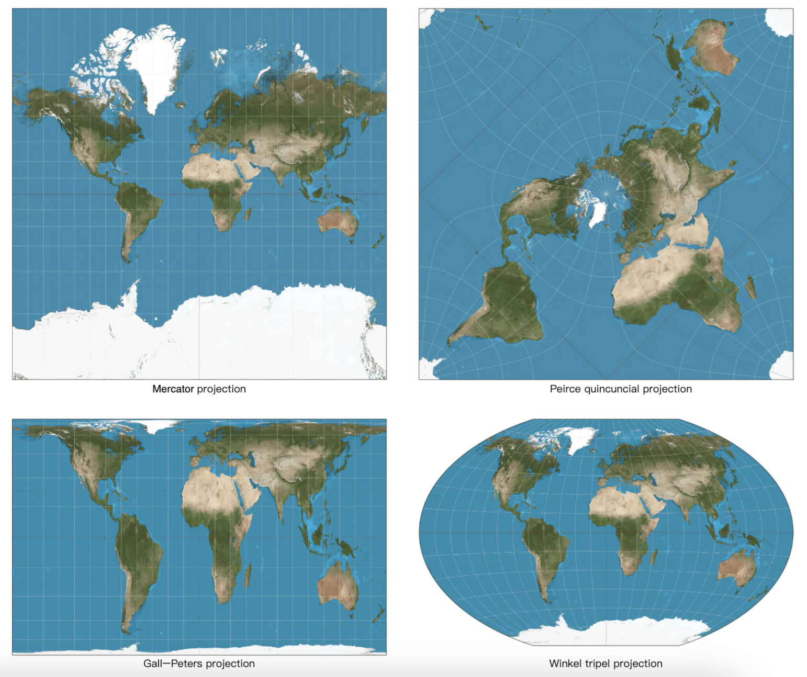
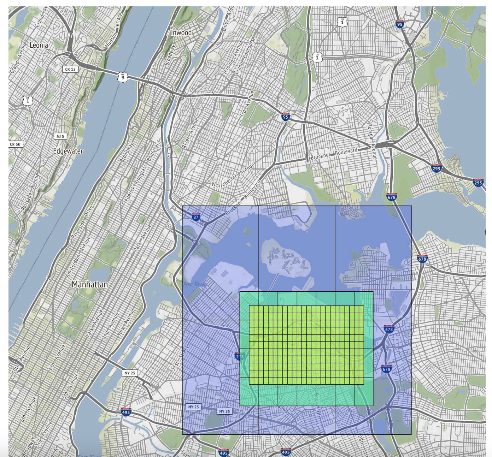
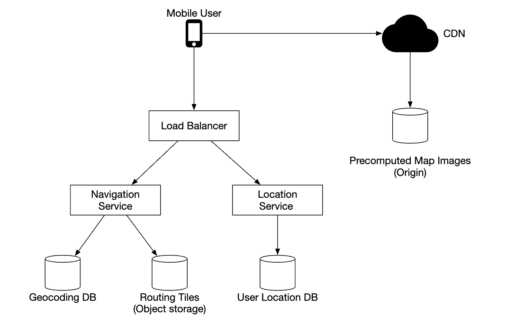
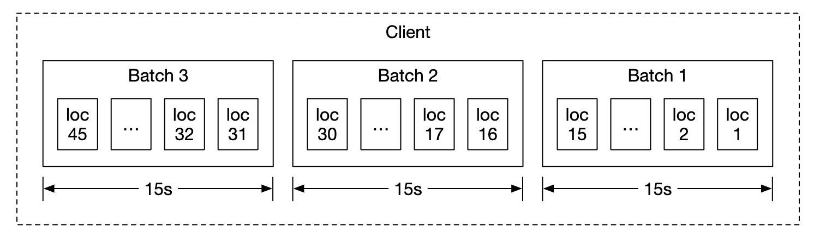
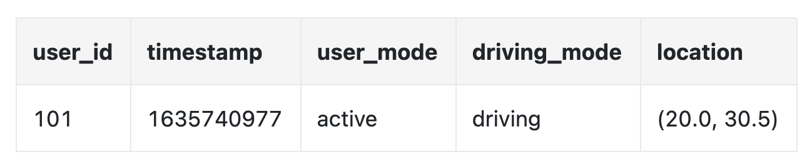
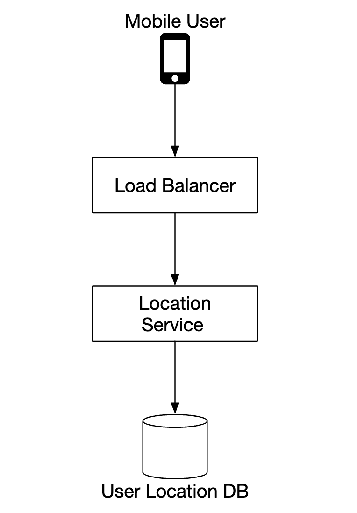
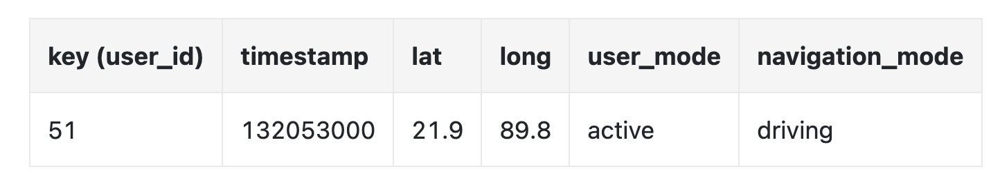
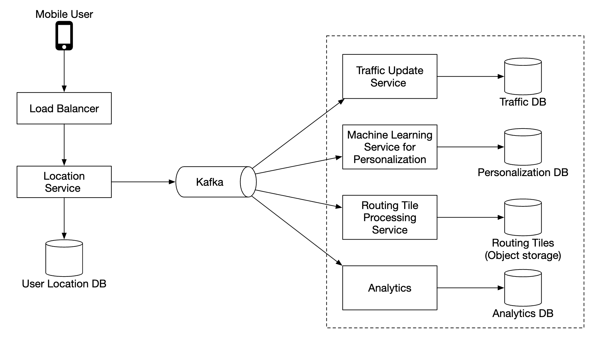
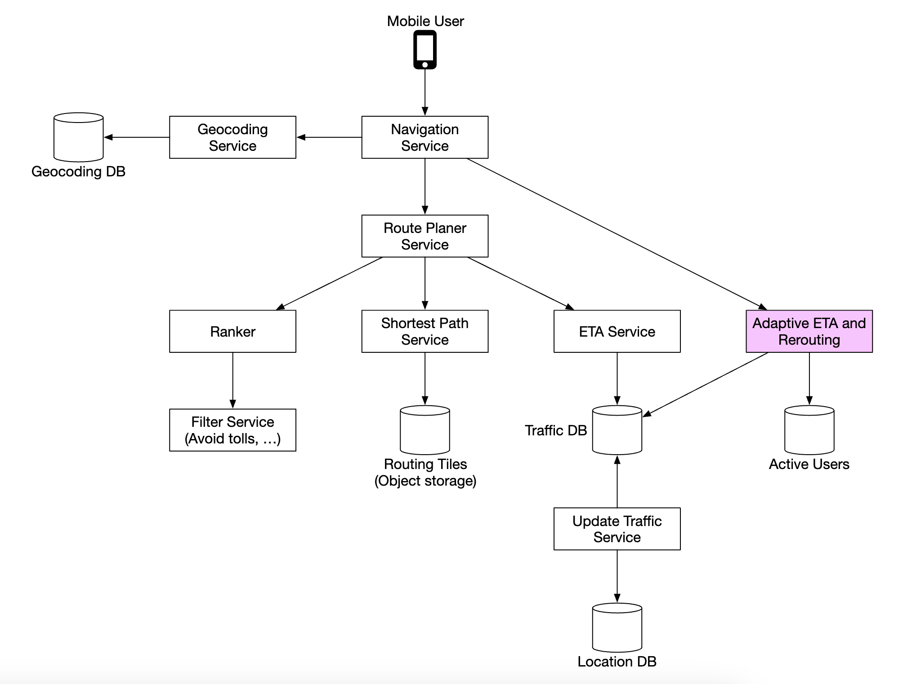

# 第18章: Google Maps

## はじめに

**Google Maps**のシンプルな版を設計します。

Google Mapsに関するいくつかの事実:
 * 2005年に開始
 * 衛星画像、道路地図、リアルタイムの交通状況、ルート計画などのさまざまなサービスを提供
 * 2021年時点で、デイリーアクティブユーザーは10億人、世界の99%をカバーし、リアルタイムの位置情報が毎日2,500万件更新されている

---

## ステップ1: 問題を理解し、設計の範囲を定める

候補者（C）と面接官（I）のQ&Aの例:
 * C: デイリーアクティブユーザーはどのくらいですか？
 * I: 10億DAUです。
 * C: どの機能に焦点を当てるべきですか？
 * I: 位置の更新、ナビゲーション、到着予定時刻（ETA）、地図のレンダリングです。
 * C: 道路データの規模はどのくらいですか？ データにはアクセスできますか？
 * I: さまざまな情報源から道路データを入手しており、生データでTB単位です。
 * C: 交通状況を考慮すべきですか？
 * I: はい、正確な時間の見積もりのために考慮すべきです。
 * C: 徒歩、自転車、自動車など、異なる移動手段についてはどうですか？
 * I: それらはサポートすべきです。
 * C: 複数の経由地を含むルート案内はどうですか？
 * I: 面接の範囲としては、それには焦点を当てないことにしましょう。
 * C: 店舗の場所や写真はどうですか？
 * I: 良い質問ですが、それらは考慮しなくてよいです。

ユーザーの位置の更新、ETAを含むナビゲーションサービス、地図のレンダリングという3つの主要機能に焦点を当てます。

### **非機能要件**

- **正確性**: ユーザーに間違ったルートを案内してはならない。
- **スムーズなナビゲーション**: ユーザーはスムーズな地図のレンダリングを体験できるべきである。
- **データとバッテリーの使用量**: クライアントはデータとバッテリーの使用を可能な限り抑えるべきである。モバイルデバイスにとって重要。
- 一般的な可用性とスケーラビリティの要件

### **地図の基礎知識**

設計に入る前に、理解しておくべき地図関連の概念がいくつかあります。

#### 測位システム

地球は自転する球体です。位置は緯度（どれだけ北/南にいるか）と経度（どれだけ東/西にいるか）によって定義されます。

<div style="margin-left:3rem">
    
</div>

#### 3Dから2Dへ

3Dの点を2D平面に変換する処理を「地図投影法」と呼びます。

さまざまな方法があり、それぞれに長所と短所があります。ほぼすべての方法で実際の形状がゆがみます。

<div style="margin-left:3rem">
    
</div>

Google Mapsは、メルカトル図法を修正した「Webメルカトル」を採用しています。

#### ジオコーディング

ジオコーディングとは、住所を地理座標に変換する処理です。

その逆の処理は「逆ジオコーディング」と呼ばれます。

これを実現する1つの方法は補間を使うことです。道路網が地理座標空間にマッピングされている、さまざまな情報源（例: GIS）のデータを活用します。

#### ジオハッシング

ジオハッシングは、地理的な領域を英数字の文字列にエンコードする方式です。

世界を平面として描き、再帰的に4つの象限に分割します。

<div style="margin-left:3rem">
    
</div>

#### 地図のレンダリング

地図のレンダリングはタイル化によって行われます。地図全体を1枚の大きなカスタム画像としてレンダリングする代わりに、世界をより小さなタイルに分割します。

クライアントは関連するタイルのみをダウンロードし、モザイクをつなぎ合わせるようにレンダリングします。

ズームレベルごとに異なるタイルがあります。クライアントは自身のズームレベルに基づいて適切なタイルを選びます。

例えば、世界全体までズームアウトした場合は、世界全体を表す256x256のタイル1枚だけをダウンロードします。

#### ナビゲーションアルゴリズムのための道路データ処理

ほとんどのルーティングアルゴリズムでは、交差点はノードとして、道路はエッジとして表現されます。

<div style="margin-left:3rem">
    
</div>

ほとんどのナビゲーションアルゴリズムは、ダイクストラ法やA*アルゴリズムを修正したものを使います。

経路探索の性能はグラフのサイズに敏感です。大規模に動作させるには、世界全体を1つのグラフとして表現し、それに対してアルゴリズムを実行することはできません。

代わりに、タイル化と同様の手法を使い、世界をより小さなグラフへと細分化します。

ルーティングタイルは隣接するタイルへの参照を保持しており、アルゴリズムは相互につながったタイルをたどりながら、より大きな道路グラフをつなぎ合わせることができます。

<div style="margin-left:3rem">
    
</div>

この手法により、メモリ帯域幅を大幅に削減でき、特定の出発地/目的地のペアに必要なタイルのみを読み込めます。

しかし、より長いルートの場合、小さく詳細なルーティングタイルをつなぎ合わせるのは依然として時間とメモリを消費します。そこで、詳細度の異なるルーティングタイルを用意し、アルゴリズムは向かう目的地に応じて適切な詳細度のタイルを使います。

<div style="margin-left:3rem">
    
</div>

### **概算見積もり**

ストレージとして、次のものを保存する必要があります。
 * 世界地図 - 保存する必要のあるすべてのタイルに基づき約70PBと見積もられるが、非常に似たタイル（例: 広大な砂漠）の圧縮を考慮に入れている。
 * メタデータ - サイズは無視できるほど小さいため、計算から除外できる。
 * 道路情報 - ルーティングタイルとして保存される。

ナビゲーションリクエストのQPSの見積もり - 10億DAUで週35分の利用 → 1日あたり50億分。
GPS更新リクエストがバッチ化されると仮定すると、20万QPS、ピーク時には100万QPSとなります。

---

## ステップ2: 高レベル設計を提案し、合意を得る

<div style="margin-left:3rem">
    
</div>

### **位置情報サービス**

<div style="margin-left:3rem">
    
</div>

ユーザーの位置の更新を記録する役割を担います。
 * 位置の更新は `t` 秒ごとに送信される。
 * 位置データのストリームは、時間をかけてサービスを改善するために使える。例えば、より正確なETAの提供、交通データの監視、通行止めの道路の検出、ユーザー行動の分析など。

位置の更新を常にサーバーに送信する代わりに、クライアント側で更新をバッチ化し、バッチを送信することができます。

<div style="margin-left:3rem">
    
</div>

この最適化を行っても、Google Mapsの規模のシステムでは負荷は依然として大きいです。そのため、Cassandraのような大量の書き込みに最適化されたデータベースを活用できます。

さらなる分析のための位置の更新を効率的にストリーム処理するために、Kafkaを活用することもできます。

位置更新リクエストのペイロードの例:

```
POST /v1/locations
Parameters
  locs: JSON encoded array of (latitude, longitude, timestamp) tuples.
```

### **ナビゲーションサービス**

このコンポーネントは、AとBの間の速いルートを妥当な時間内に見つける役割を担います（多少のレイテンシは許容されます）。ルートが最速である必要はありませんが、正確性は重要です。

リクエストのペイロードの例:

```
GET /v1/nav?origin=1355+market+street,SF&destination=Disneyland
```

レスポンスの例:

```json
{
  "distance": {"text":"0.2 mi", "value": 259},
  "duration": {"text": "1 min", "value": 83},
  "end_location": {"lat": 37.4038943, "Ing": -121.9410454},
  "html_instructions": "Head <b>northeast</b> on <b>Brandon St</b> toward <b>Lumin Way</b><div style=\"font-size:0.9em\">Restricted usage road</div>",
  "polyline": {"points": "_fhcFjbhgVuAwDsCal"},
  "start_location": {"lat": 37.4027165, "lng": -121.9435809},
  "geocoded_waypoints": [
    {
       "geocoder_status" : "OK",
       "partial_match" : true,
       "place_id" : "ChIJwZNMti1fawwRO2aVVVX2yKg",
       "types" : [ "locality", "political" ]
    },
    {
       "geocoder_status" : "OK",
       "partial_match" : true,
       "place_id" : "ChIJ3aPgQGtXawwRLYeiBMUi7bM",
       "types" : [ "locality", "political" ]
    }
  ],
  "travel_mode": "DRIVING"
}
```

交通状況の変化やルートの再検索はまだ考慮していません。それらは深掘りのセクションで取り上げます。

### **地図のレンダリング**

地図タイルのデータセット全体はペタバイト規模であるため、クライアント側に保持するのは現実的ではありません。

タイルは、クライアントの位置とズームレベルに基づいて、サーバーからオンデマンドで取得する必要があります。

新しいタイルを取得すべきタイミングは、ユーザーがズームイン/アウトしているとき、そしてナビゲーション中に新しいタイルに向かって移動しているときです。

地図タイルはどのようにクライアントに提供すべきでしょうか？
 * 動的に生成することもできるが、サーバーに大きな負荷がかかり、キャッシュも難しくなる。
 * 地図タイルは、クライアントが計算できるGeohashに基づいて静的に提供する。静的に保存し、CDNから配信できる。

<div style="margin-left:3rem">
    
</div>

CDNを使うと、ユーザーはレイテンシを最小限に抑えるために、最も近いPOP（Point of Presence）サーバーから地図タイルを取得できます。

<div style="margin-left:3rem">
    
</div>

地図タイルを決定する際に検討すべき選択肢:
 * 地図タイルのGeohashはクライアント側で計算できる。その場合、クライアントに更新を強制するのは難しいため、この種の地図タイル計算方法を長期にわたって使い続けることを前提にするよう注意すべきである。
 * あるいは、追加のAPI呼び出しのコストと引き換えに、クライアントに代わって地図タイルのURLを計算するシンプルなAPIを用意することもできる。

<div style="margin-left:3rem">
    
</div>

---

## ステップ3: 設計の深掘り

### **データモデル**

扱うさまざまな種類のデータをどのように保存するかを議論しましょう。

#### ルーティングタイル

初期の道路データセットはさまざまな情報源から入手します。位置更新のデータに基づいて、時間とともに改善されます。

道路データは非構造化データです。定期的なオフライン処理パイプラインを用意し、この生データをアプリが必要とするグラフベースのルーティングタイルに変換します。

データベースの機能は何も必要ないため、これらのタイルはデータベースには保存しません。S3のオブジェクトストレージに保存し、積極的にキャッシュします。

隣接リストをバイナリファイルに効率的に圧縮するライブラリを活用することもできます。

#### ユーザーの位置データ

ユーザーの位置データは、交通状況の更新や、その他あらゆる種類の分析に非常に役立ちます。

この種のデータは書き込み中心という性質を持つため、保存にはCassandraを使えます。

行の例:

<div style="margin-left:3rem">
    
</div>

#### ジオコーディングデータベース

このデータベースは、緯度/経度のペアと場所のキーバリューペアを保存します。

読み取りが頻繁で書き込みがまれであるため、読み取りアクセスが高速なRedisを使えます。

#### 事前計算された世界地図の画像

前述のとおり、地図タイルの画像を事前に計算してCDNに保存します。

<div style="margin-left:3rem">
    
</div>

### **サービス**

#### 位置情報サービス

このサービスについて、データベースの設計とユーザーの位置がどのように保存されるかに詳しく焦点を当てましょう。

<div style="margin-left:3rem">
    
</div>

位置の更新による大量の書き込み負荷に対応するため、NoSQLデータベースを使えます。ユーザーの位置データは頻繁に変化し、新しい更新が届くと古くなるため、一貫性よりも可用性を優先します。

すべての要件にうまく合致するため、データベースにはCassandraを選択します。

保存する行の例:

<div style="margin-left:3rem">
    
</div>

 * `user_id` は、特定のユーザーのすべての位置の更新に素早くアクセスするためのパーティションキーである。
 * `timestamp` は、位置の更新を受信した時刻順にデータを並べて保存するためのクラスタリングキーである。

また、さまざまな目的で位置の更新を必要とする他のさまざまなサービスに位置の更新をストリーミングするため、Kafkaを活用します。

<div style="margin-left:3rem">
    
</div>

#### 地図のレンダリング

地図タイルはさまざまなズームレベルで保存されます。最も低いズームレベルでは、世界全体が256x256のタイル1枚で表されます。

ズームレベルが上がるごとに、地図タイルの数は4倍になります。

<div style="margin-left:3rem">
    
</div>

使える最適化の1つは、画像情報全体をネットワーク経由で送信するのではなく、タイルをベクター（パスとポリゴン）として表現し、クライアントにタイルを動的にレンダリングさせることです。

これにより帯域幅を大幅に節約できます。

#### ナビゲーションサービス

このサービスは最速のルートを見つける役割を担います。

<div style="margin-left:3rem">
    
</div>

このサブシステムの各コンポーネントを見ていきましょう。

まず、住所を緯度/経度のペアの位置に解決するジオコーディングサービスがあります。

リクエストの例:

```
https://maps.googleapis.com/maps/api/geocode/json?address=1600+Amphitheatre+Parkway,+Mountain+View,+CA
```

レスポンスの例:

```json
{
   "results" : [
      {
         "formatted_address" : "1600 Amphitheatre Parkway, Mountain View, CA 94043, USA",
         "geometry" : {
            "location" : {
               "lat" : 37.4224764,
               "lng" : -122.0842499
            },
            "location_type" : "ROOFTOP",
            "viewport" : {
               "northeast" : {
                  "lat" : 37.4238253802915,
                  "lng" : -122.0829009197085
               },
               "southwest" : {
                  "lat" : 37.4211274197085,
                  "lng" : -122.0855988802915
               }
            }
         },
         "place_id" : "ChIJ2eUgeAK6j4ARbn5u_wAGqWA",
         "plus_code": {
            "compound_code": "CWC8+W5 Mountain View, California, United States",
            "global_code": "849VCWC8+W5"
         },
         "types" : [ "street_address" ]
      }
   ],
   "status" : "OK"
}
```

ルートプランナーサービスは、現在の交通状況に応じて移動時間が最適になるよう、推奨ルートを計算します。

最短経路サービスは、オブジェクトストレージ内のルーティングタイルに対してA*アルゴリズムの変種を実行し、最適な経路を計算します。
 * 出発地/目的地のペアを受け取り、それらを緯度/経度のペアに変換し、そのペアからGeohashを導出してルーティングタイルを求める。
 * アルゴリズムは最初のルーティングタイルから開始し、目的地のタイルまでの十分に良い経路が見つかるまで走査を続ける。

<div style="margin-left:3rem">
    
</div>

ETAサービスは、ルートプランナーから呼び出され、交通データに基づいてETAを予測する機械学習アルゴリズムを用いて推定時間を返します。

ランカーサービスは、ユーザーから渡されたフィルター（例: 有料道路や高速道路を避けるフラグ）に基づいて、考えられるさまざまな経路をランク付けする役割を担います。

アップデーターサービスは、重要なデータベースのいくつかを非同期に更新し、最新の状態に保ちます。

#### 改善 - 適応的なETAとルートの再検索

可能な改善の1つは、新たに得られた交通データに基づいて、進行中のルートを適応的に更新することです。

これを実装する1つの方法は、現在ルート案内中のユーザーについて、通過する予定のすべてのタイルをデータベースに保存しておくことです。

データは次のようになります。

```
user_1: r_1, r_2, r_3, …, r_k
user_2: r_4, r_6, r_9, …, r_n
user_3: r_2, r_8, r_9, …, r_m
...
user_n: r_2, r_10, r21, ..., r_l
```

あるタイルで交通事故が発生した場合、そのタイルを経路が通過するすべてのユーザーを特定し、ルートを再検索できます。

データベースに保存するタイルの量を減らすため、代わりに出発地のルーティングタイルと、目的地のタイルも含まれるようになるまでの異なる解像度レベルの複数のルーティングタイルを保存することができます。

```
user_1, r_1, super(r_1), super(super(r_1)), ...
```

<div style="margin-left:3rem">
    
</div>

これを使えば、ユーザーが影響を受けるかどうかを確認するには、そのユーザーの最後のタイルに交通事故のタイルが含まれているかどうかを確認するだけで済みます。

また、ルート案内中のユーザーについて考えられるすべてのルートを追跡し、より速い代替ルートが利用可能になったら通知することもできます。

#### 配信プロトコル

サーバーからクライアントへ能動的にデータをプッシュするための選択肢がいくつかあります。
 * モバイルのプッシュ通知は、ペイロードが制限されており、Webアプリでは利用できないため使えない。
 * WebSocketは、サーバー上の計算リソースの消費が少ないため、一般的にロングポーリングより良い選択肢である。
 * Server-Sent Events（SSE）も使えるが、例えばラストワンマイル配送機能などで役立つ双方向通信をサポートしているため、WebSocketを選ぶ方に傾く。

---

## ステップ4: まとめ

これが最終的な設計です。

<div style="margin-left:3rem">
    
</div>

提供できる追加機能の1つは複数経由地のナビゲーションです。複数の場所を訪問するための最適な経路を求めるために、UberやLyftのような企業顧客に販売できます。
