# 第19章: 分散メッセージキュー

## はじめに

本章では、**分散メッセージキュー**を設計します。

メッセージキューの利点:
- **疎結合化**: コンポーネント間の密結合を解消し、それぞれを個別に更新できるようにする。
- **スケーラビリティの向上**: プロデューサーとコンシューマーをトラフィックに応じて独立にスケールさせられる。
- **可用性の向上**: システムの一部がダウンしても、他の部分はキューとのやり取りを続けられる。
- **性能の向上**: プロデューサーはコンシューマーの確認を待たずにメッセージを生成できる。

代表的なメッセージキューの実装 - Kafka、RabbitMQ、RocketMQ、Apache Pulsar、ActiveMQ、ZeroMQ。

厳密に言えば、KafkaとPulsarはメッセージキューではなく、イベントストリーミングプラットフォームです。
しかし、機能の収束が進んでおり、メッセージキューとイベントストリーミングプラットフォームの区別は曖昧になっています。

本章では、長期のデータ保持やメッセージの繰り返し消費など、より高度な機能をサポートするメッセージキューを構築します。

---

## ステップ1: 問題を理解し、設計の範囲を定める

メッセージキューは、プロデューサーがメッセージを生成し、コンシューマーがそれを消費するという基本的な機能をサポートすべきです。
ただし、性能、メッセージ配信、データ保持などに関してさまざまな検討事項があります。

候補者（C）と面接官（I）の間で想定される質問の例:
 * C: メッセージの形式と平均サイズは？ テキストのみですか？
 * I: メッセージはテキストのみで、通常は数KBです。
 * C: メッセージは繰り返し消費できますか？
 * I: はい、メッセージは異なるコンシューマーによって繰り返し消費できます。これは追加の要件で、従来のメッセージキューではサポートされていません。
 * C: メッセージは生成された順序で消費されますか？
 * I: はい、順序の保証は維持されるべきです。これは追加の要件で、従来のメッセージキューではサポートされていません。
 * C: データ保持の要件は何ですか？
 * I: メッセージは2週間保持する必要があります。これは追加の要件です。
 * C: プロデューサーとコンシューマーはいくつサポートしたいですか？
 * I: 多ければ多いほど良いです。
 * C: どのデータ配信セマンティクスをサポートしたいですか？ at-most-once、at-least-once、exactly-onceのどれですか？
 * I: at-least-onceは必ずサポートしたいです。理想的にはすべてをサポートし、設定可能にしたいです。
 * C: エンドツーエンドのレイテンシに対する目標スループットは？
 * I: ログ集約のようなユースケースには高スループットを、より従来型のユースケースには低スループット（低レイテンシ）をサポートすべきです。

### **機能要件**

 * プロデューサーがメッセージキューにメッセージを送信する
 * コンシューマーがキューからメッセージを消費する
 * メッセージは1回だけ、または繰り返し消費できる
 * 過去のデータは切り捨てることができる
 * メッセージのサイズはKB単位
 * メッセージの順序を維持する必要がある
 * データ配信セマンティクスは設定可能 - at-most-once/at-least-once/exactly-once

### **非機能要件**

- **高スループットまたは低レイテンシ**: ユースケースに応じて設定可能
- **スケーラブル**: システムは分散型であり、メッセージ量の突然の急増に対応できるべきである
- **永続性と耐久性**: データはディスクに永続化され、ノード間でレプリケートされるべきである

従来のメッセージキューは通常、データ保持をサポートせず、順序の保証も提供しません。これにより設計は大幅に単純になります。これについて議論していきます。

---

## ステップ2: 高レベル設計を提案し、合意を得る

メッセージキューの主要コンポーネント:

    

 * プロデューサーがキューにメッセージを送信する
 * コンシューマーがキューを購読し、購読したメッセージを消費する
 * メッセージキューは中間にあるサービスで、プロデューサーとコンシューマーを疎結合にし、それぞれが独立してスケールできるようにする。
 * プロデューサーとコンシューマーはどちらもクライアントであり、メッセージキューはサーバーである。

### **メッセージングモデル**

1つ目のメッセージングモデルはポイントツーポイントで、従来のメッセージキューでよく見られます。

    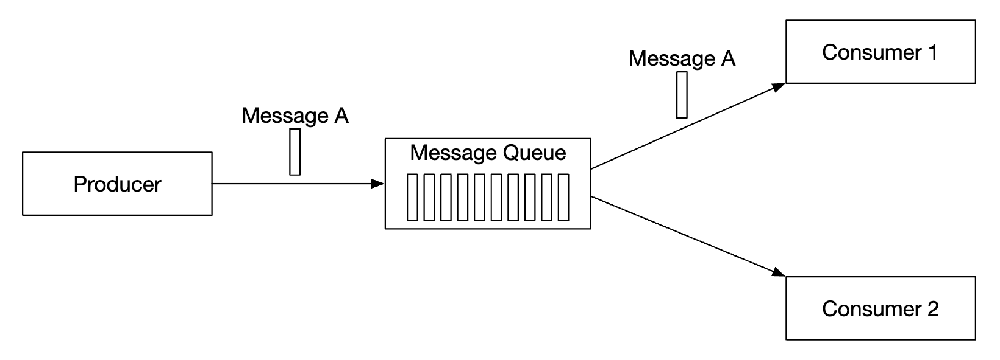

 * メッセージはキューに送信され、ちょうど1つのコンシューマーによって消費される。
 * 複数のコンシューマーが存在し得るが、1つのメッセージが消費されるのは1回だけである。
 * メッセージが消費済みと確認応答されると、キューから削除される。
 * ポイントツーポイントモデルにはデータ保持がないが、私たちの設計にはある。

一方、パブリッシュ/サブスクライブモデルはイベントストリーミングプラットフォームでより一般的です。

    

 * このモデルでは、メッセージはトピックに関連付けられる。
 * コンシューマーはトピックを購読し、そのトピックに送信されたすべてのメッセージを受け取る。

### **トピック、パーティション、ブローカー**

トピックのデータ量が大きすぎる場合はどうするでしょうか？ スケールさせる1つの方法は、トピックをパーティションに分割すること（シャーディング）です。

    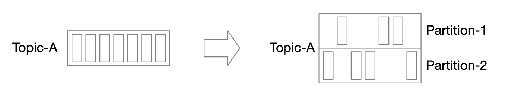

 * トピックに送信されたメッセージは、パーティション間に均等に分散される
 * パーティションをホストするサーバーはブローカーと呼ばれる
 * 各トピックはメッセージ処理にFIFOを使うキューのように動作する。メッセージの順序はパーティション内で維持される。
 * パーティション内でのメッセージの位置は**オフセット**と呼ばれる。
 * 生成された各メッセージは特定のパーティションに送られる。パーティションキーによって、メッセージがどのパーティションに入るかが決まる。
   * 例えば、同じユーザーのメッセージの順序を保証するために、`user_id` をパーティションキーとして使える。
 * 各コンシューマーは1つ以上のパーティションを購読する。同じメッセージに対して複数のコンシューマーがいる場合、それらはコンシューマーグループを形成する。

### **コンシューマーグループ**

コンシューマーグループは、トピックからメッセージを消費するために協力して動作するコンシューマーの集合です。

    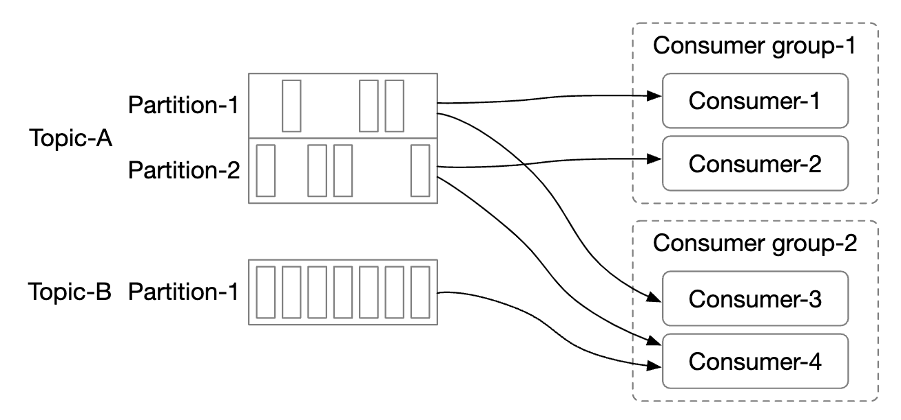

 * メッセージはコンシューマーグループ単位で（コンシューマー単位ではなく）複製される。
 * 各コンシューマーグループは独自のオフセットを保持する。
 * コンシューマーグループでメッセージを並列に読み取るとスループットが向上するが、順序の保証が損なわれる。
 * これは、1つのパーティションを購読できるのはグループ内の1つのコンシューマーだけ、とすることで緩和できる。
 * つまり、グループ内のコンシューマー数をパーティション数より多くすることはできない。

### **高レベルアーキテクチャ**

    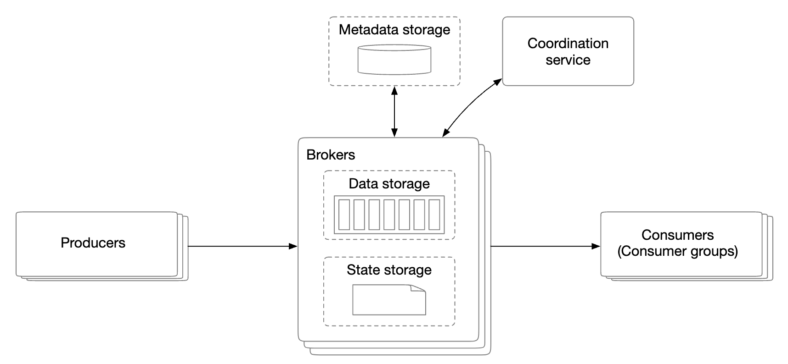

- **クライアント**: プロデューサーとコンシューマー。プロデューサーは指定されたトピックにメッセージをプッシュする。コンシューマーグループはトピックのメッセージを購読する。
- **ブローカー**: 複数のパーティションを保持する。パーティションはトピックのメッセージの一部を保持する。
- **データストレージ**: パーティション内のメッセージを保存する。
- **状態ストレージ**: コンシューマーの状態を保持する。
- **メタデータストレージ**: 設定とトピックのプロパティを保存する。
- **調整サービス**: サービスディスカバリ（どのブローカーが稼働しているか）とリーダー選出（どのブローカーがリーダーで、パーティションの割り当てを担当するか）を担う。

---

## ステップ3: 設計の深掘り

高スループットを達成し、長期のデータ保持の要件を満たすために、いくつかの重要な設計上の選択を行いました。
 * 最新のHDDの特性と、最新のOSのディスクキャッシュ戦略を活かすディスク上のデータ構造を選んだ。
 * 大量・高トラフィックのシステムでは避けたい余分なコピーを避けるため、メッセージのデータ構造をイミュータブルにした。
 * 小さなI/Oは高スループットの敵であるため、書き込みをバッチ処理を中心に設計した。

### **データストレージ**

メッセージに最適なデータストアを見つけるには、メッセージの特性を調べる必要があります。
 * 書き込みが多く、読み取りも多い
 * 更新/削除の操作がない。従来のメッセージキューでは、メッセージが保持されないため「削除」操作がある。
 * 主に逐次的な読み書きのアクセスパターン。

選択肢は何でしょうか:
- **データベース**: 一般的なデータベースは、書き込みも読み取りも多いシステムをうまくサポートできないため、理想的ではない。
- **先行書き込みログ（WAL）**: 追記のみをサポートするプレーンテキストファイルで、HDDとの相性が非常に良い。
  * 非常に大きなファイルを維持しなくて済むよう、パーティションをセグメントに分割する。
  * 古いセグメントは読み取り専用である。書き込みは最新のセグメントだけが受け付ける。

    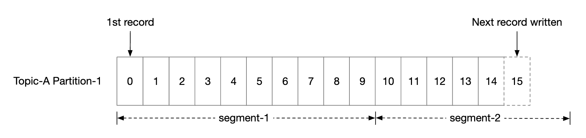

WALファイルは、従来のHDDで使うと非常に効率的です。

HDDのアクセスは遅いという誤解がありますが、それはアクセスパターンに大きく依存します。
アクセスパターンが逐次的な場合（今回のケースのように）、HDDは数MB/秒の読み書き速度を達成でき、私たちのニーズには十分です。
また、OSがディスクのデータを積極的にメモリにキャッシュするという事実も利用します。

### **メッセージのデータ構造**

余分なコピーを避けるため、メッセージのスキーマがプロデューサー、キュー、コンシューマーの間で一致していることが重要です。これにより、はるかに効率的な処理が可能になります。

メッセージ構造の例:

    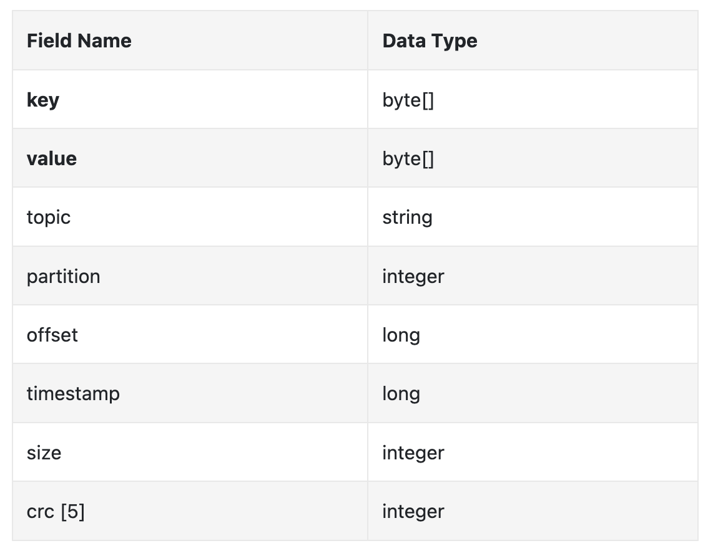

メッセージのキーは、メッセージがどのパーティションに属するかを指定します。マッピングの例は `hash(key) % numPartitions` です。
より柔軟にするため、プロデューサーはデフォルトのキーを上書きして、メッセージをどのパーティションに分配するかを制御できます。

メッセージの値はメッセージのペイロードです。プレーンテキストまたは圧縮されたバイナリブロックです。

**注意:** メッセージのキーは、従来のKVストアとは異なり、一意である必要はありません。キーが重複していても、さらにはキーがなくても構いません。

その他のメッセージのフィールド:
- **トピック**: メッセージが属するトピック
- **パーティション**: メッセージが属するパーティションのID
- **オフセット**: パーティション内のメッセージの位置。メッセージは `topic`、`partition`、`offset` で特定できる。
- **タイムスタンプ**: メッセージが保存された時刻
- **サイズ**: このメッセージのサイズ
- **CRC**: メッセージの完全性を確保するためのチェックサム

フィールドを追加することで、フィルタリングなどの追加機能をサポートできます。

### **バッチ処理**

バッチ処理はシステムの性能にとって極めて重要です。プロデューサー、コンシューマー、メッセージキューのすべてで適用します。

重要である理由:
 * OSがメッセージをまとめてグループ化でき、コストの高いネットワークの往復のコストを償却できる
 * メッセージはグループ単位で逐次的にWALに書き込まれるため、多くの逐次書き込みとディスクキャッシュにつながる

レイテンシとスループットの間にはトレードオフがあります。
 * バッチを大きくすると、スループットが高くなりレイテンシも高くなる。
 * バッチを小さくすると、スループットが低くなりレイテンシも低くなる。

システムを従来型のメッセージキューとしてデプロイするため低レイテンシをサポートする必要がある場合は、より小さなバッチサイズを使うようにシステムを調整できます。

スループット重視で調整する場合は、遅い逐次ディスク書き込みのスループットを補うため、トピックあたりのパーティション数を増やす必要があるかもしれません。

### **プロデューサーのフロー**

プロデューサーがパーティションにメッセージを送信したい場合、どのブローカーに接続すべきでしょうか？

1つの選択肢は、メッセージを正しいブローカーにルーティングするルーティング層を導入することです。レプリケーションが有効な場合、正しいブローカーとはリーダーレプリカです。

    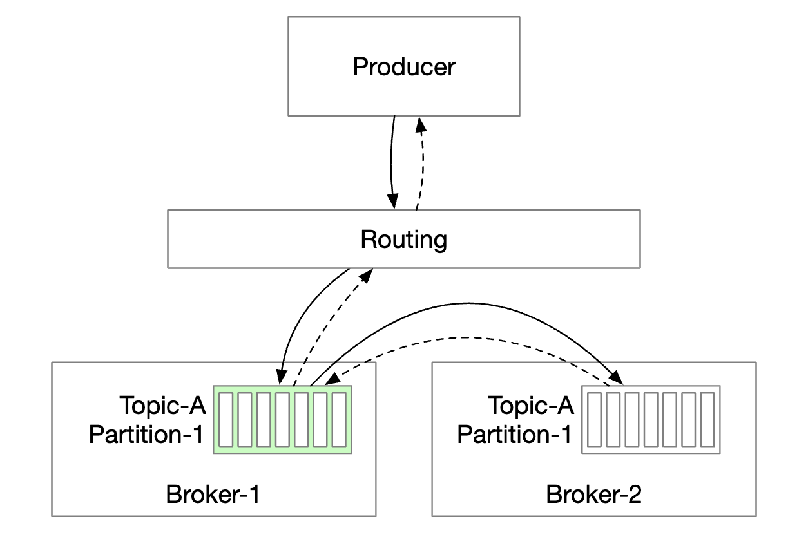

 * ルーティング層はメタデータストアからレプリケーション計画を読み取り、ローカルにキャッシュする。
 * プロデューサーがルーティング層にメッセージを送信する。
 * メッセージは、該当パーティションのリーダーであるブローカー1に転送される。
 * フォロワーレプリカはリーダーから新しいメッセージをプルする。十分な確認が得られると、リーダーはデータをコミットし、プロデューサーに応答する。

レプリカを持つ理由は、耐障害性を実現するためです。

このアプローチは機能しますが、いくつかの欠点があります。
 * 余分なコンポーネントのためにネットワークのホップが増える
 * この設計ではメッセージのバッチ処理ができない

これらの問題を緩和するため、ルーティング層をプロデューサーに組み込むことができます。

    

 * ネットワークのホップが減り、レイテンシが低くなる
 * プロデューサーがメッセージをどのパーティションにルーティングするかを制御できる
 * バッファによってメッセージをメモリ内でバッチ化し、1回のリクエストでより大きなバッチを送信できるため、スループットが向上する。

バッチサイズの選択は、スループットとレイテンシの古典的なトレードオフです。

    

 * バッチサイズが大きいと、バッチがコミットされるまでの待ち時間が長くなる。
 * バッチサイズが小さいと、リクエストが早く送信されレイテンシは低くなるが、スループットも低くなる。

### **コンシューマーのフロー**

コンシューマーはパーティション内のオフセットを指定し、そのオフセットから始まるメッセージのまとまりを受け取ります。

    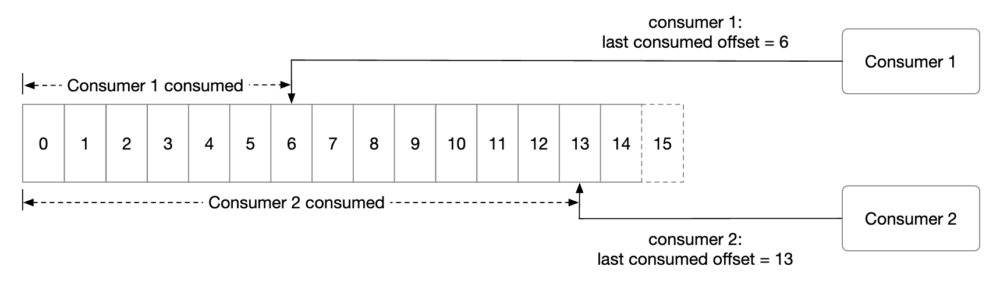

コンシューマーを設計する際の重要な検討事項の1つは、プッシュモデルとプルモデルのどちらを使うかです。
- **プッシュモデル**: ブローカーがメッセージを受け取るとすぐにコンシューマーにプッシュするため、レイテンシが低くなる。
  * しかし、消費のレートが生成のレートに追いつかない場合、コンシューマーが圧倒される可能性がある。
  * ブローカーが消費のレートを制御するため、処理能力の異なるコンシューマーに対処するのが難しい。
- **プルモデル**: コンシューマーが消費のレートを制御する。
  * 消費のレートが遅くてもコンシューマーが圧倒されることはなく、追いつくためにスケールさせることができる。
  * プッシュモデルではブローカーはコンシューマーがどれだけのメッセージを処理できるかを知ることができないため、プルモデルの方がバッチ処理に適している。
  * 一方、プルモデルでは、コンシューマーは大きなメッセージのバッチを積極的に取得できる。
  * 欠点は、レイテンシが高くなることと、新しいメッセージがないときに余分なネットワーク呼び出しが発生することである。後者の問題はロングポーリングで緩和できる。

そのため、ほとんどのメッセージキュー（そして私たち）はプルモデルを選択します。

    

 * 新しいコンシューマーがトピックAを購読し、グループ1に参加する。
 * グループ名をハッシュ化することで正しいブローカーノードが見つかる。こうすることで、グループ内のすべてのコンシューマーが同じブローカーに接続する。
 * このコンシューマーグループのコーディネーターは、調整サービス（ZooKeeper）とは異なることに注意する。
 * コーディネーターは、コンシューマーがグループに参加したことを確認し、そのコンシューマーにパーティション2を割り当てる。
 * パーティションの割り当て戦略には、ラウンドロビン、レンジなどさまざまなものがある。
 * コンシューマーは最後のオフセットから最新のメッセージを取得する。状態ストレージがコンシューマーのオフセットを保持する。
 * コンシューマーはメッセージを処理し、オフセットをブローカーにコミットする。これらの操作の順序がメッセージ配信のセマンティクスに影響する。

### **コンシューマーのリバランス**

コンシューマーのリバランスは、どのコンシューマーがどのパーティションを担当するかを決定する処理です。

この処理は、コンシューマーが参加/離脱したとき、またはパーティションが追加/削除されたときに発生します。

コーディネーターとして機能するブローカーが、リバランスのワークフローを統括する上で大きな役割を果たします。

    

 * 同じグループのすべてのコンシューマーは同じコーディネーターに接続される。コーディネーターはグループ名をハッシュ化することで見つかる。
 * コンシューマーのリストが変わると、コーディネーターはグループの新しいリーダーを選ぶ。
 * グループのリーダーは新しいパーティション割り当て計画を計算してコーディネーターに報告し、コーディネーターがそれを他のコンシューマーにブロードキャストする。

コーディネーターがグループ内のコンシューマーからハートビートを受信しなくなると、リバランスがトリガーされます。

    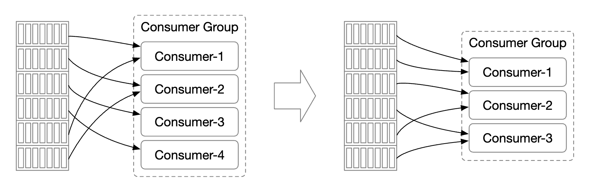

コンシューマーがグループに参加したときに何が起こるかを見ていきましょう。

    

 * 最初は、コンシューマーAだけがグループにいて、すべてのパーティションを消費している。
 * コンシューマーBがグループへの参加リクエストを送信する。
 * コーディネーターは、ハートビートへの応答として、受動的にリバランスの時期であることをすべてのグループメンバーに通知する。
 * すべてのコンシューマーがグループに再参加すると、コーディネーターはリーダーを選び、選出結果を残りのメンバーに通知する。
 * リーダーはパーティション割り当て計画を生成し、コーディネーターに送信する。他のメンバーは割り当て計画を待つ。
 * コンシューマーは新たに割り当てられたパーティションから消費を開始する。

コンシューマーがグループから離脱したときに起こることは次のとおりです。

    

 * コンシューマーAとBが同じグループにいる
 * コンシューマーBがグループからの離脱を求める
 * コーディネーターはAのハートビートを受信したときに、リバランスの時期であることをAに伝える。
 * 残りの手順は同じである。

コンシューマーが長時間ハートビートを送信しない場合も、処理は同様です。

    

### **状態ストレージ**

状態ストレージは、パーティションとコンシューマーのマッピングと、パーティションごとに最後に消費されたオフセットを保存します。

    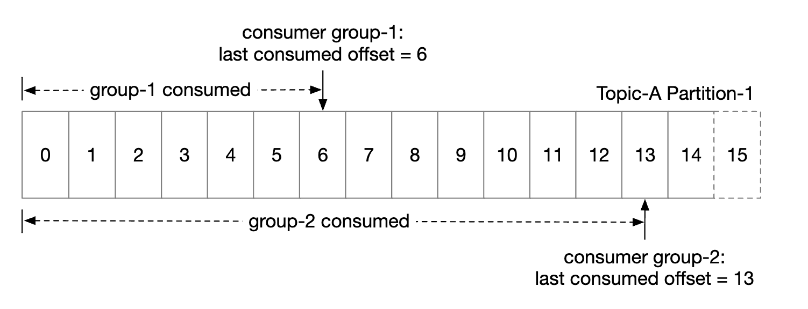

グループ1のオフセットは6であり、それ以前のメッセージはすべて消費済みであることを意味します。コンシューマーがクラッシュした場合、新しいコンシューマーはそのメッセージから処理を続けます。

コンシューマーの状態に対するデータアクセスパターン:
 * 読み書きの操作は頻繁だが、量は少ない
 * データは頻繁に更新されるが、削除されることはまれ
 * ランダムな読み書き
 * データの一貫性が重要

これらの要件から、ZooKeeperのような高速なKVストレージが理想的です。

### **メタデータストレージ**

メタデータストレージは、設定とトピックのプロパティ（パーティション数、保持期間、レプリカの配置）を保存します。

メタデータは頻繁には変わらず量も少ないですが、高い一貫性が求められます。
このストレージにはZooKeeperが適しています。

### **ZooKeeper**

ZooKeeperは、分散メッセージキューを構築する上で不可欠です。

ZooKeeperは階層型のキーバリューストアで、分散設定、同期サービス、名前レジストリ（つまりサービスディスカバリ）によく使われます。

    

この変更により、ブローカーはメッセージのデータだけを保持すればよくなります。メタデータと状態のストレージはZooKeeperにあります。

ZooKeeperは、ブローカーのレプリカのリーダー選出にも役立ちます。

### **レプリケーション**

分散システムでは、ハードウェアの問題は避けられません。高可用性を実現するために、レプリケーションで対処できます。

    

 * 各パーティションは複数のブローカーにレプリケートされるが、リーダーレプリカは1つだけである。
 * プロデューサーはリーダーレプリカにメッセージを送信する
 * フォロワーはリーダーからレプリケートされたメッセージをプルする
 * 十分な数のレプリカが同期されると、リーダーはプロデューサーに確認応答を返す
 * 各パーティションのレプリカの配置は、レプリカ配置計画と呼ばれる。
 * 該当パーティションのリーダーがレプリカ配置計画を作成し、ZooKeeperに保存する

### **同期レプリカ（ISR）**

対処すべき問題の1つは、あるパーティションについてリーダーとフォロワーの間でメッセージの同期を保つことです。

同期レプリカ（In-Sync Replicas、ISR）は、リーダーと同期を保っているパーティションのレプリカです。

`replica.lag.max.messages` は、同期しているとみなされるために、レプリカがリーダーから何件のメッセージまで遅れてよいかを定義します。

    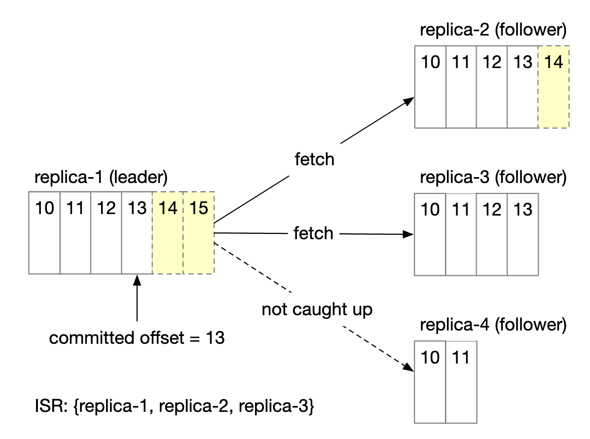

 * コミット済みのオフセットは13
 * 2つの新しいメッセージがリーダーに書き込まれたが、まだコミットされていない。
 * ISR内のすべてのレプリカがそのメッセージを同期すると、メッセージはコミットされる
 * レプリカ2と3はリーダーに完全に追いついているので、ISRに含まれる
 * レプリカ4は遅れているので、当面ISRから除外される

ISRは、性能と耐久性の間のトレードオフを反映しています。
 * プロデューサーがメッセージを失わないためには、確認応答を送る前にすべてのレプリカが同期しているべきである
 * しかし、遅いレプリカが1つあると、パーティション全体が利用できなくなる

確認応答の扱いは設定可能です。

`ACK=all` は、ISR内のすべてのレプリカがメッセージを同期しなければならないことを意味します。メッセージの送信は遅いですが、メッセージの耐久性は最も高くなります。

    

`ACK=1` は、リーダーがメッセージを受け取った時点でプロデューサーが確認応答を受け取ることを意味します。メッセージの送信は速いですが、メッセージの耐久性は低くなります。

    

`ACK=0` は、プロデューサーがリーダーからの確認応答を一切待たずにメッセージを送信することを意味します。メッセージの送信は最も速く、メッセージの耐久性は最も低くなります。

    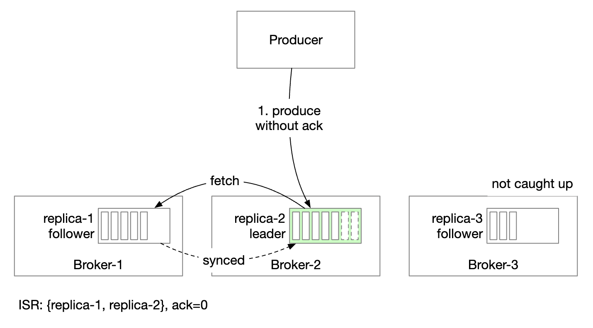

コンシューマー側では、すべてのコンシューマーをパーティションのリーダーに接続し、そこからメッセージを読み取らせることができます。
 * これは最もシンプルな設計で、運用も最も容易である
 * パーティション内のメッセージはグループ内の1つのコンシューマーにのみ送信されるため、リーダーレプリカへの接続数が制限される
 * トピックが極端にホットでない限り、リーダーレプリカへの接続数は通常それほど多くない
 * ホットなトピックは、パーティションとコンシューマーの数を増やすことでスケールさせられる
 * 特定のシナリオ、例えばコンシューマーが別のデータセンターにある場合などは、ISRから読み取らせることが理にかなう場合もある

ISRのリストは、自身と各レプリカとの間の遅れを追跡するリーダーによって管理されます。

### **スケーラビリティ**

システムのさまざまな部分をどのようにスケールさせられるかを評価しましょう。

#### プロデューサー

プロデューサーはコンシューマーよりもはるかに小さいです。そのスケーラビリティは、プロデューサーのインスタンスを追加/削除することで容易に実現できます。

#### コンシューマー

コンシューマーグループは互いに分離されています。コンシューマーグループは自由に追加/削除できます。

リバランスにより、グループへのコンシューマーの追加/削除を正常に処理できます。

コンシューマーグループとリバランスは、スケーラビリティと耐障害性の実現に役立ちます。

#### ブローカー

ブローカーは障害にどのように対処するのでしょうか？

    

 * ブローカーが故障しても、パーティションのデータ損失を避けるのに十分な数のレプリカが残っている
 * 新しいリーダーが選出され、ブローカーのコーディネーターは故障したブローカーにあったパーティションを既存のレプリカに再配置する
 * 既存のレプリカは新しいパーティションを引き受け、リーダーに追いついてISRになるまでフォロワーとして動作する

ブローカーの耐障害性を高めるための追加の検討事項:
 * ISRの最小数は、レイテンシと安全性のバランスをとるものである。ニーズに合わせて微調整できる。
 * パーティションのすべてのレプリカが同じノードにあると、リソースの無駄である。レプリカは異なるブローカーに配置すべきである。
 * パーティションのすべてのレプリカがクラッシュすると、データは永久に失われる。レプリカを複数のデータセンターに分散させると役立つが、レイテンシが大きく増える。回避策の1つとして[データミラーリング](https://cwiki.apache.org/confluence/pages/viewpage.action?pageId=27846330)を使う方法がある。

新しいブローカーが追加されたとき、レプリカの再配置はどのように扱うのでしょうか？

    

 * 新しいブローカーが追いつくまで、一時的に設定より多くのレプリカを許可できる
 * 追いついたら、不要になったパーティションのレプリカを削除できる

#### パーティション

新しいパーティションが追加されると、プロデューサーに通知され、コンシューマーのリバランスがトリガーされます。

データストレージの観点では、古いメッセージをすべてコピーしようとするのではなく、新しいメッセージだけを新しいパーティションに保存すればよいです。

    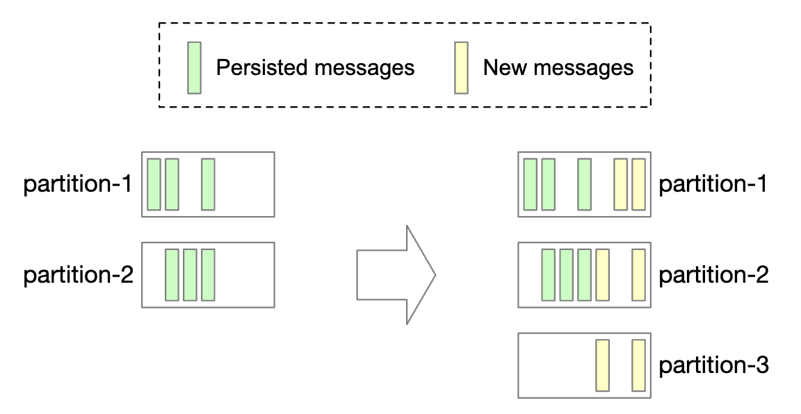

パーティション数を減らすのはより複雑です。

    

 * パーティションが廃止されると、新しいメッセージは残りのパーティションだけが受け取る
 * 廃止されたパーティションからもまだメッセージを消費できるため、すぐには削除されない
 * あらかじめ設定された保持期間が過ぎて初めて、データが切り捨てられ、ストレージ容量が解放される
 * 移行期間中、プロデューサーはアクティブなパーティションにのみメッセージを送信するが、コンシューマーはすべてのパーティションから読み取る
 * 保持期間が切れると、コンシューマーがリバランスされる

### **データ配信のセマンティクス**

さまざまな配信セマンティクスについて議論しましょう。

#### At-most once（最大1回）

この保証では、メッセージは1回を超えて配信されることはなく、まったく配信されない可能性もあります。

    

 * プロデューサーはトピックに非同期でメッセージを送信する。メッセージの配信が失敗してもリトライしない。
 * コンシューマーはメッセージを取得し、すぐにオフセットをコミットする。メッセージを処理する前にコンシューマーがクラッシュすると、そのメッセージは処理されない。

#### At-least once（少なくとも1回）

メッセージは複数回送信される可能性がありますが、未処理のまま残されるメッセージはあってはなりません。

    

 * プロデューサーは `ack=1` または `ack=all` でメッセージを送信する。何らかの問題があれば、リトライし続ける。
 * コンシューマーはメッセージを取得し、処理が完了した後にのみオフセットをコミットする。
 * 例えば、コンシューマーがメッセージを処理した後、オフセットをコミットする前にクラッシュした場合などには、メッセージが複数回配信される可能性がある。
 * そのため、データの重複が許容されるか、重複排除が可能なユースケースに適している。

#### Exactly once（正確に1回）

ユーザーにとっては最も扱いやすい保証ですが、システムにとって実装のコストが非常に高くなります。

    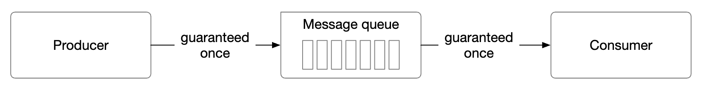

### **高度な機能**

面接で議論する可能性のある、いくつかの高度な機能について議論しましょう。

#### メッセージのフィルタリング

一部のコンシューマーは、パーティション内の特定の種類のメッセージだけを消費したい場合があります。

これは、メッセージの部分集合ごとに別々のトピックを作ることで実現できますが、システムに異なるユースケースが多すぎるとコストが高くなります。
 * 同じメッセージを異なるトピックに保存するのはリソースの無駄である
 * 新しいコンシューマーの要件のたびにプロデューサーが変わるため、プロデューサーがコンシューマーと密結合になる

これはメッセージのフィルタリングで解決できます。
 * 素朴なアプローチはコンシューマー側でフィルタリングを行うことだが、それではコンシューマーに不要なトラフィックが発生する
 * あるいは、メッセージにタグを付け、コンシューマーが購読するタグを指定できるようにする
 * メッセージのペイロードでフィルタリングすることもできるが、暗号化/シリアライズされたメッセージでは難しく、安全でない場合がある
 * より複雑な数式に対しては、ブローカーが文法パーサーやスクリプト実行器を実装することもできるが、メッセージキューにとっては重すぎる可能性がある

    

#### 遅延メッセージとスケジュールされたメッセージ

ユースケースによっては、メッセージの配信を遅延させたり、スケジュールしたりしたい場合があります。
例えば、30分後に支払い確認のチェックを投入し、支払いが成功したかどうかをコンシューマーに確認させるといった場合です。

これは、ブローカー内の一時ストレージにメッセージを送り、適切なタイミングでメッセージをパーティションに移すことで実現できます。

    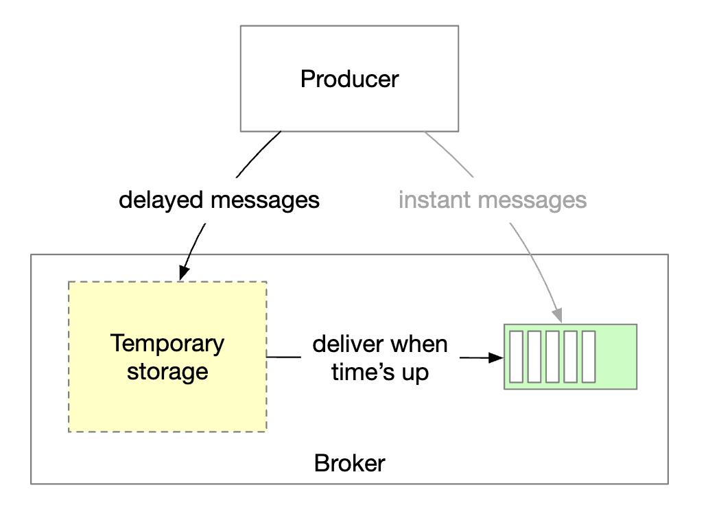

 * 一時ストレージは、1つ以上の特別なメッセージトピックとすることができる
 * タイミングの機能は、専用の遅延キューや[階層型タイムホイール](http://www.cs.columbia.edu/~nahum/w6998/papers/sosp87-timing-wheels.pdf)を使って実現できる

---

## ステップ4: まとめ

追加の論点:
- **通信プロトコル**: 重要な検討事項 - すべてのユースケースと大量のデータをサポートし、メッセージの完全性を検証すること。代表的なプロトコル - AMQPとKafkaプロトコル。
- **消費のリトライ**: メッセージをすぐに処理できない場合、後で再試行するために専用のリトライトピックに送ることができる。
- **履歴データのアーカイブ**: 古いメッセージは、HDFSやオブジェクトストレージ（例: S3）などの大容量ストレージにバックアップできる。
