# 第20章: メトリクス監視・アラートシステム

## はじめに
本章では、高可用性と信頼性を確保するうえで不可欠な、高いスケーラビリティを持つ**メトリクス監視・アラートシステム**の設計に焦点を当てます。

---

## ステップ1: 問題を理解し、設計の範囲を定める
メトリクス監視システムはさまざまな意味を持ち得ます。例えば、面接官がインフラのメトリクスにしか関心がないのに、ログ集約システムを設計してしまうのは避けたいところです。

まずは問題を理解しましょう（C: 候補者、I: 面接官）。
 - C: 誰のためにシステムを構築するのですか？ 大手テック企業の社内監視システムですか、それともDataDogのようなSaaSですか？
 - I: 社内利用のみのために構築します。
 - C: どのメトリクスを収集したいですか？
 - I: 運用上のシステムメトリクス（CPU負荷、メモリ、データディスクの空き容量）です。また、1秒あたりのリクエスト数のような高レベルのメトリクスも対象です。ビジネスメトリクスは範囲外です。
 - C: 監視対象のインフラの規模はどのくらいですか？
 - I: デイリーアクティブユーザー1億人、サーバープール1,000個、プールあたり100台のマシンです。
 - C: データはどのくらいの期間保持すべきですか？
 - I: 保持期間は1年と仮定しましょう。
 - C: 長期保存のためにメトリクスデータの解像度を下げてもよいですか？
 - I: 新しく受信したメトリクスは7日間保持してください。その後の30日間は1分解像度に集約し、30日以降はさらに1時間解像度に集約してください。
 - C: サポートするアラートのチャネルは何ですか？
 - I: メール、電話、PagerDuty、Webhookです。
 - C: エラーログやアクセスログなどのログを収集する必要はありますか？
 - I: いいえ。
 - C: 分散システムのトレーシングをサポートする必要はありますか？
 - I: いいえ。

### **高レベルの要件と前提**
監視対象のインフラは大規模です。
 - 1億DAU
 - サーバープール1,000個 * マシン100台 * マシンあたり約100メトリクス → 約1,000万メトリクス
 - データ保持期間は1年
 - データ保持ポリシー - 生データは7日間、1分解像度で30日間、1時間解像度で1年間

さまざまなメトリクスを監視できます。
 - CPU負荷
 - リクエスト数
 - メモリ使用量
 - メッセージキュー内のメッセージ数

### **非機能要件**
 - **スケーラビリティ**: より多くのメトリクスとアラートに対応できるよう、システムはスケーラブルであるべきである。
 - **低レイテンシ**: ダッシュボードとアラートのために、システムのクエリレイテンシは低くなければならない。
 - **信頼性**: 重要なアラートを見逃さないよう、システムは高い信頼性を持つべきである。
 - **柔軟性**: 将来、新しい技術を容易に統合できるべきである。

範囲外の要件は何でしょうか？
 - **ログ監視**: このユースケースにはELKスタックが非常によく使われる。
 - **分散システムのトレーシング**: リクエストがシステム内の複数のサービスを流れる際のライフサイクルに関するデータを収集することを指す。

---

## ステップ2: 高レベル設計を提案し、合意を得る

### **基本**
メトリクス監視・アラートシステムには、5つの中核コンポーネントがあります。

<div style="margin-left:3rem">
    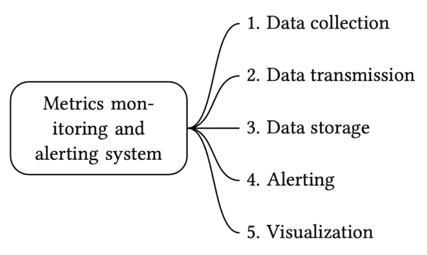
</div>

 - **データ収集**: さまざまなソースからメトリクスデータを収集する
 - **データ転送**: ソースからメトリクス監視システムへデータを転送する
 - **データストレージ**: 受信したデータを整理して保存する
 - **アラート**: 受信したデータを分析し、異常を検出してアラートを生成する
 - **可視化**: データをグラフやチャートなどで表示する

### **データモデル**
メトリクスデータは通常、タイムスタンプ付きの値の集合を含む時系列として記録されます。
系列は、名前とオプションのタグの集合で識別できます。

例1 - 本番サーバーインスタンス i631 の20:00時点のCPU負荷はいくつか？

<div style="margin-left:3rem">
    
</div>

データは次の表で識別できます。

<div style="margin-left:3rem">
    
</div>

時系列は、メトリクス名、ラベル、特定の時刻における単一の点によって識別されます。

例2 - 過去10分間における、us-westリージョンのすべてのWebサーバーの平均CPU負荷はいくつか？

```
CPU.load host=webserver01,region=us-west 1613707265 50

CPU.load host=webserver01,region=us-west 1613707265 62

CPU.load host=webserver02,region=us-west 1613707265 43

CPU.load host=webserver02,region=us-west 1613707265 53

...

CPU.load host=webserver01,region=us-west 1613707265 76

CPU.load host=webserver01,region=us-west 1613707265 83
```

これは、この質問に答えるためにストレージから取得する可能性のあるデータの例です。
平均CPU負荷は、各行の最後の列の値を平均することで計算できます。

上に示した形式はラインプロトコルと呼ばれ、市場で人気のある多くの監視ソフトウェア（例: Prometheus、OpenTSDB）で使われています。

すべての時系列は次の要素で構成されます。

<div style="margin-left:3rem">
    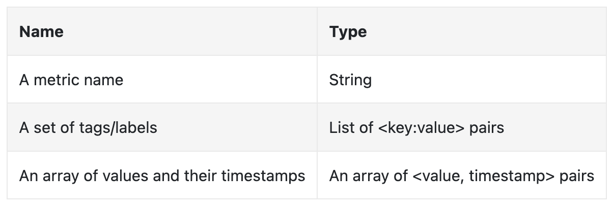
</div>

データがどのようなものかを可視化する良い方法は次のとおりです。

<div style="margin-left:3rem">
    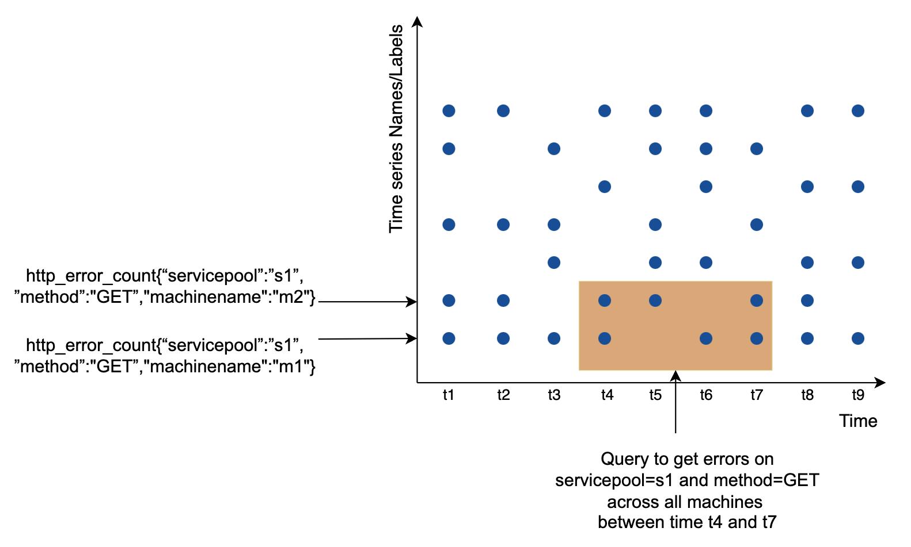
</div>

 - x軸は時間
 - y軸は問い合わせる次元（例: メトリクス名、タグなど）

大量のメトリクスを収集する一方でアクセスされる頻度は低い（ただし、例えばインシデントの発生中にはバースト的にアクセスされる）ため、データアクセスパターンは書き込みが多く、読み取りはスパイク的です。

データストレージシステムがこの設計の中核です。
 - 専門家レベルのチューニングによって良好なスケールを達成できる場合もあるが、この問題に汎用データベースを使うことは推奨されない。
 - NoSQLデータベースを使うことも理論的には可能だが、時系列データを効果的に保存・問い合わせるためのスケーラブルなスキーマを考案するのは難しい。

時系列データの保存に特化したデータベースは数多くあります。その多くは、時系列データを効果的に問い合わせられる独自のクエリインターフェースをサポートしています。
 - OpenTSDBは分散時系列データベースだが、HadoopとHBaseに基づいている。そのインフラが用意されていなければ、この技術を使うのは難しい。
 - TwitterはMetricsDBを使っており、AmazonはTimestreamを提供している。
 - 最も人気のある2つの時系列データベースはInfluxDBとPrometheusである。
 - どちらも大量の時系列データを保存するように設計されている。どちらもインメモリキャッシュ + ディスク上のストレージに基づいている。

InfluxDBの規模の例 - 8コアと32GB RAMで構成した場合、毎秒25万件以上の書き込み:

<div style="margin-left:3rem">
    
</div>

メトリクスデータベースの内部はニッチな知識であるため、理解していることは期待されていません。履歴書に記載している場合にのみ質問される可能性があります。

面接の目的としては、メトリクスが時系列データであることを理解し、InfluxDBのような人気のある時系列データベースを知っていれば十分です。

時系列データベースの優れた機能の1つは、大量の時系列データをラベルによって効率的に集約・分析できることです。
例えばInfluxDBは、ラベルごとにインデックスを構築します。

ただし、ラベルのカーディナリティを低く保つこと、つまり一意なラベルを使いすぎないことが極めて重要です。

### **高レベル設計**

<div style="margin-left:3rem">
    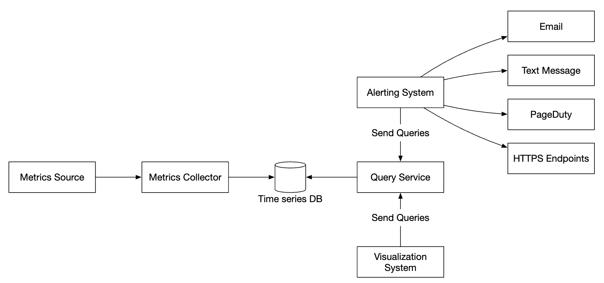
</div>

 - **メトリクスソース**: アプリケーションサーバー、SQLデータベース、メッセージキューなど。
 - **メトリクスコレクター**: メトリクスデータを収集し、時系列データベースに書き込む。
 - **時系列データベース**: メトリクスを時系列として保存する。大量のメトリクスを分析するための独自のクエリインターフェースを提供する。
 - **クエリサービス**: 時系列DBからのデータの問い合わせと取得を容易にする。DBのインターフェースが十分に強力であれば、完全に置き換えることもできる。
 - **アラートシステム**: さまざまなアラート送信先にアラート通知を送る。
 - **可視化システム**: メトリクスをグラフ/チャートの形で表示する。

---

## ステップ3: 設計の深掘り
システムのより興味深い部分のいくつかを深掘りしましょう。

### **メトリクスの収集**
メトリクスの収集では、ときどきデータが失われても致命的ではありません。クライアントは送りっぱなし（fire and forget）でも構いません。

<div style="margin-left:3rem">
    
</div>

メトリクスの収集を実装する方法には、プルとプッシュの2つがあります。

プルモデルは次のようになります。

<div style="margin-left:3rem">
    
</div>

この方式では、メトリクスコレクターはサービスとメトリクスエンドポイントの最新のリストを保持する必要があります。
その目的、つまりサービスディスカバリにはZooKeeperやetcdを使えます。

サービスディスカバリには、いつ、どこからメトリクスを収集するかについての設定ルールが含まれます。

<div style="margin-left:3rem">
    
</div>

メトリクス収集のフローの詳しい説明は次のとおりです。

<div style="margin-left:3rem">
    
</div>

 - メトリクスコレクターがサービスディスカバリから設定のメタデータを取得する。これにはプルの間隔、IPアドレス、タイムアウトとリトライのパラメータが含まれる。
 - メトリクスコレクターが、あらかじめ定義されたHTTPエンドポイント（例: `/metrics`）を介してメトリクスデータをプルする。これは通常、クライアントライブラリによって行われる。
 - あるいは、メトリクスコレクターはサービスディスカバリに変更イベントの通知を登録し、サービスのエンドポイントが変わったときに通知を受けることもできる。
 - もう1つの選択肢は、メトリクスコレクターがメトリクスエンドポイントの設定変更を定期的にポーリングすることである。

私たちの規模では、1つのメトリクスコレクターでは不十分です。複数のインスタンスが必要です。
しかし、2つのコレクターが同じメトリクスを二重に収集しないよう、それらの間で何らかの同期も必要です。

これに対する1つの解決策は、コレクターとサーバーをコンシステントハッシュリング上に配置し、サーバーの集合を1つのコレクターにのみ関連付けることです。

<div style="margin-left:3rem">
    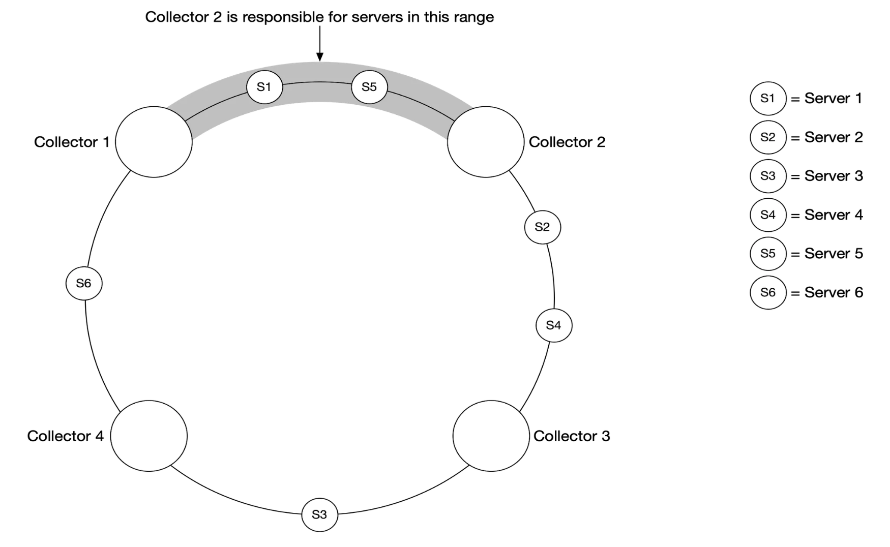
</div>

一方、プッシュモデルでは、サービスが能動的にメトリクスをメトリクスコレクターにプッシュします。

<div style="margin-left:3rem">
    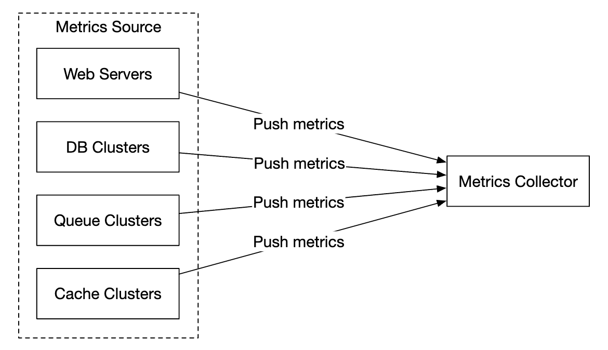
</div>

このアプローチでは、通常、収集エージェントがサービスインスタンスと並べてインストールされます。
エージェントはサーバーからメトリクスを収集し、メトリクスコレクターにプッシュします。

<div style="margin-left:3rem">
    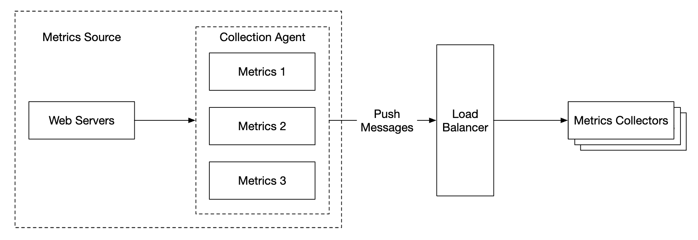
</div>

このモデルでは、コレクターに送信する前にメトリクスを集約できる可能性があり、コレクターが処理するデータ量を減らせます。

その反面、メトリクスコレクターは負荷を処理しきれずにプッシュリクエストを拒否する可能性があります。
そのため、コレクターをロードバランサーの背後にあるオートスケーリンググループに追加することが重要です。

では、どちらが優れているのでしょうか？ 両方のアプローチにはトレードオフがあり、システムによって異なるアプローチが使われています。
 - Prometheusはプル型のアーキテクチャを使う
 - Amazon CloudWatchとGraphiteはプッシュ型のアーキテクチャを使う

プッシュとプルの主な違いは次のとおりです。
|                                        | プル                                                                                                                                                                                                    | プッシュ                                                                                                                                                                                                                                    |
|----------------------------------------|---------------------------------------------------------------------------------------------------------------------------------------------------------------------------------------------------------|-----------------------------------------------------------------------------------------------------------------------------------------------------------------------------------------------------------------------------------------|
| デバッグの容易さ                       | メトリクスのプルに使うアプリケーションサーバー上の /metrics エンドポイントを使えば、いつでもメトリクスを確認できる。ノートPC上でも可能。プルの勝ち。                                                  | メトリクスコレクターがメトリクスを受信しない場合、ネットワークの問題が原因の可能性がある。                                                                                                                                                  |
| ヘルスチェック                         | アプリケーションサーバーがプルに応答しなければ、アプリケーションサーバーがダウンしているかをすぐに把握できる。プルの勝ち。                                                                          | メトリクスコレクターがメトリクスを受信しない場合、ネットワークの問題が原因の可能性がある。                                                                                                                                                  |
| 短命なジョブ                           |                                                                                                                                                                                                         | バッチジョブの中には短命で、プルされるまで存続しないものがある。プッシュの勝ち。プルモデルにプッシュゲートウェイを導入することで解決できる [22]。                                                                                 |
| ファイアウォールや複雑なネットワーク構成 | サーバーがメトリクスをプルするには、すべてのメトリクスエンドポイントに到達できる必要がある。複数のデータセンター構成では問題になる可能性がある。より精巧なネットワークインフラが必要になる場合がある。 | メトリクスコレクターがロードバランサーとオートスケーリンググループで構成されていれば、どこからでもデータを受信できる。プッシュの勝ち。                                                                                      |
| 性能                                   | プル方式は通常TCPを使う。                                                                                                                                                                               | プッシュ方式は通常UDPを使う。つまり、プッシュ方式の方がメトリクスを低レイテンシで転送できる。反論としては、TCP接続を確立する手間は、メトリクスのペイロードを送信する手間に比べれば小さいという点がある。                       |
| データの真正性                         | メトリクスを収集するアプリケーションサーバーは、あらかじめ設定ファイルで定義されている。それらのサーバーから収集したメトリクスは真正であることが保証される。                                     | どんな種類のクライアントでもメトリクスコレクターにメトリクスをプッシュできる。メトリクスを受け付けるサーバーをホワイトリストに登録するか、認証を必須にすることで解決できる。                                                        |

明確な勝者はありません。大規模な組織では、おそらく両方をサポートする必要があります。そもそもプッシュエージェントをインストールする方法がない場合もあります。

### **メトリクス転送パイプラインのスケーリング**

<div style="margin-left:3rem">
    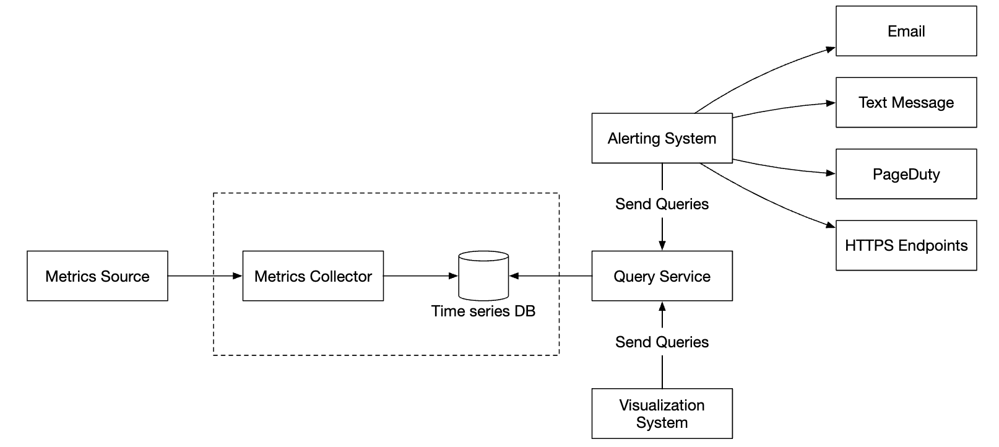
</div>

プッシュモデルとプルモデルのどちらを使うかにかかわらず、メトリクスコレクターはオートスケーリンググループでプロビジョニングされます。

しかし、時系列DBがダウンした場合には、データが失われる可能性があります。これを緩和するため、キューイングの仕組みを用意します。

<div style="margin-left:3rem">
    
</div>

 - メトリクスコレクターがメトリクスデータをKafkaにプッシュする
 - コンシューマー、またはApache Storm、Flink、Sparkなどのストリーム処理サービスがデータを処理し、時系列DBにプッシュする

このアプローチにはいくつかの利点があります。
 - Kafkaは信頼性が高くスケーラブルな分散メッセージプラットフォームとして使われる
 - データの収集とデータの処理を互いに疎結合にする
 - Kafkaにデータを保持することで、データの損失を防げる

コンシューマーがメトリクス名ごとにデータを集約できるよう、Kafkaはメトリクス名ごとに1つのパーティションを持つように設定できます。
これをスケールさせるには、タグ/ラベルでさらにパーティショニングし、先に収集すべきメトリクスを分類/優先順位付けします。

<div style="margin-left:3rem">
    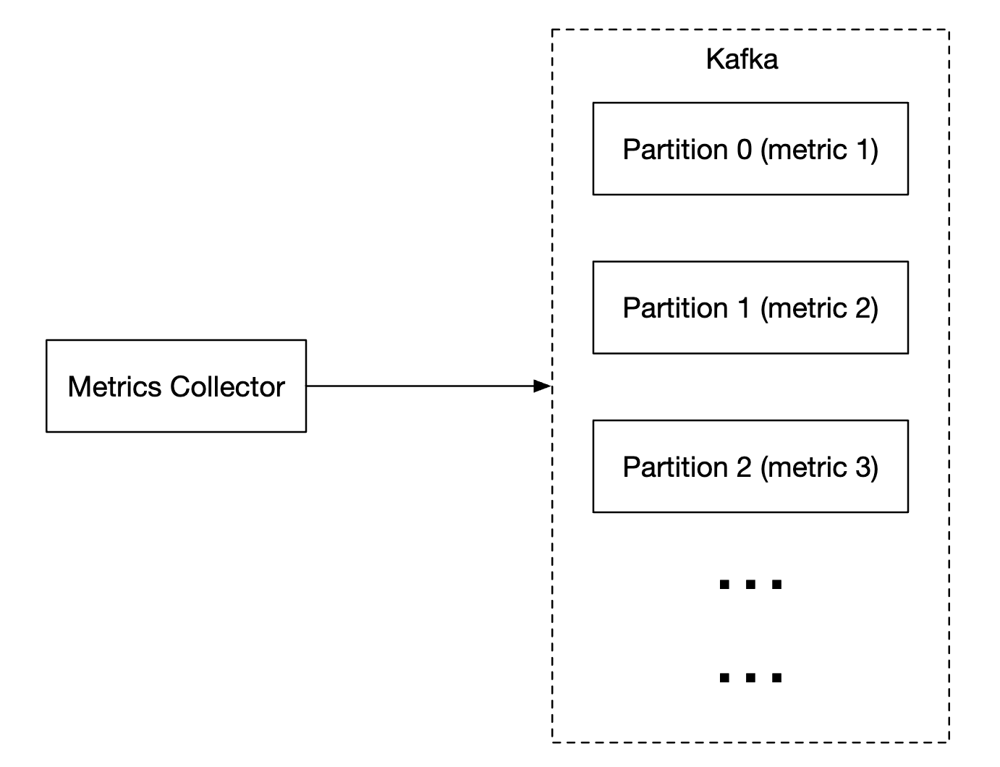
</div>

この問題にKafkaを使う主な欠点は、保守/運用のオーバーヘッドです。
代替案は、[Gorilla](https://www.vldb.org/pvldb/vol8/p1816-teller.pdf)のような大規模な取り込みシステムを使うことです。
それを使えば、キューイングにKafkaを使うのと同等にスケーラブルであると主張できます。

### **集約を行える場所**
メトリクスはいくつかの場所で集約できます。選択肢によってトレードオフがあります。
 - **収集エージェント**: クライアント側の収集エージェントは単純な集約ロジックのみをサポートする。例えば、1分間カウンターを集計してメトリクスコレクターに送信する。
 - **取り込みパイプライン**: DBに書き込む前にデータを集約するには、Flinkのようなストリーム処理エンジンが必要である。書き込み量は減るが、生データを保存しないためデータの精度が失われる。
 - **クエリ側**: 可視化システムからクエリを実行するときにデータを集約できる。データの損失はないが、大量のデータ処理のためクエリが遅くなる可能性がある。

### **クエリサービス**
時系列DBとは別にクエリサービスを持つことで、可視化システムとアラートシステムをデータベースから切り離せます。これによりDBをクライアントから切り離し、自由に変更できるようになります。

時系列データベースの負荷を減らすため、ここにキャッシュ層を追加できます。

<div style="margin-left:3rem">
    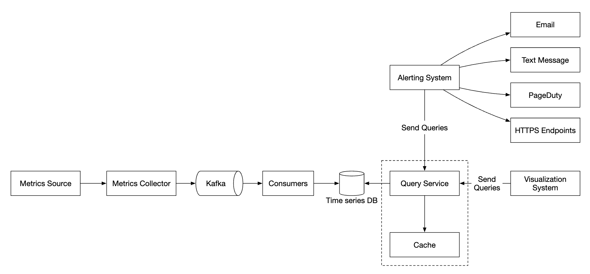
</div>

ほとんどの可視化システムやアラートシステムには、ほとんどの時系列データベースと統合するための強力なプラグインがあるため、クエリサービスの追加自体を省くこともできます。
適切に選んだ時系列DBであれば、独自のキャッシュ層を導入する必要もないかもしれません。

ほとんどの時系列DBはSQLをサポートしていません。単純に、SQLは時系列データの問い合わせには効果的でないためです。以下は指数移動平均を計算するSQLクエリの例です。

```
select id,
       temp,
       avg(temp) over (partition by group_nr order by time_read) as rolling_avg
from (
  select id,
         temp,
         time_read,
         interval_group,
         id - row_number() over (partition by interval_group order by time_read) as group_nr
  from (
    select id,
    time_read,
    "epoch"::timestamp + "900 seconds"::interval * (extract(epoch from time_read)::int4 / 900) as interval_group,
    temp
    from readings
  ) t1
) t2
order by time_read;
```

以下は、InfluxDBで使われるクエリ言語であるFluxで書いた同じクエリです。

```
from(db:"telegraf")
  |> range(start:-1h)
  |> filter(fn: (r) => r._measurement == "foo")
  |> exponentialMovingAverage(size:-10s)
```

### **ストレージ層**
時系列データベースは慎重に選ぶことが重要です。

Facebookが発表した研究によると、運用データストアへのクエリの約85%は過去26時間のデータに対するものでした。

この特性を活かすデータベースを選べば、システムの性能に大きな影響を与えられます。InfluxDBはそのような選択肢の1つです。

どのデータベースを選ぶかにかかわらず、採用できる最適化がいくつかあります。

データのエンコーディングと圧縮により、データのサイズを大幅に削減できます。これらの機能は通常、優れた時系列データベースに組み込まれています。

<div style="margin-left:3rem">
    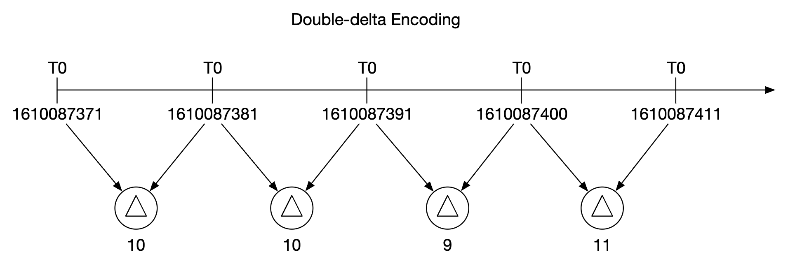
</div>

上の例では、完全なタイムスタンプを保存する代わりに、タイムスタンプの差分を保存できます。

採用できるもう1つの手法はダウンサンプリングです。ディスク使用量を減らすため、高解像度のデータを低解像度に変換します。

これを古いデータに適用し、ルールをデータサイエンティストが設定できるようにします。例:
 - 7日 - ダウンサンプリングなし
 - 30日 - 1分にダウンサンプリング
 - 1年 - 1時間にダウンサンプリング

例えば、10秒解像度のメトリクステーブルは次のとおりです。
| metric | timestamp            | hostname | Metric_value |
|--------|----------------------|----------|--------------|
| cpu    | 2021-10-24T19:00:00Z | host-a   | 10           |
| cpu    | 2021-10-24T19:00:10Z | host-a   | 16           |
| cpu    | 2021-10-24T19:00:20Z | host-a   | 20           |
| cpu    | 2021-10-24T19:00:30Z | host-a   | 30           |
| cpu    | 2021-10-24T19:00:40Z | host-a   | 20           |
| cpu    | 2021-10-24T19:00:50Z | host-a   | 30           |

30秒解像度にダウンサンプリングしたもの:
| metric | timestamp            | hostname | Metric_value (avg) |
|--------|----------------------|----------|--------------------|
| cpu    | 2021-10-24T19:00:00Z | host-a   | 19                 |
| cpu    | 2021-10-24T19:00:30Z | host-a   | 25                 |

最後に、もう使われなくなった古いデータにはコールドストレージを使うこともできます。コールドストレージの金銭的コストははるかに低いです。

### **アラートシステム**

<div style="margin-left:3rem">
    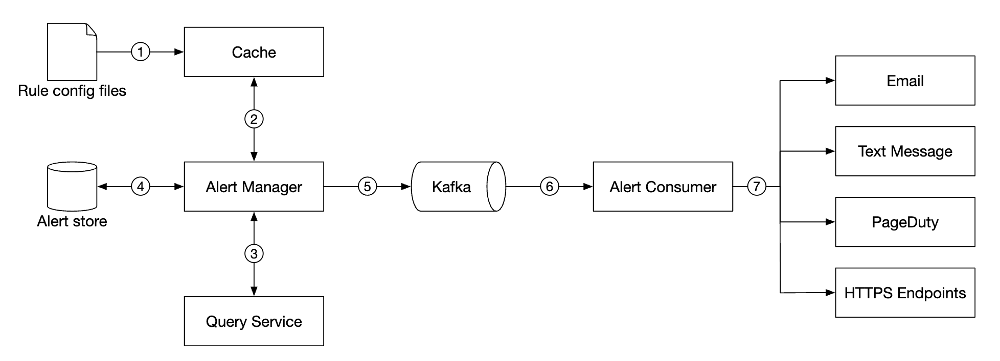
</div>

設定はキャッシュサーバーに読み込まれます。ルールは通常YAML形式で定義されます。例を示します。

```
- name: instance_down
  rules:

  # Alert for any instance that is unreachable for >5 minutes.
  - alert: instance_down
    expr: up == 0
    for: 5m
    labels:
      severity: page
```

アラートマネージャーはキャッシュからアラートの設定を取得します。設定ルールに基づいて、あらかじめ定めた間隔でクエリサービスも呼び出します。
ルールが満たされると、アラートイベントが作成されます。

アラートマネージャーのその他の責務は次のとおりです。
 - アラートのフィルタリング、マージ、重複排除。例えば、単一のインスタンスのアラートが複数回トリガーされた場合でも、生成されるアラートイベントは1つだけである。
 - アクセス制御 - アラート管理の操作を特定の人だけに制限することが重要である。
 - リトライ - マネージャーはアラートが少なくとも1回は伝達されることを保証する。

アラートストアはCassandraのようなキーバリューデータベースで、すべてのアラートの状態を保持します。通知が少なくとも1回は送信されることを保証します。
アラートがトリガーされると、Kafkaに発行されます。

最後に、アラートコンシューマーがKafkaからアラートデータをプルし、メール、テキストメッセージ、PagerDuty、Webhookなどのさまざまなチャネルに通知を送信します。

実世界には、アラートシステムのための既製のソリューションが数多くあります。独自のシステムを社内で構築することを正当化するのは困難です。

### **可視化システム**
可視化システムは、一定期間のメトリクスとアラートを表示します。以下はGrafanaで構築したダッシュボードです。

<div style="margin-left:3rem">
    
</div>

高品質な可視化システムを構築するのは非常に困難です。Grafanaのような既製のソリューションを使わないことを正当化するのは難しいでしょう。

---

## ステップ4: まとめ
最終的な設計は次のとおりです。

<div style="margin-left:3rem">
    
</div>
