# 第21章: 広告クリックイベント集計

## はじめに
Facebook、YouTube、TikTokなどの台頭により、**デジタル広告**は巨大な産業になっています。

そのため、広告クリックイベントの追跡は重要です。本章では、Facebook/Google規模の**広告クリックイベント集計**システムを設計する方法を探ります。

デジタル広告には、デジタル広告枠が売買される**リアルタイム入札（RTB）**というプロセスがあります。

<div style="margin-left:3rem">
    
</div>

RTBは通常1秒以内に行われるため、その速度が重要です。
また、広告主が支払う金額に影響するため、データの正確性も非常に重要です。

広告クリックイベントの集計に基づいて、広告主はターゲットオーディエンスやキーワードの調整などの意思決定を行えます。

---

## ステップ1: 問題を理解し、設計の範囲を定める
 - C: 入力データの形式は何ですか？
 - I: 1日あたり10億件の広告クリックがあり、広告は合計200万件です。広告クリックイベントの数は前年比30%で増加しています。
 - C: システムがサポートすべき最も重要なクエリは何ですか？
 - I: 考慮すべき主なクエリは次のとおりです。
   - 広告Xについて、直近Y分間のクリックイベント数を返す
   - 直近1分間で最もクリックされた上位100件の広告を返す。どちらのパラメータも設定可能にする。集計は1分ごとに行う。
   - 上記のクエリについて、`ip`、`user_id`、`country` によるデータのフィルタリングをサポートする
 - C: エッジケースを気にする必要はありますか？ 私が思いつくのは次のようなものです。
   - 想定より遅れて到着するイベントがあるかもしれない
   - 重複したイベントがあるかもしれない
   - システムのさまざまな部分がダウンする可能性があるため、システムの復旧を考慮する必要がある
 - I: 良いリストです。それらを考慮してください。
 - C: レイテンシの要件は何ですか？
 - I: 広告クリックの集計については、エンドツーエンドで数分のレイテンシです。RTBについては1秒未満です。広告クリックの集計は通常、請求やレポートに使われるため、その程度のレイテンシで問題ありません。

### **機能要件**
 - 直近Y分間の `ad_id` のクリック数を集計する
 - 1分ごとに、最もクリックされた上位100件の `ad_id` を返す
 - さまざまな属性による集計のフィルタリングをサポートする
 - データセットの量はFacebookやGoogleの規模である

### **非機能要件**
 - 集計結果はRTBと広告の請求に使われるため、その正確性が重要である
 - 遅延したイベントや重複したイベントを適切に処理する
 - 堅牢性 - システムは部分的な障害に耐えられるべきである
 - レイテンシ - エンドツーエンドで最大数分のレイテンシ

### **概算見積もり**
 - 10億DAU
 - ユーザーが1日に1件の広告をクリックすると仮定 → 1日あたり10億件の広告クリック
 - 広告クリックのQPS = 10,000
 - ピークQPSはその5倍 = 50,000
 - 1件の広告クリックは0.1KBのストレージを占める。1日あたりのストレージ要件は100GB
 - 月間のストレージ = 3TB

---

## ステップ2: 高レベル設計を提案し、合意を得る
このセクションでは、クエリAPIの設計、データモデル、高レベル設計について議論します。

### **クエリAPIの設計**
APIはクライアントとサーバーの間の契約です。今回の場合、クライアントはダッシュボードのユーザー（データサイエンティスト/アナリスト、広告主など）です。

機能要件は次のとおりです。
 - 直近Y分間の `ad_id` のクリック数を集計する
 - 直近M分間で最もクリックされた上位N件の `ad_id` を返す
 - さまざまな属性による集計のフィルタリングをサポートする

これらの要件を満たすには、2つのエンドポイントが必要です。フィルタリングは、そのうちの1つのクエリパラメータで行えます。

**直近M分間の ad_id のクリック数を集計する**:

```
GET /v1/ads/{:ad_id}/aggregated_count
```

クエリパラメータ:
 - from - 開始時刻（分）。デフォルトは現在 - 1分
 - to - 終了時刻（分）。デフォルトは現在
 - filter - さまざまなフィルタリング戦略の識別子。例えば 001 は「米国外のクリック」を意味する。

レスポンス:
 - ad_id - 広告の識別子
 - count - 開始時刻から終了時刻までの集計されたカウント

**直近M分間で最もクリックされた上位N件の ad_id を返す**

```
GET /v1/ads/popular_ads
```

クエリパラメータ:
 - count - 最もクリックされた上位N件の広告
 - window - 集計ウィンドウのサイズ（分）
 - filter - さまざまなフィルタリング戦略の識別子

レスポンス:
 - ad_id のリスト

### **データモデル**
このシステムには、生データと集計データがあります。

生データは次のようなものです。

```
[AdClickEvent] ad001, 2021-01-01 00:00:01, user 1, 207.148.22.22, USA
```

構造化した形式の例は次のとおりです。
| ad_id | click_timestamp     | user  | ip            | country |
|-------|---------------------|-------|---------------|---------|
| ad001 | 2021-01-01 00:00:01 | user1 | 207.148.22.22 | USA     |
| ad001 | 2021-01-01 00:00:02 | user1 | 207.148.22.22 | USA     |
| ad002 | 2021-01-01 00:00:02 | user2 | 209.153.56.11 | USA     |

集計版は次のとおりです。
| ad_id | click_minute | filter_id | count |
|-------|--------------|-----------|-------|
| ad001 | 202101010000 | 0012      | 2     |
| ad001 | 202101010000 | 0023      | 3     |
| ad001 | 202101010001 | 0012      | 1     |
| ad001 | 202101010001 | 0023      | 6     |

`filter_id` はフィルタリングの要件を満たすのに役立ちます。
| filter_id | region | IP        | user_id |
|-----------|--------|-----------|---------|
| 0012      | US     | *         | *       |
| 0013      | *      | 123.1.2.3 | *       |

直近M分間で最もクリックされた上位N件の広告を素早く返せるよう、次の構造も保持します。
| most_clicked_ads   |           |                                                  |
|--------------------|-----------|--------------------------------------------------|
| window_size        | integer   | 集計ウィンドウのサイズ（M）、単位は分            |
| update_time_minute | timestamp | 最終更新のタイムスタンプ（1分単位の粒度）        |
| most_clicked_ads   | array     | JSON形式の広告IDのリスト                         |

生データを保存する場合と集計データを保存する場合の長所と短所は何でしょうか？
 - 生データでは完全なデータセットを使え、データのフィルタリングと再計算をサポートできる
 - 一方、集計データではデータセットが小さくなり、クエリが高速になる
 - 生データでは、データストアが大きくなり、クエリが遅くなる
 - しかし集計データは派生データであるため、一部のデータが失われる。

私たちの設計では、両方のアプローチを組み合わせて使います。
 - デバッグのために生データを残しておくのは良い考えである。集計にバグがあった場合、バグを発見してバックフィル（遡って再計算）できる。
 - クエリ性能を高めるため、集計データも保存すべきである。
 - 余分なストレージコストを避けるため、生データはコールドストレージに保存できる。

データベースについては、考慮すべき要因がいくつかあります。
 - データはどのようなものか？ リレーショナルか、ドキュメントか、Blobか？
 - ワークロードは読み取り中心か、書き込み中心か、それとも両方か？
 - トランザクションは必要か？
 - クエリはSUMやCOUNTのようなOLAP関数に依存するか？

生データについては、平均QPSが1万、ピークQPSが5万であることから、システムは書き込み中心であることがわかります。
一方、生データは主に何か問題が起きたときのバックアップとして使われるため、読み取りトラフィックは少ないです。

リレーショナルデータベースでも対応できますが、書き込みをスケールさせるのが難しい場合があります。
代わりに、大量の書き込み負荷をネイティブにより良くサポートするCassandraやInfluxDBを使えます。

もう1つの選択肢は、ORC、Parquet、AVROなどの列指向データ形式とともにAmazon S3を使うことです。この構成はなじみが薄いため、Cassandraを使うことにします。

集計データについては、ダッシュボードやアラートのために集計データが常に問い合わせられるため、ワークロードは読み取りと書き込みの両方が多くなります。
また、集計サービスによって1分ごとにデータが集計・書き込みされるため、書き込みも多くなります。
そのため、ここでも同じデータストア（Cassandra）を使います。

### **高レベル設計**
システムは次のようになります。

<div style="margin-left:3rem">
    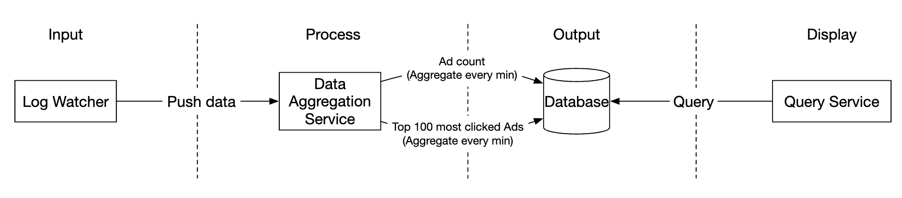
</div>

データは、入力と出力の両方で無限のデータストリームとして流れます。

コンシューマーのクラッシュによってシステム全体が停止しかねない同期的なシンクを避けるため、
メッセージキュー（Kafka）を使った非同期処理を活用し、コンシューマーとプロデューサーを疎結合にします。

<div style="margin-left:3rem">
    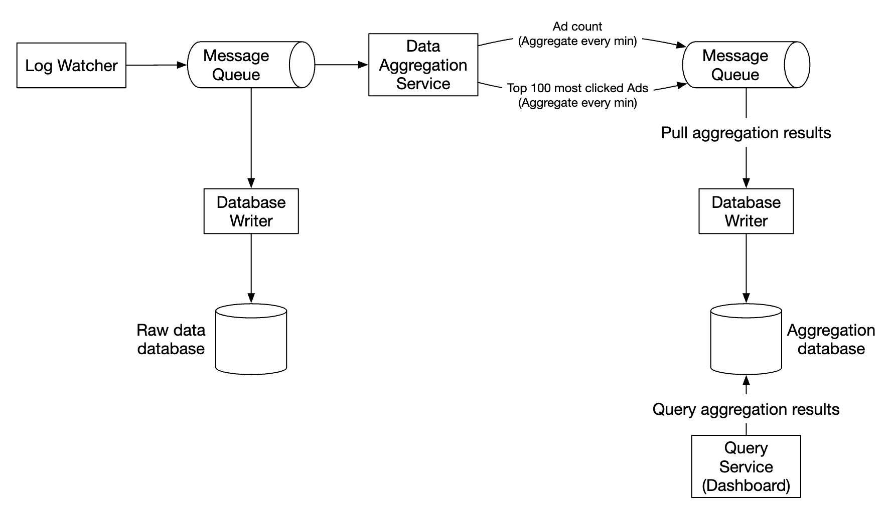
</div>

1つ目のメッセージキューは、広告クリックイベントのデータを保存します。
| ad_id | click_timestamp | user_id | ip | country |
|-------|-----------------|---------|----|---------|

2つ目のメッセージキューには、1分ごとに集計された広告クリック数が含まれます。
| ad_id | click_minute | count |
|-------|--------------|-------|

また、1分ごとに集計された、クリック数上位N件の広告も含まれます。
| update_time_minute | most_clicked_ads |
|--------------------|------------------|

2つ目のメッセージキューは、エンドツーエンドでexactly-onceのアトミックなコミットのセマンティクスを実現するために存在します。

<div style="margin-left:3rem">
    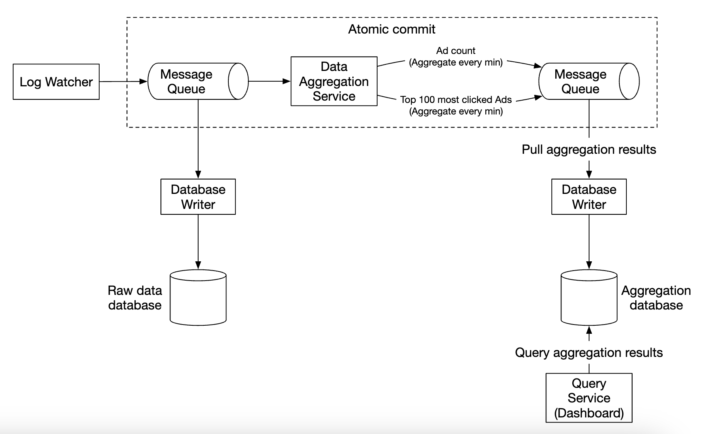
</div>

集計サービスには、MapReduceフレームワークを使うのが良い選択肢です。

<div style="margin-left:3rem">
    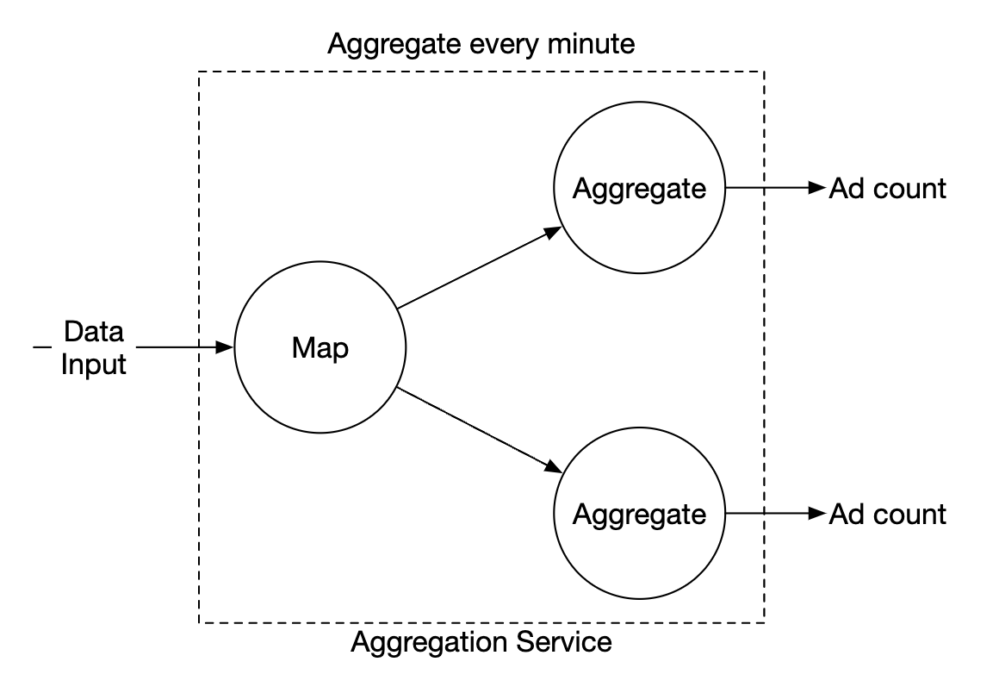
</div>

<div style="margin-left:3rem">
    
</div>

各ノードは1つのタスクを担当し、処理結果を下流のノードに送ります。

Mapノードは、データソースから読み取り、データをフィルタリング・変換する役割を担います。

例えば、Mapノードは `ad_id` に基づいてデータをさまざまな集計ノードに割り当てることができます。

<div style="margin-left:3rem">
    
</div>

あるいは、広告をKafkaのパーティションに分散させ、集計ノードがコンシューマーグループ内で直接購読するようにもできます。
しかし、Mapノードを使えば、後続の処理の前にデータをサニタイズまたは変換できます。

もう1つの理由として、データがどのように生成されるかを制御できないため、
同じ `ad_id` に関連するイベントが異なるパーティションに入る可能性があることが挙げられます。

Aggregateノードは、1分ごとにメモリ内で `ad_id` ごとに広告クリックイベントをカウントします。

Reduceノードは、Aggregateノードから集計結果を集め、最終結果を生成します。

<div style="margin-left:3rem">
    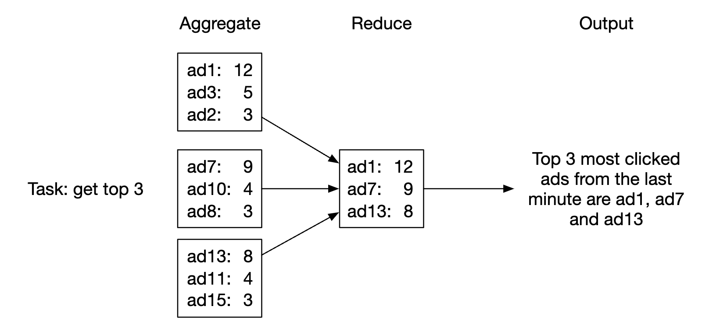
</div>

このDAGモデルはMapReduceのパラダイムを使っています。ビッグデータを受け取り、並列分散コンピューティングを活用して通常サイズのデータに変換します。

DAGモデルでは、中間データはメモリ内に保存され、異なるノードはTCPまたは共有メモリを使って互いに通信します。

このモデルがさまざまなユースケースの実現にどのように役立つかを見ていきましょう。

**ユースケース1 - クリック数を集計する**:

<div style="margin-left:3rem">
    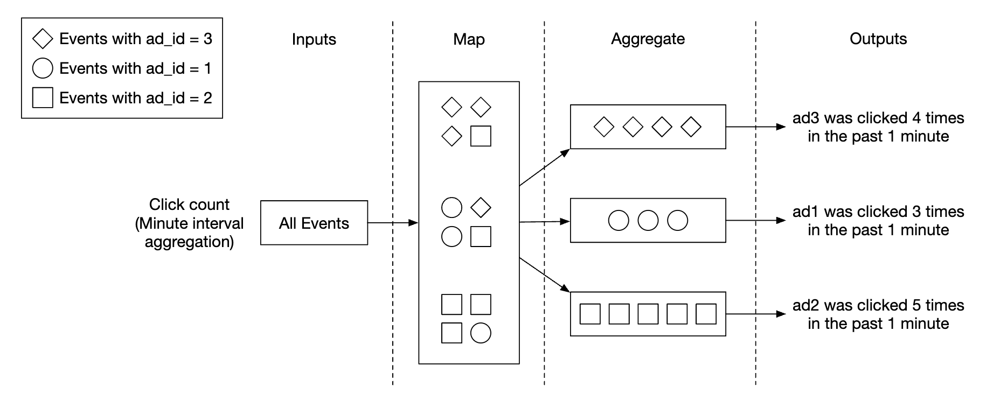
</div>

 - 広告は `ad_id % 3` を使ってパーティショニングされる

**ユースケース2 - 最もクリックされた上位N件の広告を返す**:

<div style="margin-left:3rem">
    
</div>

 - この例では上位3件の広告を集計しているが、上位N件の広告に容易に拡張できる
 - 各ノードは、上位N件の広告を高速に取得するためにヒープデータ構造を保持する

**ユースケース3 - データのフィルタリング**:
高速なデータフィルタリングをサポートするため、フィルタリング条件をあらかじめ定義し、それに基づいて事前集計できます。
| ad_id | click_minute | country | count |
|-------|--------------|---------|-------|
| ad001 | 202101010001 | USA     | 100   |
| ad001 | 202101010001 | GPB     | 200   |
| ad001 | 202101010001 | others  | 3000  |
| ad002 | 202101010001 | USA     | 10    |
| ad002 | 202101010001 | GPB     | 25    |
| ad002 | 202101010001 | others  | 12    |

この手法は**スタースキーマ**と呼ばれ、データウェアハウスで広く使われています。
フィルタリングのフィールドは**ディメンション**と呼ばれます。

このアプローチには次の利点があります。
 - 理解しやすく、構築も簡単
 - 既存の集計サービスを再利用して、スタースキーマにさらにディメンションを作成できる
 - 結果が事前に計算されているため、フィルタリング条件に基づくデータへのアクセスが高速

このアプローチの制約は、特にフィルタリング条件が多い場合に、はるかに多くのバケットとレコードが作成されることです。

---

## ステップ3: 設計の深掘り
より興味深いトピックのいくつかを深掘りしましょう。

### **ストリーミングとバッチ**
提案した高レベルアーキテクチャは、ストリーム処理システムの一種です。
3種類のシステムの比較は次のとおりです。
|                         | サービス（オンラインシステム） | バッチシステム（オフラインシステム）                   | ストリーミングシステム（ニアリアルタイムシステム） |
|-------------------------|-------------------------------|--------------------------------------------------------|----------------------------------------------|
| 応答性                  | クライアントに素早く応答する  | クライアントへの応答は不要                             | クライアントへの応答は不要                   |
| 入力                    | ユーザーのリクエスト          | 有限サイズの有界な入力。大量のデータ                   | 入力に境界がない（無限のストリーム）         |
| 出力                    | クライアントへのレスポンス    | マテリアライズドビュー、集計されたメトリクスなど       | マテリアライズドビュー、集計されたメトリクスなど |
| 性能の測定              | 可用性、レイテンシ            | スループット                                           | スループット、レイテンシ                     |
| 例                      | オンラインショッピング        | MapReduce                                              | Flink [13]                                   |

私たちの設計では、バッチとストリーミングを組み合わせて使いました。

データが到着したときに処理し、ニアリアルタイムで集計結果を生成するためにストリーミングを使いました。
一方、過去データのバックアップにはバッチを使いました。

バッチとストリーミングという2つの処理経路を同時に持つシステムのアーキテクチャは、ラムダアーキテクチャと呼ばれます。
欠点は、2つの処理経路があり、2つの異なるコードベースを保守しなければならないことです。

カッパアーキテクチャは代替のアーキテクチャで、バッチ処理とストリーム処理を1つの処理経路にまとめます。
鍵となる考え方は、単一のストリーム処理エンジンを使うことです。

ラムダアーキテクチャ:

<div style="margin-left:3rem">
    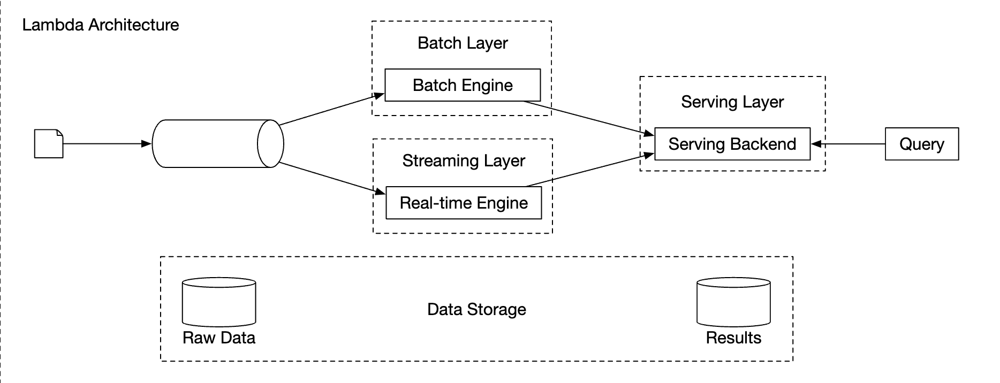
</div>

カッパアーキテクチャ:

<div style="margin-left:3rem">
    
</div>

過去データの再処理も集計サービスを経由するため、私たちの高レベル設計はカッパアーキテクチャを使っています。

例えば集計ロジックの重大なバグなどにより集計データを再計算しなければならない場合は、保存してある生データから集計を再計算できます。
 - 再計算サービスが生データのストレージからデータを取得する。これはバッチジョブである。
 - リアルタイム処理の集計サービスに影響を与えないよう、取得したデータは専用の集計サービスに送られる。
 - 集計結果は2つ目のメッセージキューに送られ、その後、集計データベース内の結果を更新する。

<div style="margin-left:3rem">
    
</div>

### **時刻**
集計を行うにはタイムスタンプが必要です。タイムスタンプは2か所で生成できます。
 - イベント時刻 - 広告のクリックが発生した時刻
 - 処理時刻 - サーバーがイベントを処理したときのシステム時刻

非同期処理（メッセージキュー）の使用とネットワークの遅延により、イベント時刻と処理時刻の間に大きな差が生じることがあります。
 - 処理時刻を使うと、集計結果が不正確になる可能性がある
 - イベント時刻を使うと、遅延したイベントに対処しなければならない

完璧な解決策はなく、トレードオフを考慮する必要があります。
|                 | 長所                                  | 短所                                                                                 |
|-----------------|---------------------------------------|--------------------------------------------------------------------------------------|
| イベント時刻    | 集計結果がより正確                    | クライアントの時刻が間違っている可能性や、悪意のあるユーザーがタイムスタンプを生成する可能性がある |
| 処理時刻        | サーバーのタイムスタンプの方が信頼できる | イベントが遅れて到着した場合、タイムスタンプが正確でない                           |

データの正確性が重要であるため、集計にはイベント時刻を使います。

遅延したイベントの問題を緩和するため、「ウォーターマーク」と呼ばれる手法を活用できます。

以下の例では、イベント2は集計されるべきウィンドウに間に合っていません。

<div style="margin-left:3rem">
    
</div>

しかし、意図的に集計ウィンドウを延長すれば、イベントを取りこぼす可能性を減らせます。
ウィンドウの延長部分は「ウォーターマーク」と呼ばれます。

<div style="margin-left:3rem">
    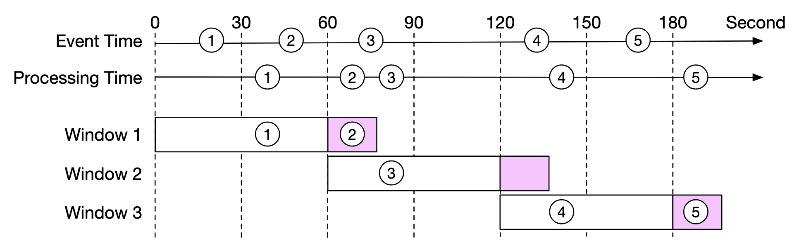
</div>

 - ウォーターマークが短いと、イベントを取りこぼす可能性が高まるが、レイテンシは低くなる
 - ウォーターマークが長いと、イベントを取りこぼす可能性は減るが、レイテンシは高くなる

ウォーターマークのサイズにかかわらず、イベントを取りこぼす可能性は常にあります。しかし、そのような確率の低いイベントのために最適化しても意味がありません。

代わりに、日次の照合（リコンシリエーション）を行うことで、そのような不整合を解消できます。

### **集計ウィンドウ**
ウィンドウ関数には4つの種類があります。
 - タンブリング（固定）ウィンドウ
 - ホッピングウィンドウ
 - スライディングウィンドウ
 - セッションウィンドウ

私たちの設計では、広告クリックの集計にタンブリングウィンドウを活用します。

<div style="margin-left:3rem">
    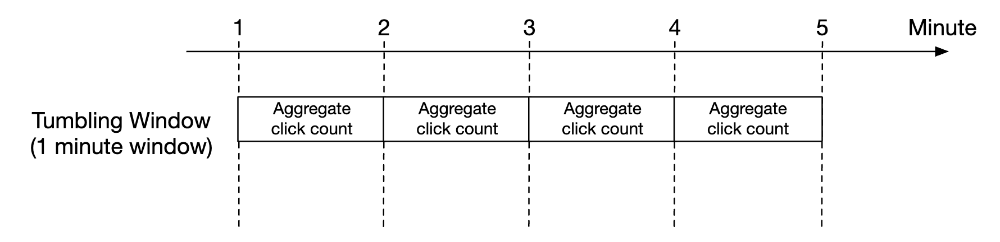
</div>

また、M分間でクリック数上位N件の広告の集計にはスライディングウィンドウを活用します。

<div style="margin-left:3rem">
    
</div>

### **配信の保証**
集計するデータは請求に使われるため、データの正確性が最優先です。

そのため、次の点について議論する必要があります。
 - 重複したイベントの処理をどう避けるか
 - すべてのイベントが処理されることをどう保証するか

使える配信保証には、at-most-once、at-least-once、exactly-onceの3つがあります。

ほとんどの状況では、少量の重複が許容されるのであれば、at-least-onceで十分です。
しかし、私たちのシステムではそうではありません。わずかな割合の差が数百万ドルの食い違いにつながる可能性があるためです。
そのため、exactly-onceの配信セマンティクスを使う必要があります。

### **データの重複排除**
最も一般的なデータ品質の問題の1つは、データの重複です。

重複は、さまざまな原因から発生します。
 - クライアント側 - クライアントが同じイベントを複数回再送する可能性がある。悪意を持って送信された重複イベントは、リスクエンジンで処理するのが最善である。
 - サーバーの障害 - 集計の途中で集計サービスのノードがダウンし、上流のサービスが確認応答を受け取っていないため、イベントが再送される。

最後のホップでイベントの確認応答に失敗したことによってデータの重複が発生する例を示します。

<div style="margin-left:3rem">
    
</div>

この例では、オフセット100が複数回処理され、下流に送られます。

これを緩和する1つの選択肢は、最後に確認したオフセットをHDFS/S3に保存することですが、これでは結果が下流に届かないリスクがあります。

<div style="margin-left:3rem">
    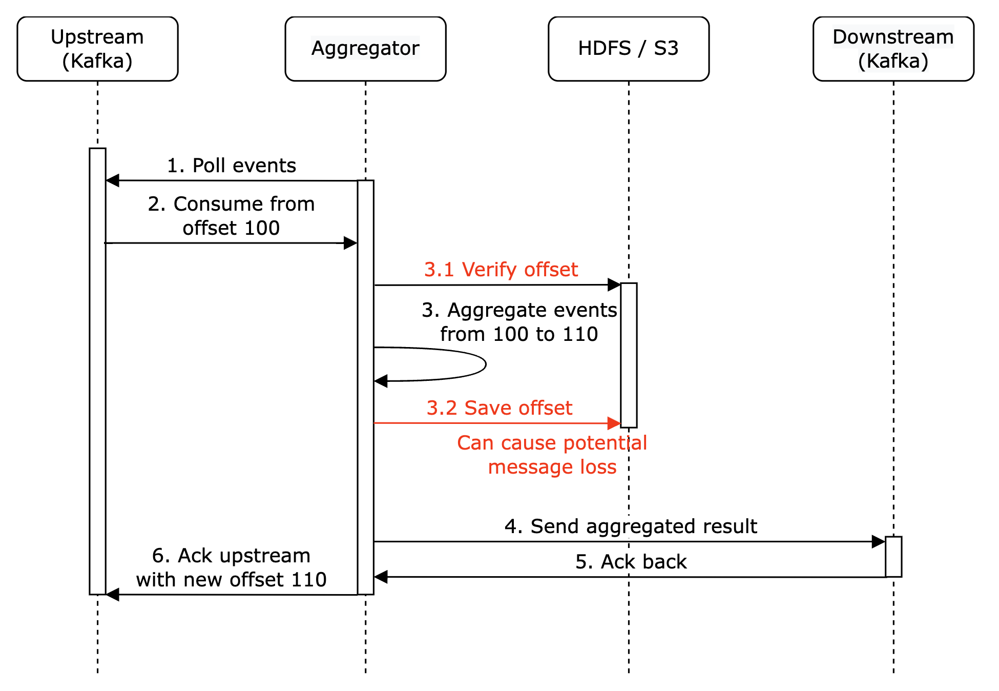
</div>

最終的に、下流とのやり取りとオフセットの保存をアトミックに行うことができます。これを実現するには、分散トランザクションを実装する必要があります。

<div style="margin-left:3rem">
    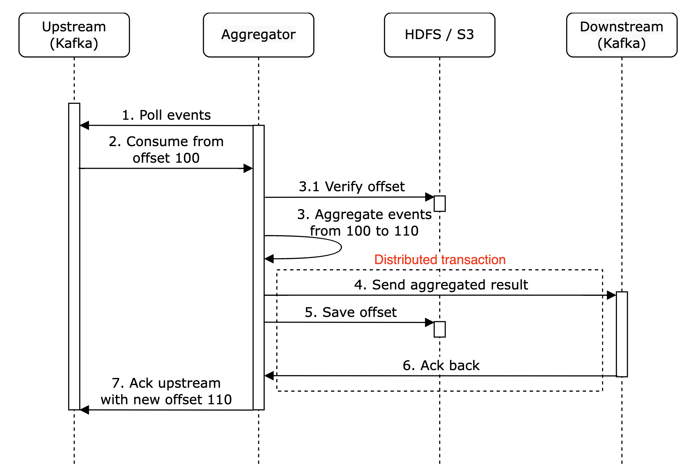
</div>

**個人的な補足**: あるいは、下流のシステムが集計結果を冪等に処理するのであれば、分散トランザクションは不要です。

### **システムのスケーリング**
システムの成長に合わせて、どのようにスケールさせるかを議論しましょう。

メッセージキュー、集計サービス、データベースという3つの独立したコンポーネントがあります。
これらは疎結合であるため、独立してスケールさせられます。

メッセージキューのスケーリング方法:
 - プロデューサーには制限を設けていないため、容易にスケールできる
 - コンシューマーは、コンシューマーグループに割り当ててコンシューマーの数を増やすことでスケールできる
 - これが機能するためには、事前に十分な数のパーティションを作成しておく必要もある
 - また、コンシューマーが数千ある場合、コンシューマーのリバランスに時間がかかることがあるため、ピーク時間外に行うことが推奨される
 - 地域ごとにトピックをパーティショニングすることも検討できる。例: `topic_na`、`topic_eu` など

<div style="margin-left:3rem">
    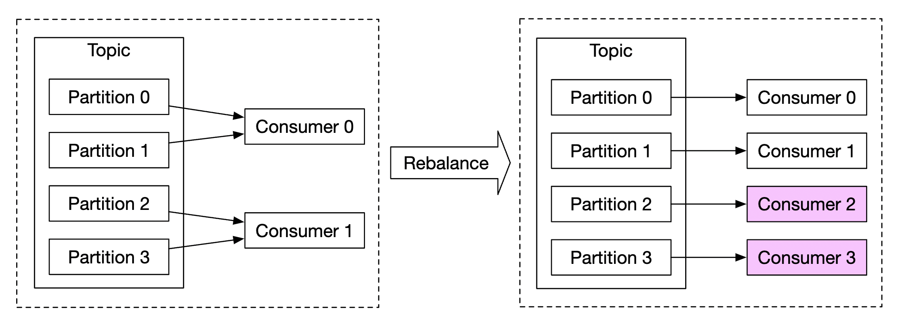
</div>

集計サービスのスケーリング方法:

<div style="margin-left:3rem">
    
</div>

 - MapReduceのノードは、ノードを追加することで容易にスケールできる
 - 集計サービスのスループットは、マルチスレッドを活用することでスケールできる
 - あるいは、Apache YARNのようなリソースプロバイダーを活用してマルチプロセスを利用できる
 - 選択肢1の方が簡単だが、よりスケーラブルであるため、実際には選択肢2の方が広く使われている
 - マルチスレッドの例を示す:

<div style="margin-left:3rem">
    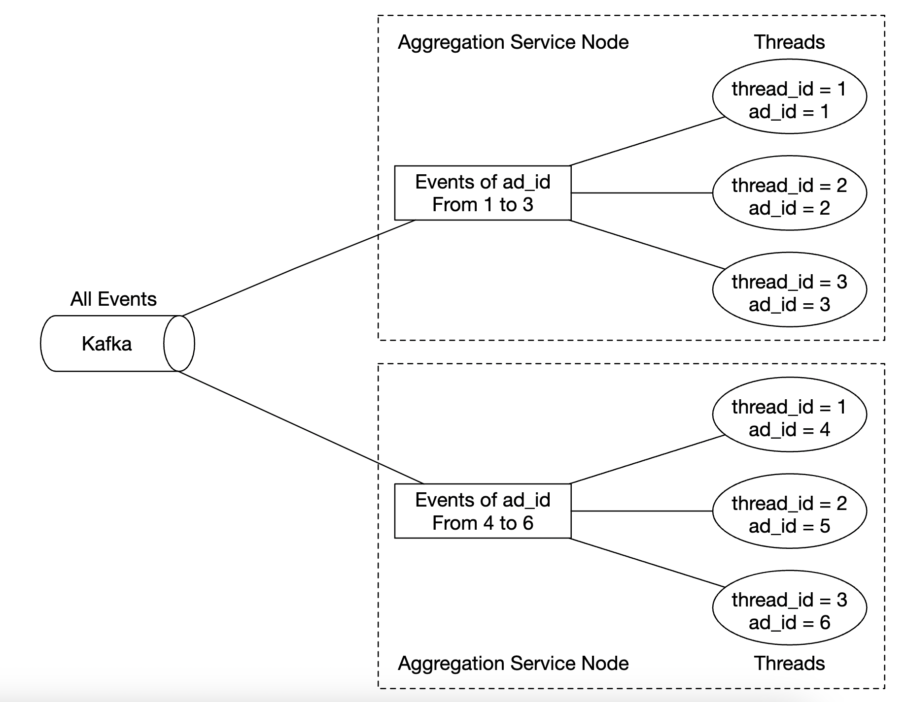
</div>

データベースのスケーリング方法:
 - Cassandraを使う場合、コンシステントハッシュを利用した水平スケーリングをネイティブにサポートしている
 - クラスターに新しいノードが追加されると、データはすべての（仮想）ノード間で自動的にリバランスされる
 - このアプローチでは、手動での（再）シャーディングは不要

<div style="margin-left:3rem">
    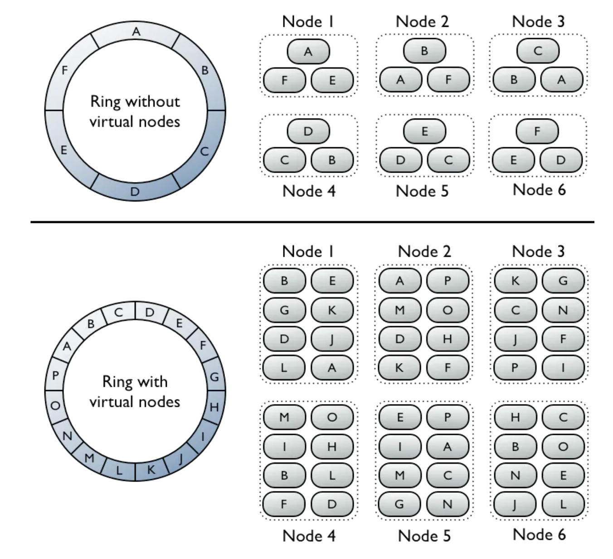
</div>

検討すべきもう1つのスケーラビリティの問題はホットスポットの問題です。ある広告が他よりも人気があり、より多くの注目を集めた場合はどうなるでしょうか？

<div style="margin-left:3rem">
    
</div>

 - 上の例では、集計サービスのノードはリソースマネージャーを介して追加のリソースを申請できる
 - リソースマネージャーがより多くのリソースを割り当てるため、元のノードは過負荷にならない
 - 元のノードはイベントを3つのグループに分割し、各集計ノードが100件のイベントを処理する
 - 結果は元の集計ノードに書き戻される

ホットスポットの問題に対処する、より洗練された代替手段:
 - グローバル-ローカル集計
 - スプリットディスティンクト集計

### **耐障害性**
集計ノード内では、データをメモリ内で処理しています。ノードがダウンすると、処理済みのデータが失われます。

別のノードが処理を引き継いだら、Kafkaのコンシューマーオフセットを活用して中断したところから再開できます。
しかし、M分間の上位N件の広告を集計しているため、保持する必要のある追加の中間状態があります。

進行中の集計について、特定の分の時点でスナップショットを作成できます。

<div style="margin-left:3rem">
    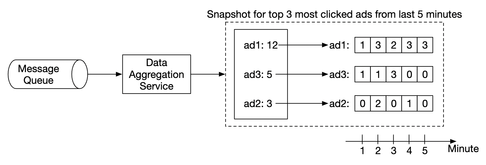
</div>

ノードがダウンした場合、新しいノードは最新のコミット済みコンシューマーオフセットと最新のスナップショットを読み取って、ジョブを続行できます。

<div style="margin-left:3rem">
    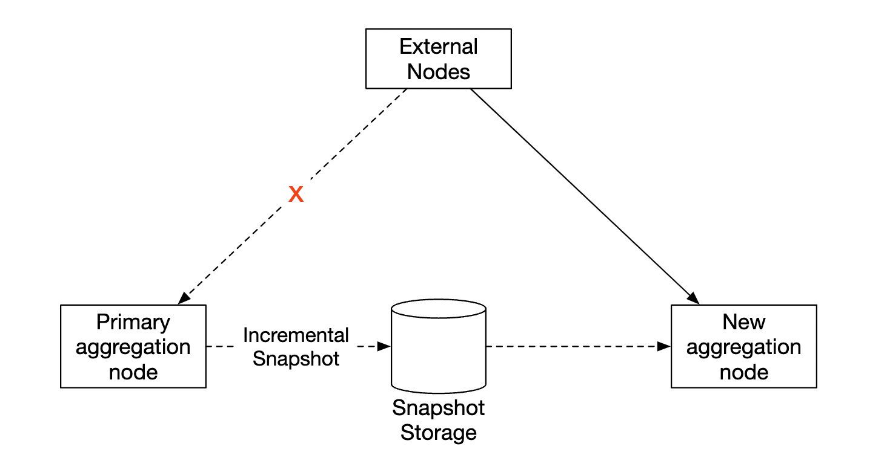
</div>

### **データの監視と正確性**
集計するデータは請求に使われる重要なものであるため、正確性を確保するために厳格な監視を行うことが非常に重要です。

監視したいメトリクスの例:
 - **レイテンシ**: システムのエンドツーエンドのレイテンシを把握するため、さまざまなイベントのタイムスタンプを追跡できる
 - **メッセージキューのサイズ**: キューのサイズが急増した場合は、集計ノードを追加する必要がある。Kafkaは分散コミットログとして実装されているため、代わりにrecords-lagメトリクスを追跡する必要がある。
 - **集計ノードのシステムリソース**: CPU、ディスク、JVMなど

また、1日の終わりに実行されるバッチジョブとして、照合（リコンシリエーション）のフローを実装する必要があります。
このフローは生データから集計結果を計算し、集計データベースに保存されている実際のデータと比較します。

<div style="margin-left:3rem">
    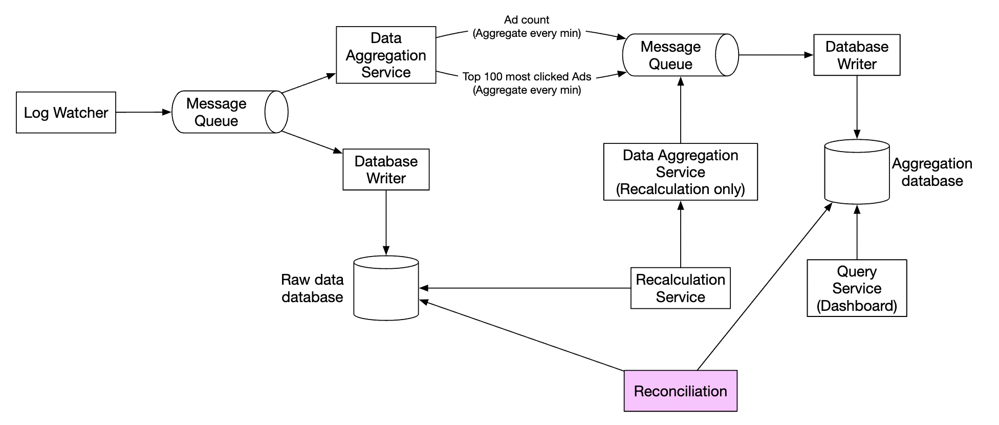
</div>

### **代替の設計**
汎用的なシステム設計面接では、ビッグデータ処理で使われる専門的なソフトウェアの内部を知っていることは期待されていません。

特定のツールを知っていることよりも、思考プロセスを説明し、トレードオフを議論することの方が重要です。そのため、本章では汎用的な解決策を扱っています。

既製のツールを活用する代替の設計としては、広告クリックデータをHiveに保存し、クエリを高速化するためにその上にElasticsearchの層を構築する方法があります。

集計は通常、ClickHouseやDruidのようなOLAPデータベースで行われます。

<div style="margin-left:3rem">
    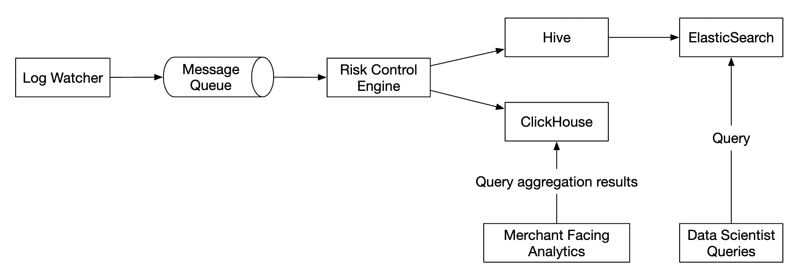
</div>

---

## ステップ4: まとめ
取り上げた内容:
 - データモデルとAPIの設計
 - MapReduceを使った広告クリックイベントの集計
 - メッセージキュー、集計サービス、データベースのスケーリング
 - ホットスポットの問題の緩和
 - システムの継続的な監視
 - 照合（リコンシリエーション）による正確性の確保
 - 耐障害性

広告クリックイベント集計は、典型的なビッグデータ処理システムです。

関連する技術について事前に知識があれば、理解や設計がより容易になるでしょう。
 - Apache Kafka
 - Apache Spark
 - Apache Flink
