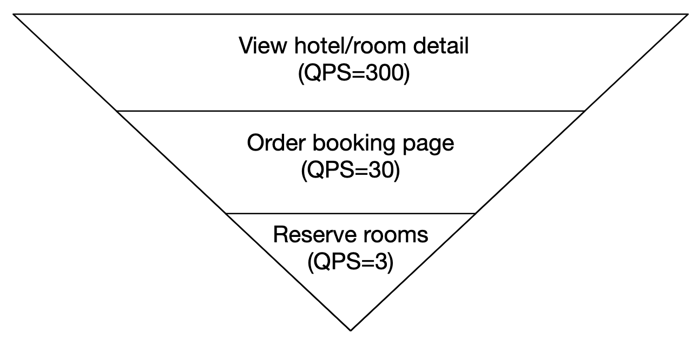
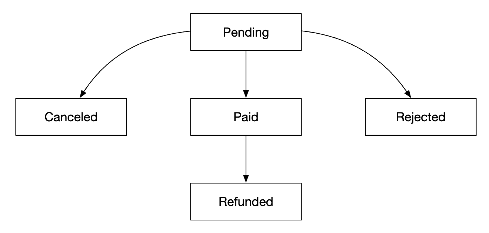
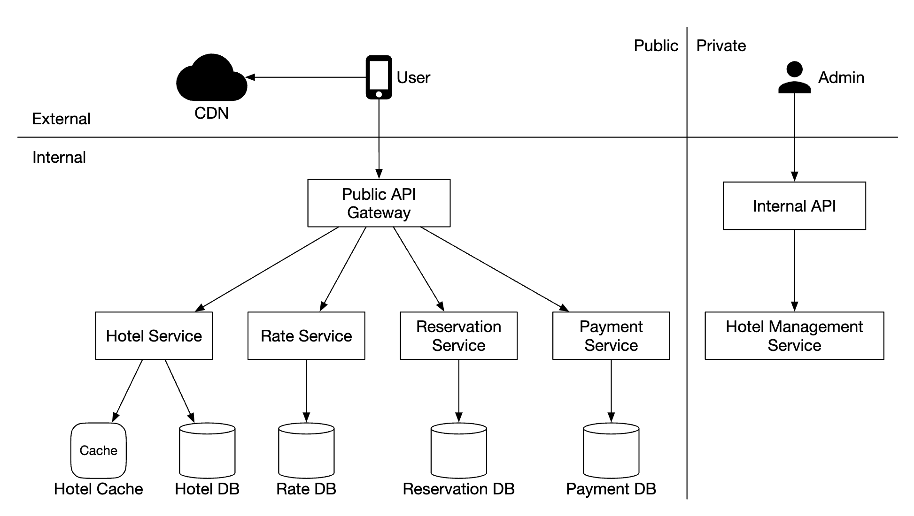
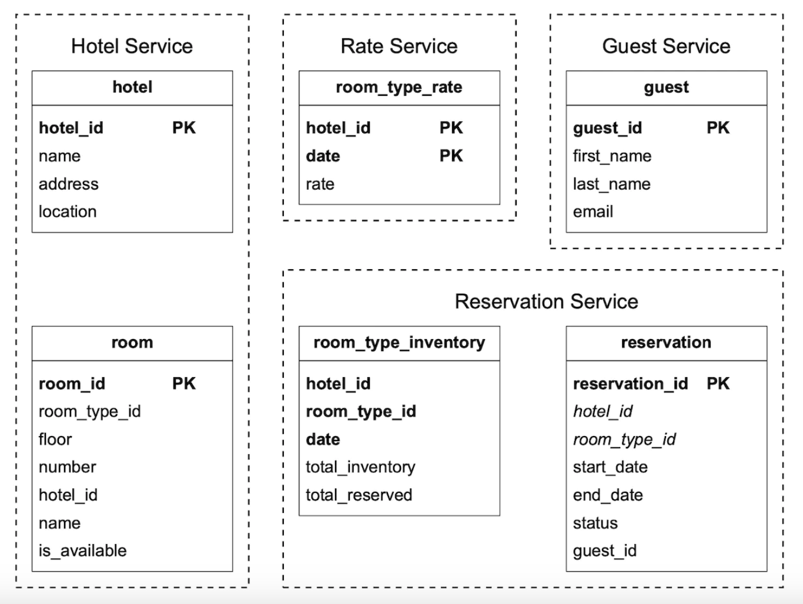
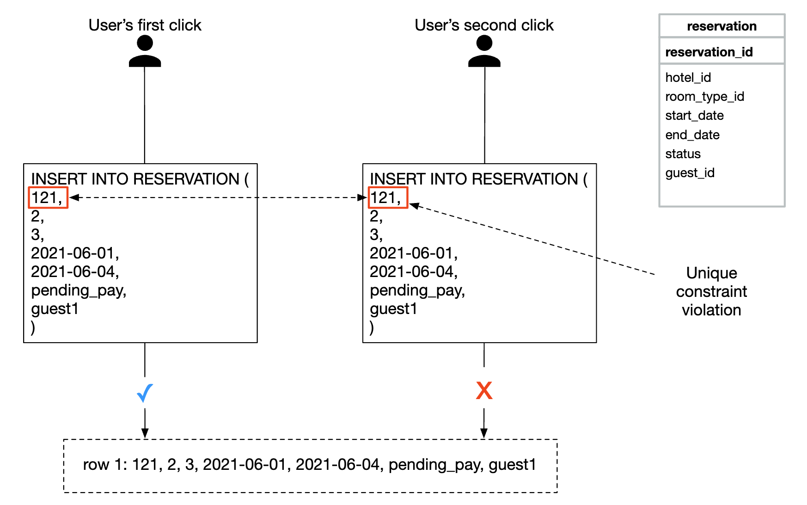
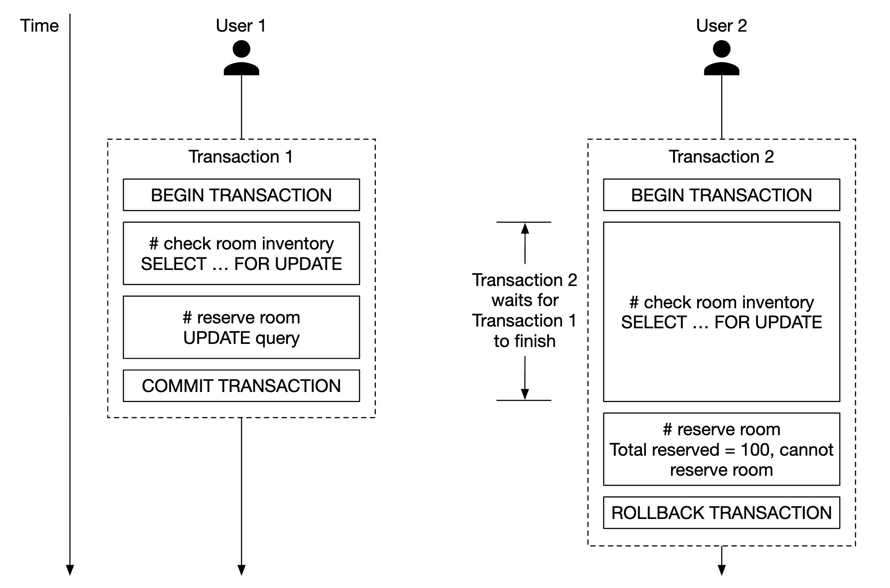
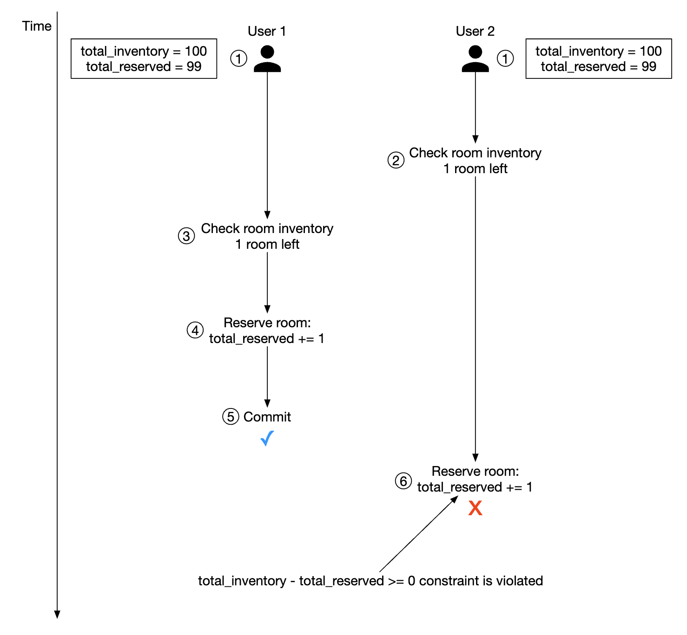

# 第22章: ホテル予約システム

## はじめに
本章では、Marriott Internationalのような**ホテル予約システム**を設計します。

他の種類のシステム（Airbnb、航空券予約、映画チケット予約）にも応用できます。

---

## ステップ1: 問題を理解し、設計の範囲を定める
システムの設計に入る前に、範囲を明確にするため面接官に質問すべきです。
 - C: システムの規模はどのくらいですか？
 - I: 5,000軒のホテルと100万室を持つホテルチェーンのWebサイトを構築します。
 - C: 顧客は予約時に支払いますか、それともホテル到着時に支払いますか？
 - I: 予約時に全額を支払います。
 - C: 顧客はWebサイトからのみホテルの部屋を予約しますか？ 電話など他の予約手段をサポートする必要はありますか？
 - I: 予約はWebサイトまたはアプリからのみ行います。
 - C: 顧客は予約をキャンセルできますか？
 - I: はい。
 - C: 他に考慮すべきことはありますか？
 - I: はい、10%のオーバーブッキングを許可します。ホテルは実際の部屋数より多くの部屋を販売します。顧客が予約をキャンセルすることを見込んで、ホテルはこれを行います。
 - C: 時間があまりないので、ホテル関連のページの表示、客室詳細ページ、部屋の予約、管理パネル、オーバーブッキングのサポートに焦点を当てます。
 - I: よいでしょう。
 - I: もう1点、ホテルの価格は常に変動します。客室の価格は毎日変わると仮定してください。
 - C: わかりました。

### **非機能要件**
 - 高い同時実行性のサポート - 繁忙期には多くの顧客が同じホテルを予約しようとする可能性がある。
 - 中程度のレイテンシ - ユーザーが予約するときのレイテンシは低いのが理想だが、システムが処理に数秒かかっても許容される。

### **概算見積もり**
 - 合計5,000軒のホテルと100万室
 - 客室の70%が埋まっており、平均滞在期間が3日だと仮定する
 - 1日あたりの推定予約数 - 100万 * 0.7 / 3 = 1日あたり約24万件の予約
 - 1秒あたりの予約数 - 24万 / 1日の秒数10^5 = 約3。平均の予約TPSは低い。

QPSを見積もりましょう。予約ページに到達するまでに3つのステップがあり、ページごとのコンバージョン率が10%だと仮定すると、
予約が3件あれば、予約ページの閲覧は30回、客室詳細ページの閲覧は300回あるはずだと見積もれます。

<div style="margin-left:3rem">
    
</div>

---

## ステップ2: 高レベル設計を提案し、合意を得る
API設計、データモデル、高レベル設計を検討します。

### **API設計**
このAPI設計では、ホテル予約システムをサポートするために必要な中核のエンドポイント（RESTfulの慣行に従う）に焦点を当てます。

本格的なシステムでは、さまざまな条件に基づいて部屋を検索するためのより広範なAPIが必要になりますが、このセクションではそれには焦点を当てません。
技術的に難しくないため、範囲外とします。

**ホテル関連のAPI**
 - `GET /v1/hotels/{id}` - ホテルの詳細情報を取得する
 - `POST /v1/hotels` - 新しいホテルを追加する。運用スタッフのみ利用可能
 - `PUT /v1/hotels/{id}` - ホテル情報を更新する。運用スタッフのみ利用可能
 - `DELETE /v1/hotels/{id}` - ホテルを削除する。運用スタッフのみ利用可能

**客室関連のAPI**
 - `GET /v1/hotels/{id}/rooms/{id}` - 客室の詳細情報を取得する
 - `POST /v1/hotels/{id}/rooms` - 客室を追加する。運用スタッフのみ利用可能
 - `PUT /v1/hotels/{id}/rooms/{id}` - 客室情報を更新する。運用スタッフのみ利用可能
 - `DELETE /v1/hotels/{id}/rooms/{id}` - 客室を削除する。運用スタッフのみ利用可能

**予約関連のAPI**
 - `GET /v1/reservations` - 現在のユーザーの予約履歴を取得する
 - `GET /v1/reservations/{id}` - 予約の詳細情報を取得する
 - `POST /v1/reservations` - 新しい予約を行う
 - `DELETE /v1/reservations/{id}` - 予約をキャンセルする

予約を行うリクエストの例を示します。

```
{
  "startDate":"2021-04-28",
  "endDate":"2021-04-30",
  "hotelID":"245",
  "roomID":"U12354673389",
  "reservationID":"13422445"
}
```

`reservationID` は、二重予約を避けるための冪等キーであることに注意してください。詳細は[同時実行の問題のセクション](#同時実行の問題)で説明します。

### **データモデル**
使用するデータベースを選ぶ前に、アクセスパターンを検討しましょう。

次のクエリをサポートする必要があります。
 - ホテルの詳細情報を閲覧する
 - 日付の範囲を指定して、空いている客室タイプを見つける
 - 予約を記録する
 - 予約または過去の予約履歴を検索する

見積もりから、システムの規模は大きくないことがわかっていますが、トラフィックの急増には備える必要があります。

これを踏まえ、次の理由でリレーショナルデータベースを選びます。
 - リレーショナルDBは、読み取りが多く書き込みが少ないシステムに適している。
 - NoSQLデータベースは通常書き込みに最適化されているが、サイトを訪れたユーザーのうち予約するのはごく一部なので、書き込みは多くないことがわかっている。
 - リレーショナルDBはACIDの保証を提供する。これがなければ、残高のマイナスや二重請求などの問題を防げないため、このようなシステムにとって重要である。
 - 構造が非常に明確なので、リレーショナルDBでデータを容易にモデル化できる。

スキーマ設計は次のとおりです。

<div style="margin-left:3rem">
    
</div>

ほとんどのフィールドは説明不要です。言及に値する唯一のフィールドは `status` フィールドで、これは客室の状態遷移（ステートマシン）を表します。

<div style="margin-left:3rem">
    
</div>

このデータモデルはAirbnbのようなシステムには適していますが、ユーザーが特定の部屋ではなく客室タイプを予約するホテルには適していません。
ホテルでは、ユーザーは客室タイプを予約し、部屋番号は予約の時点で選ばれます。

この欠点は[改善されたデータモデル](#改善されたデータモデル)のセクションで対処します。

### **高レベル設計**
この設計にはマイクロサービスアーキテクチャを選びました。近年、非常に人気が高まっています。

<div style="margin-left:3rem">
    
</div>

 - **ユーザー**: スマートフォンやコンピューターでホテルの部屋を予約する
 - **管理者**: 支払いの返金/キャンセルなどの管理機能を実行する
 - **CDN**: JSバンドル、画像、動画などの静的リソースをキャッシュする
 - **公開APIゲートウェイ**: レート制限、認証などをサポートするフルマネージドサービス
 - **内部API**: 認可されたスタッフにのみ公開される。通常はVPNで保護される。
 - **ホテルサービス**: ホテルと客室の詳細情報を提供する。ホテルと客室のデータは静的なので、積極的にキャッシュできる。
 - **料金サービス**: 将来のさまざまな日付の客室料金を提供する。このドメインの興味深い点は、価格がその日のホテルの埋まり具合に依存することである。
 - **予約サービス**: 予約リクエストを受け取り、ホテルの部屋を予約する。予約の作成/キャンセルに応じて客室の在庫も追跡する。
 - **決済サービス**: 支払いを処理し、成功したら予約のステータスを更新する。
 - **ホテル管理サービス**: 認可されたスタッフのみが利用できる。予約やホテルなどを管理・閲覧するための特定の管理機能を提供する。

サービス間の通信は、gRPCなどのRPCフレームワークを介して行えます。

---

## ステップ3: 設計の深掘り
次の点を深掘りしましょう。
 - 改善されたデータモデル
 - 同時実行の問題
 - スケーラビリティ
 - マイクロサービスにおけるデータ不整合の解決

### **改善されたデータモデル**
前のセクションで述べたように、特定の部屋ではなく客室タイプを予約できるよう、APIとスキーマを修正する必要があります。

予約APIでは、もはや `roomID` を予約するのではなく、`roomTypeID` を予約します。

```
POST /v1/reservations
{
  "startDate":"2021-04-28",
  "endDate":"2021-04-30",
  "hotelID":"245",
  "roomTypeID":"12354673389",
  "roomCount":"3",
  "reservationID":"13422445"
}
```

更新されたスキーマは次のとおりです。

<div style="margin-left:3rem">
    
</div>

 - **room**: 客室に関する情報を含む
 - **room_type_rate**: 客室タイプごとの価格に関する情報を含む
 - **reservation**: 宿泊客の予約データを記録する
 - **room_type_inventory**: ホテルの客室の在庫データを保存する。

`room_type_inventory` テーブルの方が興味深いので、その列を見てみましょう。
 - **hotel_id**: ホテルのID
 - **room_type_id**: 客室タイプのID
 - **date**: 単一の日付
 - **total_inventory**: 客室の総数から、一時的に在庫から外されている部屋を除いた数。
 - **total_reserved**: (hotel_id, room_type_id, date) について予約された部屋の総数

このテーブルを設計する方法は他にもありますが、(hotel_id, room_type_id, date) ごとに1行を持つことで、
予約の管理が容易になり、クエリも簡単になります。

テーブルの行は、日次のCRONジョブを使って事前に作成されます。

サンプルデータ:
| hotel_id | room_type_id | date       | total_inventory | total_reserved |
|----------|--------------|------------|-----------------|----------------|
| 211      | 1001         | 2021-06-01 | 100             | 80             |
| 211      | 1001         | 2021-06-02 | 100             | 82             |
| 211      | 1001         | 2021-06-03 | 100             | 86             |
| 211      | 1001         | ...        | ...             |                |
| 211      | 1001         | 2023-05-31 | 100             | 0              |
| 211      | 1002         | 2021-06-01 | 200             | 16             |
| 2210     | 101          | 2021-06-01 | 30              | 23             |
| 2210     | 101          | 2021-06-02 | 30              | 25             |

客室タイプの空き状況を確認するSQLクエリの例:

```
SELECT date, total_inventory, total_reserved
FROM room_type_inventory
WHERE room_type_id = ${roomTypeId} AND hotel_id = ${hotelId}
AND date between ${startDate} and ${endDate}
```

このデータを使って、指定した数の部屋の空き状況を確認する方法（オーバーブッキングをサポートしていることに注意）:

```
if (total_reserved + ${numberOfRoomsToReserve}) <= 110% * total_inventory
```

次に、ストレージの量を見積もりましょう。
 - ホテルは5,000軒ある。
 - 各ホテルには20種類の客室タイプがある。
 - 5000 * 20 * 2（年） * 365（日） = 7,300万行

7,300万行はそれほど多いデータではなく、1台のデータベースサーバーで処理できます。
ただし、高可用性を実現するために、（場合によっては異なるゾーンにまたがって）リードレプリケーションを設定するのは理にかなっています。

フォローアップの質問 - 予約データが1台のデータベースには大きすぎる場合、どうしますか？
 - 現在と将来の予約データのみを保存する。予約履歴はコールドストレージに移せる。
 - データベースのシャーディング - クエリでは常に `hotel_id` を指定するため、`hash(hotel_id) % servers_cnt` でデータをシャーディングできる。

### **同時実行の問題**
対処すべきもう1つの重要な問題は、二重予約です。

対処すべき問題は2つあります。
 - 同じユーザーが「予約」を2回クリックする
 - 複数のユーザーが同時に同じ部屋を予約しようとする

1つ目の問題を図示します。

<div style="margin-left:3rem">
    
</div>

この問題を解決するアプローチは2つあります。
 - クライアント側での処理 - フロントエンドで、予約ボタンがクリックされたら無効化する。ただし、ユーザーがJavaScriptを無効にしている場合、ボタンがグレーアウトされない。
 - 冪等なAPI - APIに冪等キーを追加し、エンドポイントが何回呼び出されても、ユーザーがアクションを1回だけ実行できるようにする。

<div style="margin-left:3rem">
    
</div>

このフローは次のように動作します。
 - 詳細を入力して予約を行う過程で、予約オーダーが生成される。予約オーダーはグローバルに一意な識別子を使って生成される。
 - 前のステップで生成された `reservation_id` を使って予約1を送信する。
 - 「予約を完了」が2回目にクリックされた場合、同じ `reservation_id` が送信され、バックエンドはこれが重複した予約であることを検出する。
 - `reservation_id` 列に一意制約を設けることで、そのIDを持つ複数のレコードがDBに保存されるのを防ぎ、重複を回避する。

<div style="margin-left:3rem">
    
</div>

複数のユーザーが同じ予約を行う場合はどうでしょうか？

<div style="margin-left:3rem">
    
</div>

 - トランザクション分離レベルがSerializableではないと仮定する
 - ユーザー1と2が同時に同じ部屋を予約しようとする。
 - トランザクション1が十分な部屋があるかを確認する - ある
 - トランザクション2が十分な部屋があるかを確認する - ある
 - トランザクション2が部屋を予約し、在庫を更新する
 - トランザクション1も、100室中 `total_reserved` が99室であるとまだ見えているため、部屋を予約する。
 - 両方のトランザクションが変更のコミットに成功する

この問題は、何らかのロックの仕組みを使って解決できます。
 - 悲観的ロック
 - 楽観的ロック
 - データベースの制約

部屋を予約するために使うSQLは次のとおりです。

```sql
# step 1: check room inventory
SELECT date, total_inventory, total_reserved
FROM room_type_inventory
WHERE room_type_id = ${roomTypeId} AND hotel_id = ${hotelId}
AND date between ${startDate} and ${endDate}

# For every entry returned from step 1
if((total_reserved + ${numberOfRoomsToReserve}) > 110% * total_inventory) {
  Rollback
}

# step 2: reserve rooms
UPDATE room_type_inventory
SET total_reserved = total_reserved + ${numberOfRoomsToReserve}
WHERE room_type_id = ${roomTypeId}
AND date between ${startDate} and ${endDate}

Commit
```

#### 選択肢1: 悲観的ロック
悲観的ロックは、レコードの更新中にそのレコードにロックをかけることで、同時更新を防ぎます。

MySQLでは `SELECT... FOR UPDATE` クエリを使うことでこれを実現できます。このクエリは、トランザクションがコミットされるまで、クエリで選択された行をロックします。

<div style="margin-left:3rem">
    
</div>

長所:
 - 変更中のデータをアプリケーションが更新するのを防ぐ
 - 実装が容易で、更新を直列化することで競合を回避する。データの競合が激しい場合に有用。

短所:
 - 複数のリソースがロックされると、デッドロックが発生する可能性がある。
 - このアプローチはスケーラブルではない - トランザクションが長時間ロックされると、そのリソースにアクセスしようとする他のすべてのトランザクションに影響する。
 - クエリが多くのリソースを選択し、トランザクションが長時間続く場合、影響は深刻である。

著者は、スケーラビリティの問題があるため、このアプローチを推奨していません。

#### 選択肢2: 楽観的ロック
楽観的ロックでは、複数のユーザーが同時にレコードの更新を試みることができます。

実装には一般的に2つの方法があります。バージョン番号とタイムスタンプです。サーバーのクロックは不正確な場合があるため、バージョン番号が推奨されます。

<div style="margin-left:3rem">
    
</div>

 - データベースのテーブルに新しい `version` 列を追加する
 - ユーザーがデータベースの行を変更する前に、バージョン番号を読み取る
 - ユーザーが行を更新するとき、バージョン番号を1増やしてデータベースに書き戻す
 - 新しいバージョン番号が以前のものを上回らない場合、データベースの検証によって挿入が阻止される

データベースをロックしないため、楽観的ロックは通常、悲観的ロックより高速です。
ただし、同時実行性が高いと多数のロールバックが発生するため、性能が低下する傾向があります。

長所:
 - アプリケーションが古いデータを編集するのを防ぐ
 - データベースでロックを取得する必要がない
 - データの競合が少ない場合、つまり更新の衝突がまれな場合に好ましい選択肢

短所:
 - データの競合が激しい場合は性能が悪い

予約のQPSは極端に高くないため、楽観的ロックは私たちのシステムにとって良い選択肢です。

#### 選択肢3: データベースの制約
このアプローチは楽観的ロックとよく似ていますが、ガードレールをデータベースの制約を使って実装します。

```
CONSTRAINT `check_room_count` CHECK((`total_inventory - total_reserved` >= 0))
```

<div style="margin-left:3rem">
    
</div>

長所:
 - 実装が容易
 - データの競合が少ない場合にうまく機能する

短所:
 - 楽観的ロックと同様に、データの競合が激しい場合は性能が悪い
 - データベースの制約は、アプリケーションコードのように容易にバージョン管理できない
 - すべてのデータベースが制約をサポートしているわけではない

実装が容易であるため、これもホテル予約システムにとって良い選択肢です。

### **スケーラビリティ**
通常、ホテル予約システムの負荷は高くありません。

しかし面接官は、booking.comのような、より大規模で人気のある旅行サイトでこのシステムが採用された場合にどう対処するかを尋ねるかもしれません。
その場合、QPSは1,000倍になる可能性があります。

そのような状況では、ボトルネックがどこにあるかを理解することが重要です。すべてのサービスはステートレスなので、複製によって容易にスケールできます。

しかし、データベースはステートフルであり、どのようにスケールさせられるかはそれほど明白ではありません。

スケールさせる1つの方法は、データベースのシャーディングを実装することです。データを複数のデータベースに分割し、それぞれがデータの一部を保持するようにします。

すべてのクエリが `hotel_id` に基づいてフィルタリングするため、それに基づいてシャーディングできます。
QPSが30,000だと仮定すると、データベースを16個のシャードに分割した後、各シャードは1,875 QPSを処理することになり、これは単一のMySQLクラスターの負荷容量の範囲内です。

<div style="margin-left:3rem">
    
</div>

また、Redisを介して客室の在庫と予約にキャッシュを活用することもできます。過ぎた日付の古いデータが期限切れになるよう、TTLを設定できます。

<div style="margin-left:3rem">
    
</div>

在庫の保存方法は、`hotel_id`、`room_type_id`、`date` に基づきます。

```
key: hotelID_roomTypeID_{date}
value: the number of available rooms for the given hotel ID, room type ID and date.
```

データの一貫性は非同期に確保され、CDC（変更データキャプチャ）のストリーミングの仕組みを使って管理されます。データベースの変更が読み取られ、別のシステムに適用されます。
Debeziumは、データベースの変更をRedisと同期するための人気のある選択肢です。

このような仕組みを使うと、キャッシュとデータベースがしばらくの間不整合になる可能性があります。
データベースが無効な予約を防いでくれるため、今回のケースではこれで問題ありません。

これによりUI上でいくつかの問題が生じます。ユーザーは「もう空室がない」ことを確認するためにページを更新しなければならないからです。
しかし、これは例えば予約する前に人が長く迷っている場合など、この問題とは関係なく起こり得ることです。

キャッシュの長所:
 - データベースの負荷の削減
 - Redisはデータをメモリ内で管理するため、高性能

キャッシュの短所:
 - キャッシュとDBの間でデータの一貫性を保つのが難しい。不整合がユーザー体験にどう影響するかを考慮する必要がある。

### **サービス間のデータの一貫性**
モノリシックなアプリケーションでは、共有のリレーショナルデータベースを使ってデータの一貫性を確保できます。

私たちのマイクロサービス設計では、一部のサービスは分離しつつ、
予約APIと在庫APIは同じサービスで処理するというハイブリッドなアプローチを選びました。

これは、一貫性を確保するためにリレーショナルデータベースのACID保証を活用したいからです。

しかし、各サービスが専用のデータベースを持つ純粋なマイクロサービスアーキテクチャではないため、面接官がこのアプローチに異議を唱えるかもしれません。

<div style="margin-left:3rem">
    
</div>

純粋なマイクロサービスでは一貫性の問題が生じる可能性があります。モノリシックなサーバーでは、リレーショナルDBのトランザクション機能を活用してアトミックな操作を実装できます。

<div style="margin-left:3rem">
    
</div>

しかし、操作が複数のサービスにまたがる場合、このアトミック性を保証するのはより困難です。

<div style="margin-left:3rem">
    
</div>

こうしたデータの不整合に対処するための、よく知られた手法がいくつかあります。
 - **2フェーズコミット**: 複数のノードにまたがるアトミックなトランザクションのコミットを保証するデータベースプロトコル。
   ただし、1つのノードの遅延がすべてのノードの操作をブロックすることにつながるため、性能は良くない。
 - **Saga**: ローカルトランザクションの連続で、ワークフローのいずれかのステップが失敗した場合に補償トランザクションがトリガーされる。これは結果整合性のアプローチである。

マイクロサービス間のデータ不整合への対処は難しい問題であり、システムの複雑さを高めることに注意が必要です。
依存する操作を同じリレーショナルデータベース内にカプセル化するという、より実用的なアプローチを踏まえて、そのコストに見合う価値があるかを検討するのがよいでしょう。

---

## ステップ4: まとめ
ホテル予約システムの設計を示しました。

たどったステップは次のとおりです。
 - 要件を収集し、概算見積もりを行ってシステムの規模を把握した
 - 高レベル設計で、API設計、データモデル、システムアーキテクチャを示した
 - 深掘りでは、要件の変化に合わせて代替のデータベーススキーマ設計を検討した
 - 競合状態について議論し、解決策（悲観的/楽観的ロック、データベースの制約）を提案した
 - データベースのシャーディングとキャッシュによってシステムをスケールさせる方法を検討した
 - 最後に、複数のマイクロサービスにまたがるデータの一貫性の問題にどう対処するかを扱った
