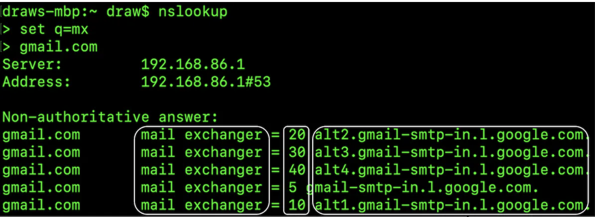
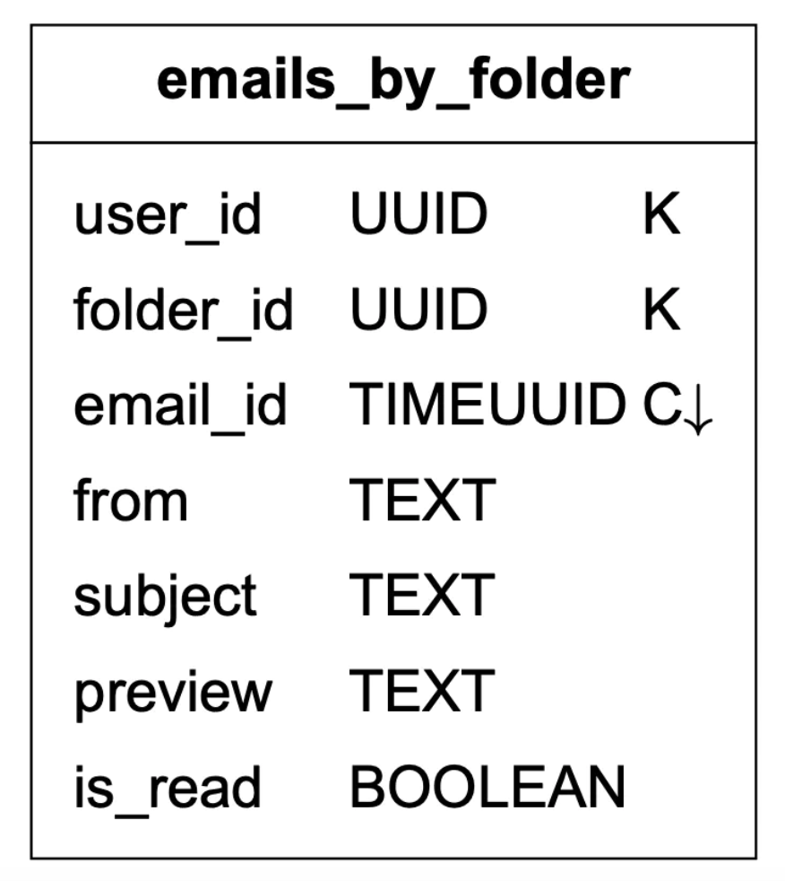
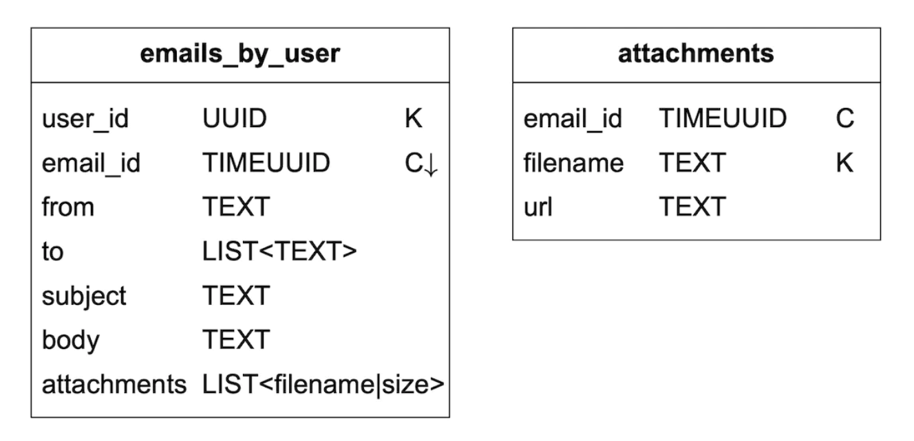
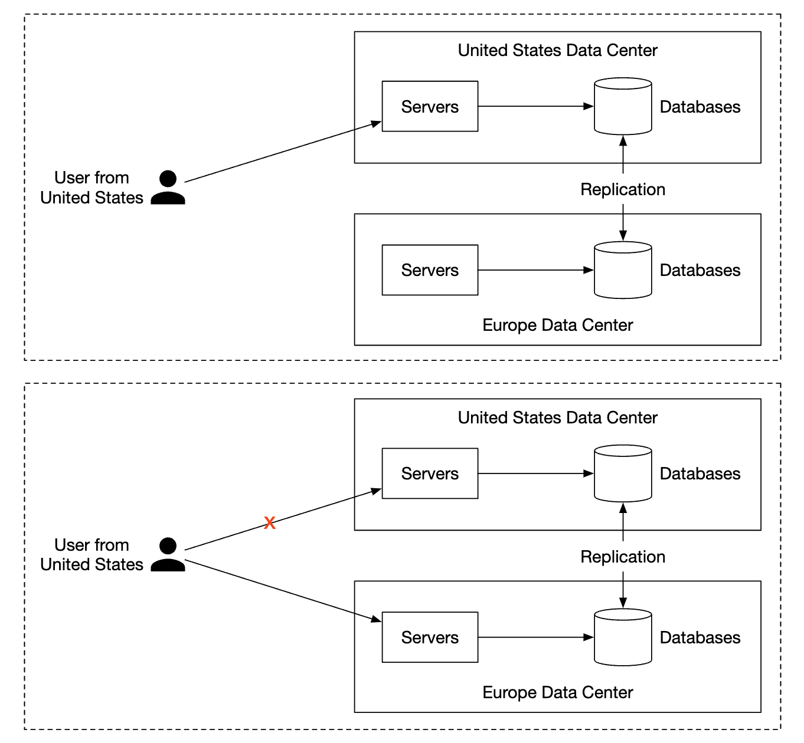

# 第23章: 分散メールサービス

## はじめに

本章では、**Gmail**のような**分散メールサービス**を設計します。

2020年時点で、**Gmail**のアクティブユーザーは18億人、**Outlook**のユーザーは世界で4億人でした。

---

## ステップ1: 問題を理解し、設計の範囲を定める

- C: システムを使うユーザーは何人ですか？
- I: 10億ユーザーです。
- C: 次の機能が重要だと思います - 認証、メールの送受信、メールの取得、メールのフィルタリング、メールの検索、スパム対策。
- I: 良いリストです。認証については今は気にしなくて構いません。
- C: ユーザーはどのようにメールサーバーに接続しますか？
- I: 通常、メールクライアントはSMTP、POP、IMAPで接続しますが、この問題ではHTTPを使います。
- C: メールに添付ファイルを付けられますか？
- I: はい。

### **非機能要件**

- **信頼性** - データを失ってはならない
- **可用性** - 単一障害点を防ぐためにレプリケーションを使うべきである。また、システムの部分的な障害にも耐えるべきである。
- **スケーラビリティ** - ユーザーベースが拡大しても、システムが対応できるべきである。
- **柔軟性と拡張性** - システムは柔軟で、新機能で容易に拡張できるべきである。これが、SMTPなどのメールプロトコルではなくHTTPを選んだ理由の1つである。

### **概算見積もり**

- **10億ユーザー**
- 1人が1日に10通のメールを送信すると仮定 → **毎秒10万通のメール**。
- 1人が1日に40通のメールを受信し、各メールのメタデータが平均50KBだと仮定 → **年間730PBのストレージ**。
- メールの20%に添付ファイルがあり、平均サイズが500KBだと仮定 → **年間1,460PB**。

---

## ステップ2: 高レベル設計を提案し、合意を得る

### **メールの基礎知識**

メールの送受信には、さまざまなプロトコルが使われます。
- **SMTP** - あるサーバーから別のサーバーへメールを送信するための標準プロトコル。
- **POP** - リモートのメールサーバーからローカルのクライアントへメールを受信・ダウンロードするための標準プロトコル。取得されると、メールはリモートサーバーから削除される。
- **IMAP** - POPと同様に、リモートサーバーからメールを受信・ダウンロードするために使われるが、メールをサーバー側に保持する。
- **HTTPS** - 厳密にはメールプロトコルではないが、Webベースのメールクライアントに使える。

メールプロトコルとは別に、メールサーバーのために設定する必要のあるDNSレコード、つまりMXレコードがあります。

<div style="margin-left:3rem">
    
</div>

メールの添付ファイルはBase64エンコードで送信され、ほとんどのメールサービスでは通常25MBのサイズ制限があります。
これは設定可能で、個人アカウントと企業アカウントで異なります。

### **従来のメールサーバー**

従来のメールサーバーは、限られた数のユーザーが単一のサーバーに接続している場合にはうまく機能します。

<div style="margin-left:3rem">
    
</div>

- AliceがOutlookのメールにログインし、「送信」を押す。メールはOutlookのメールサーバーに送られる。通信はSMTPで行われる。
- OutlookのサーバーはDNSに問い合わせてgmail.comのMXレコードを見つけ、メールをGmailのサーバーに転送する。通信はSMTPで行われる。
- BobはIMAP/POPを介してGmailのサーバーからメールを取得する。

従来のメールサーバーでは、メールはローカルのファイルシステムに保存されていました。各メールが個別のファイルでした。

<div style="margin-left:3rem">
    
</div>

規模が大きくなるにつれ、ディスクI/Oがボトルネックになりました。また、高可用性と信頼性の要件も満たせません。
ディスクは損傷する可能性があり、サーバーはダウンする可能性があります。

### **分散メールサーバー**

分散メールサーバーは、現代のユースケースをサポートし、現代のスケーラビリティの問題を解決するように設計されています。

これらのサーバーも、ネイティブのメールクライアント向けにIMAP/POPを、サーバー間のメール交換にSMTPを引き続きサポートできます。

しかし、リッチなWebベースのメールクライアントには、通常HTTP上のRESTful APIが使われます。

APIの例:
- `POST /v1/messages` - To、Cc、Bccヘッダーの受信者にメッセージを送信する。
- `GET /v1/folders` - メールアカウントのすべてのフォルダを返す

レスポンスの例:

```
[{id: string        Unique folder identifier.
  name: string      Name of the folder.
                    According to RFC6154 [9], the default folders can be one of
                    the following: All, Archive, Drafts, Flagged, Junk, Sent,
                    and Trash.
  user_id: string   Reference to the account owner
}]
```

- `GET /v1/folders/{:folder_id}/messages` - フォルダ内のすべてのメッセージをページネーション付きで返す
- `GET /v1/messages/{:message_id}` - 特定のメッセージに関するすべての情報を取得する

レスポンスの例:

```
{
  user_id: string                      // Reference to the account owner.
  from: {name: string, email: string}  // <name, email> pair of the sender.
  to: [{name: string, email: string}]  // A list of <name, email> paris
  subject: string                      // Subject of an email
  body: string                         //  Message body
  is_read: boolean                     //  Indicate if a message is read or not.
}
```

分散メールサーバーの高レベル設計は次のとおりです。

<div style="margin-left:3rem">
    
</div>

- **Webメール** - ユーザーはWebブラウザを使ってメールを送受信する
- **Webサーバー** - ログイン、サインアップ、ユーザープロフィールなどの管理に使われる、外部公開のリクエスト/レスポンス型サービス
- **リアルタイムサーバー** - 新着メールの更新をリアルタイムでクライアントにプッシュするために使われる。リアルタイム通信にはWebSocketを使うが、WebSocketをサポートしない古いブラウザではロングポーリングにフォールバックする。
- **メタデータDB** - 件名、本文、送信者、宛先などのメールのメタデータを保存する。
- **添付ファイルストア** - 大きなファイルの保存に適したオブジェクトストア（例: Amazon S3）。
- **分散キャッシュ** - UXを改善するため、最近のメールをRedisにキャッシュできる。
- **検索ストア** - 全文検索をサポートするために使われる分散ドキュメントストア。

メール送信のフローは次のようになります。

<div style="margin-left:3rem">
    
</div>

- ユーザーがメールを書いて「送信」を押す。メールはロードバランサーに送られる。
- ロードバランサーは過剰なメール送信をレート制限し、Webサーバーのいずれかにルーティングする。
- Webサーバーは基本的なメールの検証（例: メールのサイズ）を行い、宛先のドメインが送信者と同じであれば外部への送信フローを省略する。ただし、先にスパムチェックを行う。
- 基本的な検証に合格すると、メールはメッセージキューに送られる（添付ファイルはオブジェクトストアから参照される）
- 基本的な検証に失敗すると、メールはエラーキューに送られる
- SMTP送信ワーカーが送信キューからメッセージを取り出し、スパム/ウイルスのチェックを行って、宛先のメールサーバーにルーティングする。
- メールは「送信済み」フォルダに保存される

送信メッセージキューのサイズも監視する必要があります。大きくなりすぎる場合は、問題を示している可能性があります。
- 受信者のメールサーバーが利用できない。指数バックオフを使って、後でメールの送信を再試行できる。
- 負荷を処理するのに十分なコンシューマーがいない。コンシューマーをスケールさせる必要があるかもしれない。

メール受信のフローは次のとおりです。

<div style="margin-left:3rem">
    
</div>

- 受信メールはSMTPロードバランサーに到着する。メールはSMTPサーバーに分配され、そこでメールの受け入れポリシーが適用される（例: 無効なメールは直接破棄される）。
- メールの添付ファイルが大きすぎる場合は、オブジェクトストア（S3）に置くことができる。
- メール処理ワーカーが予備的なチェックを行い、その後メールはストレージ、キャッシュ、オブジェクトストア、リアルタイムサーバーに転送される。
- オフラインのユーザーは、オンラインに戻ったときにHTTP APIを介して新しいメールを受け取る。

---

## ステップ3: 設計の深掘り

いくつかのコンポーネントをさらに深掘りしましょう。

### **メタデータデータベース**

メールのメタデータには次のような特徴があります。
- ヘッダーは通常小さく、頻繁にアクセスされる
- 本文のサイズは小さいものから大きいものまでさまざまだが、通常は一度しか読まれない
- ほとんどのメール操作は1人のユーザーに閉じている。例えば、メールの取得、既読にする、検索など。
- データの新しさがデータの利用に影響する。ユーザーは通常、最近のメールしか読まない
- データには高い信頼性が求められる。データの損失は許されない。

Gmail/Outlookの規模では、1秒あたりの入出力操作数（IOPS）を減らすため、データベースは通常独自に作られています。

どのようなデータベースの選択肢があるかを検討しましょう。
- **リレーショナルデータベース** - ヘッダーと本文にインデックスを構築できるが、これらのDBは通常、小さなデータのまとまりに最適化されている。
- **分散オブジェクトストア** - バックアップ用のストレージとしては良い選択肢になり得るが、検索や既読化などを効率的にサポートできない。
- **NoSQL** - GmailではGoogle BigTableが使われているが、オープンソースではない。

上記の分析に基づくと、私たちのニーズに完全に合う既存のソリューションはほとんどないようです。
面接の場で新しい分散データベースのソリューションを設計するのは現実的ではありませんが、次のような特性に言及することが重要です。
- 1つの列が数MB（1桁台）になり得る
- 強いデータ一貫性
- ディスクI/Oを減らすように設計されている
- 高可用性と耐障害性
- 増分バックアップを容易に作成できるべきである

データをパーティショニングするには、`user_id` をパーティションキーとして使い、1人のユーザーのデータが1つのシャードに保存されるようにできます。
これにより、1通のメールを複数のユーザーで共有することはできなくなりますが、今回の面接ではそれは要件ではありません。

テーブルを定義しましょう。
- 主キーは、パーティションキー（データの分散）とクラスタリングキー（データの並べ替え）で構成される
- サポートする必要のあるクエリ - ユーザーのすべてのフォルダを取得する、フォルダ内のすべてのメールを表示する、メールを作成/取得/削除する、既読/未読のメールを取得する、会話スレッドを取得する（ボーナス）

以降のテーブルの凡例:

<div style="margin-left:3rem">
    
</div>

フォルダテーブルは次のとおりです。

<div style="margin-left:3rem">
    
</div>

メールテーブル:

<div style="margin-left:3rem">
    
</div>

- email_id はtimeuuidで、メールが作成されたときのタイムスタンプに基づいて並べ替えることができる

添付ファイルは、ファイル名で識別される別のテーブルに保存されます。

<div style="margin-left:3rem">
    
</div>

既読/未読メールの取得をサポートするのは、従来のリレーショナルデータベースでは簡単ですが、Cassandraではパーティションキー/クラスタリングキー以外でのフィルタリングが禁止されているため簡単ではありません。
1つの回避策は、フォルダ内のすべてのメールを取得してメモリ内でフィルタリングすることですが、十分に大きなアプリケーションではうまく機能しません。

代わりに、メールテーブルを既読メールテーブルと未読メールテーブルに非正規化することができます。

<div style="margin-left:3rem">
    
</div>

会話スレッドをサポートするために、いくつかのヘッダーを含めることができます。メールクライアントはこれを解釈し、会話スレッドの再構築に使います。

```
{
  "headers" {
     "Message-Id": "<7BA04B2A-430C-4D12-8B57-862103C34501@gmail.com>",
     "In-Reply-To": "<CAEWTXuPfN=LzECjDJtgY9Vu03kgFvJnJUSHTt6TW@gmail.com>",
     "References": ["<7BA04B2A-430C-4D12-8B57-862103C34501@gmail.com>"]
  }
}
```

最後に、この問題では一貫性が必須の要件であるため、分散データベースでは可用性を犠牲にして一貫性を優先します。

そのため、フェイルオーバーやネットワーク分断が発生した場合、影響を受けるユーザーは同期/更新の操作が一時的に利用できなくなります。

### **メールの到達性**

メールを送信するサーバーを立ち上げるのは簡単ですが、スパム対策のアルゴリズムがあるため、メールを受信者の受信箱に届けるのは困難です。

新しいメールサーバーを立ち上げてそこからメールを送信し始めるだけでは、メールはおそらく迷惑メールフォルダに入ってしまいます。

それを防ぐためにできることは次のとおりです。
- **専用IP** - メールの送信には専用IPを使う。そうしないと、受信側のサーバーに信頼されない。
- **メールの分類** - より重要なメールがスパムに分類されるのを防ぐため、マーケティングメールを同じサーバーから送信しない
- **IPアドレスのウォームアップ** - 大手メールプロバイダーとの間で良い評判を築くため、時間をかけてIPアドレスをウォームアップする。新しいIPのウォームアップには2〜6週間かかる
- **スパマーの迅速な追放** - 評判を損なわないよう、スパマーをすぐに追放する
- **フィードバックの処理** - ISPとのフィードバックループを構築して苦情率を追跡し、スパムアカウントをすぐに追放する。
- **メール認証** - Sender Policy Framework（SPF）、DomainKeys Identified Mail（DKIM）など、フィッシングに対抗するための一般的な手法を使う。

これらすべてを覚えておく必要はありません。優れたメールサーバーを構築するには多くのドメイン知識が必要だということだけを知っておいてください。

### **検索**

検索には、メールの内容に基づく全文検索や、送信者、宛先、件名、未読などのフィルターに基づくより高度なクエリが含まれます。

メール検索の特徴の1つは、ユーザーに閉じていることと、読み取りより書き込みが多いことです。操作のたびにインデックスを再作成する必要がある一方で、ユーザーが検索タブを使うことはまれだからです。

Google検索とメール検索を比較しましょう。

|               | 範囲                       | 並べ替え                                   | 正確性                                                    |
|---------------|----------------------------|--------------------------------------------|-----------------------------------------------------------|
| Google検索    | インターネット全体         | 関連性で並べ替え                           | インデックス作成に時間がかかるため、結果は即時ではない。 |
| メール検索    | ユーザー自身のメールボックス | 時刻、日付などの属性で並べ替え             | インデックス作成は素早く、結果は正確であるべきである。   |

この検索機能を実現する1つの選択肢は、Elasticsearchクラスターを使うことです。`user_id` をパーティションキーとして使い、データを同じノードにまとめることができます。

<div style="margin-left:3rem">
    
</div>

サービスを再インデックスのフローから切り離すため、変更を伴う操作はKafkaを介して非同期に行われます。
実際のデータの検索は同期的に行われます。

Elasticsearchは最も人気のある検索エンジンデータベースの1つで、メールの全文検索を非常によくサポートしています。

あるいは、特定の要件を満たすために、独自の検索ソリューションの開発を試みることもできます。

そのようなシステムの設計は範囲外です。構築する際の中核的な課題の1つは、書き込み中心のワークロードに最適化することです。

これを実現するには、LSMツリー（Log-Structured Merge-Tree）を使ってディスク上のインデックスデータを構造化できます。書き込みパスは逐次書き込みのみに最適化されます。
この手法はCassandra、BigTable、RocksDBで使われています。

その中核となる考え方は、あらかじめ定めたしきい値に達するまでデータをメモリ内に保存し、その後、次の層（ディスク）にマージするというものです。

<div style="margin-left:3rem">
    
</div>

2つのアプローチの主なトレードオフ:
- Elasticsearchはある程度までスケールするが、独自の検索エンジンはメールのユースケースに合わせて微調整でき、さらにスケールさせられる。
- Elasticsearchは、メタデータストアとは別に保守する必要のあるサービスである。独自のソリューションであれば、データストア自体にできる。
- Elasticsearchは既製のソリューションだが、独自の検索エンジンを構築するには多大なエンジニアリングの労力が必要になる。

### **スケーラビリティと可用性**

個々のユーザーの操作は他のユーザーと衝突しないため、ほとんどのコンポーネントは独立してスケールさせられます。

高可用性を確保するため、障害時のリーダー-フォロワー型フェイルオーバーを備えたマルチデータセンター構成を使うこともできます。

<div style="margin-left:3rem">
    
</div>

---

## ステップ4: まとめ

追加の論点:
- **耐障害性** - システムの多くの部分が故障し得る。ノードの障害にどう対処するかを検討する価値がある。
- **コンプライアンス** - 欧州のGDPR法を踏まえ、個人を特定できる情報（PII）を適切な方法で保存する必要がある。
- **セキュリティ** - メールの暗号化、フィッシング対策、セーフブラウジングなど。
- **最適化** - 例えば、異なるユーザーによって複数回送信された同じ添付ファイルの重複を防ぐ。
