# 第24章: S3ライクなオブジェクトストレージ

## はじめに

本章では、**Amazon S3**のような**オブジェクトストレージ**サービスを設計します。

ストレージシステムは大きく3つのカテゴリに分けられます。
- **ブロックストレージ**
- **ファイルストレージ**
- **オブジェクトストレージ**

**ブロックストレージ**は1960年代に登場したデバイスです。HDDやSSDがその例です。
これらのデバイスは通常、サーバーに物理的に接続されますが、高速なネットワークプロトコルを介してネットワーク接続することもできます。
サーバーは生のブロックをフォーマットしてファイルシステムとして使うことも、その制御をサーバーに直接委ねることもできます。

**ファイルストレージ**はブロックストレージの上に構築されます。より高いレベルの抽象化を提供し、フォルダやファイルの管理を容易にします。

**オブジェクトストレージ**は、高い耐久性、膨大な規模、低コストのために性能を犠牲にしています。
「コールド」なデータを対象とし、主にアーカイブやバックアップに使われます。
階層的なディレクトリ構造はなく、すべてのデータはフラットな構造のオブジェクトとして保存されます。
他のストレージタイプと比べて比較的遅いです。ほとんどのクラウドプロバイダーがオブジェクトストレージを提供しています（Amazon S3、Google GCSなど）。

<div style="margin-left:3rem">
    
</div>

|                 | ブロックストレージ                 | ファイルストレージ                      | オブジェクトストレージ         |
|-----------------|----------------------------------|-----------------------------------------|--------------------------------|
| 内容の変更      | 可                               | 可                                      | 不可（オブジェクトのバージョニングあり） |
| コスト          | 高                               | 中〜高                                  | 低                             |
| 性能            | 中〜高、非常に高                 | 中〜高                                  | 低〜中                         |
| 一貫性          | 強い一貫性                       | 強い一貫性                              | 強い一貫性 [5]                 |
| データアクセス  | SAS/iSCSI/FC                     | 標準的なファイルアクセス、CIFS/SMB、NFS | RESTful API                    |
| スケーラビリティ | 中程度                          | 高い                                    | 膨大                           |
| 適している用途  | 仮想マシン（VM）、データベース   | 汎用的なファイルシステムアクセス        | バイナリデータ、非構造化データ |

オブジェクトストレージに関連する用語:
- **バケット** - オブジェクトの論理的なコンテナ。名前はグローバルに一意である。
- **オブジェクト** - バケットに保存される個々のデータ。オブジェクトのデータとメタデータを含む。
- **バージョニング** - 同じバケット内でオブジェクトの複数の版を保持する機能。
- **URI（Uniform Resource Identifier）** - 各リソースはURIによって一意に識別される。
- **SLA（サービスレベル合意）** - サービスプロバイダーとクライアントの間の契約。

Amazon S3 Standard-Infrequent Accessストレージクラスの SLA:
- 複数のアベイラビリティゾーンにわたって99.999999999%の耐久性
- アベイラビリティゾーン全体が破壊された場合でもデータは保たれる
- 99.9%の可用性を目指して設計されている

---

## ステップ1: 問題を理解し、設計の範囲を定める

- C: どの機能を含めるべきですか？
- I: バケットの作成、オブジェクトのアップロード/ダウンロード、バージョニング、バケット内のオブジェクトの一覧表示です。
- C: 典型的なデータサイズはどのくらいですか？
- I: 巨大なオブジェクトと小さなオブジェクトの両方を効率的に保存する必要があります。
- C: 1年間にどのくらいのデータを保存しますか？
- I: 100ペタバイトです。
- C: データの耐久性はシックスナイン（99.9999%）、サービスの可用性はフォーナイン（99.99%）と想定してよいですか？
- I: はい、妥当だと思います。

### **非機能要件**

- **100 PBのデータ**
- **シックスナインのデータ耐久性**
- **フォーナインのサービス可用性**
- ストレージ効率。高い信頼性と性能を維持しながらストレージコストを削減する

### **概算見積もり**

オブジェクトストレージは、ディスク容量または1秒あたりのIO（IOPS）がボトルネックになる可能性が高いです。

前提:
- 小さなオブジェクト（1MB未満）が20%、中サイズ（1〜64MB）が60%、大きなオブジェクト（64MB超）が20%ある
- 1台のハードディスク（SATA、7200rpm）は毎秒100〜150回のランダムシークが可能（100〜150 IOPS）

これらの前提から、システムが永続化できるオブジェクトの総数を見積もれます。
- 計算を単純にするため、オブジェクトの種類ごとの中央値サイズを使う - 小は0.5MB、中は32MB、大は200MB。
- 100PBのストレージ（10^11 MB）とストレージ使用率40%から、6.8億個のオブジェクトとなる
- メタデータが1KBだと仮定すると、メタデータ情報を保存するのに0.68TBの容量が必要になる

---

## ステップ2: 高レベル設計を提案し、合意を得る

設計に入る前に、オブジェクトストレージの興味深い特性をいくつか見ていきましょう。
- **オブジェクトのイミュータビリティ** - オブジェクトストレージ内のオブジェクトはイミュータブル（不変）である（他のストレージシステムではそうではない）。削除や置き換えはできるが、更新はできない。
- **キーバリューストア** - オブジェクトのURIがキーであり、HTTP呼び出しによって内容を取得できる
- **一度書き込み、何度も読み取る** - データアクセスパターンは一度書き込んで何度も読み取るものである。LinkedInの研究によると、操作の95%は読み取りである
- 小さなオブジェクトと大きなオブジェクトの両方をサポートする

オブジェクトストレージの設計思想はUNIXに似ています。ファイルを保存すると、inodeと呼ばれるデータ構造にファイル名が作成され、ファイルのデータはディスク上の別の場所に保存されます。
inodeには、ディスク上のさまざまな場所を指すファイルブロックのポインターのリストが含まれます。

ファイルにアクセスするときは、ファイルの内容を取得する前に、まずinodeからメタデータを取得します。

オブジェクトストレージも同様に動作します。ファイル情報にはメタデータストアを使い、内容はディスクに保存します。

<div style="margin-left:3rem">
    
</div>

メタデータとファイルの内容を分離することで、それぞれのストアを独立してスケールさせられます。

<div style="margin-left:3rem">
    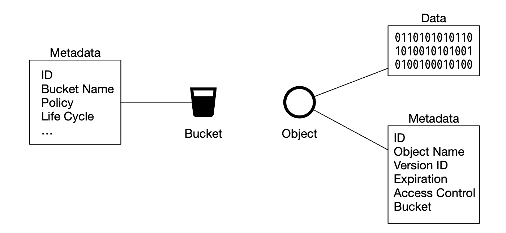
</div>

### **高レベル設計**

<div style="margin-left:3rem">
    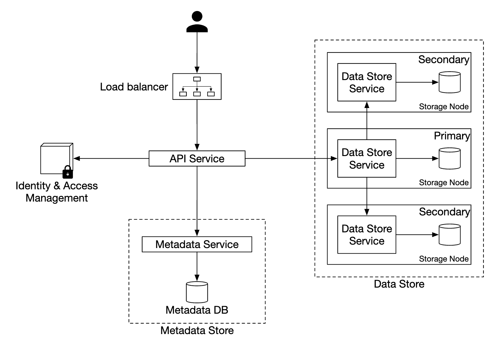
</div>

- **ロードバランサー** - APIリクエストをサービスのレプリカに分散する
- **APIサービス** - メタデータストア、オブジェクトストア、IAMサービスへの呼び出しを統括するステートレスなサーバー。
- **IAM（アイデンティティとアクセス管理）** - 認証、認可、アクセス制御を一元的に行う場所。
- **データストア** - 実際のデータを保存・取得する。操作はオブジェクトID（UUID）に基づく。
- **メタデータストア** - オブジェクトのメタデータを保存する

### **オブジェクトのアップロード**

<div style="margin-left:3rem">
    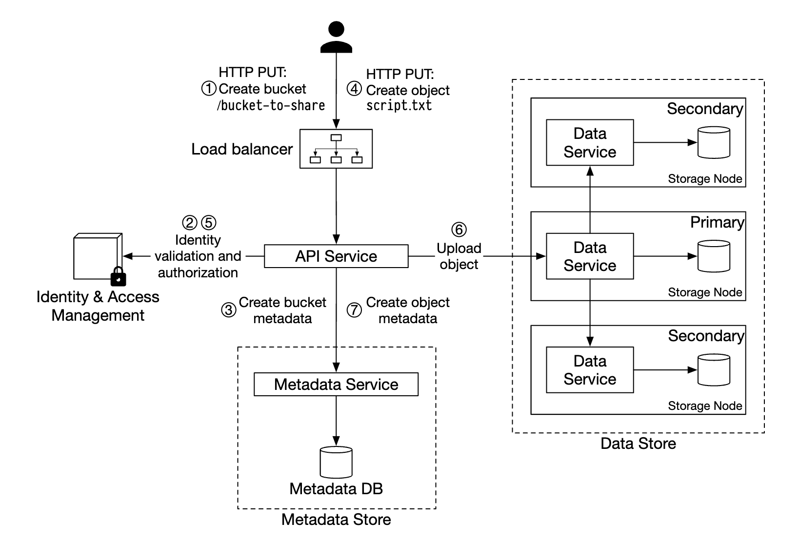
</div>

- HTTP PUTリクエストで「bucket-to-share」という名前のバケットを作成する
- APIサービスがIAMを呼び出し、ユーザーが認可されており書き込み権限を持っていることを確認する
- APIサービスがメタデータストアを呼び出してバケットのエントリを作成する。作成されると、成功のレスポンスが返される。
- バケットが作成された後、「script.txt」という名前のオブジェクトを作成するためにHTTP PUTが送信される
- APIサービスがユーザーの身元を確認し、ユーザーが書き込み権限を持っていることを確認する
- 検証に合格すると、オブジェクトのペイロードがHTTP PUTでデータストアに送られる。データストアはそれを永続化し、UUIDを返す。
- APIサービスがメタデータストアを呼び出し、object_id、bucket_id、bucket_nameなどのメタデータを含む新しいエントリを作成する。

オブジェクトのアップロードリクエストの例:

```
PUT /bucket-to-share/script.txt HTTP/1.1
Host: foo.s3example.org
Date: Sun, 12 Sept 2021 17:51:00 GMT
Authorization: authorization string
Content-Type: text/plain
Content-Length: 4567
x-amz-meta-author: Alex

[4567 bytes of object data]
```

### **オブジェクトのダウンロード**

バケットにはディレクトリの階層はありませんが、バケット名とオブジェクト名を連結することで論理的な階層を作り、フォルダ構造をシミュレートできます。

オブジェクトを取得するGETリクエストの例:

```
GET /bucket-to-share/script.txt HTTP/1.1
Host: foo.s3example.org
Date: Sun, 12 Sept 2021 18:30:01 GMT
Authorization: authorization string
```

<div style="margin-left:3rem">
    
</div>

- クライアントがロードバランサーにHTTP GETリクエスト（つまり `GET /bucket-to-share/script.txt`）を送信する
- APIサービスがIAMに問い合わせ、ユーザーがバケットを読み取る正しい権限を持っていることを確認する
- 検証が済むと、メタデータストアからオブジェクトのUUIDが取得される
- UUIDに基づいてデータストアからオブジェクトのペイロードが取得され、クライアントに返される

---

// sprint 1

## ステップ3: 設計の深掘り

### **データストア**

APIサービスがデータストアとどのようにやり取りするかを示します。

<div style="margin-left:3rem">
    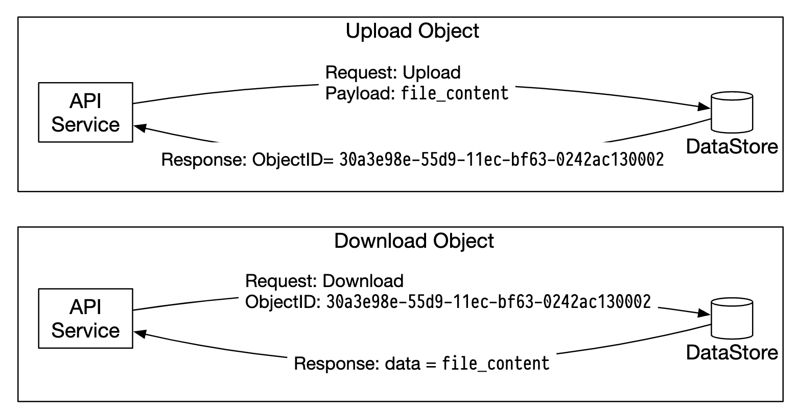
</div>

データストアの主要コンポーネント:

<div style="margin-left:3rem">
    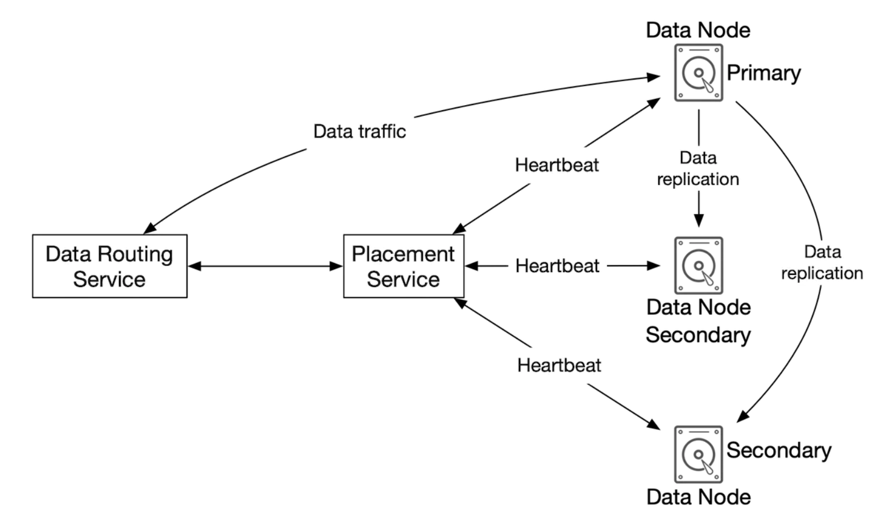
</div>

データルーティングサービスは、データノードクラスターにアクセスするためのRESTfulまたはgRPCのAPIを提供します。
ステートレスなサービスであり、サーバーを追加することでスケールします。

主な責務は次のとおりです。
- 配置サービスに問い合わせて、データを保存するのに最適なデータノードを得る
- データノードからデータを読み取り、APIサービスに返す
- データノードにデータを書き込む

配置サービスは、どのデータノードにオブジェクトを保存すべきかを決定します。
クラスターの物理的なトポロジーを決める仮想クラスターマップを保持します。

<div style="margin-left:3rem">
    
</div>

このサービスはまた、すべてのデータノードにハートビートを送り、仮想クラスターから外すべきかどうかを判断します。

これは重要なサービスであるため、PaxosやRaftのコンセンサスアルゴリズムで同期された5台または7台のレプリカからなるクラスターを維持することが推奨されます。
例えば、7ノードのクラスターは3ノードの故障に耐えられます。

データノードは実際のオブジェクトデータを保存します。
信頼性と耐久性は、データを複数のデータノードにレプリケートすることで確保されます。

各データノードではデーモンが動作しており、配置サービスにハートビートを送信します。

ハートビートには次の情報が含まれます。
- データノードが管理しているディスクドライブ（HDDまたはSSD）の数
- 各ドライブに保存されているデータの量

#### データ永続化のフロー

<div style="margin-left:3rem">
    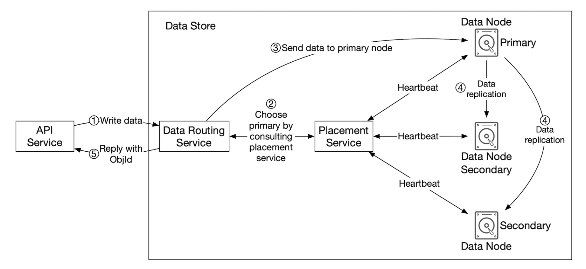
</div>

- APIサービスがオブジェクトデータをデータストアに転送する
- データルーティングサービスがデータをプライマリデータノードに送る
- プライマリデータノードはデータをローカルに保存し、2つのセカンダリデータノードにレプリケートする。レプリケーションが成功した後にレスポンスが送られる。
- オブジェクトのUUIDがAPIサービスに返される。

注意点:
- オブジェクトのUUIDが与えられると、そのレプリケーショングループはコンシステントハッシュを使って決定論的に選ばれる
- ステップ4では、プライマリデータノードはレスポンスを返す前にオブジェクトデータをレプリケートする。これはレイテンシが高くなる代わりに強い一貫性を優先している。

<div style="margin-left:3rem">
    
</div>

#### データの構成方法

データを管理するシンプルなアプローチの1つは、各オブジェクトを個別のファイルに保存することです。

これは機能しますが、ファイルシステム内に小さなファイルが多数あると性能が良くありません。
- すべてのファイルがブロックサイズ全体を使うため、HDD上のデータブロックが無駄になる。典型的なブロックサイズは4KBである。
- ファイルが多いということは、inodeが多いということである。OSは非常に多くのinodeをうまく扱えず、inodeの最大数の制限もある。

これらの問題は、先行書き込みログ（WAL）を使って多数の小さなファイルを大きなファイルにまとめることで対処できます。ファイルが容量（通常は数GB）に達すると、新しいファイルが作成されます。

<div style="margin-left:3rem">
    
</div>

このアプローチの欠点は、ファイルへの書き込みアクセスを直列化する必要があることです。同じファイルにアクセスする複数のコアは互いに待たなければなりません。
これを解決するには、ロックの競合を避けるため、ファイルを特定のコアに限定できます。

#### オブジェクトの検索

同じファイルに複数のオブジェクトを保存できるようにするには、データノードに次の情報を伝えるテーブルを保持する必要があります。
- `object_id`
- オブジェクトが保存されている `filename`
- オブジェクトが始まる `file_offset`
- `object_size`

このテーブルは、RocksDBのようなファイルベースのDBや、従来のリレーショナルデータベースにデプロイできます。
アクセスパターンは書き込みが少なく読み取りが多いので、リレーショナルデータベースの方が適しています。

どのようにデプロイすべきでしょうか？
DBをデプロイしてクラスターとして別にスケールさせ、すべてのデータノードからアクセスさせることができます。

欠点:
- すべてのリクエストを処理するため、クラスターを積極的にスケールさせる必要がある
- データノードとDBクラスターの間に追加のネットワークレイテンシが生じる

代替案は、データノードは自分に関連するデータにしか関心がないという事実を活かして、
リレーショナルDBをデータノード自体の中にデプロイすることです。

SQLiteは軽量なファイルベースのリレーショナルデータベースであるため、良い選択肢です。

#### 更新されたデータ永続化のフロー

<div style="margin-left:3rem">
    
</div>

- APIサービスが新しいオブジェクトを保存するリクエストを送信する
- データノードサービスが、「/data/c」という名前のファイルの末尾に新しいオブジェクトを追記する
- オブジェクトの新しいレコードがオブジェクトマッピングテーブルに挿入される

#### 耐久性

データの耐久性は、この設計における重要な要件です。シックスナインの耐久性を達成するには、すべての障害ケースを適切に検討する必要があります。

最初に対処すべき問題はハードウェアの故障です。データノードをレプリケートして故障の確率を最小化することで対処できます。
しかしそれに加えて、異なる障害ドメイン（ラック間、データセンター間、別々のネットワークなど）にまたがってレプリケートすべきです。
重大なイベントは、同じドメイン内で複数のハードウェア故障を引き起こす可能性があります。

<div style="margin-left:3rem">
    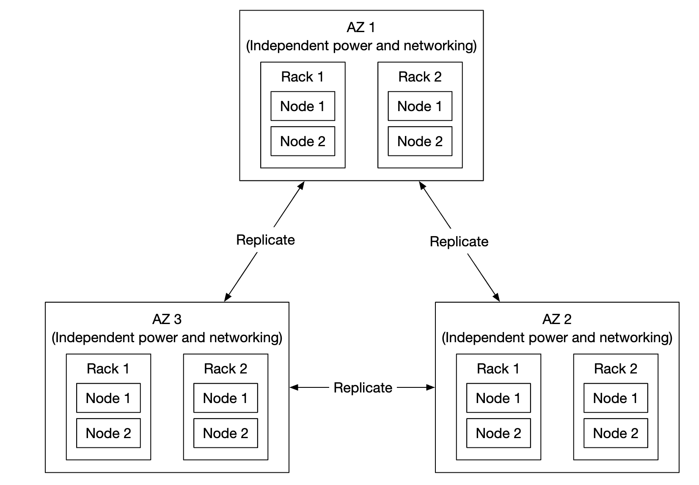
</div>

典型的なHDDの年間故障率を0.81%とすると、3つのコピーを作成することでシックスナインの耐久性が得られます。

このようにデータノードをレプリケートすれば望む耐久性が得られますが、ストレージコストを削減するためにイレイジャーコーディングを活用することもできます。

イレイジャーコーディングではパリティビットを使い、障害が発生したときに失われたビットを再構築できます。

<div style="margin-left:3rem">
    
</div>

これらのビットがデータノードだと想像してください。そのうち2つがダウンしても、残りの4つを使って復元できます。

イレイジャーコーディングにはさまざまな方式があります。今回のケースでは、信頼性を最大化するために異なる障害ドメインに分散させた8+4のイレイジャーコーディングを使えます。

<div style="margin-left:3rem">
    
</div>

イレイジャーコーディングでは、ストレージコストを大幅に削減できます（50%の改善）。その代わり、データルーティングサービスが複数の場所からデータを集める必要があるため、アクセス速度が犠牲になります。

<div style="margin-left:3rem">
    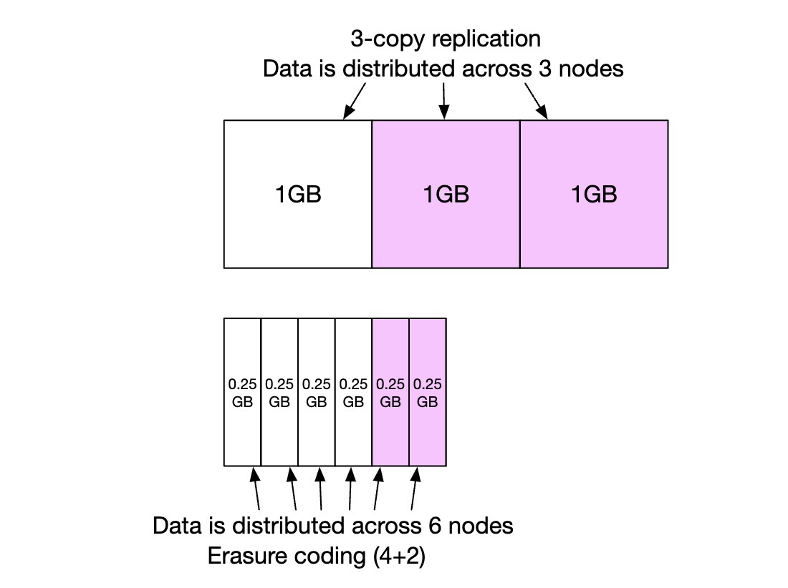
</div>

その他の注意点:
- レプリケーションには200%のストレージオーバーヘッドが必要（レプリカが3つの場合）なのに対し、イレイジャーコーディングでは50%
- イレイジャーコーディングでは[イレブンナイン（11個の9）の耐久性が得られる](https://github.com/Backblaze/erasure-coding-durability)のに対し、レプリケーションではシックスナイン
- イレイジャーコーディングでは、パリティの計算と保存により多くの計算が必要

まとめると、レプリケーションはレイテンシに敏感なアプリケーションに有用であり、イレイジャーコーディングはストレージコストの効率と耐久性の点で魅力的です。
また、イレイジャーコーディングの実装ははるかに困難です。

#### 正しさの検証

ディスク全体が故障した場合、障害の検出は容易です。ディスクの一部のメモリが破損した場合は、それほど簡単ではありません。

これを検出するには、チェックサム（ファイルの内容のハッシュで、ファイルの完全性の検証に使える）を使えます。

今回のケースでは、ファイルごととオブジェクトごとにチェックサムを保存します。

<div style="margin-left:3rem">
    
</div>

イレイジャーコーディング（8+4）の場合は、8つのデータ片をそれぞれ個別に取得し、それぞれのチェックサムを検証する必要があります。

// sprint 2

### **メタデータのデータモデル**

テーブルスキーマ:

<div style="margin-left:3rem">
    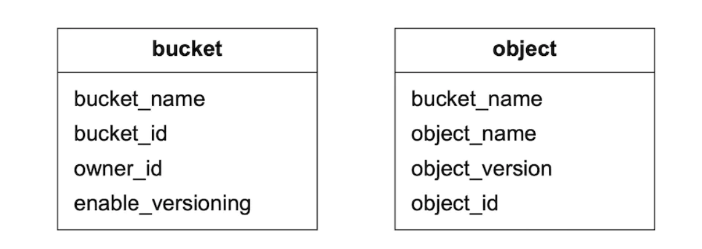
</div>

サポートする必要のあるクエリ:
- 名前でオブジェクトIDを見つける
- 名前に基づいてオブジェクトを挿入/削除する
- 同じプレフィックスを持つバケット内のオブジェクトを一覧表示する

通常、ユーザーが作成できるバケットの数には上限があるため、bucketsテーブルのサイズは小さく、1台のDBサーバーに収まります。
それでも、読み取りのスループットのためにサーバーをスケールさせる必要があります。

一方、objectテーブルはおそらく1台のデータベースサーバーには収まりません。そのため、シャーディングでテーブルをスケールさせられます。
- バケットには数十億のオブジェクトが入り得るため、bucket_idによるシャーディングはホットスポットの問題を招く
- object_idによるシャーディングでは負荷がより均等に分散されるが、クエリが遅くなる
- ほとんどのクエリはオブジェクト名/バケット名に基づくため、`hash(bucket_name, object_name)` によるシャーディングを選ぶ。

ただし、このシャーディング方式でも、バケット内のオブジェクトの一覧表示は遅くなります。

### **バケット内のオブジェクトの一覧表示**

単一のデータベースでは、プレフィックス（ディレクトリのように見える）に基づくオブジェクトの一覧表示は次のように動作します。

```
SELECT * FROM object WHERE bucket_id = "123" AND object_name LIKE `abc/%`
```

データベースがシャーディングされていると、これを実現するのは困難です。実現するには、すべてのシャードでクエリを実行し、結果をメモリ内で集約します。
ただし、シャードごとに結果のサイズが異なり、それぞれに別々のlimit/offsetを保持する必要があるため、ページネーションが難しくなります。

一般的にオブジェクトストアはオブジェクトの一覧表示に最適化されていないという事実を活かし、一覧表示の性能は犠牲にできます。
また、バケットIDでシャーディングした、オブジェクトの一覧表示用の非正規化テーブルを作成することもできます。
そうすれば、一覧表示のクエリは単一のデータベースインスタンスに閉じるため、十分に高速になります。

### **オブジェクトのバージョニング**

バージョニングは、TIMEUUID型の `object_version` 列をもう1つ持たせることで機能し、それに基づいてレコードを並べ替えられます。

新しいバージョンごとに新しい `object_id` が生成されます。

<div style="margin-left:3rem">
    
</div>

オブジェクトを削除すると、オブジェクトが削除されたことを示す特別な `object_id` を持つ新しいバージョンが作成されます。それに対するクエリは404を返します。

<div style="margin-left:3rem">
    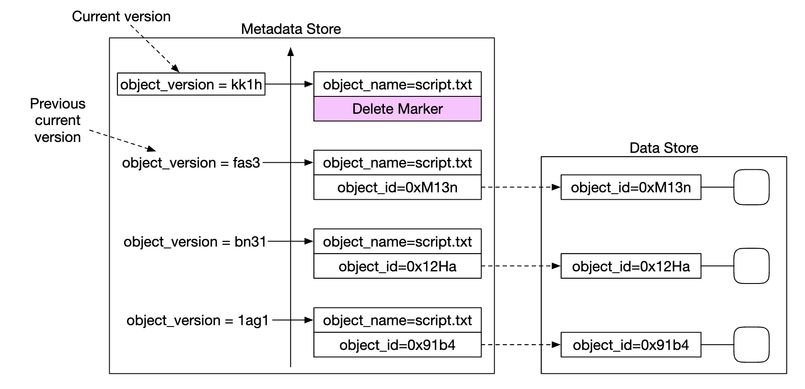
</div>

### **大きなファイルのアップロードの最適化**

大きなファイルのアップロードは、マルチパートアップロード（大きなファイルを複数のチャンクに分割し、独立してアップロードする）を使って最適化できます。

<div style="margin-left:3rem">
    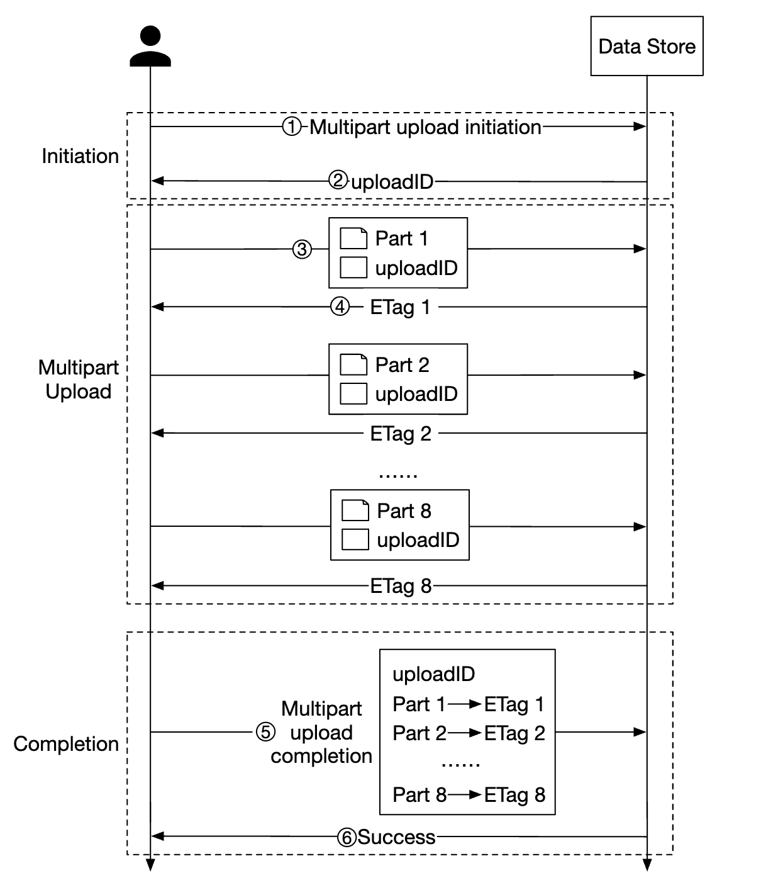
</div>

- クライアントがサービスを呼び出してマルチパートアップロードを開始する
- データストアが、アップロードを一意に識別するアップロードIDを返す
- クライアントは大きなファイルを複数のチャンクに分割し、アップロードIDを使ってそれぞれ独立にアップロードする
- チャンクがアップロードされると、データストアはそのアップロードチャンクを識別するMD5チェックサムであるETagを返す
- すべてのパートがアップロードされた後、クライアントはupload_id、パート番号、すべてのETagを含むマルチパートアップロード完了リクエストを送信する
- データストアはパートからオブジェクトを再構成する。この処理には数分かかることがある。その後、成功のレスポンスがクライアントに返される。

この時点で、もはや不要になった古いパートは削除できます。これに対処するためにガベージコレクターを導入できます。

### **ガベージコレクション**

ガベージコレクションとは、もはや使われていないストレージ容量を回収する処理です。データがゴミになる経緯はいくつかあります。
- **オブジェクトの遅延削除** - オブジェクトは実際には削除されずに、削除済みとしてマークされる
- **孤立したデータ** - 例えばアップロードが途中で失敗し、古いパートを削除する必要がある
- **破損したデータ** - チェックサムの検証に失敗したデータ

ガベージコレクターは、レプリカ内の未使用領域を回収する役割も担います。
レプリケーションの場合、データはプライマリとレプリカの両方から削除されます。イレイジャーコーディング（8+4）の場合、データは12ノードすべてから削除されます。

削除を容易にするため、コンパクションと呼ばれる処理を使います。
- ガベージコレクターが、削除されていないオブジェクトを「data/b」から「data/d」にコピーする
- コピーが完了すると、データベーストランザクションを使って `object_mapping` テーブルを更新する
- 小さなファイルが多くなりすぎないよう、コンパクションは一定のしきい値を超えて大きくなったファイルに対して行う

<div style="margin-left:3rem">
    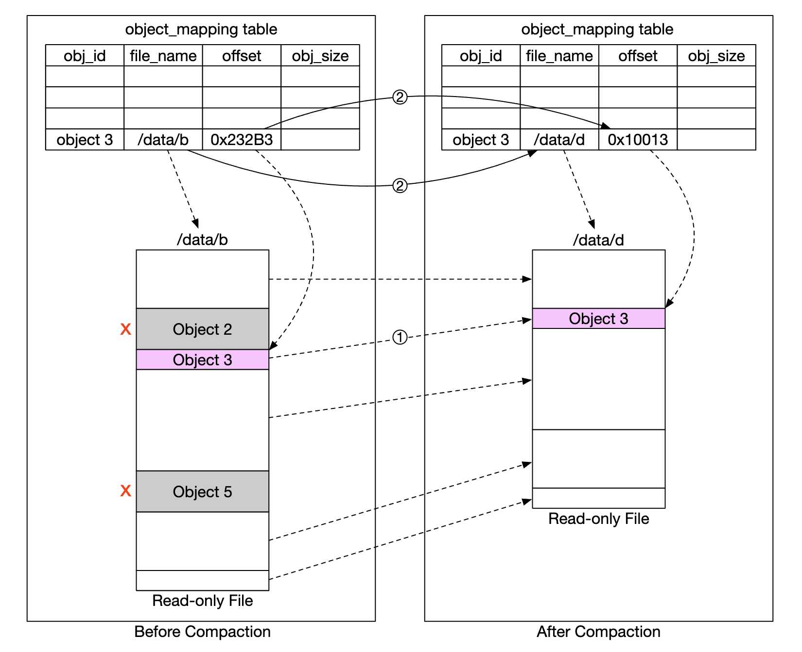
</div>

---

## ステップ4: まとめ

取り上げた内容:
- S3ライクなオブジェクトストレージの設計
- オブジェクトストレージ、ブロックストレージ、ファイルストレージの違いの比較
- バケット内のオブジェクトのアップロード、ダウンロード、一覧表示、バージョニング
- 設計の深掘り - データストアとメタデータストア、レプリケーションとイレイジャーコーディング、マルチパートアップロード、シャーディング
