# 第25章: リアルタイムゲームリーダーボード

## はじめに

オンラインのモバイルゲーム向けの**リーダーボード（ランキング表）**を設計します。

<div style="margin-left:3rem">
    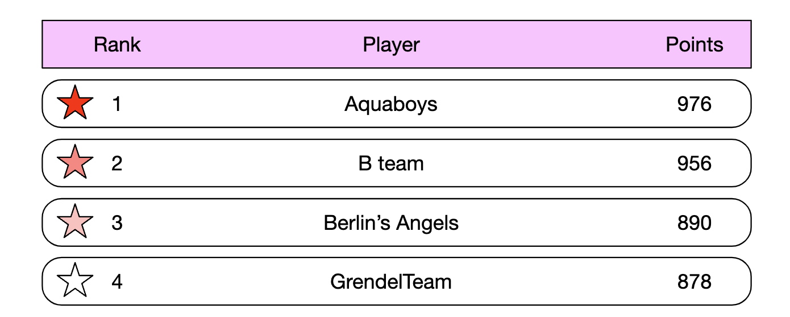
</div>

---

## ステップ1: 問題を理解し、設計の範囲を定める

- C: リーダーボードのスコアはどのように計算されますか？
- I: ユーザーは試合に勝つたびに1ポイントを獲得します。
- C: すべてのプレイヤーがリーダーボードに含まれますか？
- I: はい。
- C: リーダーボードには期間の区切りがありますか？
- I: 毎月新しいトーナメントが始まり、それに伴って新しいリーダーボードが始まります。
- C: 上位10人のユーザーだけを気にすればよいと考えてよいですか？
- I: 上位10人のユーザーに加えて、特定のユーザーの順位も表示したいです。時間があれば、リーダーボード上で特定のユーザーの周辺にいるユーザーを表示することについても議論できます。
- C: トーナメントには何人のユーザーがいますか？
- I: DAUは500万人、MAUは2,500万人です。
- C: トーナメント中に平均して何試合が行われますか？
- I: 各プレイヤーは1日に平均10試合を行います。
- C: 2人のプレイヤーが同じスコアの場合、順位はどのように決めますか？
- I: その場合、順位は同じです。時間があれば、同点の扱いについて議論できます。
- C: リーダーボードはリアルタイムである必要がありますか？
- I: はい、リアルタイムの結果、またはできるだけリアルタイムに近い結果を表示したいです。バッチ処理した結果の履歴を表示するのは不可です。

### **機能要件**

- リーダーボードに上位10人のプレイヤーを表示する
- ユーザーの特定の順位を表示する
- 指定したユーザーの4つ上と4つ下の順位のユーザーを表示する（ボーナス）

### **非機能要件**

- スコアのリアルタイム更新
- スコアの更新がリーダーボードにリアルタイムで反映される
- 一般的なスケーラビリティ、可用性、信頼性

### **概算見積もり**

DAUが500万人で、プレイヤーが24時間に均等に分布していれば、平均して毎秒50人のユーザーになります。
しかし、分布は通常不均一であるため、ピーク時のオンラインユーザーは毎秒250人と見積もれます。

ユーザーがポイントを獲得する際のQPS - 1日平均10ゲームとすると、毎秒50人 * 10 = 500 QPS。ピークQPS = 2,500。

上位10人のリーダーボードを取得する際のQPS - ユーザーが平均して1日1回開くと仮定すると、QPSは50です。

---

## ステップ2: 高レベル設計を提案し、合意を得る

### **API設計**

最初に必要なAPIは、ユーザーのスコアを更新するものです。

```
POST /v1/scores
```

このAPIは2つのパラメータを取ります。`user_id` と、ゲームに勝って獲得した `points` です。

このAPIは、エンドクライアントではなく、ゲームサーバーからのみアクセスできるようにすべきです。

次は、リーダーボードの上位10人のプレイヤーを取得するためのものです。

```
GET /v1/scores
```

レスポンスの例:

```
{
  "data": [
    {
      "user_id": "user_id1",
      "user_name": "alice",
      "rank": 1,
      "score": 12543
    },
    {
      "user_id": "user_id2",
      "user_name": "bob",
      "rank": 2,
      "score": 11500
    }
  ],
  ...
  "total": 10
}
```

特定のユーザーのスコアを取得することもできます。

```
GET /v1/scores/{:user_id}
```

レスポンスの例:

```
{
    "user_info": {
        "user_id": "user5",
        "score": 1000,
        "rank": 6,
    }
}
```

### **高レベルアーキテクチャ**

<div style="margin-left:3rem">
    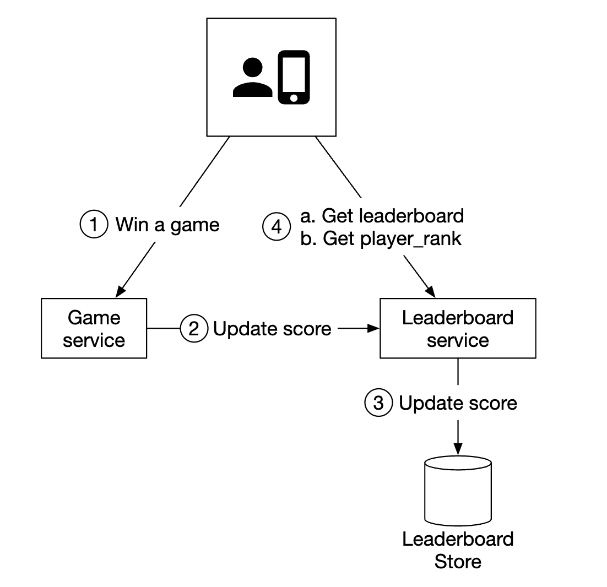
</div>

- プレイヤーがゲームに勝つと、クライアントがゲームサービスにリクエストを送信する
- ゲームサービスは勝利が正当かどうかを検証し、リーダーボードサービスを呼び出してプレイヤーのスコアを更新する
- リーダーボードサービスがリーダーボードストア内のユーザーのスコアを更新する
- プレイヤーはリーダーボードサービスを呼び出して、リーダーボードのデータ（例: 上位10人のプレイヤーと、指定したプレイヤーの順位）を取得する

検討された代替の設計として、クライアントがリーダーボードサービス内で直接自分のスコアを更新する方法があります。

<div style="margin-left:3rem">
    
</div>

この選択肢は中間者攻撃を受けやすいため、安全ではありません。プレイヤーがプロキシを挟んで、スコアを好きなように変更できてしまいます。

もう1つの注意点として、ゲームロジックがサーバーで管理されているゲームでは、クライアントが勝利を記録するためにサーバーを明示的に呼び出す必要はありません。
サーバーがゲームロジックに基づいて自動的にそれを行います。

もう1つ検討すべきことは、ゲームサーバーとリーダーボードサービスの間にメッセージキューを置くべきかどうかです。他のサービスがゲームの結果に関心を持つ場合には有用ですが、これまでの面接では明示的な要件ではないため、設計には含めていません。

<div style="margin-left:3rem">
    
</div>

### **データモデル**

リーダーボードのデータを保存するための選択肢（リレーショナルDB、Redis、NoSQL）について議論しましょう。

NoSQLのソリューションについては深掘りのセクションで議論します。

#### リレーショナルデータベースによるソリューション

規模が問題にならず、ユーザー数もそれほど多くなければ、リレーショナルDBで十分に対応できます。

月ごとに1つのシンプルなリーダーボードテーブルから始められます（個人的な注記 - これは理にかなっていない。`month` 列を追加すれば、毎月新しいテーブルを管理する手間を避けられる）。

<div style="margin-left:3rem">
    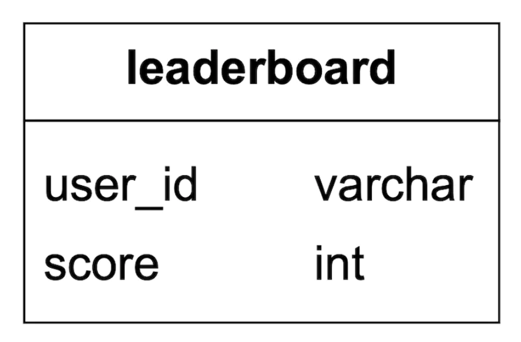
</div>

ここに含めるべき追加のデータもありますが、実行するクエリには関係ないため省略しています。

ユーザーがポイントを獲得すると何が起こるでしょうか？

<div style="margin-left:3rem">
    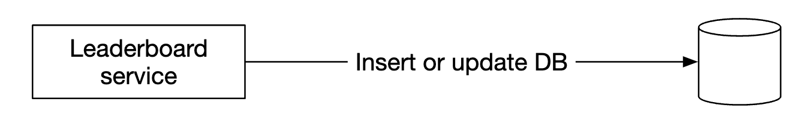
</div>

ユーザーがまだテーブルに存在しない場合は、まず挿入する必要があります。

```
INSERT INTO leaderboard (user_id, score) VALUES ('mary1934', 1);
```

以降の呼び出しでは、スコアを更新するだけです。

```
UPDATE leaderboard set score=score + 1 where user_id='mary1934';
```

リーダーボードの上位プレイヤーはどのように見つけるのでしょうか？

<div style="margin-left:3rem">
    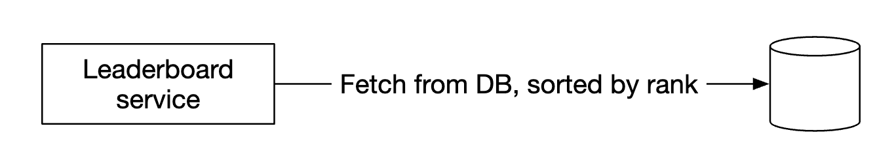
</div>

次のクエリを実行できます。

```
SELECT (@rownum := @rownum + 1) AS rank, user_id, score
FROM leaderboard
ORDER BY score DESC;
```

しかし、データベーステーブル内のすべてのレコードを並べ替えるためにテーブルスキャンを行うため、性能は良くありません。

`score` にインデックスを追加し、`LIMIT` 操作を使ってすべてをスキャンしないようにすることで最適化できます。

```
SELECT (@rownum := @rownum + 1) AS rank, user_id, score
FROM leaderboard
ORDER BY score DESC
LIMIT 10;
```

ただし、このアプローチは、ユーザーがリーダーボードの上位におらず、その順位を特定したい場合にはうまくスケールしません。

#### Redisによるソリューション

複雑なデータベースクエリに頼らずに、数百万人のプレイヤーでもうまく機能するソリューションを見つけたいところです。

Redisはインメモリのデータストアで、メモリ上で動作するため高速であり、私たちのニーズに適したデータ構造であるソート済みセット（sorted set）を持っています。

ソート済みセットは、プログラミング言語のセットに似たデータ構造で、指定した基準でデータ構造をソートされた状態に保てます。
内部的には、キー（user_id）と値（score）のマッピングを保持するハッシュマップと、スコアをソート順にユーザーへマッピングするスキップリストを使って実装されています。

<div style="margin-left:3rem">
    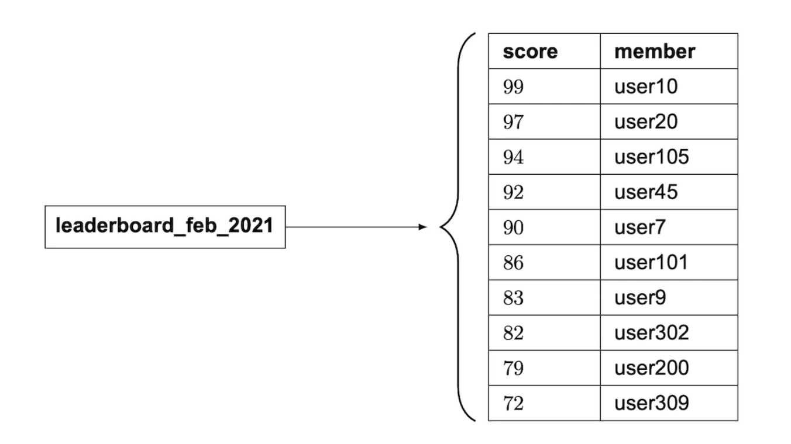
</div>

スキップリストはどのように機能するのでしょうか？
- 高速な検索を可能にする連結リストである
- ソート済みの連結リストと多段のインデックスで構成される

<div style="margin-left:3rem">
    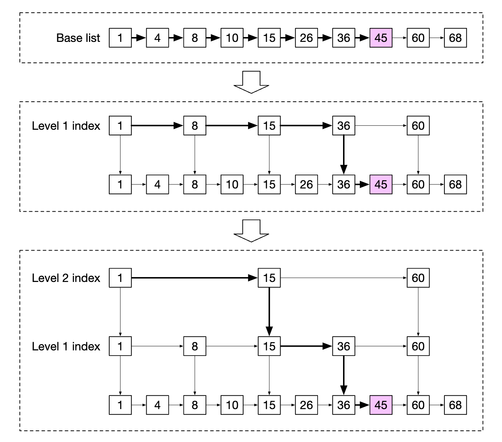
</div>

この構造により、データセットが十分に大きい場合に特定の値を素早く検索できます。
以下の例（64ノード）では、指定した値を見つけるのに、基本の連結リストでは62ノードをたどる必要がありますが、スキップリストの場合は11ノードで済みます。

<div style="margin-left:3rem">
    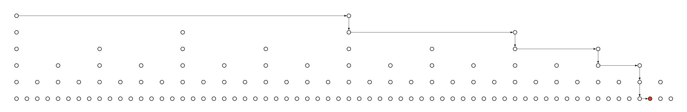
</div>

ソート済みセットは、追加と検索の操作がO(logN)になる代わりにデータが常にソートされた状態に保たれるため、リレーショナルデータベースより性能が優れています。

対照的に、リレーショナルDBで指定したユーザーの順位を見つけるには、次のような入れ子のクエリを実行する必要があります。

```
SELECT *,(SELECT COUNT(*) FROM leaderboard lb2
WHERE lb2.score >= lb1.score) RANK
FROM leaderboard lb1
WHERE lb1.user_id = {:user_id};
```

Redisでリーダーボードを運用するには、どのような操作が必要でしょうか？
- **ZADD** - ユーザーが存在しなければセットに挿入し、存在すればスコアを更新する。時間計算量はO(logN)。
- **ZINCRBY** - ユーザーのスコアを指定した量だけ増やす。ユーザーが存在しなければ、スコアは0から始まる。時間計算量はO(logN)。
- **ZRANGE/ZREVRANGE** - スコアでソートされたユーザーの範囲を取得する。順序（昇順/降順）、オフセット、結果のサイズを指定できる。時間計算量はO(logN+M)（Mは結果のサイズ）。
- **ZRANK/ZREVRANK** - 指定したユーザーの昇順/降順での位置（順位）を取得する。時間計算量はO(logN)。

ユーザーがポイントを獲得すると何が起こるでしょうか？

```
ZINCRBY leaderboard_feb_2021 1 'mary1934'
```

毎月新しいリーダーボードが作成され、古いものは履歴用のストレージに移されます。

ユーザーが上位10人のプレイヤーを取得すると何が起こるでしょうか？

```
ZREVRANGE leaderboard_feb_2021 0 9 WITHSCORES
```

結果の例:

```
[(user2,score2),(user1,score1),(user5,score5)...]
```

ユーザーが自分のリーダーボード上の位置を取得する場合はどうでしょうか？

<div style="margin-left:3rem">
    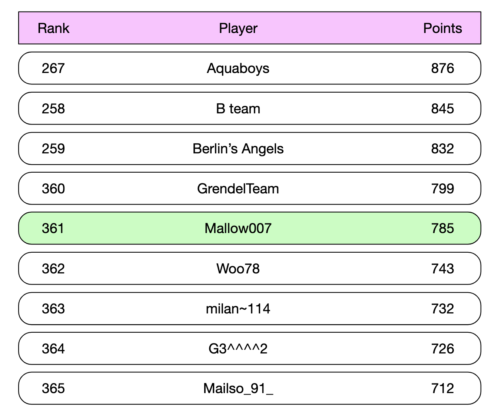
</div>

ユーザーのリーダーボード上の位置がわかっていれば、次のクエリで容易に実現できます。

```
ZREVRANGE leaderboard_feb_2021 357 365
```

ユーザーの位置は `ZREVRANK <user-id>` を使って取得できます。

ストレージの要件を検討しましょう。
- 最悪のケースとして、MAUの2,500万人全員がその月にゲームに参加すると仮定する
- IDが24文字の文字列、スコアが16ビット整数だとすると、26バイト * 2,500万 = 約650MBのストレージが必要
- スキップリストのオーバーヘッドによってストレージコストが2倍になったとしても、最新のRedisクラスターには容易に収まる

検討すべきもう1つの非機能要件は、毎秒2,500件の更新をサポートすることです。これは単一のRedisサーバーの能力の範囲内に十分収まります。

追加の注意点:
- Redisサーバーがクラッシュしたときにデータを失わないよう、Redisのレプリカを立ち上げることができる
- クラッシュ時にデータを失わないよう、Redisの永続化機能も活用できる
- ユーザー名や表示名などのユーザーの詳細を取得したり、例えばユーザーがいつゲームに勝ったかを保存したりするために、MySQLに2つの補助テーブルが必要になる
- MySQLの2つ目のテーブルは、インフラ障害が発生したときにリーダーボードを再構築するために使える
- 小さな性能最適化として、頻繁にアクセスされる上位10人のプレイヤーのユーザー詳細をキャッシュできる

---

## ステップ3: 設計の深掘り

### **クラウドプロバイダーを使うかどうか**

自前でサービスをデプロイ・管理するか、クラウドプロバイダーに管理を任せるかを選べます。

自前でサービスを管理する場合は、リーダーボードのデータにRedisを、ユーザープロフィールにMySQLを使い、データベースをスケールさせたい場合はユーザープロフィールのキャッシュも使うことになるでしょう。

<div style="margin-left:3rem">
    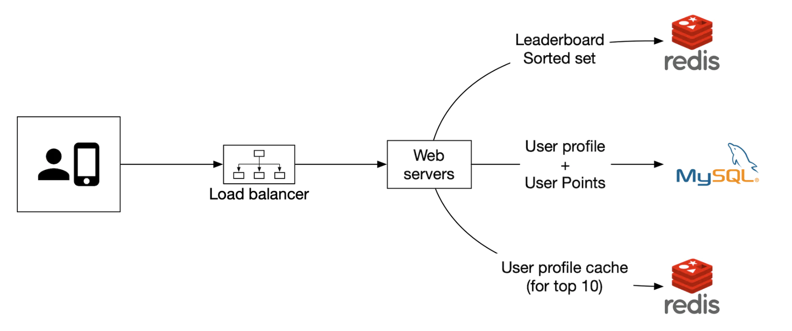
</div>

あるいは、クラウドのサービスを使って、多くのサービスの管理を任せることもできます。例えば、AWS API Gatewayを使って、API呼び出しをAWS Lambda関数にルーティングできます。

<div style="margin-left:3rem">
    
</div>

AWS Lambdaを使えば、サーバーを自分で管理・プロビジョニングすることなくコードを実行できます。必要なときにだけ実行され、自動的にスケールします。

ユーザーがポイントを獲得する例:

<div style="margin-left:3rem">
    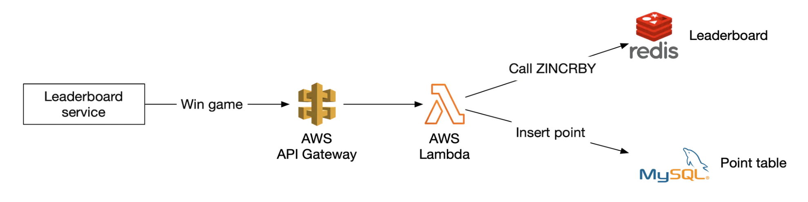
</div>

ユーザーがリーダーボードを取得する例:

<div style="margin-left:3rem">
    
</div>

Lambdaはサーバーレスアーキテクチャの実装の1つです。スケーリングや環境のセットアップを管理する必要がありません。

ゲームをゼロから構築する場合は、このアプローチを採用することを著者は推奨しています。

### **Redisのスケーリング**

DAUが500万人であれば、ストレージとQPSのどちらの観点からも、単一のRedisインスタンスで対応できます。

しかし、ユーザーベースが10倍の5億DAUに成長すると想定すると、ストレージには65GBが必要になり、QPSは25万に達します。

そのような規模ではシャーディングが必要になります。

それを実現する1つの方法は、データを範囲でパーティショニングすることです。

<div style="margin-left:3rem">
    
</div>

この例では、ユーザーのスコアに基づいてシャーディングします。user_idとシャードのマッピングはアプリケーションコードで保持します。
マッピング自体は、MySQLか別のキャッシュを使って保持できます。

上位10人のプレイヤーを取得するには、最も高いスコアのシャード（`[900-1000]`）に問い合わせます。

ユーザーの順位を取得するには、そのユーザーのシャード内での順位を計算し、他のシャードにいるより高いスコアのユーザーの数をすべて足し合わせる必要があります。
後者は、シャードごとの総レコード数をinfo keyspaceコマンドで素早く取得できるため、O(1)の操作です。

あるいは、Redis Clusterによるハッシュパーティショニングを使うこともできます。これは、コンシステントハッシュに似た（ただし完全に同じではない）パーティショニングに基づいて、Redisノード間にデータを分散するプロキシです。

<div style="margin-left:3rem">
    
</div>

この構成では、上位10人のプレイヤーを計算するのが困難です。各シャードの上位10人のプレイヤーを取得し、アプリケーションで結果をマージする必要があります。

<div style="margin-left:3rem">
    
</div>

ハッシュパーティショニングにはいくつかの制約があります。
- Kが大きい上位K人のユーザーを取得する必要がある場合、すべてのシャードから大量のデータを取得する必要があるため、レイテンシが増加する可能性がある
- パーティションの数が増えるにつれてレイテンシが増加する
- ユーザーの順位を求める簡単な方法がない

これらすべての理由から、著者はこの問題には固定のパーティションを使うことに傾いています。

その他の注意点:
- ベストプラクティスとして、書き込みの多いRedisノードには、必要に応じてスナップショットに対応できるよう、必要量の2倍のメモリを割り当てる
- Redis-benchmarkというツールを使ってRedis構成の性能を追跡し、データに基づいた意思決定を行える

### **代替のソリューション: NoSQL**

検討すべき代替のソリューションとして、次の点に最適化された適切なNoSQLデータベースを使う方法があります。
- 大量の書き込み
- 同じパーティション内の項目をスコアで効果的にソートすること

DynamoDB、Cassandra、MongoDBはいずれも適しています。

本章では、著者はDynamoDBを使うことにしました。DynamoDBはフルマネージドのNoSQLデータベースで、信頼できる性能と優れたスケーラビリティを提供します。
また、主キーに含まれないフィールドで問い合わせる必要がある場合には、グローバルセカンダリインデックスを使えます。

<div style="margin-left:3rem">
    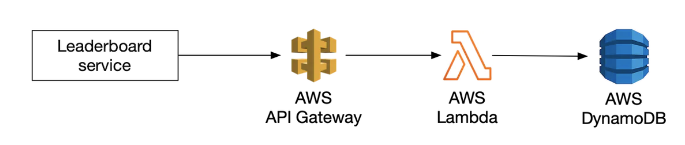
</div>

チェスゲームのリーダーボードを保存するためのテーブルから始めましょう。

<div style="margin-left:3rem">
    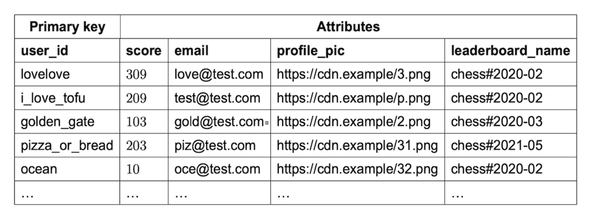
</div>

これはうまく機能しますが、スコアで何かを問い合わせる必要がある場合にはうまくスケールしません。そのため、スコアをソートキーにすることができます。

<div style="margin-left:3rem">
    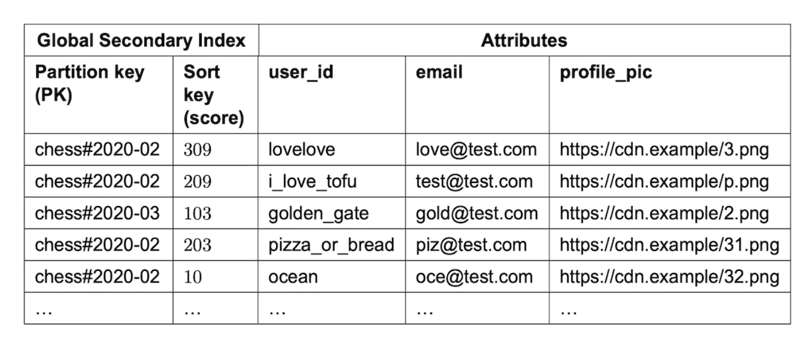
</div>

この設計のもう1つの問題は、月でパーティショニングしていることです。最新の月は他の月に比べて偏ってアクセスされるため、ホットスポットのパーティションが生じます。

書き込みシャーディングと呼ばれる手法を使えます。これは、`user_id % num_partitions` で計算したパーティション番号を各キーに付加するものです。

<div style="margin-left:3rem">
    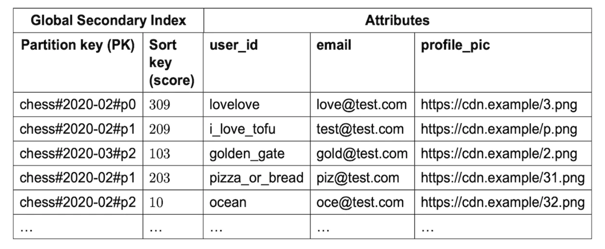
</div>

検討すべき重要なトレードオフは、いくつのパーティションを使うべきかです。
- パーティションが多いほど、書き込みのスケーラビリティは高くなる
- しかし、集約した結果を得るためにより多くのパーティションに問い合わせる必要があるため、読み取りのスケーラビリティが損なわれる

このアプローチでは、先に見た「スキャッター・ギャザー（scatter-gather）」の手法を使う必要があり、パーティションを追加するにつれて時間計算量が増大します。

<div style="margin-left:3rem">
    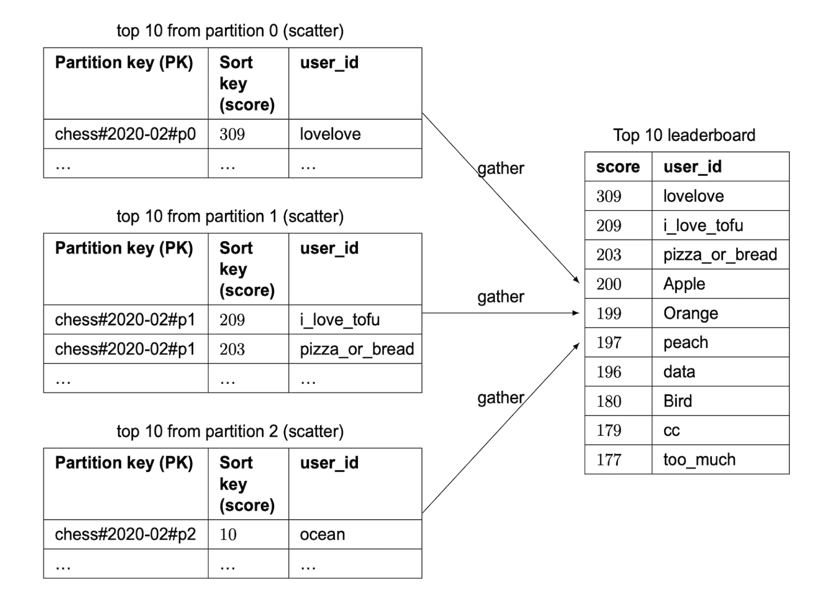
</div>

パーティション数を適切に評価するには、ベンチマークを行う必要があるでしょう。

このNoSQLのアプローチには依然として大きな欠点が1つあります。ユーザーの具体的な順位を計算するのが難しいことです。

シャーディングが必要なほどの規模がある場合は、ユーザーにスコアの「パーセンタイル」を伝えるという方法もあるかもしれません。

cronジョブを定期的に実行してスコアの分布を分析し、それに基づいてユーザーのパーセンタイルを決定できます。例:

```
10th percentile = score < 100
20th percentile = score < 500
...
90th percentile = score < 6500
```

---

## ステップ4: まとめ

時間があれば議論すべきその他の事項:
- **より高速な取得** - `user_id -> ユーザーオブジェクト` のマッピングを持つRedisのハッシュでユーザーオブジェクトをキャッシュできる。これにより、データベースに問い合わせるよりも高速に取得できる。
- **同点の処理** - 2人のプレイヤーが同じスコアの場合、最後にプレイしたゲームの時刻で並べ替えることで同点を解消できる。
- **システム障害からの復旧** - 大規模なRedisの障害が発生した場合、MySQLのWALエントリをたどり、アドホックなスクリプトでリーダーボードを再作成できる。
