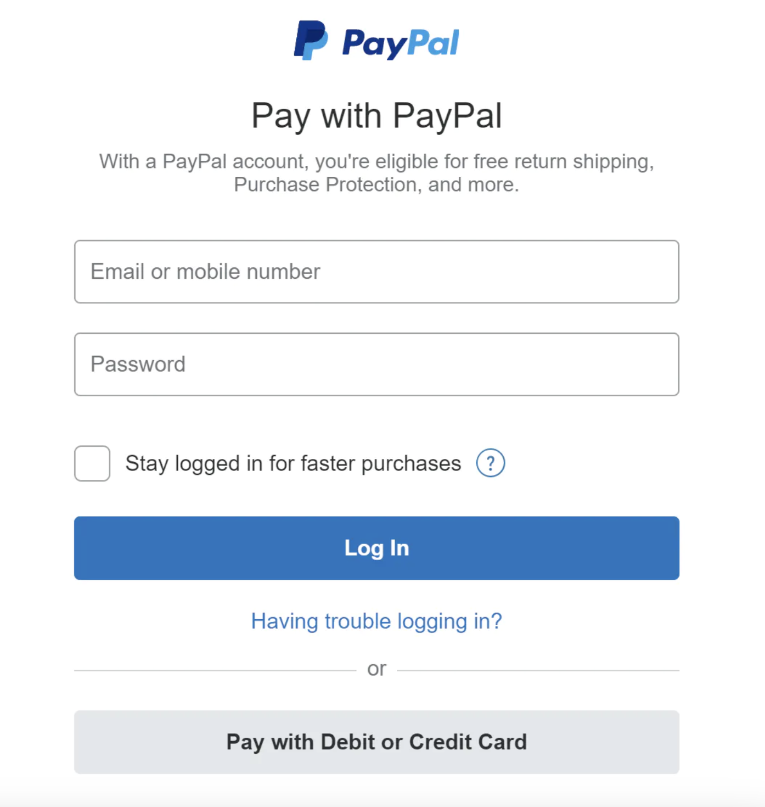
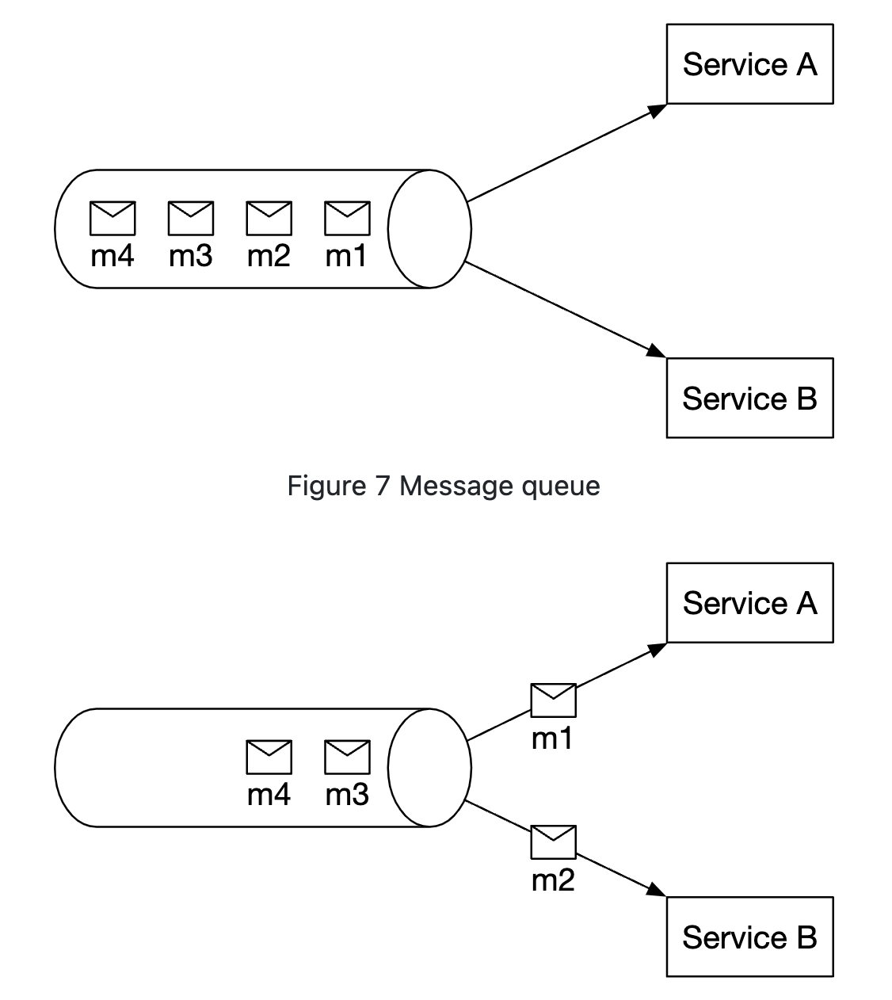
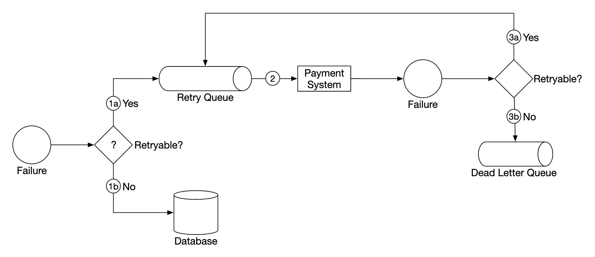
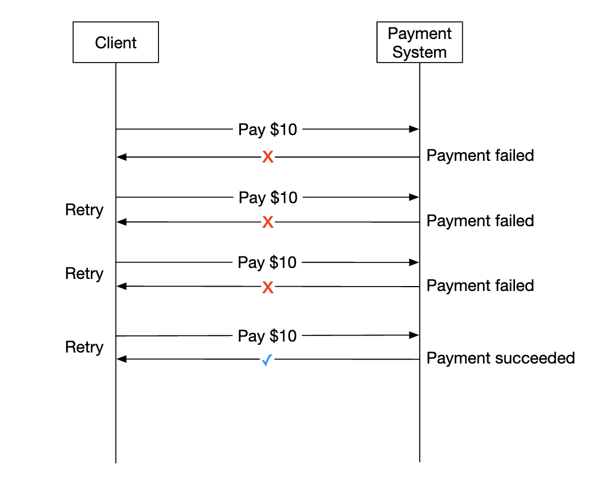
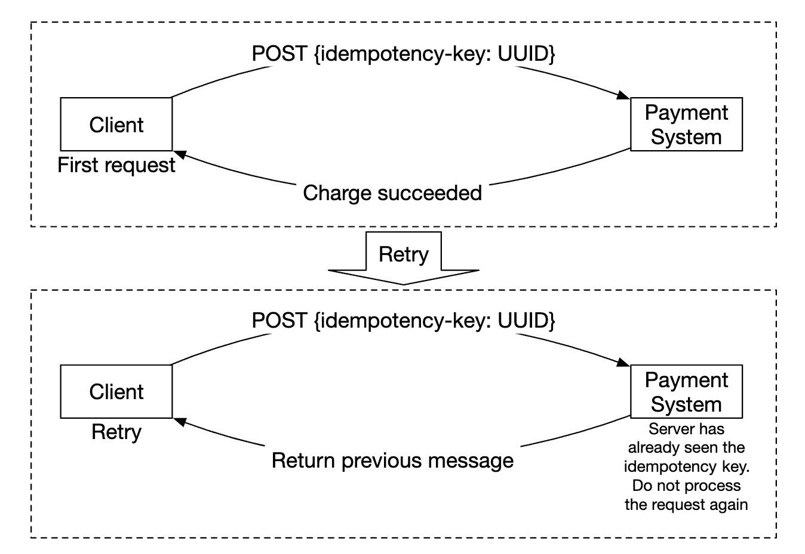

# 第26章: 決済システム

## はじめに
本章では、現代のあらゆる**eコマース**を支える**決済システム**を設計します。

**決済システム**は、金銭的価値を移転することで金融取引を決済するために使われます。

---

## ステップ1: 問題を理解し、設計の範囲を定める
 * C: どのような種類の決済システムを構築するのですか？
 * I: Amazon.comのようなeコマースシステムの決済バックエンドです。お金の移動に関するすべてを処理します。
 * C: どの支払い方法をサポートしますか？ クレジットカード、PayPal、銀行カードなどですか？
 * I: 実際にはこれらすべての方法をサポートすべきです。面接の目的としては、クレジットカード決済を使うことにしましょう。
 * C: クレジットカードの処理は自分たちで行いますか？
 * I: いいえ、Stripe、Braintree、Squareなどのサードパーティのプロバイダーを使います。
 * C: クレジットカードのデータをシステムに保存しますか？
 * I: コンプライアンス上の理由から、クレジットカードのデータをシステムに直接保存することはしません。サードパーティの決済処理業者に依存します。
 * C: アプリケーションはグローバルですか？ 異なる通貨や国際決済をサポートする必要がありますか？
 * I: アプリケーションはグローバルですが、面接の目的としては1つの通貨のみを使うと仮定します。
 * C: 1日あたり何件の決済トランザクションをサポートしますか？
 * I: 1日あたり100万件のトランザクションです。
 * C: 例えば毎月の販売者への支払いのような、支払い（ペイアウト）フローをサポートする必要はありますか？
 * I: はい、それはサポートする必要があります。
 * C: 他に注意すべきことはありますか？
 * I: 内部システムおよび外部システムとの通信における不整合を修正するため、照合（リコンシリエーション）をサポートする必要があります。

### **機能要件**
 * 入金（ペイイン）フロー - 決済システムが販売者に代わって顧客からお金を受け取る
 * 支払い（ペイアウト）フロー - 決済システムが世界中の販売者にお金を送る

### **非機能要件**
 * 信頼性と耐障害性。失敗した決済は慎重に扱う必要がある
 * 内部システムと外部システムの間の照合の仕組みを構築する必要がある

### **概算見積もり**
システムは1日あたり100万件のトランザクション、つまり毎秒10件のトランザクションを処理する必要があります。

これはどのデータベースシステムにとっても高いスループットではないため、この面接の焦点ではありません。

---

## ステップ2: 高レベル設計を提案し、合意を得る
高レベルでは、お金の移動に関わる3つのアクターがいます。

<div style="margin-left:3rem">
    
</div>

### **入金フロー**
入金フローの高レベルの概要は次のとおりです。

<div style="margin-left:3rem">
    
</div>

 * 決済サービス - 決済イベントを受け付け、決済プロセスを調整する。通常、マネーロンダリング対策（AML）違反や犯罪行為についてサードパーティのプロバイダーを使ったリスクチェックも行う。
 * 決済実行器（Payment executor） - 決済サービスプロバイダー（PSP）を介して1件の決済オーダーを実行する。決済イベントには複数の決済オーダーが含まれる場合がある。
 * 決済サービスプロバイダー（PSP） - ある口座から別の口座へお金を移動させる。例えば、購入者のクレジットカード口座からeコマースサイトの銀行口座へ。
 * カードスキーム - クレジットカードの処理を行う組織。例: Visa、MasterCardなど。
 * 台帳（Ledger） - すべての決済トランザクションの財務記録を保持する。
 * ウォレット - すべての販売者の口座残高を保持する。

入金フローの例は次のとおりです。
 * ユーザーが「注文を確定」をクリックすると、決済イベントが決済サービスに送られる
 * 決済サービスがイベントをデータベースに保存する
 * 決済サービスが、その決済イベントに含まれるすべての決済オーダーについて決済実行器を呼び出す
 * 決済実行器が決済オーダーをデータベースに保存する
 * 決済実行器が外部のPSPを呼び出し、クレジットカード決済を処理する
 * 決済実行器が決済を処理した後、決済サービスがウォレットを更新し、販売者がいくら持っているかを記録する
 * ウォレットサービスが更新された残高情報をデータベースに保存する
 * 決済サービスが台帳を呼び出し、すべてのお金の移動を記録する

### **決済サービスのAPI**
```
POST /v1/payments
{
  "buyer_info": {...},
  "checkout_id": "some_id",
  "credit_card_info": {...},
  "payment_orders": [{...}, {...}, {...}]
}
```

`payment_order` の例:
```
{
  "seller_account": "SELLER_IBAN",
  "amount": "3.15",
  "currency": "USD",
  "payment_order_id": "globally_unique_payment_id"
}
```

注意点:
 * `payment_order_id` は決済の重複排除のためにPSPに転送される。つまり、冪等キーである。
 * `double` は金額を表すのに適していないため、amountフィールドは `string` である。

```
GET /v1/payments/{:id}
```

このエンドポイントは、`payment_order_id` に基づいて、1件の決済の実行状況を返します。

### **決済サービスのデータモデル**
`payment_events` と `payment_orders` の2つのテーブルを保持する必要があります。

決済では、通常、性能は重要な要因ではありません。しかし、強い一貫性は重要です。

データベースを選ぶ際のその他の検討事項:
 * データベースを管理するDBAを採用できる市場が充実していること
 * 他の大手金融機関で使われてきた実績があること
 * サポートツールが充実していること
 * ACID保証のため、NoSQL/NewSQLよりも従来型のSQLを選ぶこと

`payment_events` テーブルには次の内容が含まれます。
 * `checkout_id` - 文字列、主キー
 * `buyer_info` - 文字列（個人的な注記 - おそらく別のテーブルへの外部キーの方が適切）
 * `seller_info` - 文字列（個人的な注記 - 上と同じ）
 * `credit_card_info` - カードプロバイダーに依存する
 * `is_payment_done` - 真偽値

`payment_orders` テーブルには次の内容が含まれます。
 * `payment_order_id` - 文字列、主キー
 * `buyer_account` - 文字列
 * `amount` - 文字列
 * `currency` - 文字列
 * `checkout_id` - 文字列、外部キー
 * `payment_order_status` - 列挙型（`NOT_STARTED`、`EXECUTING`、`SUCCESS`、`FAILED`）
 * `ledger_updated` - 真偽値
 * `wallet_updated` - 真偽値

注意点:
 * 1つの決済イベントには、多くの決済オーダーが紐づく
 * 入金フローでは `seller_info` は必要ない。それが必要なのは支払いフローだけである
 * `ledger_updated` と `wallet_updated` は、それぞれのサービスが呼び出されて決済の結果を記録したときに更新される
 * 決済の状態遷移はバックグラウンドジョブによって管理される。このジョブは処理中の決済の更新を確認し、決済が妥当な時間内に処理されない場合にアラートをトリガーする

### **複式簿記の台帳システム**
複式簿記の仕組みは、あらゆる決済システムの鍵となります。これは、お金の操作を常に2つの口座に適用し、一方の口座残高が増え（貸方）、もう一方が減る（借方）ようにすることで、お金の移動を追跡する仕組みです。

| 口座   | 借方  | 貸方   |
|--------|-------|--------|
| 購入者 | $1    |        |
| 販売者 |       | $1     |

すべての取引記録の合計は常にゼロになります。この仕組みにより、システム内のすべてのお金の移動をエンドツーエンドで追跡できます。

### **ホスト型決済ページ**
クレジットカード情報を保存し、さまざまな厳しい規制に準拠しなければならない事態を避けるため、ほとんどの企業は、クレジットカード決済の保存と処理を代行してくれる、PSPが提供するウィジェットの利用を好みます。

<div style="margin-left:3rem">
    
</div>

### **支払いフロー**
支払いフローのコンポーネントは、入金フローと非常によく似ています。

主な違い:
 * お金はeコマースサイトの銀行口座から販売者の銀行口座へ移動する
 * Tipaltiのようなサードパーティの買掛金管理プロバイダーを利用できる
 * 支払いに関しても、処理すべき記帳や規制上の要件が数多くある

---

## ステップ3: 設計の深掘り
このセクションでは、システムをより速く、より堅牢で、より安全にすることに焦点を当てます。

### **PSPとの連携**
システムが銀行やカードスキームに直接接続できれば、PSPなしで決済を行えます。
このような接続は非常にまれで一般的ではなく、通常はその投資を正当化できる大企業で行われます。

従来の方法をとる場合、PSPは次の2つの方法のいずれかで連携できます。
 * 決済システムが支払い情報を収集できる場合は、APIを介して連携する
 * 支払い情報に関する規制への対応を避けるため、ホスト型決済ページを介して連携する

ホスト型決済ページのワークフローは次のように動作します。

<div style="margin-left:3rem">
    
</div>

 * ユーザーがブラウザで「チェックアウト」ボタンをクリックする
 * クライアントが決済オーダーの情報とともに決済サービスを呼び出す
 * 決済オーダーの情報を受け取った後、決済サービスがPSPに決済登録リクエストを送信する
 * PSPは、通貨、金額、有効期限などの決済情報と、冪等性のためのUUID（通常は決済オーダーのUUID）を受け取る
 * PSPは、決済登録を一意に識別するトークンを返す。トークンは決済サービスのデータベースに保存される
 * トークンが保存されると、ユーザーにPSPがホストする決済ページが表示される。このページは、トークンと、成功/失敗時のリダイレクトURLを使って初期化される
 * ユーザーがPSPのページで支払いの詳細を入力すると、PSPが決済を処理し、決済のステータスを返す
 * ユーザーはここでリダイレクトURLにリダイレクトされる。リダイレクトURLの例 - `https://your-company.com/?tokenID=JIOUIQ123NSF&payResult=X324FSa`
 * 非同期に、PSPがWebhookを介して決済サービスを呼び出し、バックエンドに決済結果を通知する
 * 決済サービスは、受信したWebhookに基づいて決済結果を記録する

### **照合（リコンシリエーション）**
前のセクションでは、決済が正常に進む場合（ハッピーパス）を説明しました。正常でない経路は、バックグラウンドの照合プロセスを使って検出・照合されます。

毎晩、PSPは決済ファイル（settlement file）を送信し、システムはそれを使って外部システムの状態と内部システムの状態を比較します。

<div style="margin-left:3rem">
    
</div>

このプロセスは、例えば台帳サービスとウォレットサービスの間の内部的な不整合を検出するのにも使えます。

不一致は財務チームが手動で処理します。不一致は次のように扱われます。
 * 分類可能。つまり既知の不一致であり、標準の手順で調整できる
 * 分類可能だが、自動化できない。財務チームが手動で調整する
 * 分類不能。財務チームが手動で調査し、調整する

### **決済処理の遅延への対処**
決済は通常数秒で完了しますが、完了までに数時間かかる場合もあります。

これは次のような理由で起こり得ます。
 * 決済が高リスクとしてフラグ付けされ、誰かが手動で審査しなければならない
 * クレジットカードが追加の保護（例えば3Dセキュア認証）を必要とし、完了するためにカード保有者からの追加の情報が必要になる

こうした状況には次のように対処します。
 * 決済が完了したときにPSPからWebhookが送られてくるのを待つ。PSPがWebhookを提供していない場合は、そのAPIをポーリングする
 * ユーザーに「保留中」のステータスを表示し、決済の更新状況を確認できるページを提供する。決済が完了したらメールを送ることもできる

### **内部サービス間の通信**
サービスが互いに通信するために使う通信パターンには、同期と非同期の2種類があります。

同期通信（つまりHTTP）は小規模なシステムではうまく機能しますが、規模が大きくなるにつれて問題が生じます。
 * 低い性能 - 呼び出しチェーンに関わるサービスが増えるほど、リクエスト-レスポンスのサイクルが長くなる
 * 障害の分離が不十分 - PSPやその他のサービスが故障すると、ユーザーはレスポンスを受け取れない
 * 密結合 - 送信者が受信者を知っている必要がある
 * スケールが困難 - バッファがないため、トラフィックの急増に対応するのが容易ではない

非同期通信は2つのカテゴリに分けられます。

単一の受信者 - 複数の受信者が同じトピックを購読するが、メッセージは1回だけ処理される。

<div style="margin-left:3rem">
    
</div>

複数の受信者 - 複数の受信者が同じトピックを購読し、メッセージはそのすべてに転送される。

<div style="margin-left:3rem">
    
</div>

1つの決済が、異なるサービスによって処理される複数の副作用を引き起こす可能性があるため、後者のモデルが私たちの決済システムには適しています。

要するに、同期通信はより単純ですが、サービスが自律的に動作することを許しません。
非同期通信は、単純さと一貫性を犠牲にして、スケーラビリティと回復力を得ます。

### **失敗した決済への対処**
すべての決済システムは、失敗した決済に対処する必要があります。それを実現するために使う仕組みをいくつか示します。
 * 決済状態の追跡 - 決済が失敗するたびに、決済の状態に基づいてリトライするか返金するかを判断できる
 * リトライキュー - リトライする決済はリトライキューに発行される
 * デッドレターキュー - 最終的に失敗した決済はデッドレターキューにプッシュされ、そこで失敗した決済をデバッグ・調査できる

<div style="margin-left:3rem">
    
</div>

### **Exactly-once配信**
顧客への二重請求を避けるため、決済が正確に1回だけ処理されることを保証する必要があります。

操作が「少なくとも1回」かつ「最大1回」の両方を同時に満たして実行されれば、その操作は正確に1回だけ実行されたことになります。

「少なくとも1回」の保証を実現するために、リトライの仕組みを使います。

<div style="margin-left:3rem">
    
</div>

リトライの間隔を決めるための一般的な戦略をいくつか示します。
 * 即時リトライ - クライアントは失敗後すぐに別のリクエストを送信する
 * 固定間隔 - 決済をリトライする前に一定時間待つ
 * 増分間隔 - リトライのたびにリトライ間隔を段階的に長くする
 * 指数バックオフ - 連続するリトライの間でリトライ間隔を2倍にする
 * キャンセル - クライアントがリクエストをキャンセルする。エラーが致命的である場合や、リトライのしきい値に達した場合に起こる

経験則として、デフォルトでは指数バックオフのリトライ戦略を使います。良い慣行は、サーバーが `Retry-After` ヘッダーを使ってリトライ間隔を指定することです。

リトライの問題点は、サーバーが決済を二重に処理してしまう可能性があることです。
 * クライアントが「支払う」ボタンを2回クリックし、その結果2回請求される
 * 決済はPSPでは正常に処理されたが、下流のサービス（台帳、ウォレット）では処理されなかった。リトライによって、PSPで決済が再び処理されてしまう

二重決済の問題に対処するには、冪等性の仕組みを使う必要があります。冪等性とは、操作を複数回適用しても1回だけ処理されるという性質です。

APIの観点からは、クライアントは複数回呼び出しても同じ結果が得られます。
冪等性は、リクエスト内の特別なヘッダー（例: `idempotency-key`）で管理され、通常はUUIDです。

<div style="margin-left:3rem">
    
</div>

冪等性は、データベースの一意キー制約の仕組みを使って実現できます。
 * サーバーがデータベースに新しい行の挿入を試みる
 * 一意キー制約の違反により挿入が失敗する
 * サーバーはそのエラーを検出し、代わりに既存のオブジェクトをクライアントに返す

冪等性はPSP側でも、前述のnonceを使って適用されます。PSPは、同じnonceを持つ決済を2回処理しないよう注意を払います。

### **一貫性**
決済のライフサイクルを通じて、いくつかのステートフルなサービス（PSP、台帳、ウォレット、決済サービス）が呼び出されます。

任意の2つのサービス間の通信は失敗する可能性があります。
exactly-onceの処理と照合を実装することで、すべてのサービス間でデータの結果整合性を確保できます。

レプリケーションを使う場合は、レプリケーションの遅延に対処する必要があります。これにより、ユーザーがプライマリとレプリカのデータベース間で一貫しないデータを目にする可能性があります。

これを緩和するため、すべての読み取りと書き込みをプライマリデータベースから提供し、レプリカは冗長化とフェイルオーバーのためだけに使うことができます。
あるいは、PaxosやRaftのようなコンセンサスアルゴリズムを使って、レプリカが常に同期していることを保証できます。
YugabyteDBやCockroachDBのような、コンセンサスベースの分散データベースを使うこともできます。

### **決済のセキュリティ**
決済のセキュリティを確保するために使える仕組みをいくつか示します。
 * リクエスト/レスポンスの盗聴 - HTTPSを使ってすべての通信を保護する
 * データの改ざん - 暗号化と完全性の監視を徹底する
 * 中間者攻撃 - 証明書ピンニング付きのSSLを使う
 * データの損失 - 複数のリージョンにデータをレプリケートし、データのスナップショットを取る
 * DDoS攻撃 - レート制限とファイアウォールを実装する
 * カードの盗難 - 実際のカード情報をシステムに保存する代わりにトークンを使う
 * PCI準拠 - ブランド付きクレジットカードを扱う組織のためのセキュリティ基準
 * 不正 - 住所確認、カードセキュリティコード（CVV）、ユーザー行動の分析など

---

## ステップ4: まとめ
その他の論点:
 * 監視とアラート
 * デバッグツール - 決済が失敗した理由を容易に理解できるツールが必要
 * 通貨の両替 - 国際的に使う決済システムを設計する際に重要
 * 地域 - 地域によって支払い方法が異なる場合がある
 * 現金決済 - インドやブラジルなどでは非常に一般的
 * Google Pay/Apple Payとの連携
