# 第27章: デジタルウォレット

## はじめに
**決済プラットフォーム**には通常**ウォレットサービス**があり、クライアントはアプリケーション内に資金を保管し、後で引き出すことができます。

また、商品やサービスの支払いや、**デジタルウォレット**サービスを使う他のユーザーへの送金にも使えます。これは通常の決済インフラを経由するよりも速く、安価な場合があります。

<div style="margin-left:3rem">
    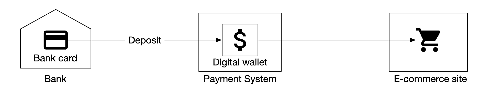
</div>

---

## ステップ1: 問題を理解し、設計の範囲を定める
 * C: デジタルウォレット間の送金だけに焦点を当てるべきですか？ 他の操作もサポートすべきですか？
 * I: 今はデジタルウォレット間の送金に焦点を当てましょう。
 * C: システムは毎秒何件のトランザクションをサポートする必要がありますか？
 * I: 100万TPSと仮定しましょう。
 * C: デジタルウォレットには厳格な正確性の要件があります。トランザクションの保証で十分と考えてよいですか？
 * I: よいでしょう。
 * C: 正確性を証明する必要はありますか？
 * I: 照合（リコンシリエーション）で行うこともできますが、それでは不一致を検出できるだけで、その根本原因はわかりません。代わりに、最初からデータを再生して履歴を再構築できるようにしたいです。
 * C: 可用性の要件は99.99%と考えてよいですか？
 * I: はい。
 * C: 外国為替を考慮する必要はありますか？
 * I: いいえ、範囲外です。

サポートしなければならない内容をまとめると次のとおりです。
 * 2つの口座間の残高移動をサポートする
 * 100万TPSをサポートする
 * 信頼性は99.99%
 * トランザクションをサポートする
 * 再現性をサポートする

### **概算見積もり**
クラウド上にプロビジョニングした従来のリレーショナルデータベースは、約1,000 TPSをサポートできます。

100万TPSに到達するには、1,000台のデータベースノードが必要になります。しかし、各送金に2つのレッグ（引き落としと入金）がある場合、実際には200万TPSをサポートする必要があります。

設計目標の1つは、データベースノードを減らせるよう、1ノードが処理できるTPSを高めることです。

| ノードあたりのTPS | ノード数    |
|--------------|-------------|
| 100          | 20,000      |
| 1,000        | 2,000       |
| 10,000       | 200         |

---

## ステップ2: 高レベル設計を提案し、合意を得る

### **API設計**
この面接では、1つのエンドポイントのみをサポートすればよいです。
```
POST /v1/wallet/balance_transfer - transfers balance from one wallet to another
```

リクエストパラメータ - from_account、to_account、amount（精度を失わないよう文字列）、currency、transaction_id（冪等キー）。

レスポンスの例:
```
{
    "status": "success"
    "transaction_id": "01589980-2664-11ec-9621-0242ac130002"
}
```

### **インメモリのシャーディングによるソリューション**
ウォレットアプリケーションは、すべてのユーザーアカウントの口座残高を保持します。

これを表現する良いデータ構造の1つは `map<user_id, balance>` で、インメモリのRedisストアを使って実装できます。

1台のRedisノードでは100万TPSに耐えられないため、Redisクラスターを複数のノードにパーティショニングする必要があります。

パーティショニングのアルゴリズムの例:
```
String accountID = "A";
Int partitionNumber = 7;
Int myPartition = accountID.hashCode() % partitionNumber;
```

ZooKeeperは高可用な設定ストレージであるため、パーティション数とRedisノードのアドレスを保存するのに使えます。

最後に、ウォレットサービスは送金操作を実行する役割を担うステートレスなサービスです。容易に水平スケールできます。

<div style="margin-left:3rem">
    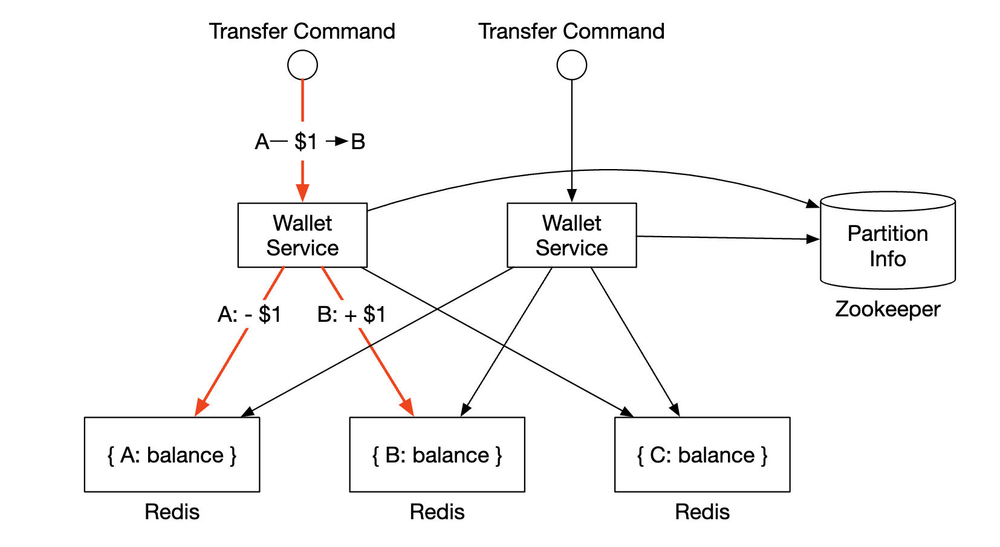
</div>

このソリューションはスケーラビリティの懸念には対処できますが、残高移動をアトミックに実行することはできません。

### **分散トランザクション**
トランザクションを扱う1つのアプローチは、標準的なシャーディングされたリレーショナルデータベースの上で2フェーズコミットプロトコルを使うことです。

<div style="margin-left:3rem">
    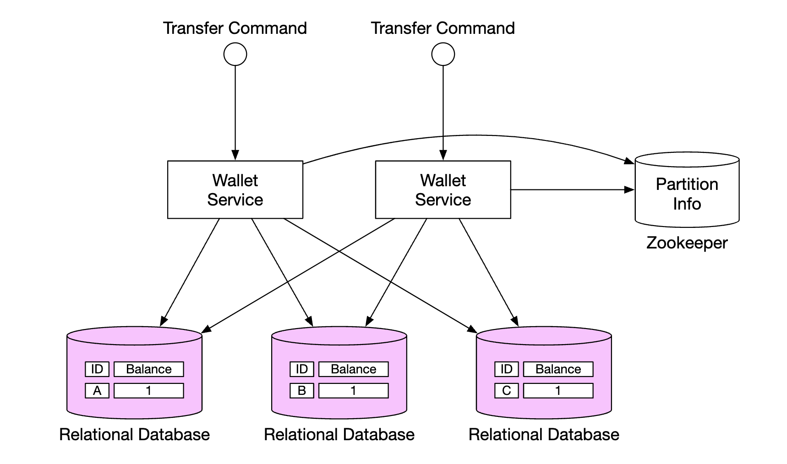
</div>

2フェーズコミット（2PC）プロトコルは次のように動作します。

<div style="margin-left:3rem">
    
</div>

 * コーディネーター（ウォレットサービス）が、通常どおり複数のデータベースに対して読み取りと書き込みの操作を行う
 * アプリケーションがトランザクションをコミットする準備ができると、コーディネーターはすべてのデータベースに準備（prepare）を依頼する
 * すべてのデータベースが「yes」と応答した場合、コーディネーターはデータベースにトランザクションのコミットを依頼する
 * そうでない場合、すべてのデータベースにトランザクションの中止を依頼する

2PCのアプローチの欠点:
 * ロックの競合のため性能が良くない
 * コーディネーターが単一障害点になる

### **Try-Confirm/Cancel（TC/C）を使った分散トランザクション**
TC/Cは2PCプロトコルの変種で、補償トランザクションを使って動作します。
 * コーディネーターがすべてのデータベースに、トランザクションのためのリソースの確保を依頼する
 * コーディネーターがDBからの応答を集める - yesであれば、DBにtry-confirmを依頼する。noであれば、DBにtry-cancelを依頼する。

TC/Cと2PCの重要な違いの1つは、2PCが単一のトランザクションを実行するのに対し、TC/Cでは2つの独立したトランザクションがあることです。

TC/Cがフェーズごとにどのように動作するかを示します。

| フェーズ | 操作      | A                   | C                   |
|-------|-----------|---------------------|---------------------|
| 1     | Try       | 残高変更: -$1       | 何もしない          |
| 2     | Confirm   | 何もしない          | 残高変更: +$1       |
|       | Cancel    | 残高変更: +$1       | 何もしない          |

フェーズ1 - Try:

<div style="margin-left:3rem">
    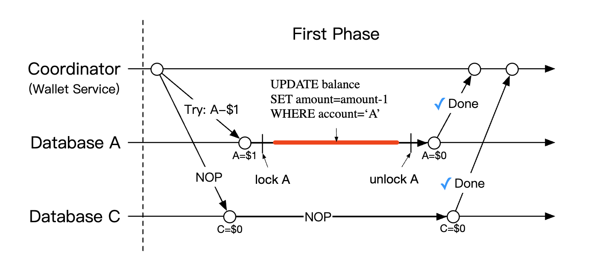
</div>

 * コーディネーターがAのDBでローカルトランザクションを開始し、Aの残高を$1減らす
 * CのDBには何もしないNOP命令が与えられる

フェーズ2a - Confirm:

<div style="margin-left:3rem">
    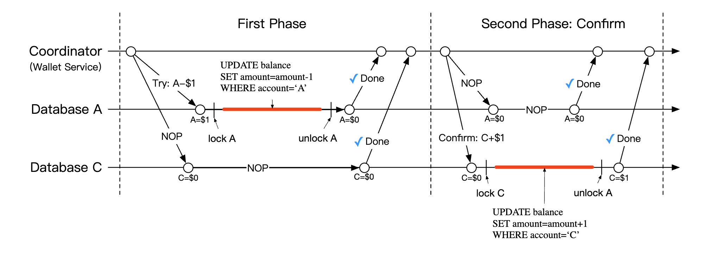
</div>

 * 両方のDBが「yes」と応答した場合、Confirmフェーズが始まる。
 * AのDBはNOPを受け取り、CのDBはCの残高を$1増やすよう指示される（ローカルトランザクション）

フェーズ2b - Cancel:

<div style="margin-left:3rem">
    
</div>

 * フェーズ1の操作のいずれかが失敗した場合、Cancelフェーズが始まる。
 * AのDBはAの残高を$1増やすよう指示され、CのDBはNOPを受け取る

2PCとTC/Cの比較は次のとおりです。

|      | 第1フェーズ                                            | 第2フェーズ: 成功                  | 第2フェーズ: 失敗                         |
|------|--------------------------------------------------------|------------------------------------|-------------------------------------------|
| 2PC  | トランザクションはまだ完了していない                   | すべてのトランザクションをコミット/キャンセルする | すべてのトランザクションをキャンセルする |
| TC/C | すべてのトランザクションが完了（コミットまたはキャンセル）している | 必要に応じて新しいトランザクションを実行する | コミット済みのトランザクションを取り消す |

TC/Cは、補償による分散トランザクションとも呼ばれます。高レベルの操作はビジネスロジック内で扱われます。

TC/Cのその他の特性:
 * データベースがトランザクションをサポートしていれば、データベースに依存しない
 * 分散トランザクションの詳細と複雑さはビジネスロジック内で扱う必要がある

### **TC/Cの障害モード**
コーディネーターが処理の途中で停止した場合、中間状態を復元する必要があります。
これは、データベースのシャード内でアトミックに更新されるフェーズステータステーブルを保持することで実現できます。

<div style="margin-left:3rem">
    
</div>

このテーブルには次の内容が含まれます。
 * 分散トランザクションのIDと内容
 * Tryフェーズのステータス - 未送信、送信済み、応答受信済み
 * 第2フェーズの名前 - ConfirmまたはCancel
 * 第2フェーズのステータス
 * 順序外れ（out-of-order）フラグ（後述）

TC/Cを使う際の注意点の1つは、分散トランザクションの処理中に、口座の状態が互いに一貫しない短い期間があることです。

<div style="margin-left:3rem">
    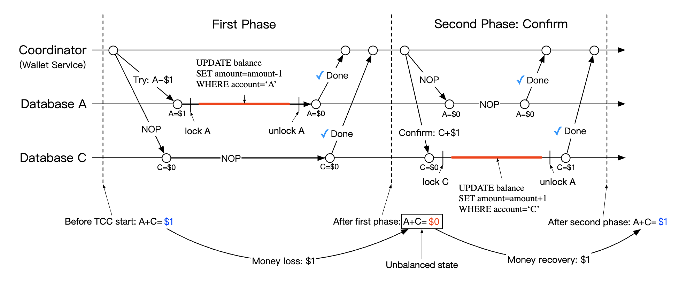
</div>

常にこの状態から回復でき、ユーザーが中間状態を（例えば使ってしまうなど）利用できない限り、これは問題ありません。
これは、常に加算より先に減算を実行することで保証されます。

| Tryフェーズの選択肢 | 口座A     | 口座C     |
|--------------------|-----------|-----------|
| 選択肢1            | -$1       | NOP       |
| 選択肢2（無効）    | NOP       | +$1       |
| 選択肢3（無効）    | -$1       | +$1       |

上の表の選択肢3が無効なのは、2PCに頼らずに異なるデータベースにまたがるトランザクションのアトミックな実行を保証できないためです。

対処すべきエッジケースの1つは、順序外れの実行です。

<div style="margin-left:3rem">
    
</div>

データベースがTryを受け取る前にCancel操作を受け取る可能性があります。このエッジケースは、フェーズステータステーブルに順序外れフラグを追加することで対処できます。
Try操作を受け取ったら、まず順序外れフラグが設定されているかを確認し、設定されていれば失敗を返します。

### **Sagaを使った分散トランザクション**
もう1つの人気のあるアプローチは、Sagaを使うことです。Sagaは、マイクロサービスアーキテクチャで分散トランザクションを実装するための標準的な方式です。

次のように動作します。
 * すべての操作は順序付けられる。すべての操作は、それぞれのデータベースで独立している。
 * 操作は最初から最後まで順に実行される
 * ある操作が失敗すると、補償操作によってプロセス全体が最初までロールバックし始める

<div style="margin-left:3rem">
    
</div>

ワークフローはどのように調整するのでしょうか？ 取り得るアプローチは2つあります。
 * コレオグラフィー - Sagaに関わるすべてのサービスが関連するイベントを購読し、Sagaの中で自分の役割を果たす
 * オーケストレーション - 単一のコーディネーターが、すべてのサービスに正しい順序で仕事をするよう指示する

コレオグラフィーを使う上での課題は、ビジネスロジックが非同期に通信する複数のサービスに分散してしまうことです。
オーケストレーションのアプローチは複雑さをうまく扱えるため、デジタルウォレットシステムでは通常こちらが好まれます。

TC/CとSagaの比較は次のとおりです。

|                                           | TC/C            | Saga                     |
|-------------------------------------------|-----------------|--------------------------|
| 補償アクション                            | Cancelフェーズ  | ロールバックフェーズ     |
| 中央での調整                              | あり            | あり（オーケストレーションモード） |
| 操作の実行順序                            | 任意            | 線形                     |
| 並列実行の可能性                          | あり            | なし（線形に実行）       |
| 部分的に一貫しない状態が見えることがあるか | あり            | あり                     |
| アプリケーションロジックかデータベースロジックか | アプリケーション | アプリケーション     |

主な違いは、TC/Cは並列化可能であることです。そのため、判断はレイテンシの要件に基づきます。低レイテンシを実現する必要がある場合は、TC/Cのアプローチを選ぶべきです。

どちらのアプローチをとるにせよ、失敗した状態から回復するために、監査と履歴の再生をサポートする必要があります。

### **イベントソーシング**
実際には、デジタルウォレットアプリケーションは監査を受ける可能性があり、次のような質問に答えなければなりません。
 * 任意の時点の口座残高がわかるか？
 * 過去および現在の残高が正しいことをどうやって知るか？
 * コード変更後にシステムのロジックが正しいことをどう証明するか？

イベントソーシングは、これらの質問に答えるのに役立つ手法です。

イベントソーシングは4つの概念で構成されます。
 * コマンド - 現実世界からの意図されたアクション。例えば、口座Aから口座Bへ$1を送金する。グローバルな順序を持つ必要があるため、FIFOキューに入れられる。
   * コマンドはイベントとは異なり、失敗する可能性があり、IOや無効な状態などによるランダム性を持つ。
   * コマンドは0個以上のイベントを生成し得る
   * イベントの生成には外部IOなどのランダム性が含まれ得る。これについては後で再び取り上げる
 * イベント - システム内で発生した事柄についての過去の事実。例えば「AからBへ$1を送金した」。
   * コマンドとは異なり、イベントはシステム内で起きた事実である
   * コマンドと同様に順序付ける必要があるため、FIFOキューに入れられる
 * 状態 - イベントの結果として何が変わったか。例えば、口座とその残高のキーバリューストア。
 * ステートマシン - イベントソーシングのプロセスを駆動する。主にコマンドを検証し、イベントを適用してシステムの状態を更新する。
   * ステートマシンは決定論的であるべきであり、外部IOを読んだりランダム性に依存したりすべきではない。

<div style="margin-left:3rem">
    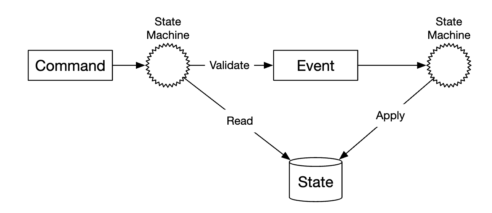
</div>

イベントソーシングの動的なビューを示します。

<div style="margin-left:3rem">
    
</div>

ウォレットサービスの場合、コマンドは残高移動のリクエストです。これらはKafkaのようなFIFOキューに入れられます。

<div style="margin-left:3rem">
    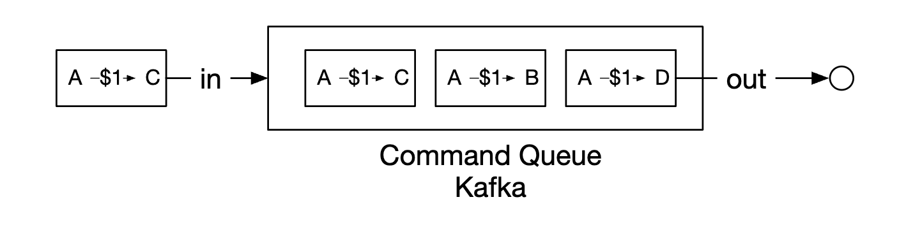
</div>

全体像は次のとおりです。

<div style="margin-left:3rem">
    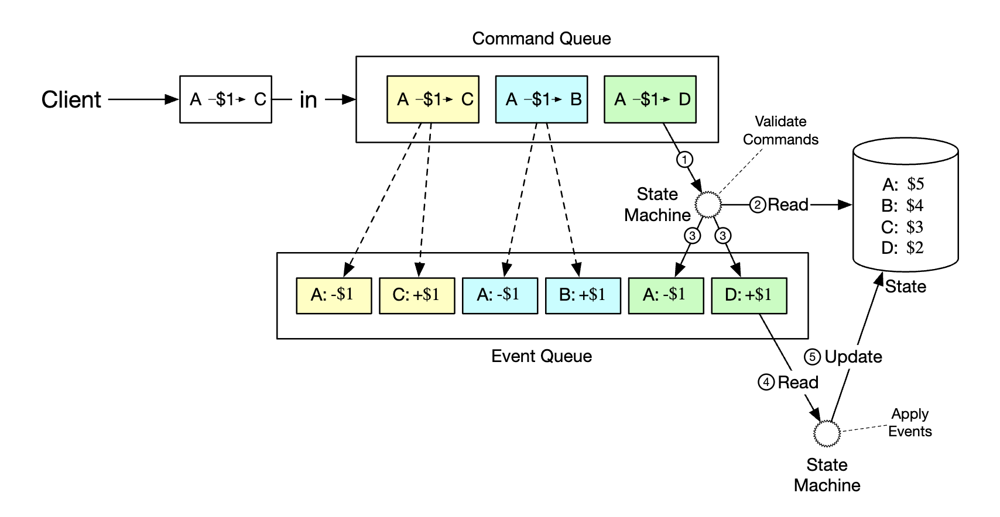
</div>

 * ステートマシンがコマンドキューからコマンドを読み取る
 * データベースから残高の状態を読み取る
 * コマンドを検証する。有効であれば、各口座について1つずつ、2つのイベントを生成する
 * 次のイベントを読み取り、データベース内の残高（状態）を更新することで適用する

イベントソーシングを使う主な利点は、その再現性です。この設計では、すべての状態更新操作が、すべての残高変更のイミュータブルな履歴として保存されます。

過去の残高は、イベントを最初から再生することで常に再構築できます。
イベントのリストはイミュータブルであり、ステートマシンは決定論的であるため、どの中間状態の再生にも必ず成功することが保証されます。

<div style="margin-left:3rem">
    
</div>

このセクションの冒頭で挙げた監査関連の質問はすべて、イベントソーシングに頼ることで答えられます。
 * 任意の時点の口座残高がわかるか？ - イベントを最初から関心のある時点まで再生できる
 * 過去および現在の残高が正しいことをどうやって知るか？ - すべてのイベントを最初から再計算することで正確性を検証できる
 * コード変更後にシステムのロジックが正しいことをどう証明するか？ - 異なるバージョンのコードをイベントに対して実行し、結果が同一であることを検証できる

クライアントからの残高に関する問い合わせへの回答は、CQRSアーキテクチャで対処できます。イミュータブルなイベントリストに基づいて過去の状態を問い合わせる役割を担う、読み取り専用のステートマシンを複数用意できます。

<div style="margin-left:3rem">
    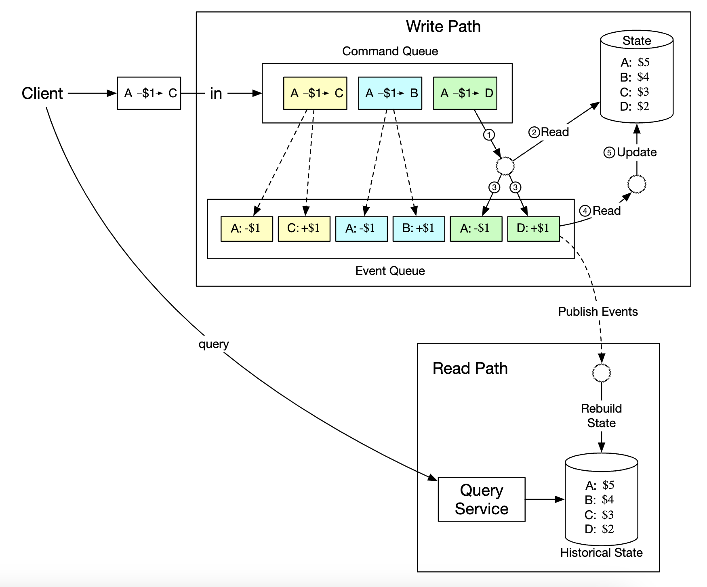
</div>

---

## ステップ3: 設計の深掘り
依然として100万TPSまでスケールさせる必要があるため、このセクションでは性能の最適化をいくつか探ります。

### **高性能なイベントソーシング**
最初に検討する最適化は、コマンドとイベントを、Kafkaのような外部ストアではなくローカルディスクのストアに保存することです。

これによりネットワークのレイテンシを回避でき、また追記しか行わないため、HDDでもその操作は一般的に高速です。

次の最適化は、最近のコマンドとイベントをメモリ内にキャッシュし、ディスクから読み込み直す時間を節約することです。

低レベルでは、mmapと呼ばれるコマンドを活用することで前述の最適化を実現できます。mmapはデータをローカルディスクに保存すると同時に、メモリ内にキャッシュします。

<div style="margin-left:3rem">
    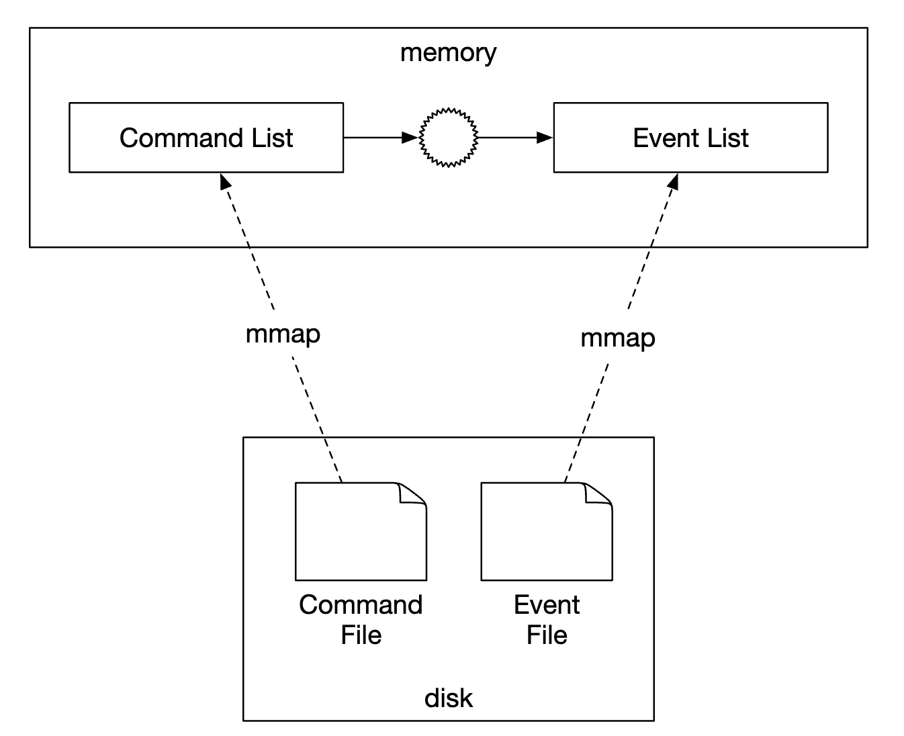
</div>

次にできる最適化は、ファイルベースのローカルなリレーショナルデータベースであるSQLiteを使って、状態もローカルのファイルシステムに保存することです。RocksDBも良い選択肢です。

私たちの目的では、書き込み操作に最適化されたLSMツリー（Log-Structured Merge-Tree）を使っているため、RocksDBを選びます。
読み取り性能はキャッシュによって最適化されます。

<div style="margin-left:3rem">
    
</div>

再現性を最適化するため、毎回ある状態を最初から再現しなくて済むよう、定期的にスナップショットをディスクに保存できます。スナップショットは、HDFSのような分散ファイルストレージに大きなバイナリファイルとして保存できます。

<div style="margin-left:3rem">
    
</div>

### **信頼性の高い高性能なイベントソーシング**
これまでの最適化はすべて優れていますが、サービスがステートフルになってしまいます。信頼性のために、何らかの形のレプリケーションを導入する必要があります。

その前に、システム内でどのような種類のデータに高い信頼性が必要かを分析すべきです。
 * 状態とスナップショットは、イベントリストから再現することで常に再生成できる。したがって、イベントリストの信頼性だけを保証すればよい。
 * コマンドリストからイベントリストを常に再生成できると考えるかもしれないが、コマンドは非決定論的であるため、それは正しくない。
 * 結論として、イベントリストについてのみ高い信頼性を確保すればよい

イベントの高い信頼性を実現するには、リストを複数のノードにレプリケートする必要があります。次のことを保証する必要があります。
 * データの損失がないこと
 * ログファイル内のデータの相対的な順序がレプリカ間で同じに保たれること

これを実現するには、Raftのようなコンセンサスアルゴリズムを採用できます。

Raftでは、アクティブなリーダーと、パッシブなフォロワーがいます。リーダーが停止すると、フォロワーの1つが引き継ぎます。
ノードの過半数が稼働している限り、システムは動作し続けます。

<div style="margin-left:3rem">
    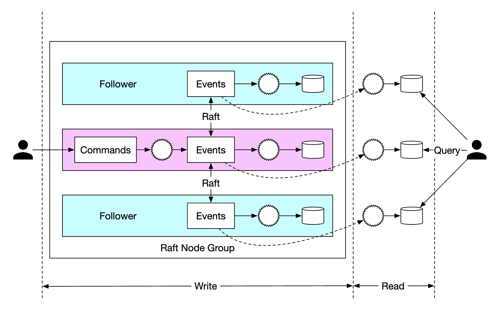
</div>

このアプローチでは、すべてのノードがイベントリストに基づいて状態を更新します。Raftは、リーダーとフォロワーが同じイベントリストを持つことを保証します。

### **分散イベントソーシング**
ここまでで、単一ノードの性能が高く、信頼性のあるシステムを設計できました。

対処しなければならない制約がいくつかあります。
 * 単一のRaftグループの容量には限りがある。いずれはデータをシャーディングし、分散トランザクションを実装する必要がある
 * CQRSアーキテクチャでは、リクエスト/レスポンスのフローが遅い。クライアントはウォレットがいつ更新されたかを知るために、定期的にシステムをポーリングする必要がある

ポーリングはリアルタイムではないため、ユーザーが残高の更新を知るまでに時間がかかる場合があります。また、ポーリングの頻度が高すぎると、クエリサービスに過負荷をかける可能性があります。

<div style="margin-left:3rem">
    
</div>

システムの負荷を緩和するため、ユーザーに代わってコマンドを送信し、ユーザーに代わってレスポンスをポーリングするリバースプロキシを導入できます。

<div style="margin-left:3rem">
    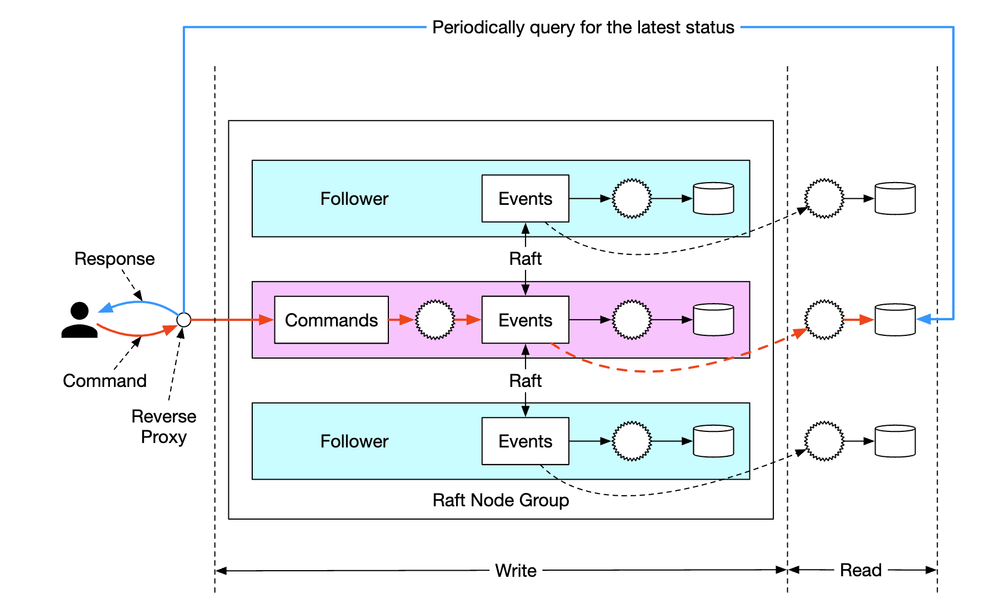
</div>

1回のリクエストで複数のユーザーのデータを取得できるため、これによりシステムの負荷は軽減されますが、リアルタイムでの受け取りという要件は依然として解決されません。

最後にできる変更は、読み取り専用のステートマシンが、レスポンスが利用可能になった時点でリバースプロキシにプッシュするようにすることです。これにより、ユーザーには更新がリアルタイムで起きているように感じられます。

<div style="margin-left:3rem">
    
</div>

最後に、システムをさらにスケールさせるため、システムを複数のRaftグループにシャーディングし、その上でオーケストレーターを使って、TC/CまたはSagaによる分散トランザクションを実装できます。

<div style="margin-left:3rem">
    
</div>

最終的なシステムにおける残高移動リクエストのライフサイクルの例を示します。
 * ユーザーAが、`A-1` と `C+1` という2つの操作を含む分散トランザクションをSagaコーディネーターに送信する。
 * Sagaコーディネーターが、トランザクションのステータスを追跡するためにフェーズステータステーブルにレコードを作成する
 * コーディネーターが、どのパーティションにコマンドを送る必要があるかを決定する。
 * パーティション1のRaftリーダーが `A-1` コマンドを受け取り、検証してイベントに変換し、Raftグループ内の他のノードにレプリケートする
 * イベントの結果が読み取り用ステートマシンに同期され、ステートマシンがコーディネーターにレスポンスをプッシュする
 * コーディネーターは操作が成功したことを示すレコードを作成し、次の操作 `C+1` に進む
 * 次の操作も1つ目と同様に実行される - パーティションが決定され、コマンドが送信・実行され、読み取り用ステートマシンがレスポンスをプッシュする
 * コーディネーターは操作2も成功したことを示すレコードを作成し、最後にクライアントに結果を通知する

---

## ステップ4: まとめ
設計の変遷は次のとおりです。
 * インメモリのRedisを使ったソリューションから始めた。このアプローチの問題は、永続的なストレージではないことである。
 * 次にリレーショナルデータベースを使うことにし、その上で2PC、TC/C、または分散Sagaを使って分散トランザクションを実行した。
 * 次に、すべての操作を監査可能にするため、イベントソーシングを導入した
 * 最初は外部のデータベースとキューを使って外部ストレージにデータを保存したが、性能が良くなかった
 * 次に、追記専用の操作の性能を活かして、データをローカルのファイルストレージに保存した。また、読み取りパスを最適化するためにキャッシュを使った
 * 前のアプローチは性能は良いものの、耐久性がなかった。そのため、単一障害点を避けるため、レプリケーションを伴うRaftコンセンサスを導入した
 * また、ユーザーに代わってトランザクションのライフサイクルを管理するため、リバースプロキシを伴うCQRSを採用した
 * 最後に、データを複数のRaftグループにパーティショニングし、それらを分散トランザクションの仕組み（TC/Cまたは分散Saga）でオーケストレーションした
