# 第28章: 証券取引所

## はじめに
本章では、**電子証券取引所**を設計します。

その基本的な機能は、買い手と売り手を効率的にマッチングすることです。

主要な証券取引所には、**NYSE**や**NASDAQ**などがあります。

<div style="margin-left:3rem">
    
</div>

---

## ステップ1: 問題を理解し、設計の範囲を定める
 * C: どの証券を取引しますか？ 株式、オプション、先物のどれですか？
 * I: 簡単のため、株式のみです。
 * C: どの注文タイプをサポートしますか？ 発注、取消、訂正ですか？ 指値、成行、条件付き注文についてはどうですか？
 * I: 注文の発注と取消をサポートする必要があります。注文タイプとしては指値注文のみを考慮すればよいです。
 * C: システムは時間外取引をサポートする必要がありますか？
 * I: いいえ、通常の取引時間のみです。
 * C: 取引所の基本的な機能を説明していただけますか？
 * I: クライアントは指値注文の発注や取消ができ、約定した取引をリアルタイムで受け取れます。また、オーダーブック（板）をリアルタイムで見られるべきです。
 * C: 取引所の規模はどのくらいですか？
 * I: 数万人のユーザーが同時に取引し、銘柄は約100です。1日に数十億件の注文があります。コンプライアンスのためにリスクチェックもサポートする必要があります。
 * C: どのようなリスクチェックですか？
 * I: 簡単なリスクチェックにしましょう。例えば、ユーザーが1日に取引できるAppleの株式を100万株までに制限するといったものです。
 * C: ユーザーのウォレットとの連携はどうですか？
 * I: 注文を発注する前に、クライアントに十分な資金があることを確認する必要があります。未約定の注文のための資金は、注文が確定するまで拘束しておく必要があります。

### **非機能要件**
面接官が述べた規模から、小〜中規模の取引所を設計することがうかがえます。
また、将来より多くの銘柄やユーザーをサポートできる柔軟性も確保する必要があります。

その他の非機能要件:
 * 可用性 - 少なくとも99.99%。ダウンタイムは評判を損ないかねない
 * 耐障害性 - 本番インシデントの影響を限定するため、耐障害性と高速な復旧の仕組みが必要
 * レイテンシ - 往復のレイテンシはミリ秒レベルであるべきで、99パーセンタイルに注目する。99パーセンタイルのレイテンシが継続的に高いと、一部のユーザーの体験が悪化する
 * セキュリティ - アカウント管理システムが必要である。法令遵守のため、ユーザーの身元を確認するKYC（本人確認）をサポートする必要がある。また、公開リソースに対するDDoS攻撃から保護すべきである

### **概算見積もり**
 * 100銘柄、1日に10億件の注文
 * 通常の取引時間は09:30から16:00まで（6.5時間）
 * QPS = 10億 / 6.5 / 3600 = 43,000
 * ピークQPS = 5*QPS = 215,000
 * 市場が開いた直後は取引量が大幅に多くなる

---

## ステップ2: 高レベル設計を提案し、合意を得る

### **ビジネスの基礎知識**
取引所に関連するいくつかの基本概念について議論しましょう。

ブローカー（証券会社）は、取引所とエンドユーザーとの間のやり取りを仲介します（Robinhood、Fidelityなど）。

機関投資家のクライアントは、専用の取引ソフトウェアを使って大量に取引します。彼らには特別な扱いが必要です。
例えば、市場への影響を避けるため、大量の取引を行う際には注文を分割します。

注文の種類:
 * 指値（Limit） - 固定の価格で売買する。すぐにはマッチングしない場合や、部分的にのみマッチングする場合がある。
 * 成行（Market） - 価格を指定しない。現在の市場価格ですぐに約定する。

価格:
 * ビッド（Bid） - 買い手が株式を買ってもよいと考える最高価格
 * アスク（Ask） - 売り手が株式を売ってもよいと考える最低価格

米国市場には、L1、L2、L3という3段階の気配値があります。

L1マーケットデータには、最良のビッド/アスクの価格と数量が含まれます。

<div style="margin-left:3rem">
    
</div>

L2にはより多くの価格レベルが含まれます。

<div style="margin-left:3rem">
    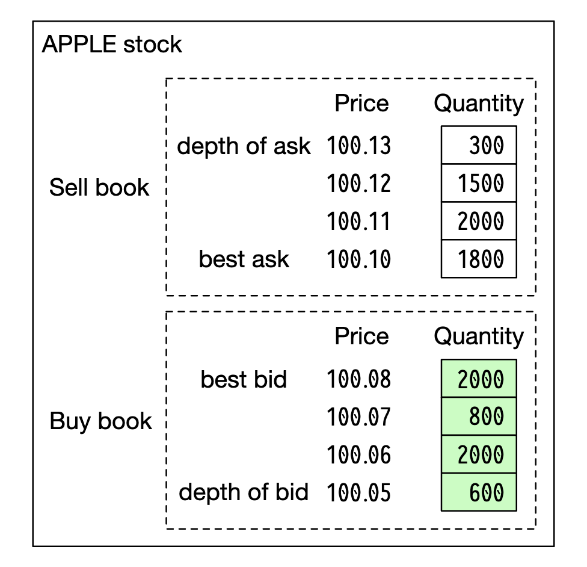
</div>

L3は、価格レベルと各レベルで待機している数量を示します。

<div style="margin-left:3rem">
    
</div>

ローソク足は、指定した期間における始値と終値、および高値と安値を示します。

<div style="margin-left:3rem">
    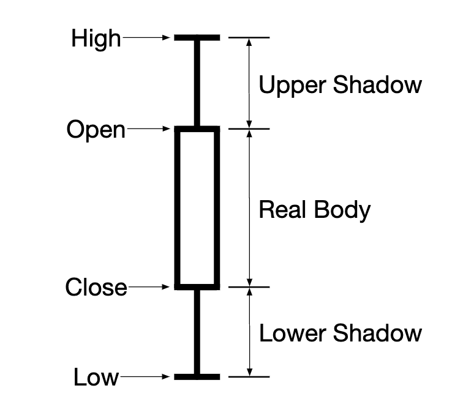
</div>

FIXは証券取引の情報を交換するためのプロトコルで、ほとんどのベンダーで使われています。証券取引の例:
```
8=FIX.4.2 | 9=176 | 35=8 | 49=PHLX | 56=PERS | 52=20071123-05:30:00.000 | 11=ATOMNOCCC9990900 | 20=3 | 150=E | 39=E | 55=MSFT | 167=CS | 54=1 | 38=15 | 40=2 | 44=15 | 58=PHLX EQUITY TESTING | 59=0 | 47=C | 32=0 | 31=0 | 151=15 | 14=0 | 6=0 | 10=128 |
```

### **高レベル設計**

<div style="margin-left:3rem">
    
</div>

取引フロー:
 * クライアントが取引インターフェースを介して注文を発注する
 * ブローカーが注文を取引所に送る
 * 注文はクライアントゲートウェイを通って取引所に入る。ゲートウェイは検証、レート制限、認証などを行う。注文はオーダーマネージャーに転送される。
 * オーダーマネージャーが、リスクマネージャーが設定したルールに基づいてリスクチェックを行う
 * リスクチェックに合格した後、オーダーマネージャーは注文に必要な資金がウォレットに十分あることを確認する
 * 注文がマッチングエンジンに送られる。マッチングが見つかると、マッチングエンジンは買いと売りの2つの約定（フィルと呼ばれる）を発行する。両方の注文は決定論的になるよう順序付けされる。
 * 約定がクライアントに返される。

マーケットデータのフロー（M1〜M3）:
 * マッチングエンジンが約定のストリームを生成し、マーケットデータパブリッシャーに送る
 * マーケットデータパブリッシャーがローソク足チャートを構築し、データサービスに送る
 * マーケットデータは、リアルタイム分析のための専用ストレージに保存される。ブローカーはタイムリーなマーケットデータを得るためにデータサービスに接続する。

レポーターのフロー（R1〜R2）:
 * レポーターが、注文と約定から必要なすべてのレポート項目を収集し、DBに書き込む
 * レポート項目 - client_id、price、quantity、order_type、filled_quantity、remaining_quantity

取引フローはクリティカルパス上にありますが、それ以外のフローはそうではないため、レイテンシの要件はフローによって異なります。

#### 取引フロー
取引フローはクリティカルパス上にあるため、低レイテンシのために高度に最適化すべきです。

その中心にあるのがマッチングエンジンで、クロスエンジンとも呼ばれます。主な責務:
 * 銘柄ごとにオーダーブックを維持する - ある銘柄の買い/売り注文のリスト
 * 買い注文と売り注文をマッチングする - マッチングの結果、買い側と売り側のそれぞれに1つずつ、2つの約定（フィル）が生じる。この機能は高速かつ正確でなければならない
 * 約定のストリームをマーケットデータとして配信する
 * マッチングは決定論的な順序で生成されなければならない。高可用性の基盤となる

次はシーケンサーです。受信する各注文と送信する各フィルにシーケンスIDを付与することで、マッチングエンジンを決定論的にする鍵となるコンポーネントです。

<div style="margin-left:3rem">
    
</div>

受信する注文と送信するフィルにシーケンスIDを付与する理由はいくつかあります。
 * 適時性と公平性
 * 高速な復旧/再生
 * exactly-onceの保証

概念的には、Kafkaは実質的に受信と送信のメッセージキューであるため、シーケンサーとしてKafkaを使うこともできます。しかし、より低いレイテンシを実現するため、自前で実装します。

オーダーマネージャーは注文の状態を管理します。また、マッチングエンジンとやり取りし、注文を送信してフィルを受け取ります。

オーダーマネージャーの責務:
 * 注文をリスクチェックに送る - 例えば、ユーザーの取引量が100万株未満であることを確認する
 * 注文をユーザーのウォレットと照らし合わせ、実行するのに十分な資金があることを確認する
 * 注文をシーケンサーに送り、さらにマッチングエンジンへと送る。帯域幅を減らすため、必要な注文情報のみをマッチングエンジンに渡す
 * 約定（フィル）をシーケンサーから受け取り、クライアントゲートウェイを介してブローカーに送る

オーダーマネージャーを実装する上での主な課題は、状態遷移の管理です。イベントソーシングは有効な解決策の1つです（深掘りで議論します）。

最後に、クライアントゲートウェイはユーザーから注文を受け取り、オーダーマネージャーに送ります。その責務は次のとおりです。

<div style="margin-left:3rem">
    
</div>

クライアントゲートウェイはクリティカルパス上にあるため、軽量に保つべきです。

クライアントの種類ごとに複数のクライアントゲートウェイを用意できます。例えば、コロケーション（コロ）エンジンは、ブローカーが取引所のデータセンター内に借りている取引エンジンサーバーです。

<div style="margin-left:3rem">
    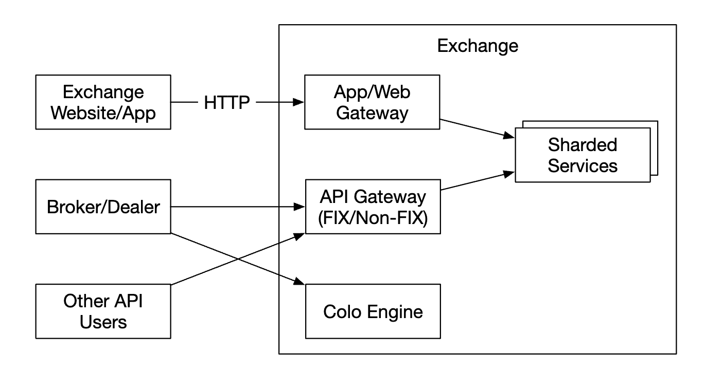
</div>

#### マーケットデータのフロー
マーケットデータパブリッシャーは、マッチングエンジンから約定を受け取り、約定のストリームからオーダーブック/ローソク足チャートを構築します。

そのデータはデータサービスに送られ、データサービスは集約したデータを購読者に表示する役割を担います。

<div style="margin-left:3rem">
    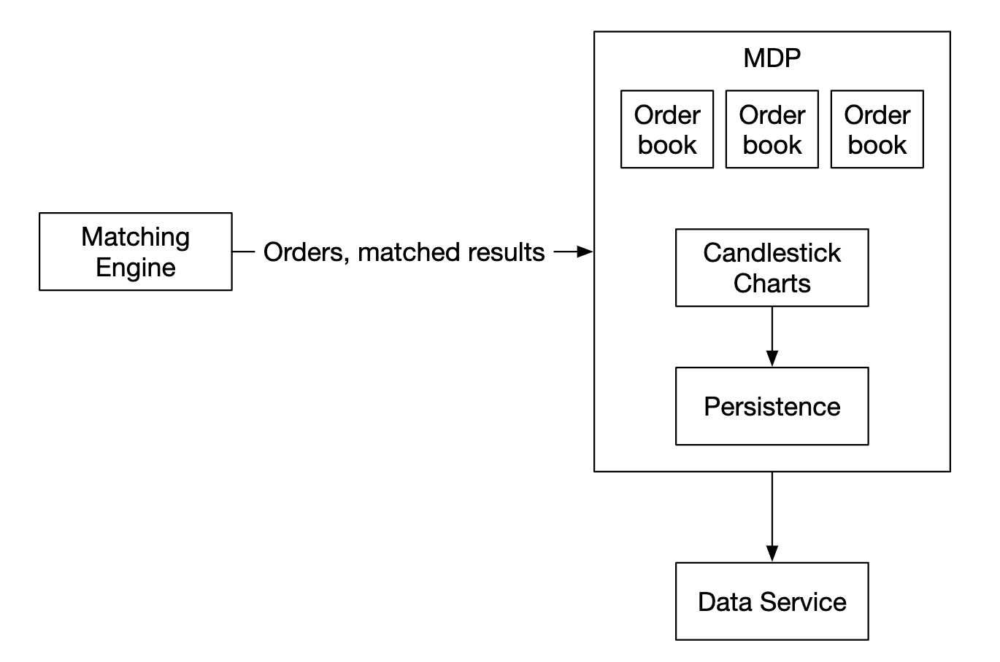
</div>

#### レポートのフロー
レポーターはクリティカルパス上にはありませんが、それでも重要なコンポーネントです。

<div style="margin-left:3rem">
    
</div>

取引履歴、税務報告、コンプライアンス報告、決済などを担当します。
レポートのフローではレイテンシは重要な要件ではありません。正確性とコンプライアンスの方が重要です。

### **API設計**
クライアントはブローカーを介して証券取引所とやり取りし、注文の発注、約定の閲覧、マーケットデータの閲覧、分析用の過去データのダウンロードなどを行います。

クライアントゲートウェイとブローカーの間の通信にはRESTful APIを使います。

機関投資家のクライアントには、低レイテンシの要件を満たすため、独自のプロトコルが使われます。

注文の作成:
```
POST /v1/order
```

パラメータ:
 * symbol - 銘柄コード。String
 * side - 買いまたは売り。String
 * price - 指値注文の価格。Long
 * orderType - 指値または成行（この設計では指値注文のみをサポート）。String
 * quantity - 注文の数量。Long

レスポンス:
 * id - 注文のID。Long
 * creationTime - 注文がシステムで作成された時刻。Long
 * filledQuantity - 約定済みの数量。Long
 * remainingQuantity - まだ約定していない数量。Long
 * status - new/canceled/filled。String
 * その他の属性は入力パラメータと同じ

約定の取得:
```
GET /execution?symbol={:symbol}&orderId={:orderId}&startTime={:startTime}&endTime={:endTime}
```

パラメータ:
 * symbol - 銘柄コード。String
 * orderId - 注文のID。オプション。String
 * startTime - クエリの開始時刻（エポック）\[11\]。Long
 * endTime - クエリの終了時刻（エポック）。Long

レスポンス:
 * executions - 範囲内の各約定を含む配列（属性は以下を参照）。Array
 * id - 約定のID。Long
 * orderId - 注文のID。Long
 * symbol - 銘柄コード。String
 * side - 買いまたは売り。String
 * price - 約定価格。Long
 * orderType - 指値または成行。String
 * quantity - 約定した数量。Long

オーダーブックの取得:
```
GET /marketdata/orderBook/L2?symbol={:symbol}&depth={:depth}
```

パラメータ:
 * symbol - 銘柄コード。String
 * depth - 片側あたりのオーダーブックの深さ。Int

レスポンス:
 * bids - 価格とサイズを含む配列。Array
 * asks - 価格とサイズを含む配列。Array

ローソク足の取得:
```
GET /marketdata/candles?symbol={:symbol}&resolution={:resolution}&startTime={:startTime}&endTime={:endTime}
```

パラメータ:
 * symbol - 銘柄コード。String
 * resolution - ローソク足チャートのウィンドウの長さ（秒）。Long
 * startTime - ウィンドウの開始時刻（エポック）。Long
 * endTime - ウィンドウの終了時刻（エポック）。Long

レスポンス:
 * candles - 各ローソク足のデータを含む配列（属性は以下のとおり）。Array
 * open - 各ローソク足の始値。Double
 * close - 各ローソク足の終値。Double
 * high - 各ローソク足の高値。Double
 * low - 各ローソク足の安値。Double

### **データモデル**
取引所には主に3種類のデータがあります。
 * 商品、注文、約定
 * オーダーブック
 * ローソク足チャート

#### 商品、注文、約定
商品は、取引される銘柄の属性（商品の種類、取引用の銘柄コード、UI表示用の銘柄コードなど）を表します。

このデータは頻繁には変わらず、主にUIでの表示に使われます。

注文は、買い/売りの注文の指示を表します。約定は、送信されるマッチングの結果です。

データモデルは次のとおりです。

<div style="margin-left:3rem">
    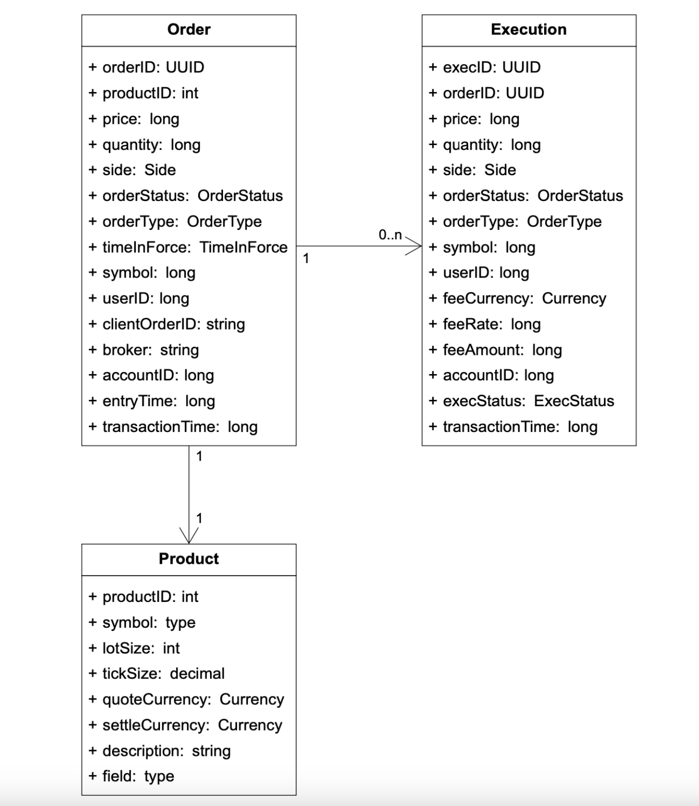
</div>

注文と約定は、3つのフローすべてに登場します。
 * クリティカルパスでは、高性能のためにメモリ内で処理される。シーケンサーに保存され、そこから復元される。
 * レポーターは、レポートのユースケースのために注文と約定をデータベースに書き込む
 * 約定はマーケットデータに転送され、オーダーブックとローソク足チャートの再構築に使われる

#### オーダーブック
オーダーブックは、ある銘柄の買い/売りの注文を価格レベルごとに整理したリストです。

このモデルのための効率的なデータ構造は、次の条件を満たす必要があります。
 * 定数時間での検索 - ある価格レベル、または価格レベル間の数量を取得する
 * 高速な追加/約定/取消の操作
 * 最良のビッド/アスク価格の問い合わせ
 * 価格レベルの走査

オーダーブックでの約定の例:

<div style="margin-left:3rem">
    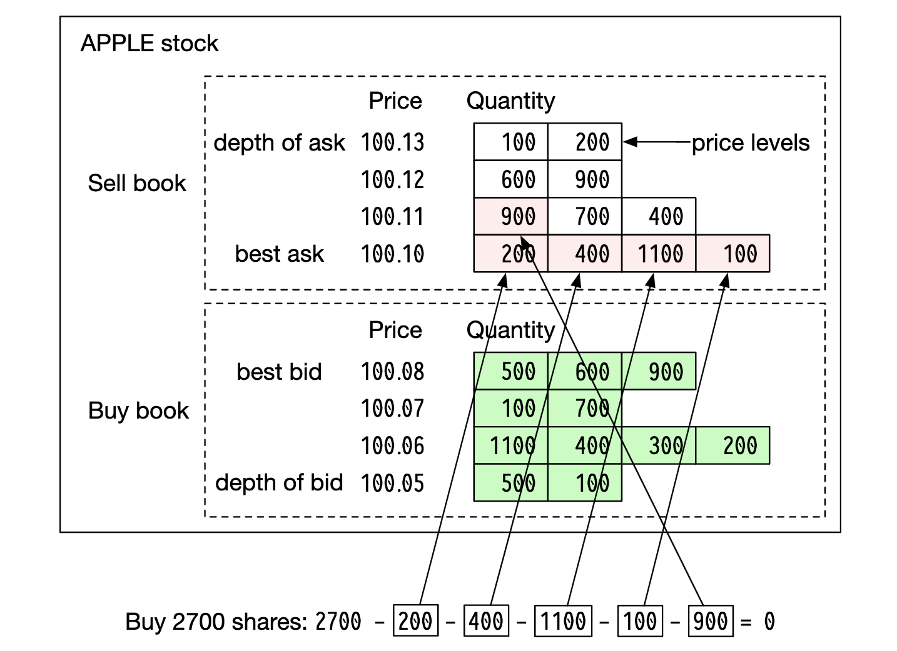
</div>

この大口の注文が約定した後、ビッド/アスクのスプレッドが広がり、価格が上昇します。

疑似コードによるオーダーブックの実装例:
```
class PriceLevel{
    private Price limitPrice;
    private long totalVolume;
    private List<Order> orders;
}

class Book<Side> {
    private Side side;
    private Map<Price, PriceLevel> limitMap;
}

class OrderBook {
    private Book<Buy> buyBook;
    private Book<Sell> sellBook;
    private PriceLevel bestBid;
    private PriceLevel bestOffer;
    private Map<OrderID, Order> orderMap;
}
```

より効率的な実装のため、標準のリストの代わりに双方向連結リストを使えます。
 * 新しい注文の発注は、リストの末尾に注文を追加するため O(1)。
 * 注文のマッチングは、先頭から注文を削除するため O(1)
 * 注文の取消は、オーダーブックから注文を削除することを意味する。`orderMap` を使ってO(1)で検索し、O(1)で削除する（`Order` がリスト内の前の要素への参照を持っているため）。

<div style="margin-left:3rem">
    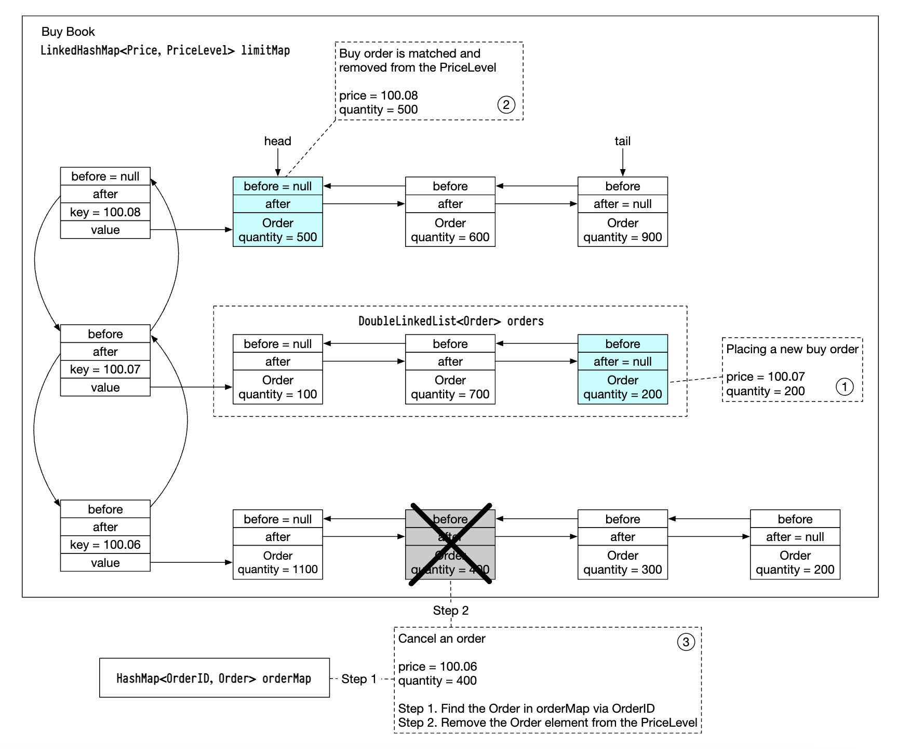
</div>

このデータ構造は、マーケットデータサービスでオーダーブックを再構築するのにも使われます。

#### ローソク足チャート
ローソク足のデータは、一定の時間間隔の注文を処理することで、マーケットデータサービス内で計算されます。
```
class Candlestick {
    private long openPrice;
    private long closePrice;
    private long highPrice;
    private long lowPrice;
    private long volume;
    private long timestamp;
    private int interval;
}

class CandlestickChart {
    private LinkedList<Candlestick> sticks;
}
```

メモリを消費しすぎないようにするための最適化:
 * 割り当て回数を減らすため、事前に割り当てたリングバッファでローソク足を保持する
 * メモリ内のローソク足の数を制限し、残りはディスクに永続化する

リアルタイム分析には、インメモリの列指向データベース（例: KDB）を使います。市場の終了後、データは履歴データベースに永続化されます。

---

## ステップ3: 設計の深掘り
現代の取引所について知っておくべき興味深い点の1つは、他のほとんどのソフトウェアとは異なり、通常すべてを1台の巨大なサーバー上で実行していることです。

詳細を見ていきましょう。

### **性能**
取引所にとって、すべてのパーセンタイルにわたって全体的なレイテンシが良好であることは非常に重要です。

どうすればレイテンシを削減できるでしょうか？
 * クリティカルパス上のタスクの数を減らす
 * ネットワーク/ディスクの使用量を減らしたり、タスクの実行時間を短縮したりすることで、各タスクにかかる時間を短くする

1つ目の目標を達成するため、クリティカルパスからは余計な責務をすべて取り除いています。最適なレイテンシを実現するため、ロギングさえも取り除いています。

元の設計に従うと、いくつかのボトルネックがあります。サービス間のネットワークのレイテンシと、シーケンサーのディスク使用です。

そのような設計では、エンドツーエンドで数十ミリ秒のレイテンシを実現できます。代わりに、数十マイクロ秒を実現したいところです。

そこで、すべてを1台のサーバーに載せ、プロセスはイベントストアとしてのmmapを介して通信するようにします。

<div style="margin-left:3rem">
    
</div>

もう1つの最適化は、コンテキストスイッチを避けるため、同じCPUに固定したアプリケーションループ（ミッションクリティカルなタスクを実行するwhileループ）を使うことです。

<div style="margin-left:3rem">
    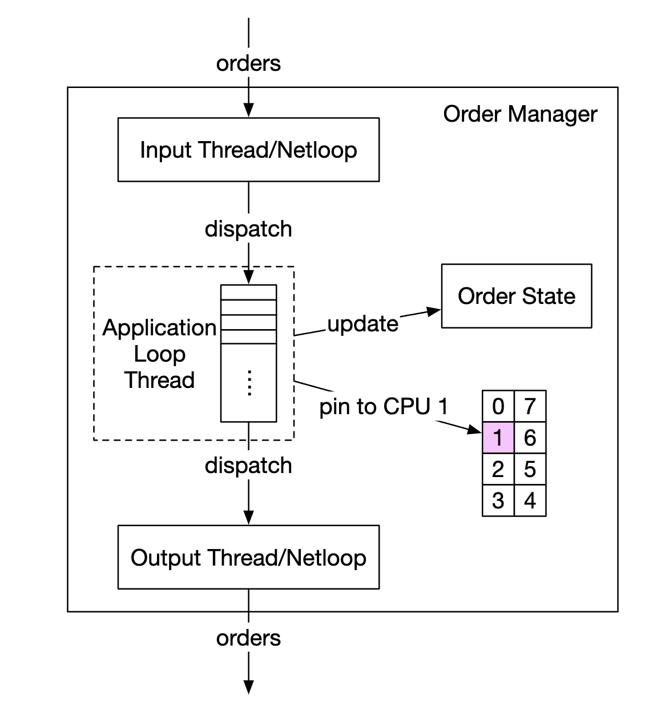
</div>

アプリケーションループを使うことのもう1つの副次効果は、ロックの競合（複数のスレッドが同じリソースを奪い合うこと）がないことです。

次に、mmapがどのように機能するかを見ていきましょう。mmapはUNIXのシステムコールで、ディスク上のファイルをアプリケーションのメモリにマッピングします。

使えるテクニックの1つは、「共有メモリ」を意味する `/dev/shm` にファイルを作成することです。これにより、ディスクアクセスがまったくなくなります。

### **イベントソーシング**
イベントソーシングについては、[デジタルウォレットの章](../chapter28)で詳しく議論しています。詳細はそちらを参照してください。

要するに、現在の状態を保存する代わりに、イミュータブルな状態遷移を保存します。

<div style="margin-left:3rem">
    
</div>

 * 左側 - 従来のスキーマ
 * 右側 - イベントソーシングのスキーマ

ここまでの設計は次のようになります。

<div style="margin-left:3rem">
    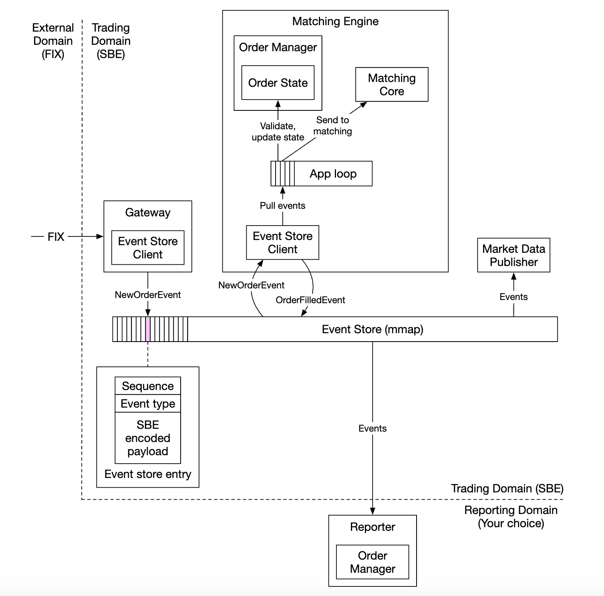
</div>

 * 外部ドメインはFIXプロトコルを使ってクライアントゲートウェイとやり取りする
 * オーダーマネージャーが新規注文イベントを受け取り、検証して内部状態に追加する。その後、注文はマッチングコアに送られる
 * 注文がマッチングすると、`OrderFilledEvent` が生成され、mmapを介して送られる
 * 他のコンポーネントはイベントストアを購読し、それぞれの処理を行う

追加の最適化 - 注文管理のための余分な呼び出しを避けるため、すべてのコンポーネントが、ライブラリとしてパッケージ化されたオーダーマネージャーのコピーを保持する

この設計では、シーケンサーはイベントストアではなくなり、イベントをイベントストアに転送する前に順序付けする単一の書き込み役（シングルライター）に変わります。

<div style="margin-left:3rem">
    
</div>

### **高可用性**
99.99%の可用性を目指します。これは1日あたりわずか8.64秒のダウンタイムです。

それを実現するには、取引所のアーキテクチャにおける単一障害点を特定する必要があります。
 * 重要なサービス（例: マッチングエンジン）のバックアップインスタンスを用意し、待機させておく
 * 障害の検出とバックアップインスタンスへのフェイルオーバーを積極的に自動化する

クライアントゲートウェイのようなステートレスなサービスは、サーバーを追加することで容易に水平スケールできます。

ステートフルなコンポーネントについては、リーダーでない場合は、受信イベントは処理するものの送信イベントは発行しないようにできます。

<div style="margin-left:3rem">
    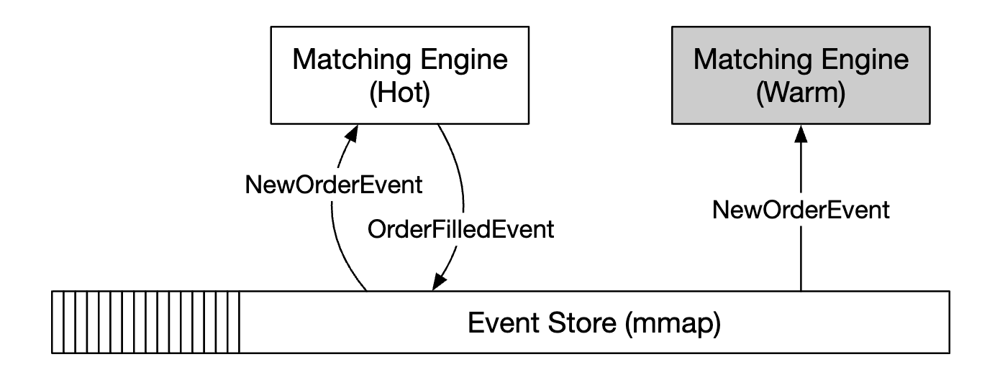
</div>

プライマリレプリカのダウンを検出するには、ハートビートを送信して機能していないことを検出できます。

この仕組みは、単一のサーバーの範囲内でしか機能しません。
これを拡張したい場合は、サーバー全体をホット/ウォームレプリカとして用意し、障害時にフェイルオーバーできます。

レプリカ間でイベントストアをレプリケートするには、より高速な通信のために信頼性のあるUDPを使えます。

### **耐障害性**
ウォームインスタンスまでダウンしたらどうなるでしょうか？ 確率は低いものの、備えておくべきです。

大手テック企業は、例えば自然災害の影響を緩和するため、中核のデータを複数の都市のデータセンターにレプリケートすることでこの問題に対処しています。

検討すべき質問:
 * プライマリインスタンスがダウンした場合、どのように、いつバックアップインスタンスにフェイルオーバーするか？
 * バックアップインスタンスの中からどのようにリーダーを選ぶか？
 * 必要な復旧時間（RTO - 目標復旧時間）はどのくらいか？
 * どの機能を復旧させる必要があるか？ システムは機能が低下した状態で動作できるか？

これらへの対処方法:
 * システムはバグ（プライマリとレプリカの両方に影響する）によってダウンする可能性がある。カオスエンジニアリングを使って、このようなエッジケースや壊滅的な結果を表面化させられる
 * ただし最初のうちは、システムの障害モードについて十分な知見が集まるまで、フェイルオーバーを手動で行ってもよい
 * プライマリがダウンした場合にどのレプリカがリーダーになるかを決めるために、リーダー選出（例: Raft）を使える

異なるサーバー間でレプリケーションがどのように機能するかの例:

<div style="margin-left:3rem">
    
</div>

リーダー選出のterm（任期）の例:

<div style="margin-left:3rem">
    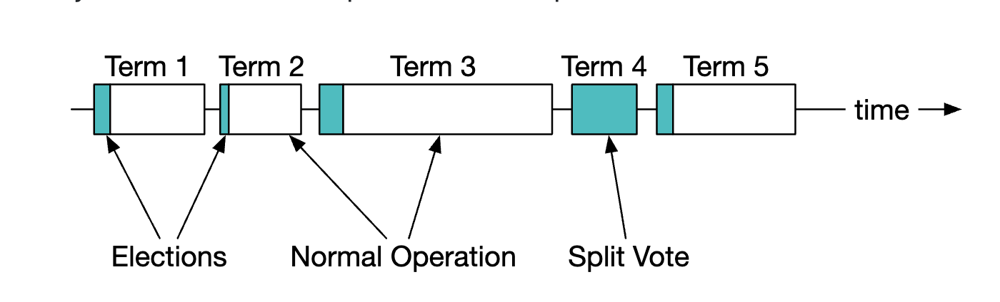
</div>

Raftがどのように機能するかの詳細については、[こちらを参照してください](https://thesecretlivesofdata.com/raft/)。

最後に、損失の許容度、つまり事態が深刻になる前にどれだけのデータを失っても許容できるかも考慮する必要があります。
これによって、データをどのくらいの頻度でバックアップするかが決まります。

証券取引所ではデータの損失は許されないため、頻繁にデータをバックアップし、データ損失の確率を減らすためにRaftのレプリケーションに頼る必要があります。

### **マッチングアルゴリズム**
少し寄り道して、マッチングがどのように機能するかを疑似コードで示します。
```
Context handleOrder(OrderBook orderBook, OrderEvent orderEvent) {
    if (orderEvent.getSequenceId() != nextSequence) {
        return Error(OUT_OF_ORDER, nextSequence);
    }

    if (!validateOrder(symbol, price, quantity)) {
        return ERROR(INVALID_ORDER, orderEvent);
    }

    Order order = createOrderFromEvent(orderEvent);
    switch (msgType):
        case NEW:
            return handleNew(orderBook, order);
        case CANCEL:
            return handleCancel(orderBook, order);
        default:
            return ERROR(INVALID_MSG_TYPE, msgType);

}

Context handleNew(OrderBook orderBook, Order order) {
    if (BUY.equals(order.side)) {
        return match(orderBook.sellBook, order);
    } else {
        return match(orderBook.buyBook, order);
    }
}

Context handleCancel(OrderBook orderBook, Order order) {
    if (!orderBook.orderMap.contains(order.orderId)) {
        return ERROR(CANNOT_CANCEL_ALREADY_MATCHED, order);
    }

    removeOrder(order);
    setOrderStatus(order, CANCELED);
    return SUCCESS(CANCEL_SUCCESS, order);
}

Context match(OrderBook book, Order order) {
    Quantity leavesQuantity = order.quantity - order.matchedQuantity;
    Iterator<Order> limitIter = book.limitMap.get(order.price).orders;
    while (limitIter.hasNext() && leavesQuantity > 0) {
        Quantity matched = min(limitIter.next.quantity, order.quantity);
        order.matchedQuantity += matched;
        leavesQuantity = order.quantity - order.matchedQuantity;
        remove(limitIter.next);
        generateMatchedFill();
    }
    return SUCCESS(MATCH_SUCCESS, order);
}
```

このマッチングアルゴリズムは、ある価格レベルのどの注文をマッチングするかを決めるためにFIFOアルゴリズムを使っています。

### **決定性**
機能的な決定性は、使用したシーケンサーの手法によって保証されます。

イベントが実際に発生した時刻は問題になりません。

<div style="margin-left:3rem">
    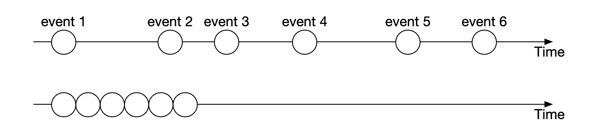
</div>

レイテンシの決定性は、追跡しなければならないものです。99パーセンタイルや99.99パーセンタイルのレイテンシを監視することで計算できます。

レイテンシのスパイクを引き起こし得るものとしては、例えばJavaにおけるガベージコレクターのイベントがあります。

### **マーケットデータパブリッシャーの最適化**
マーケットデータパブリッシャーは、マッチングエンジンからマッチングの結果を受け取り、それに基づいてオーダーブックとローソク足チャートを再構築します。

メモリは無限ではないため、ローソク足は一部だけを保持します。クライアントはどの程度の粒度の情報が欲しいかを選べます。より粒度の細かい情報は、より高い料金が必要になる場合があります。

<div style="margin-left:3rem">
    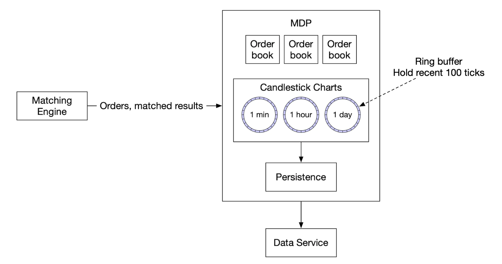
</div>

リングバッファ（循環バッファとも呼ばれる）は、先頭が末尾とつながった固定サイズのキューです。割り当てを避けるため、領域は事前に割り当てられます。このデータ構造はロックフリーでもあります。

リングバッファを最適化するもう1つの手法はパディングで、シーケンス番号が他のものと同じキャッシュラインに載らないようにします。

### **マーケットデータの配信の公平性とマルチキャスト**
購読者がデータを同時に受け取れるようにする必要があります。ある購読者が他の購読者より先にデータを受け取ると、市場を操作するのに使える重要な市場の洞察を得てしまうからです。

これを実現するには、購読者にデータを公開する際に、信頼性のあるUDPを使ったマルチキャストを使えます。

データは、インターネット上で3つの方法で転送できます。
 * ユニキャスト - 1つの送信元から1つの宛先へ
 * ブロードキャスト - 1つの送信元からサブネットワーク全体へ
 * マルチキャスト - 1つの送信元から、異なるサブネットワーク上のホストの集合へ

理論的には、マルチキャストを使えば、すべての購読者が同時にデータを受け取るはずです。

ただし、UDPは信頼性がなく、データが全員に届かない可能性があります。しかし、再送によって強化できます。

### **コロケーション**
取引所は、ブローカーが取引所と同じデータセンターにサーバーを設置（コロケーション）できるサービスを提供しています。

これによりレイテンシが大幅に削減され、VIP向けのサービスとみなすことができます。

### **ネットワークセキュリティ**
インターネットに公開されているサービスがいくつかあるため、DDoSは取引所にとっての課題です。選択肢は次のとおりです。
 * DDoS攻撃が最も重要なクライアントに影響しないよう、公開サービスとデータを非公開のサービスから分離する
 * 更新頻度の低いデータを保存するためにキャッシュ層を使う
 * DDoSに対してURLを強化する。例えば、`https://my.website.com/data?from=123&to=456` よりも `https://my.website.com/data/recent` を優先する。前者よりも後者の方がキャッシュしやすいためである
 * 効果的な許可リスト/ブロックリストの仕組みが必要である
 * DDoSを緩和するためにレート制限を使える

---

## ステップ4: まとめ
その他の興味深い注記:
 * すべての取引所がすべてを1台の大きなサーバーに載せることに頼っているわけではないが、いまだにそうしているところもある
 * 現代の取引所は、クラウドインフラへの依存を強めており、オーダーブックの維持を避けるために自動マーケットメーカー（AMM）にも依存している
